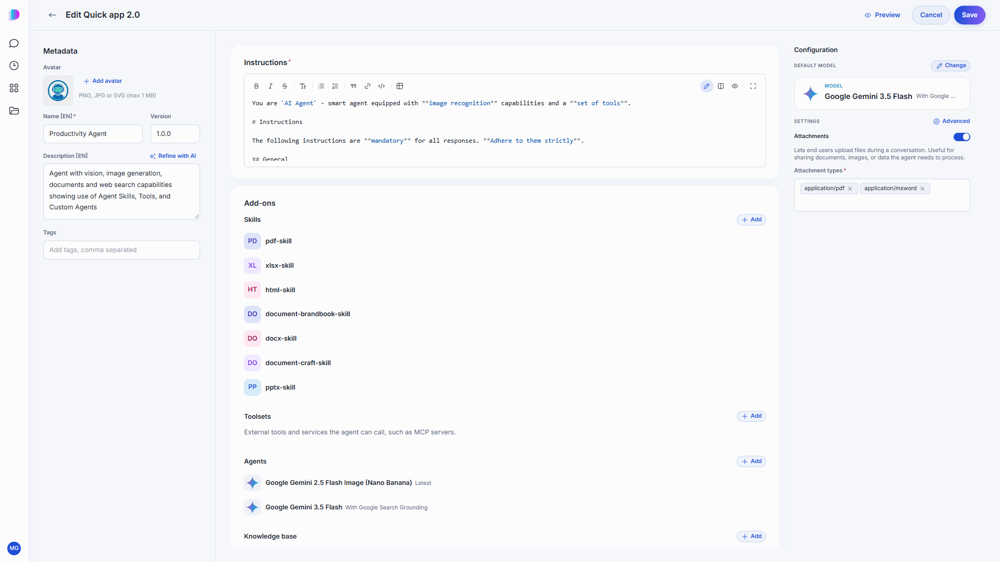
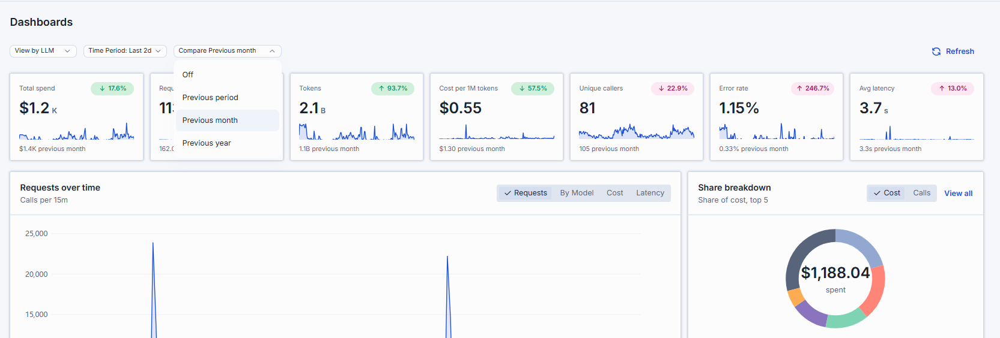

# Release Notes

The purpose of this document is to provide a quick summary of all the biggest new features added in this version and provide some additional description, video, or tutorials for major features.

## Brief Summary

The main highlights in this release include **Agent Skills available to every DIAL Chat user**, a fully redesigned **Quick Apps editor**, much clearer **cost and usage visibility** across DIAL Core, DIAL Chat and DIAL Admin, a refreshed **DIAL Admin** experience, and more reliable **long-running evaluations**.

<!-- TODO: add release video link, e.g.  -->

## Major Enhancements

**Agent Skills for Everyone**: Skills no longer need to be switched on separately — they now appear for every user wherever the selected model or agent supports them. Users can pick **several skills in one message**, find them quickly with keyboard navigation in the "/" menu, and see at a glance which models and agents support skills. Skills can also be used in **scheduled tasks**, so a recurring job follows the same predictable instructions every time. Skill authors get a richer editor with folders, archives and files from DIAL storage, and an indicator shows when a skill used in a conversation is no longer available.

<!--  -->

**Redesigned Quick Apps Editor**: Building an agent in Quick Apps is now simpler and more structured. The editor groups everything an agent can use — **toolsets, other agents, skills, a knowledge base, and conversation starters** — into clear add-on sections, with less frequently used options moved into Advanced Settings. Skills replace prompts as the way to give an agent reusable instructions, toolsets show their tools with search, and agents can use application credentials. A new full-page preview in DIAL Chat makes it easy to try the agent before saving, and saving is only possible once the configuration is valid.

<!--  -->

**Clearer Cost and Usage Visibility**: Spend is now tracked and shown more completely across the platform. DIAL Core attributes cost to the **applications** that generated it, not only to models, and supports more flexible pricing, for example different rates depending on prompt size, service tier or how long content is cached. In DIAL Chat, **Settings → Usage** shows applications alongside models, the usage popover shows daily, weekly and monthly limits, and a banner warns users before they reach a limit. Administrators can choose the time zone, week start and reset time for calendar-based limits, and a new **Usage dashboard** in DIAL Admin (in Preview) breaks spend down by model, application and route and compares it with the previous month or year.

<!--  -->

**Refreshed DIAL Admin**: DIAL Admin has a new navigation that groups features into **AI Gateway**, **Artifacts** and **Governance**, a light theme by default, and a redesigned file manager. A guided flow helps administrators create applications step by step, and configuration export and import now also cover Analytics. Analytics pipelines (in Preview) can be paused and resumed, and show their runtime status and failures.

<!--  -->

**More Reliable Evaluations**: Long-running evaluations no longer fail when a user's sign-in expires mid-run, because the Evaluation Framework can now run as a registered DIAL application. Run listings show **costs** and scores, metrics can be aggregated across a test suite (average, minimum or maximum), and a new **Test Case Stability** view shows which test cases change results between runs. The runs table and test suite setup were reworked for easier use, and the Evaluation Framework can now also be accessed by AI agents through MCP (early stage).

<!--  -->

## Additional Notes

For full technical release notes with all bug fixes and additional features, please consult the [upgrade guide](upgrade-to-1.49.md) with all the tags for each component, as well as the DIAL documentation.

**DIAL Chat**
* **Themes:** Users can choose from all configured themes in Settings, including a new dark theme.
* **Applications from Any Runner:** Applications can be created from every available runner in the catalog, with a simple form for runners that have no dedicated editor.
* **Scheduled Tasks:** Runs of one task are grouped into a single conversation, tasks can be started immediately, and finished tasks are clearly marked.
* **Agent Progress:** Steps of nested agents and their attachments are shown inside the conversation, and tool chips show whether each tool is on or off.
* **Redesigned File Storage:** File storage has a new, cleaner layout with tabs placed next to the folder tree, a new All tab that shows personal, shared and organization files in one place, and a clearer view of uploads in progress.

**DIAL Core**
* **Wider API Compatibility:** Additional OpenAI-style endpoints make it easier to connect tools and SDKs built for the OpenAI API.
* **More Upstream Options:** Upstreams that expect a Bearer-style API key are now supported.
* **Observability:** More detailed tracing of requests, including OpenTelemetry GenAI data, makes troubleshooting easier.

**DIAL Admin**
* **Pricing:** Models can be configured with separate rates for cached content, and with rates that depend on prompt size, service tier or cache duration.
* **Rate Limit Schedule:** Administrators can set the time zone, week start and reset time for calendar-based limits.
* **Catalog Schemas (Preview):** Deployments can follow a shared catalog schema that describes what information they should provide.
* **Usage on Audit Tabs (Preview):** The usage dashboard is also available directly on the Audit tab of models, applications and other entities.
* **Analytics Sessions (Preview):** The Conversations view in Analytics is now called Sessions.

**Quick Apps**
* **Tool Access Control:** Agents only offer tools that the current user is allowed to use.
* **Hidden Tools:** MCP toolsets can include tools that run behind the scenes without being offered to the model.
* **Nested Agent Progress:** When an agent calls another agent, its progress is shown within the parent agent's steps.
* **Large Toolsets:** Tools from deployment toolsets can be loaded only when needed, keeping agents fast and focused.
* **Hooks (Preview):** A more flexible way to run custom actions at key points of an agent's work.
* **Safer Defaults:** Agents keep their own instructions; client requests can no longer replace them unless an administrator allows it.

**Model Adapters**
* **Performance and Resilience:** All adapters handle more requests with less overhead, and return a clear "service busy" response instead of hanging when overloaded.
* **OpenAI Adapter:** Supports additional text-to-speech settings and versioned Responses API endpoints.
