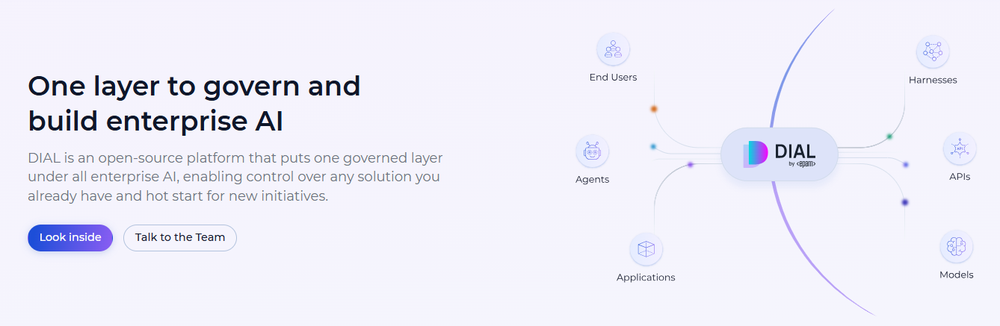
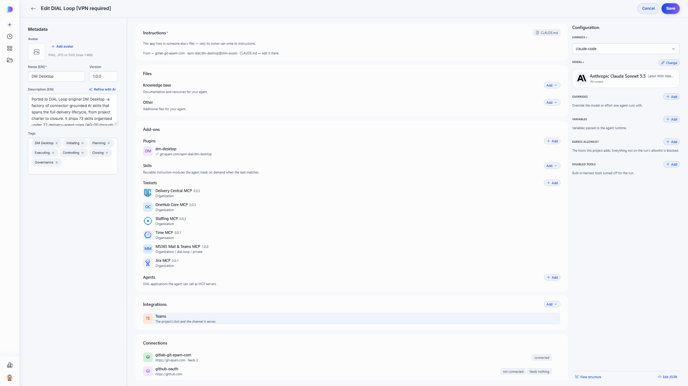
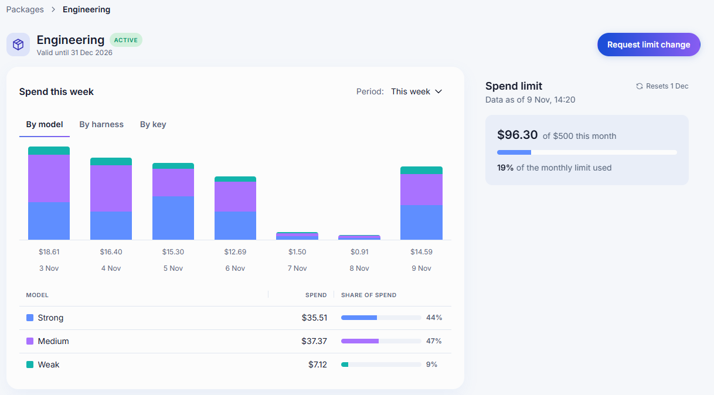
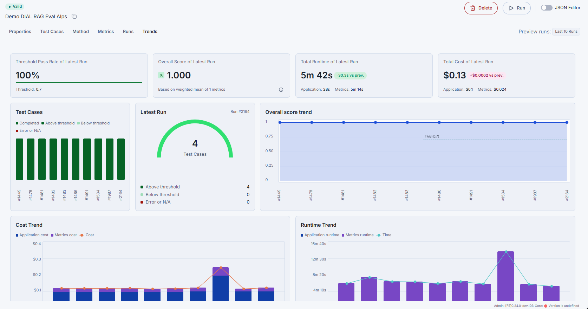

# Release Notes

The purpose of this document is to provide a quick summary of all the biggest new features added in this version and provide some additional description, video, or tutorials for major features.

## Brief Summary

The main highlights in this release include **landing page** and **documentation** redesign, and major enhancements to the **DIAL Admin** including **budgets and spending policies** with **organization units** for delegated governance (Preview), with broader **evaluations** across the DIAL ecosystem.

## Major Enhancements

**New Landing Page and Documentation**: The [DIAL Landing Page](https://dialx.ai/) and [Documentation](https://docs.dialx.ai/) have been updated to be much easier to follow. The story of DIAL remains the same: an open source, vendor-agnostic enterprise platform for AI, but the navigation has become far more streamlined. Purpose-built sections targeting specific types of users. The ecosystem itself now consists of five distinct components: DIAL Gateway, Productivity Hub, **DIAL Loop**, DIAL Grid, and DIAL Eval. We hope you find it easier to find the information you're looking for!

**DIAL Loop**: This release officially introduces Preview mode of [DIAL Loop](https://dialx.ai/features/dial-loop), as referenced in the documentation. The main idea is that agentic projects - built in the DIAL UI or locally on a chosen harness - are now executable in isolated environments on the DIAL ecosystem. Through DIAL, users get access to the marketplace of MCP connections, knowledge bases, agent skills, and models available to the enterprise. Combined with DIAL **Projects**, **Scheduled Tasks** and **Long Running Sessions**, DIAL Loop enables complex workflows supplemented with enteprise knowledge.

**Organization Units (Preview)**: Large organizations can now reflect their structure in DIAL and **delegate governance** to the people who own each area. Folders of the shared space become organization units, for example a company, its divisions and departments, and each unit has its own roles that decide who can see, manage and publish its content. Unit approvers review publication requests into their own unit, so central administrators no longer have to approve everything. DIAL Admin manages units directly in the folder storage, and access to DIAL Admin itself now follows the roles defined in DIAL Core.

**Budgets and Spending Policies (Preview)**: Administrators can now go beyond per-user limits and set **budgets for teams, departments or cost centers** through spending policies assigned to groups of users. Each policy defines daily and monthly amounts, and DIAL works out which budget applies to each request and stops usage once it is spent. A shadow mode lets organizations check how a new policy would behave on real traffic before they enforce it. Policies and the new spending limits settings are managed in DIAL Admin. Developers who use **Claude Code or Codex** through DIAL now see their DIAL spend limits and the remaining amount directly in those tools, with the built-in warnings before a limit is reached.

**Quick Apps Agent Capabilities Now Generally Available**: Ten capabilities that were in Preview are now available to every Quick Apps agent, including **tool discovery** for large toolsets, **web fetch**, **hooks**, **skills** from DIAL storage, skills picked by the user in a message, tools that run behind the scenes, and whole folders as agent context. New agents can **work with files** in DIAL storage out of the box, can use **prompt caching** on supported models to reduce cost on long conversations, and reason about time in the **user's own time zone**. In DIAL Chat, saving an agent, toolset, prompt or skill now lets users choose its folder, save it as a new version or publish it to the organization in one step.

**New Models and a Simpler Model Provider**: DIAL adds support for the latest models, including the **Claude 5.5** family on AWS Bedrock and Google Vertex AI, **Gemini 3.8 Flash** and **Gemini 3.5 Flash Lite**, and a broad set of open models on Bedrock: DeepSeek V3.2, Kimi K2.5, MiniMax M2.1, Devstral 2, NVIDIA Nemotron, GPT OSS and GLM 5. All model adapters are now also delivered as a single **Model Provider** component, so teams deploy and update one component instead of four.

**Broader Evaluations**: The Evaluation Framework can now test the **custom routes** of DIAL applications, not only chat requests, so business APIs exposed through DIAL can be covered by the same quality checks as agents. Test suites can work with **skills**, runs of different test suites that use the same dataset can be compared side by side, and run costs are split between running the test cases and scoring them. Results are easier to read with a redesigned results view and heat map, reworked trends with each run's score threshold, and support for longer conversations and larger responses.

## Additional Notes

For full technical release notes with all bug fixes and additional features, please consult the [upgrade guide](upgrade-to-1.50.md) with all the tags for each component, as well as the DIAL documentation.

**DIAL Chat**
* **File Preview:** Clicking a file's row on the file manager page opens a preview of the file.
* **Scheduled Tasks:** Tasks can repeat on several weekdays or every few weeks, and failed runs show what went wrong.
* **Custom Viewers:** Applications can again replace the chat with their own full-page interface, which eases the move from the previous DIAL Chat.
* **Controlled Creation:** Administrators can decide which roles may create skills, applications and other catalog entities.

**DIAL Core**
* **Deployment Aliases:** Administrators can offer a model, application or toolset under another name with its own access rules, without exposing the original.
* **Custom Authentication Headers:** Upstreams that expect credentials in a custom header are now supported.

**DIAL Admin**
* **Application Dependencies:** Applications show the resources they depend on, and administrators can grant consent for them on behalf of the organization.
* **Assets from Deployments:** Models and applications can be created in DIAL Core directly from running containers and model servings.
* **Unified Approvals:** All publication requests are reviewed on a single Approvals page.
* **Analytics (Preview):** Custom dashboards, CSV export of query results, SQL in aggregation pipelines, and user ratings shown in session traces.
