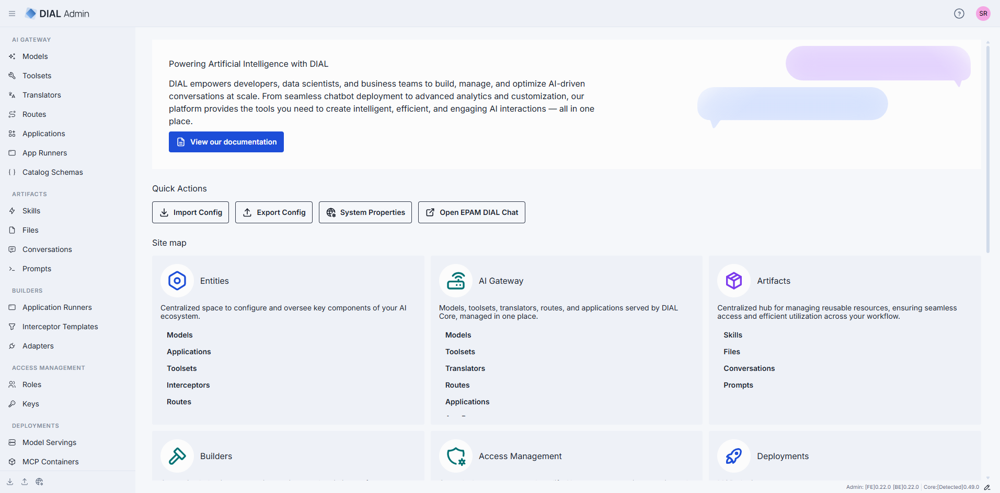

# Admin Panel overview

DIAL Admin is the web interface administrators use to configure, manage, and monitor a DIAL
deployment without editing configuration files by hand. This page explains what the Admin Panel is,
who counts as an administrator, and how its sections map to the day-to-day work of running DIAL. It is
for administrators and governance owners; no prior Admin Panel experience is assumed.

## What the Admin Panel is

DIAL Admin is a feature-rich UI layered on top of DIAL Core. Everything it does — registering models,
publishing applications, setting roles and limits, approving user content — ultimately writes to the
same [DIAL Core configuration](../4.operating-dial/4.configuration/1.core/0.index.md) you could edit
directly. The panel adds validation, change history, role-based restrictions, and an approval
workflow on top of that configuration, so teams can manage DIAL safely without sharing raw config
access.

DIAL Admin is licensed under the Apache License 2.0 and is built from these repositories:

- [DIAL Admin Frontend](https://github.com/epam/ai-dial-admin-frontend) — the UI.
- [DIAL Admin Backend](https://github.com/epam/ai-dial-admin-backend) — the API behind the UI.
- [Deployment Manager Backend](https://github.com/epam/ai-dial-admin-deployment-manager-backend) — an
  optional module that builds container images and manages deployment lifecycles. The
  [Deployments](./3.deployments/0.index.md) section requires this component.
- [Evaluation Framework Backend](https://github.com/epam/ai-dial-admin-evaluation-framework-backend) and
  [Evaluation Metrics](https://github.com/epam/ai-dial-admin-evaluation-metrics) — the services behind the
  [Evaluation](./4.evaluation/0.index.md) section.

## Who is an administrator

Administrators are defined in DIAL Core's static settings, in the `access.admin.rules` block. See
[Access Control settings](../4.operating-dial/4.configuration/1.core/1.settings-json/7.access.md) for the exact
configuration. An administrator has the following privileges:

- `READ` and `WRITE` access to all public system resources — conversations, prompts, files,
  toolsets, and applications.
- The ability to view, approve, and reject publication requests submitted by DIAL users.
- Access to all DIAL Core API endpoints, subject to the relevant permissions.
- The ability to manage the DIAL Core configuration — models, applications, toolsets, roles, API keys,
  interceptors, and more — through the panel.

For the wider model of identities, roles, and permissions, see
[Authentication and access control](../2.understand-dial/4.security-and-governance/1.authentication-and-access-control.md).

## How the sections map to your work

The Admin Panel groups its features into sections. Each maps to a stage of operating a DIAL
deployment:

- [AI Gateway](./1.ai-gateway/0.index.md) — register and configure the entities that DIAL Core exposes
  through the Unified API: models, applications, toolsets, routes, translators, application runners, and
  catalog schemas.
- [Artifacts](./2.artifacts/0.index.md) — govern the shared content that users publish: skills,
  prompts, files, and conversations.
- [Deployments](./3.deployments/0.index.md) — build and run the container images behind model servings,
  MCP servers, adapters, applications, and interceptors. Requires the Deployment Manager Backend.
- [Evaluation](./4.evaluation/0.index.md) — create test suites, manage datasets, and run evaluations
  against deployed models, applications, and MCP tools.
- [Analytics](./5.analytics/0.index.md) [Preview] — analyze conversation data with queries, dashboards,
  tables, pipelines, and sessions.
- [Governance](./6.governance/1.roles.md) — manage [roles](./6.governance/1.roles.md),
  [API keys](./6.governance/2.keys.md), [folder permissions](./6.governance/3.folders-storage.md),
  [interceptors](./6.governance/4.interceptors.md), and
  [approvals](./6.governance/5.publications-and-review.md) of user publications.

Two cross-cutting tasks have their own pages:
[User management](./6.governance/6.user-management.md) explains how user identities reach DIAL, and
[Usage limits and cost control](./6.governance/7.usage-limits-and-cost-control.md) covers how to cap consumption and
spend.

## Read-only access

Two kinds of read-only apply in the Admin Panel.

**Read-only entities.** Entities defined in the DIAL Core configuration files appear in the **file** root
folder of the AI Gateway. This folder is read-only for every administrator: its entries carry a
**READ ONLY** badge, and you can't create, edit, or delete them in DIAL Admin or through the API. To change
them, edit the configuration file. See
[Where an entity can be defined](./1.ai-gateway/0.index.md#where-an-entity-can-be-defined).

**Read-only accounts.** Not every administrator account can change configuration. If your account has
read-only permissions, DIAL Admin shows a **Read-only mode access** banner on the home page and a
**READ ONLY** badge in the header that stays visible as you navigate. Controls that modify
configuration — including **Import Config** and **Export Config** — are disabled. Access levels are themselves
managed by an administrator through [roles](./6.governance/1.roles.md).

## Further reading

- [Back up, restore, and set global properties](1.config-backup-and-global-settings.md) — import and
  export configuration and define global interceptors.
- [Compliance and legal FAQ](./6.governance/8.compliance-and-legal-faq.md) — data, privacy, and regulatory
  questions for self-hosted deployments.
- [Admin configuration reference](../4.operating-dial/4.configuration/5.admin-configuration.md) — the
  environment variables that run the Admin Backend and Frontend.
