# Manage AI model deployments

This page explains how administrators use DIAL Admin to add and configure AI model deployments. It covers creating a model, setting source types, configuring roles and rate limits, attaching interceptors, and using the JSON editor. You need access to DIAL Admin with administrator permissions.

DIAL allows you to access and use AI models from all major LLM providers, the open-source community, alternative vendors, and fine-tuned micro models, as well as self-hosted models or models listed on Hugging Face, NVIDIA NIM, or DeepSeek.

DIAL provides a single [Unified API](https://dialx.ai/dial_api), based on the OpenAI API, for accessing all AI models, embedding models, and applications. The key design principle is to create a unification layer that makes models and applications interchangeable, delivering a cohesive conversational experience and future-proof development of custom GenAI applications.

DIAL uses AI model adapters, that unify the APIs of respective AI models to align with the Unified Protocol of DIAL Core. If a model is compatible with the DIAL Unified Protocol, it can be used directly without an adapter.

You can add AI models to DIAL via direct configuration of [DIAL Core](https://github.com/epam/ai-dial-core/blob/development/docs/dynamic-settings/models.md) or using DIAL Admin. This page describes how to add and manage AI models using DIAL Admin.

**Note**
> Refer to [Supported Models](../../3.building-with-dial/3.adapters/2.supported-providers.md) to learn more about the supported AI models.

## Main screen

On this page, you can find all AI model deployments available on your DIAL instance. Here you can view, filter, and add new model definitions.

When a model deployment is successfully added in DIAL Admin AI Gateway section, it is stored in a dedicated blob storage and can be accessed across the DIAL ecosystem including [DIAL Chat](https://dialx.ai/features/dial-chat) and via the [API](https://dialx.ai/dial_api#operation/sendChatCompletionRequest) for authorized [user roles](../6.governance/1.roles.md).

**Tip**
> You can use the DIAL Core API to [access](https://dialx.ai/dial_api#tag/Deployment-listing/operation/getModels) available model deployments and to [send chat completion](https://dialx.ai/dial_api#operation/sendChatCompletionRequest) requests.

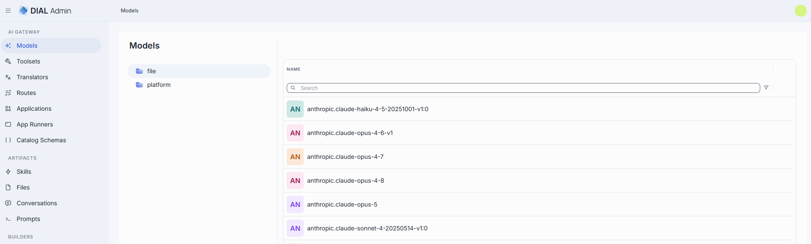

The grid displays the main properties of models:

| Field | Description |
|-------|------------|
| **Name** | Model name (e.g. "GPT-4 Turbo"). Display name is shown in all DIAL client UI components for quick model identification. |
| **Author** | Email address of the user who created the model deployment. |
| **Creation Time** | Entity creation timestamp. |
| **Updated Time** | Timestamp of the latest update of the entity. |

### Actions

The actions menu (**⋮**) at the end of each row lets you work with an individual model.

| Action | What it does |
|--------|--------------|
| **Open in a new tab** | Opens the model's configuration screen in a new browser tab. |
| **Duplicate** | Copies the model. |
| **Delete** | Permanently removes the model. |

### Folders

The left panel shows where each model definition is stored. It has two root folders:

- **file**: models defined in the DIAL Core configuration file. This folder is read-only; it lists only the
  model names. To change these models, edit the DIAL Core config file.
- **platform**: models stored in DIAL Core platform blob storage. This is where you create, edit and delete models in DIAL Admin.

Select a folder to list its models in the grid. See [AI Gateway](./0.index.md#where-an-entity-can-be-defined) for how DIAL Core combines the two sources.

## Create model

Follow these steps to add a new AI model to your DIAL instance:

1. Click **Create** to invoke a **Create Model** modal.
2. Define parameters for a new model:

    | Field | Required | Description |
    |-------|----------|-------------|
    | **ID** | Yes | Unique identifier used by the model adapter to invoke the model's backend. |
    | **Display Name** | Yes | Model name shown across the UI (e.g. "GPT-4 Turbo"). |
    | **Display version** | No | Optional tag to track releases when you register multiple variants of the same model (e.g. `2024-07-18`, `v1`). |
    | **Description** | No | Free-text note about the model's purpose or distinguishing traits. |

3. Click **Create** to close the dialog and open the [configuration screen](#configuration). When done with model configuration, click **Save**. It may take some time for the changes to take effect after saving. Once added, the model appears in the **Models** listing and becomes available to use across the DIAL ecosystem.

    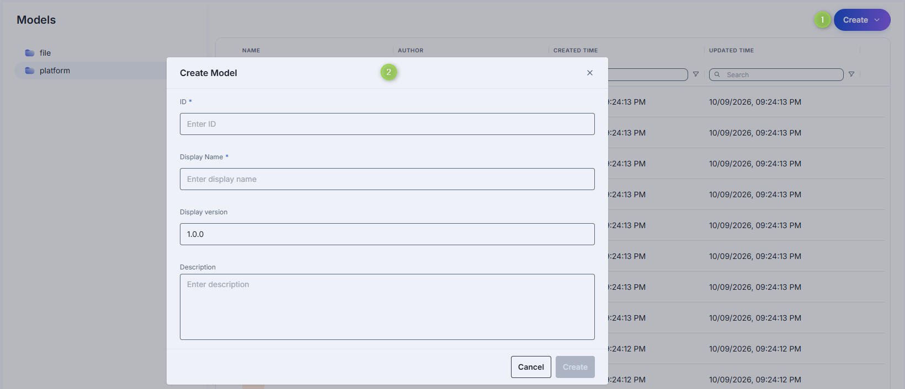

## Configuration

You can access the model deployment configuration screen by clicking any model deployment on the main screen, or when adding a new model deployment. In this section, you can view and configure all settings for the selected model deployment.

- [Properties](#properties): Main definitions and runtime settings.
- [Features](#features): Optional capabilities and custom endpoints.
- [Catalog metadata](#catalog-metedata): catalog schemas associated with the model.
- [Roles](#roles): User groups that can invoke this model and their rate limits.
- [Interceptors](#interceptors): Custom logic to modify requests or responses.
- [Audit](#audit): Aggregated audit metrics and detailed logs of individual configuration changes.

### Properties

In the **Properties** tab, you can view and edit main definitions and runtime settings for a model deployment.

- [Basic information](#basic-information): Identification and basic information about the model and its author.
- [Endpoints](#endpoints): Model's endpoints.
- [Interfaces](#interfaces): The LLM APIs the model serves (OpenAI Chat Completions, OpenAI Responses, Anthropic Messages, OpenAI Embeddings) and how requests reach them.
- [Personalization](#personalization): Parameters to customize the model's appearance on UI.
- [Attachments](#attachments): Define attachment types and maximum number of attachments the model can accept.
- [Default parameters](#default-parameters): Set default values for model parameters used in chat/completions and responses requests.
- [Upstream configuration](#upstream-configuration): Define upstream endpoints, authentication keys, weights, and extra data.
- [Advanced options](#advanced-options): Tokenizer model, forward auth token, interaction limits, retry attempts.
- [Cost configuration](#cost-configuration): Set cost unit, prompt price, and completion price for real-time billing.
- [Catalog schema](#catalog-schema): The catalog schema that defines this model's catalog metadata.

#### Basic information

| Field | Required | Editable | Description |
|-------|----------|----------|-------------|
| **ID** | - | No | Unique key DIAL Core uses in the `models` section. It is the model name clients use in requests (e.g. `gpt-4o`, `gpt-4-turbo`). DIAL Core sends the ID to the upstream as the model name, unless you set an [Override name](#personalization). Non-editable after the model is created. |
| **Updated Time** | - | No | Timestamp of the last update. |
| **Creation Time** | - | No | Model deployment creation timestamp. |
| **Display Name** | Yes | Yes | Model name shown in tables and dropdowns in DIAL clients (e.g. "GPT-4o"). Helps users identify and select models on UI. |
| **Display version** | No | Yes | Version tag for tracking releases (e.g. `0613`, `v1`). Useful for A/B testing or canary rollouts. |
| **Description** | No | Yes | Text describing the model's features, details, or other relevant information. |
| **Intro** | No | Yes | Introductory or greeting message shown to users in DIAL Chat when they select this model. Up to 2048 characters. |

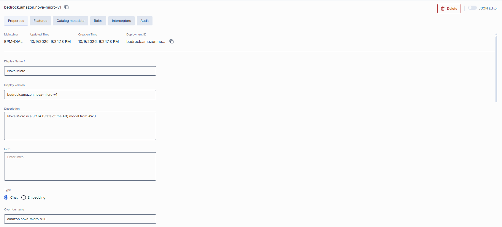

#### Endpoints

| Field | Required | Description |
|-------|----------|-------------|
| **Base URL** | No | The deployment-level upstream root URL. Each entry in **Interfaces** that has no base URL of its own falls back to this one; in passthrough mode DIAL Core routes requests straight to it. |
| **Endpoint** | Conditional | Model API for chat completions or embeddings. Endpoint of externally deployed model, provided by the running model serving container in DIAL or running adapter container in DIAL. DIAL Core forwards requests to this URL as is, without appending the request path. Not required when you declare [Interfaces](#interfaces) for the model. |
| **Responses endpoint** | No | Endpoint that supports the OpenAI Responses API. Endpoint of externally deployed model, provided by the running model serving container in DIAL or running adapter container in DIAL. Currently only [OpenAI adapters](https://github.com/epam/ai-dial-adapter-openai/blob/development/README.md) support this. When set, DIAL Core routes the Responses API requests (`POST /openai/v1/responses`, and retrieving, deleting and canceling a response) to this endpoint, including background requests. `previous_response_id`, conversations, prompts, and files are not supported. |

#### Interfaces

DIAL supports OpenAI Chat Completions, OpenAI Responses, Anthropic Messages and OpenAI Embeddings interfaces. To standard endpoints you can add alternatives.

When provided, DIAL Core forwards each request to that base URL followed by the path the request arrived on. An interface listed without a base URL of its own uses the model-level **Base URL**. If neither is set, requests to that interface fail with HTTP 503.

| Field | Required | Description |
| --- | --- | --- | 
| Base URL | Optional |The root URL that the matching ingress path is appended to. The model-level Base URL serves an entry that omits it. |
| Mode | No | Passthrough (default) or translator. It declares whether the request is forwarded in the shape it arrived in, or handed to a service that translates it into an API the model does speak. A translator interface does not touch the caller's role limits — neither checks nor charges them. The translator calls DIAL Core back to have the completion served, and that second call is the real request: it carries the tokens, the cost and the requestHour/requestDay slot, so a client call is counted once rather than twice. An exhausted quota is therefore enforced on the callback rather than on the translated call itself. |
| Translator | Optional | The translator serving this interface, required by mode: translator and rejected without it. An interface is served either by a base URL or by a translator, never by both — a model declaring both is rejected on config load. |
| Default Headers | No | Headers applied to requests for this interface only, laid over the model-level Default Headers. |
| Features | No | Feature fields that override [model-level features](#features) for this interface only. Unspecified fields inherit the model-level value, then Core defaults apply. |
| Defaults | No | Body parameters applied to requests for this interface only, replacing whichever model-level [defaults](#default-parameters) would otherwise serve it. They are injected the same way the model-level ones are — a key the request already carries is never replaced. |
| Override Paths | No | Per-operation upstream paths that replace the default "base URL + ingress path" routing for this interface. |

> Refer to [DIAL Core](https://github.com/epam/ai-dial-core/blob/development/docs/dynamic-settings/models.md#modelsmodel_nameinterfaces) documentation to learn more about interfaces, how to configure them and how they work.

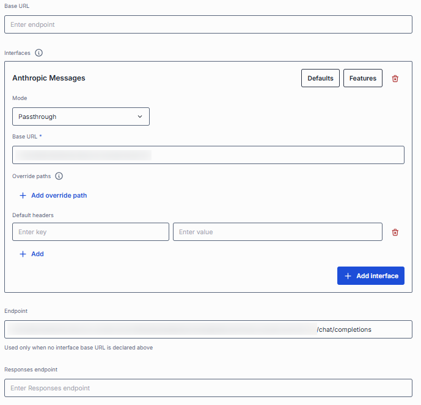

#### Personalization

These parameters help customize how the model is presented in the DIAL UI.

| Field | Required | Description |
|-------|----------|-------------|
| **Override name** | No | The model name DIAL Core sends to the upstream or adapter instead of the model ID. DIAL Core rewrites the `model` field of the outgoing request and the `X-DIAL-OVERRIDE-NAME` header to this value. It does not change how requests are routed or how the model is displayed. |
| **Icon** | No | Icon to visually distinguish model deployments in the UI. |
| **Topics** | No | Semantic tags associated with the model deployment. Click to display a list of available topics. You can add your own custom topics to the list following these rules: - The topic name must not exceed 255 characters. - The topic name must not contain leading or trailing spaces. |

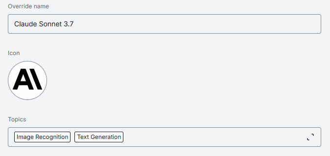

#### Attachments

| Field | Required | Description |
|-------|----------|-------------|
| **Attachment types** | No | Defines the attachment types (images, files, etc.) this model can accept. **No attachments**: Disables all attachment types. **All attachments types**: Allows all types of file attachments. Optionally specify max number of attachments. **Specific attachments types**: Enables the user to define/select specific [MIME types](https://developer.mozilla.org/en-US/docs/Web/HTTP/Basics_of_HTTP/MIME_types/Common_types). Start typing to see suggestions or use `<type>/<subtype>` format for a manual entry. |
| **Attachments max number** | No | Maximum number of input attachments. When **unset**, the limit depends on **Attachment types**: if no attachment types are defined, attachments are not allowed; if attachment types are defined, the number is unlimited. |

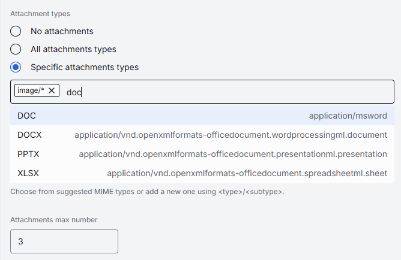

#### Default parameters

Default parameters can be used to pass additional parameters with the chat completion or responses requests.

| Field | Required | Description |
|-------|----------|-------------|
| **Completion Defaults** | No | Default parameters are applied if a request doesn't contain them in an OpenAI `chat/completions` or `embeddings` API call. They are not applied to Responses API or Anthropic Messages requests. |
| **Responses Defaults** | No | Default parameters are applied if a request doesn't contain them in an OpenAI `openai/v1/responses` API call. Available if the OpenAI Responses API is supported. |
| **Default Headers** | No | HTTP headers DIAL Core adds to a request that doesn't already carry them, for every interface the model serves. A header sent by the client, or set by DIAL Core itself (for example `Api-Key` or `X-UPSTREAM-*`), always takes precedence. Refer to [DIAL Core documentation](https://github.com/epam/ai-dial-core/blob/development/docs/dynamic-settings/models.md#modelsmodel_namedefaultheaders) to learn more about default headers. |

**Note**
> Defaults set for a specific [interface](#interfaces) replace the model-level defaults for that interface instead of being merged with them. Anthropic Messages requests get defaults only from their own interface.

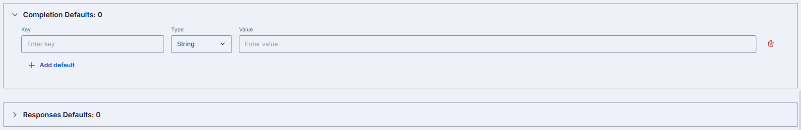

#### Upstream configuration

You can use upstream endpoints to provide alternative URLs DIAL Core will use to send chat completions and responses requests. This enables round-robin load balancing or fallback among multiple hosts. Refer to [Load Balancer](../../4.operating-dial/4.configuration/7.load-balancer.md) to learn more. For example, you can provide a model's Docker container URI if the model's container is deployed in DIAL. Refer to [Model Servings](../3.deployments/2.container-management.md) to learn more about this use case.

| Field | Description |
|-------|-------------|
| **ID** | Identifier of the upstream endpoint. It uniquely identifies this upstream within the model's upstream list, and clients can send it in the `X-UPSTREAM-ID` request header to pin a request to this upstream. Required when the model has a **Responses endpoint** (it routes follow-up Responses API requests to the same upstream) and when the upstream declares interfaces. Otherwise optional. |
| **Upstream Endpoints** | The upstream backend URL for the chat completions API. Passed to the model adapter in the `X-UPSTREAM-ENDPOINT` header. It also serves the embeddings and Anthropic Messages APIs unless they are configured explicitly. |
| **Weight** | Numeric [weight](../../4.operating-dial/4.configuration/7.load-balancer.md#weights) for this endpoint in a multi-upstream scenario. Higher = more traffic share. Default: 1. A weight of zero or less excludes the endpoint from routing. |
| **Tier** | Specifies an endpoint group. In a regular scenario, all requests are routed to endpoints with the lowest tier value (the highest priority), but in case of an outage or hitting the limits, the next one in the line helps to handle the load. Default: 0, the highest priority. |

Click the expand chevron on an upstream row to reveal additional fields:

| Field | Description |
|-------|-------------|
| **Base URL** | The provider root URL for this upstream. DIAL Core completes it with the standard path of each interface that declares no endpoint of its own: `/v1/chat/completions`, `/v1/embeddings`, `/v1/responses` or `/v1/messages`. An interface endpoint, when set, takes precedence. |
| **Responses endpoint** | The upstream backend URL for the Responses API. Visible when the model supports the Responses API. Passed to the model adapter in the `X-UPSTREAM-ENDPOINT` header when routing Responses API requests. |
| **Keys** | API key, token, or credential passed to the upstream. Stored securely and masked — click the eye icon to reveal. |
| **Extra Data** | Free-form JSON or string metadata passed to the model adapter with each request. |
| **Secret Extra Data** | Sensitive key-value metadata passed to the model adapter alongside Extra Data. Values are masked in the UI and in server logs. Use this for credentials or tokens the adapter needs at runtime. |

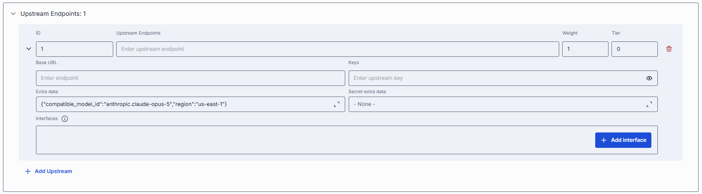

#### Advanced options

| Field | Description |
|-------|-------------|
| **Tokenizer Model** | Toggle that enables tokenizer model selection. When turned on, a selector appears where you choose the model whose tokenization algorithm matches this deployment. This is typically the earliest released model in a series sharing an identical tokenization algorithm. Essential for DIAL clients that reimplement tokenization algorithms on their side, instead of utilizing the tokenize endpoint provided by the model. |
| **Forward auth token** | Determines whether to forward an Auth Token to your model's endpoint. If enabled, the HTTP header with the authorization token is forwarded to the chat completion endpoint. |
| **Interaction limit** | Ensures that the model does not exceed a specified token limit during interactions. **Available values**: **None**: DIAL does not apply any additional interaction limits beyond limits that your model enforces natively. Ideal for early prototyping or when you trust the LLM's built-in safeguards. **Total number of tokens**: Enforces a single cap on the number of tokens in a completion request and its response combined (`prompt + completion`). **Separately Prompts & Completions**: Two independent limits: one on the number of tokens in a completion request (prompt) and another on the number of tokens in a completion response. |
| **Max retry attempts** | The number of times DIAL Core will retry a connection in case of upstream errors (e.g. on timeouts or 5xx responses). Default: 5. |

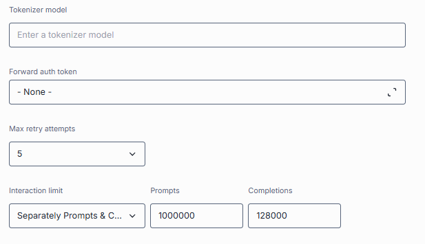

#### Cost configuration

Enables real-time cost estimation and quota enforcement. Powers the monitoring dashboards with per-model spending metrics.

| Field | Required | Description |
|-------|----------|-------------|
| **Cost unit** | Yes | Base unit and scale for billing. Select the unit type and scale (e.g. "per million"). **Available unit types**: **None**: Disables all cost tracking for this model. **Tokens**: Every token sent or received by the model is counted towards your cost metrics. **Char without whitespace**: Tells DIAL to count only non-whitespace characters (letters, numbers, punctuation) in each request as the billing unit. |
| **Prompt price** | Yes | Cost per unit for prompt tokens. |
| **Completion price** | Yes | Cost per unit for completion tokens (chat responses). |
| **Cache read/write price** | No | Cost per cache-read/cache-write token. Available only when the **Cost unit** is **Tokens**. Each is either a flat rate string (same convention as prompt/completion) or a decision-tree object that picks a rate based on the call's own usage data — the field is either a standard name or a `$-prefixed` JSON Path expression. Left unset, cache tokens are billed at the prompt rate, exactly as if caching weren't split out at all. |

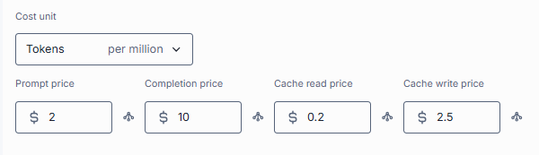

#### Catalog schema

The catalog schema that defines this model's catalog metadata. Click the selector to pick a schema, or **Browse** to choose one. Selecting a schema enables the [Catalog metadata](#catalog-metadata) section.

### Features

In the **Features** tab, you can enable, disable, or override optional capabilities for a specific model. Use model features to tailor DIAL Core's [Unified Protocol](../../2.understand-dial/2.architecture/4.unified-api-overview.md) behavior — turning features on when your model supports them, or off when it doesn't.

Some models adapters expose specialized HTTP endpoints for tokenization, rate estimation, prompt truncation, or live configuration. You can override the default Unified Protocol calls by specifying them in this section.

Model features apply per AI model, controlling what the model endpoint itself supports (e.g. whether GPT-4 can accept system prompts or function calls).

**Tip**
> Enable only the features you need. Extra toggles can cause errors if the upstream doesn't support them. After setting a custom endpoint, test it via a simple API call to confirm accessibility and authentication.

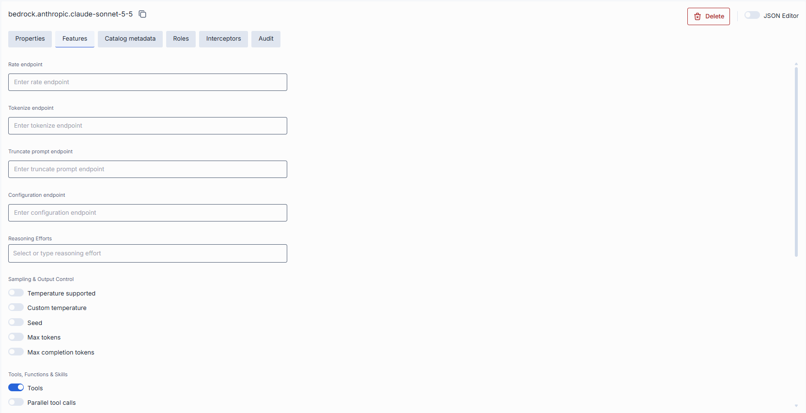

#### Custom endpoints

Some model adapters expose specialized HTTP endpoints for tokenization, rate estimation, prompt truncation, or live configuration. You can override the default Unified Protocol calls by specifying them in this section.

| Field | Description |
|-------|-------------|
| **Rate endpoint** | URL to invoke the model's cost-estimation or billing API. Call an endpoint that returns token counts and credit usage. Override if your adapter supports a dedicated "rate" path. |
| **Tokenize endpoint** | URL to invoke a standalone tokenization service. Use when you need precise token counts before truncation or batching. Models without built-in tokenization require this. |
| **Truncate prompt endpoint** | URL to invoke a prompt-truncation API. Ensures prompts are safely cut to max context length. Useful when working with very long user inputs. |
| **Configuration endpoint** | URL to fetch JSON Schema describing settings of the DIAL model. DIAL Core exposes this endpoint to DIAL clients as `GET v1/deployments/<deployment name>/configuration`. DIAL client must provide a JSON value corresponding to the configuration JSON Schema in a chat completion request in the `custom_fields.configuration` field. |

#### Reasoning

**Reasoning Efforts** defines the reasoning effort levels the model supports (e.g. `low`, `medium`, `high`). When configured, DIAL Chat displays a selector that lets users choose a reasoning effort for each request. Leave empty if the model does not support reasoning effort control.

#### Feature flags (toggles)

Model toggles ensure you don't accidentally send unsupported parameters to a given model.

Each toggle corresponds to a capability in the [Unified Protocol](../../2.understand-dial/2.architecture/4.unified-api-overview.md#chat-completion-features). Enable them only if your model and adapter fully support that feature. Toggles are organized into named groups (Sampling & Output Control, Tools, Functions & Skills, Prompt & Message Composition, Attachments, Caching, Session & Access, Feedback).

By default, DIAL Core treats the following features as enabled: **System prompt**, **Parallel tool calls**, **Max tokens**, **Custom temperature**, **Allow resume** and **Accessible by request key**. The **Temperature supported**, **Seed**, **Max completion tokens**, **Tools**, **Content parts**, **URL Attachments**, **Folder Attachments**, **Assistant attachment in request**, **Cache** and **Auto caching** toggles are disabled by default, and no **Reasoning Efforts** are set.

| Toggle | Group | Description |
|--------|-------|-------------|
| **Temperature supported** | Sampling & Output Control | Enables the `temperature` parameter to control randomness in model deployment output. |
| **Custom temperature** | Sampling & Output Control | Allows users to set a custom temperature value in DIAL Chat. When disabled, the model uses its default temperature. |
| **Seed** | Sampling & Output Control | Enables the `seed` parameter for deterministic output. If specified, the system will make a best effort to sample deterministically, such that repeated requests with the same `seed` and parameters should return the same result. Determinism is not guaranteed, and you should refer to the `system_fingerprint` response parameter to monitor changes in the backend. |
| **Max tokens** | Sampling & Output Control | Allows users to set the `max_tokens` parameter to limit the total number of tokens in a response. |
| **Max completion tokens** | Sampling & Output Control | Allows users to set the `max_completion_tokens` parameter to limit completion output length separately from the overall token budget. |
| **Tools** | Tools, Functions & Skills | Enables the `tools` (a.k.a. functions) feature for safe external API calls. Enable if you plan to use DIAL toolsets or function calling. |
| **Parallel tool calls** | Tools, Functions & Skills | Indicates whether the deployment supports `parallel_tool_calls` parameter in a [chat completion request](https://dialx.ai/dial_api#operation/sendChatCompletionRequest), which enables parallel `function` calling when using a `tool`. |
| **Skills** | Tools, Functions & Skills | Enable to support skills. |
| **System prompt** | Prompt & Message Composition | Allows injecting a system-level message (the "agent's instructions") at the start of every chat. Disable for models that ignore or block system prompts. |
| **Content parts** | Prompt & Message Composition | Indicates whether the model deployment supports requests with content parts. Content parts in a chat completion request allow sending a message consisting of different types of content, such as text, images, or other media, within a single request, which enables richer and more flexible interaction with a model. |
| **URL Attachments** | Attachments | Allows passing URLs as attachments (images, docs) to the model. Can be required for image-based or file-referencing prompts. |
| **Folder Attachments** | Attachments | Enables attaching folders (batching multiple files). |
| **Assistant attachment in request** | Attachments | Indicates whether the model deployment supports `attachments` in [chat completion request](https://dialx.ai/dial_api#operation/sendChatCompletionRequest) `messages` from `role=assistant`. When enabled, DIAL Chat must preserve `attachments` in `messages` from assistants, instead of removing them. This feature is especially useful for models that can generate attachments as well as take attachments as input. A typical example is an image-editing model. |
| **Cache** | Caching | Whether the deployment supports [LLM caching](../../3.building-with-dial/8.advanced-topics/1.prompt-caching.md). |
| **Auto caching** | Caching | Indicates whether the deployment supports [automatic caching](../../3.building-with-dial/8.advanced-topics/1.prompt-caching.md), where possible. |
| **Allow resume** | Session & Access | Enables conversation resume for this model. When enabled, users can continue a conversation from the point where it was interrupted or left off, preserving context across sessions. |
| **Accessible by request key** | Session & Access | Indicates whether the deployment is accessible using a [per-request API key](../../3.building-with-dial/7.working-with-dial-resources/5.per-request-keys.md). |
| **Support comment in rate response** | Feedback | Indicates whether the model supports the field `comment` in the rate response payload. |

### Catalog metadata

The catalog schema that defines this application's catalog metadata.

Catalog metadata describes the model against a **catalog schema**—a structured set of fields defined centrally. The section is empty until you select a schema in the **Catalog schema** field on [Properties](#properties):

- **No schema selected** — the section shows "Select a catalog schema on the Properties tab to edit its catalog metadata."
- **Schema selected** — the schema's fields render for you to complete. Use the **View** selector to switch between a generated **Form** and raw **JSON**. A banner flags any stored properties the schema does not declare.

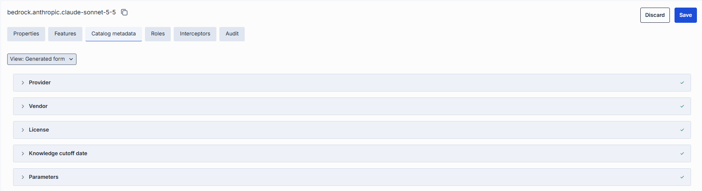

### Roles

**Note**
> You can create, set usage limits and manage roles in the [Governance](../6.governance/1.roles.md) section or via direct configuration of [DIAL Core](https://github.com/epam/ai-dial-core/blob/development/docs/dynamic-settings/roles.md).

In the **Roles** tab, you can define user groups that are authorized to use a specific model deployment.

**Important**: If roles are not specified for a specific model deployment, it is available to all users.

**Note**
> - Refer to [Access & Cost Control](../../2.understand-dial/4.security-and-governance/2.access-control-reference.md) to learn more about access control in DIAL.
> - Refer to [Roles](../../2.understand-dial/4.security-and-governance/2.access-control-reference.md) to learn more about roles in DIAL.
> - Refer to tutorials to learn how to use roles to define access and cost control for [JWT](../../4.operating-dial/5.auth-and-access-control/2.jwt.md) and [API keys](../../4.operating-dial/5.auth-and-access-control/1.api-keys.md).

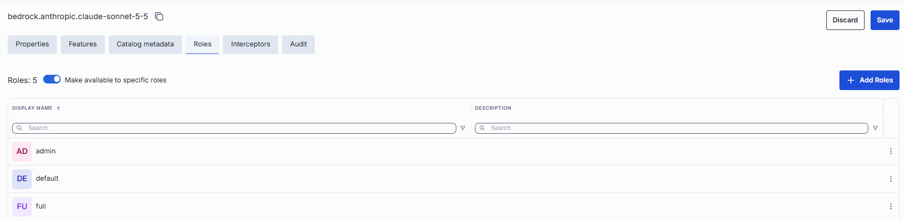

#### Roles grid

| Column | Description |
|--------|-------------|
| **Display Name** | Unique role name displayed on UI. |
| **Description** | Description of the role's purpose (e.g., "DIAL Prompt Engineering Team"). |

#### Role-specific access

Use the **Make available to specific roles** toggle to define access to the model:

- **Off**: Model is callable by any authenticated user. All existing user roles are in the grid.
- **On**: Model is restricted — only the roles you explicitly add to the grid can invoke it.

#### Add a role

You can add a role only if the **Make available to specific roles** toggle is **On**.

1. Click **+ Add** (top-right of the Roles grid).
2. Select one or more roles in the modal. The list of roles is defined in the [Governance](../6.governance/1.roles.md) section.
3. Confirm to add role(s) to the table.

#### Remove a role

You can remove a role only if the **Make available to specific roles** toggle is **On**.

1. Click the actions menu in the role's row.
2. Choose **Remove** in the menu.

### Interceptors

DIAL uses interceptors to add custom logic to inbound and outbound requests for models and applications, enabling PII obfuscation, guardrails, safety checks, and more.

**Note**
> Refer to [Interceptors](../../3.building-with-dial/2.interceptors/0.index.md) to learn more.

In the **Interceptors** tab, you can view configured [global interceptors](../1.config-backup-and-global-settings.md#system-properties) and define local interceptors that will be triggered for the selected model. You can define interceptors in the [Governance](../6.governance/4.interceptors.md) section to add them to the processing pipeline of DIAL Core.

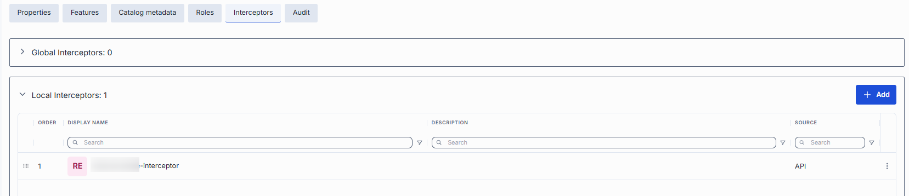

#### Interceptors grid

| Column | Description |
|--------|-------------|
| **Order** | Execution sequence. Interceptors run in ascending order (1 → 2 → 3...). A request will flow through each interceptor in this order. Response interceptors are invoked in the reversed order. |
| **Display Name** | Alias of the interceptor, matching the **Name** field in its definition. |
| **Description** | Free-text summary from the interceptor's definition, explaining its purpose. |
| **Source** | The way the interceptor was created: DIAL Core configuration file or via API. |
| **Actions** | Additional actions: open interceptor in a new tab, or [Remove](#remove-interceptor) the selected interceptor from the model's configuration. |

#### Add an interceptor

Follow these steps to attach one or more interceptors to the model's configuration:

1. Click **+ Add** (in the upper-right of the interceptors grid).
2. In the **Add Interceptors** modal, choose one or more from the grid of [defined interceptors](../6.governance/4.interceptors.md).
3. Click **Apply** to append them to the bottom of the list (added in the same order as selected in the modal).

**Tip**
> If you need a new interceptor, first create it under [Governance](../6.governance/4.interceptors.md) and then revisit this tab to attach it to the model's configuration.

#### Reorder interceptors

1. Drag and drop the handle (⋮⋮⋮⋮) to reassign the order in which interceptors are triggered.
2. Release to reposition; order renumbers automatically.
3. Click **Save** to lock in the new execution sequence.

#### Remove an interceptor {#remove-interceptor}

1. Click the actions menu in the interceptor's row.
2. Choose **Remove** to detach it from this model.
3. Click **Save** to lock in the interceptors list.

### Audit

In the **Audit** tab, you monitor usage, cost, performance, and change history for the selected AI model. It has four sub-sections: Dashboard, Traces, Conversations, and Activities.

<!-- SCREENSHOT OUTDATED: Dashboard redesigned (stat cards with sparklines, Requests over time, Share breakdown, Activity Heatmap, Breakdown table) in FE 0.22 -->
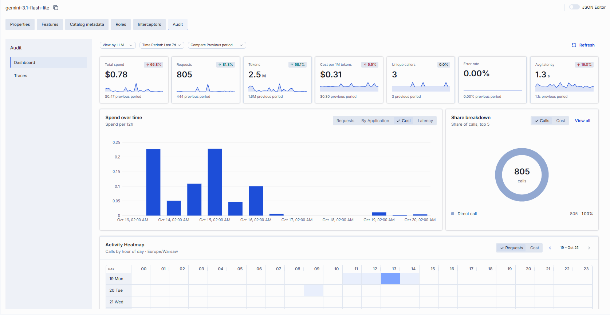

#### Dashboard

The Dashboard presents usage, cost, and performance analytics for the selected model over a chosen time range.

| Control | Description |
|---------|-------------|
| **View by** | Scope of the dashboard. For a model, this is **LLM**. |
| **Time Period** | Date range applied to all cards and charts. |
| **Compare Previous period** | Shows each metric's change against the preceding period of the same length. |
| **Refresh** | Reloads the dashboard data. |

Each metric card shows the current value, a sparkline, and (when comparison is on) the change versus the previous period:

| Metric | Description |
|--------|-------------|
| **Total spend** | Estimated cost in USD for calls to this model. |
| **Requests** | Number of requests. |
| **Tokens** | Total prompt and completion tokens. |
| **Cost per 1M tokens** | Average cost per million tokens. |
| **Unique callers** | Count of distinct users or API keys. |
| **Error rate** | Share of requests that failed. |
| **Avg latency** | Average response time. |

The Dashboard also includes:

- **Requests over time** — time-series chart. Toggle between **Requests**, **By Application** (requests broken down by the calling application), **Cost**, and **Latency**.
- **Share breakdown** — donut chart of the top 5 contributors; toggle between **Calls** and **Cost**; **View all** opens the full list.
- **Activity Heatmap** — calls by hour of day across the week; toggle **Requests** / **Cost**; navigate week by week; the color scale runs Low → High.
- **Breakdown** — table grouped by **Applications** or **Projects**, with columns Share of calls, Calls, Errors, Avg latency, and Cost.

#### Traces

The Traces tab provides a detailed view of all requests processed by DIAL Core. Each row represents an individual request—whether initiated by an external or internal DIAL client. Use it to investigate specific interactions, troubleshoot issues, or analyze usage patterns.

| Column | Description |
|--------|-------------|
| **Completion Time** | Timestamp when DIAL Core finished processing the request. |
| **Number of request messages** | Chat conversation length (for chat completion requests) or input count (for embedding requests). |
| **Trace ID** | OpenTelemetry trace ID uniquely identifying the root request. All subsequent calls triggered by this request share the same Trace ID. |
| **Core span ID** | OpenTelemetry span ID for this request. |
| **Core span parent ID** | OpenTelemetry span ID of the DIAL Core request that called this request. |
| **Response ID** | Identifier of the response object returned by the AI model. |
| **Conversation ID** | DIAL Chat conversation identifier this request belongs to. |
| **Deployment ID** | Identifier of the DIAL deployment for this request. |
| **Parent Deployment ID** | Identifier of the DIAL parent deployment that triggered this request. |
| **Execution path** | List of DIAL Deployment IDs representing the call stack. For example, `['app1', 'app2', 'model1']` means `app1` called `app2`, which called `model1`. The last element equals the Deployment ID; the penultimate element (when present) equals the Parent Deployment ID. |
| **Prompt tokens** | Total tokens in prompts sent to AI models during this request. |
| **Cached prompt tokens** | Number of prompt tokens served from cache (prompt caching) in this request. |
| **Completion tokens** | Tokens generated by the AI model as output. |
| **Deployment price** | Cost of this specific request, excluding costs of any requests it triggered. |
| **Total price** | Total cost of this request including all related requests it directly or indirectly triggered. Always: Total price ≥ Deployment price. |
| **Model** | Identifier of the underlying AI model used. |
| **Project** | Project ID corresponding to the DIAL API key used for this request. |
| **Upstream** | The upstream endpoint (e.g., the model's completions endpoint). |
| **User** | Unique hash identifying the user who initiated the request. |
| **User title** | Job title of the user (if available). |
| **Topic** | Auto-generated subject summarizing the request. |
| **Language** | Language detected in the request (e.g., `en`). |
| **Reactions** | Indication of user reactions (like/dislike) for this request. |

### JSON editor

Advanced users with technical expertise can work with the model properties in a JSON editor view mode. It is useful for advanced scenarios of bulk updates, copy/paste between environments, or tweaking settings not exposed on UI.

**Tip**
> You can switch between UI and JSON only if there are no unsaved changes.

1. Navigate to **Models**, then select the model you want to edit.
2. Click the **JSON Editor** toggle (top-right). The UI reveals the raw JSON.
3. Make changes and click **Save** to apply them.

### Delete

Use the **Delete** button in the Configuration screen toolbar to permanently remove the selected language model.

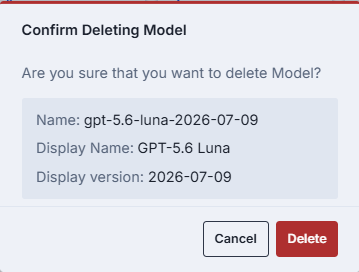

## Next steps

- [Manage applications](./2.applications.md) — configure application deployments that use models.
- [Manage interceptors](../6.governance/4.interceptors.md) — create and attach interceptors for content filtering and compliance.
- [Manage roles and access control](../6.governance/1.roles.md) — define who can access each model and at what rate limits.
