# Manage application deployments

This page explains how administrators use DIAL Admin to add and configure application deployments.

**Note**
> - Refer to [DIAL-Native Applications](../../3.building-with-dial/1.apps/0.index.md) to learn about applications in DIAL.
> - Refer to [Enable App](../../3.building-with-dial/1.apps/5.custom-apps/5.register-app.md) to learn how to enable applications in DIAL.

## Main screen

On this screen, you can access all the available application deployments in your instance of DIAL. Applications displayed in this section were either added by direct modification of the [DIAL Core](https://github.com/epam/ai-dial-core/blob/development/docs/dynamic-settings/applications.md) config file, via DIAL Admin, DIAL Core API or published by users. Here, you can also create and manage new application deployments.

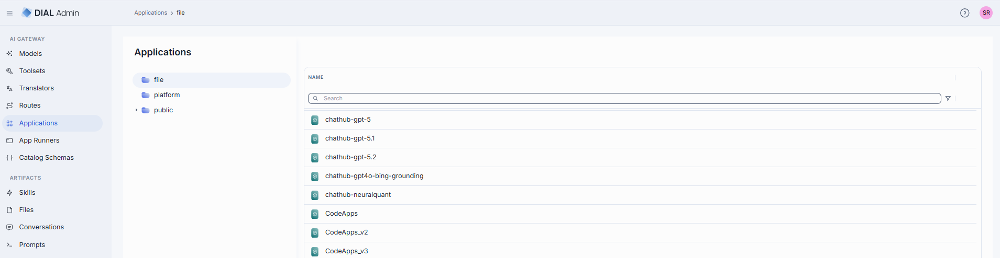

### Folders

The tree has three top-level (root) folders. Click a folder to list its contents in the grid.

| Root folder | What it is and how it behaves |
|-------------|------------------------------|
| **file** | Applications defined in the **DIAL Core configuration files** (as opposed to the database/API-managed assets in the other buckets). A **read-only**, names-only listing: no **Create** button and no row, bulk, or folder actions. Opening an entry shows its configuration in read-only mode, marked with a **READ ONLY** badge; it cannot be edited, deleted, duplicated, or moved. Use this to see which applications come from the static config rather than from published assets. |
| **platform** | Applications stored in DIAL Core platform blob storage. This is where you create, edit and delete models in DIAL Admin. It also adds a **Roles** section on the configuration screen (see [Roles](#roles)). Appears when the Catalog menu group is enabled. |
| **public** | A public bucket. Applications get here when published by users or adedd by administrators. |

The grid columns, the **Create** menu, and the available row actions all change depending on which bucket you are browsing.

### Grid columns

Columns differ by bucket. There is no ID column—the row identity is the **Name** cell. Every column (except in the file bucket) has an inline search/filter box.

**File bucket:** a single **Name** column (the config-entity name). No other columns, and no actions.

**Public bucket**

| Column | Description |
|--------|-------------|
| **Name** | Name of the application or folder. Click to open. |
| **Version** | The published version. Becomes a version picker when rows are selected. |
| **Author** | Who created or last updated the application. |
| **Updated time** | Timestamp of the last modification. |

**Platform bucket**

| Column | Description |
|--------|-------------|
| **Name** | Name of the application. Click to open. |
| **Author** | Who created or last updated the application. |
| **Created time** | Creation timestamp. |
| **Updated time** | Timestamp of the last modification. |

### Row actions

Open a row's actions menu (**⋮**). The actions depend on whether the row is an application or a folder, and on the bucket.

**Application (public bucket)**

| Action | What it does |
|--------|--------------|
| **Open in a new tab** | Opens the application's configuration screen in a new browser tab. |
| **Duplicate** | Copies the application. In public folder you can duplicate either as a **New Version** of the same application, or as a **New Application** (new ID, in a folder you choose). |
| **Move to** | Moves the application to another folder (platform is excluded as a destination). |
| **Export** | Downloads the application as a DIAL Admin Archive or JSON. |
| **Delete** | Permanently removes the application. |

**Folder (public bucket)**

| Action | What it does |
|--------|--------------|
| **Add sibling** | Creates a new folder next to this one (same parent). |
| **Add child** | Creates a new folder inside this one. |
| **Move to** | Moves the folder (and its contents) elsewhere. |
| **Export** | Downloads the folder and everything in it. |
| **Manage permissions** | Opens permission management for the folder. |
| **Rename** | Renames the folder. |
| **Delete** | Deletes the folder and its contents. |

**Application (platform bucket):** **Open in a new tab**, **Duplicate**, **Delete** only.

Select one or more rows to reveal the **bulk-actions** toolbar: **Move to**, **Export**, **Delete** (public) or **Delete** (platform).

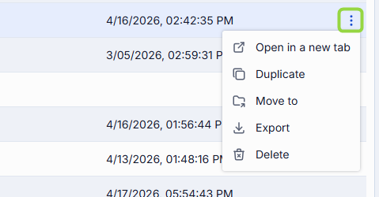

### Create: Folder, Application, or Import

The **Create** dropdown in the header is the single entry point for adding content. Its items depend on the bucket:

- **Public bucket:**
  - **Folder** — adds a new folder in the tree.
  - **Application** — opens the [Create Application modal](#create-an-application).
  - **Import** — opens the [Import modal](#import-applications).
- **Platform bucket:** only **Application**.
- **File bucket:** no Create button (read-only).

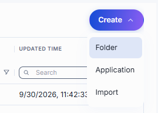

## Create

1. Select the target folder, click **Create**, and select **Application**.
2. Fill in the form. The top fields are always shown:

   | Field | Required | Description |
   |-------|----------|-------------|
   | **ID** | Yes | Unique identifier of the application. |
   | **Display Name** | Yes | Name shown on the UI (e.g. "Customer Support Bot"). |
   | **Version** | Yes | Semantic version (e.g. `1.0.0`, pre-filled). Hidden when creating in the platform bucket. |
   | **Description** | No | Free-text description of the application. |

3. The fields below **Source Type** change with the selected type:

    - **Interfaces** - select among the supported interfaces.
    - **Endpoints** — two independent checkboxes (at least one must stay checked):
        - **Chat Endpoint** → **Completion endpoint** (required; processes chat completion requests) and **Responses endpoint** (optional; processes OpenAI Responses API calls).
        - **MCP Endpoint** → **Endpoint** (required), **Transport** (fixed to HTTP), **Forward per request key** (toggle; forwards a [per-request key](../../3.building-with-dial/7.working-with-dial-resources/5.per-request-keys.md) so the MCP server can reach DIAL storage), **Configuration delivery** (**Header** or **Meta**—how the app's configuration is delivered to the MCP server).
    - **App Runner** — a single **Select Application Runner** dropdown. The runner acts as a factory; DIAL Core forwards payloads to the endpoints defined in the Application Runner configuration.
    - **Code App** — a read-only **Editor URL** (pre-filled from the configured code-app editor); nothing else to enter.

4. Click **Create**. The dialog closes and the new [application configuration screen](#configure-an-application) opens. The entry appears immediately under the selected folder.

   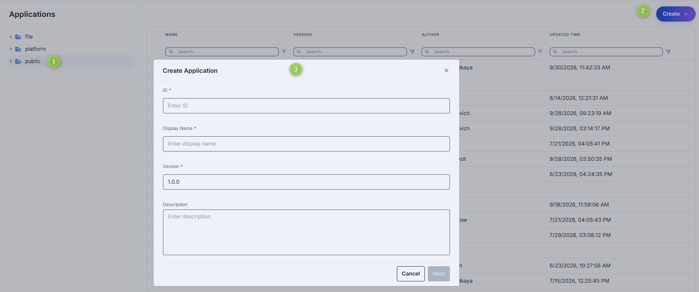

**Tip**
> You can quickly add applications by duplicating an existing one—use **Duplicate** in its row menu, then choose **New Version** or **New Application**.

## Export

You can export individual applications or whole folders (including nested folders).

- To export a folder or application, choose **Export** in its row actions menu.
- To export several items at once, select them and use **Export** in the bulk-actions toolbar.
- In the Export dialog, choose the **Format**: **DIAL Admin Archive** or **JSON**.

## Import

Importing lets you migrate, restore, or share application assets between DIAL instances.

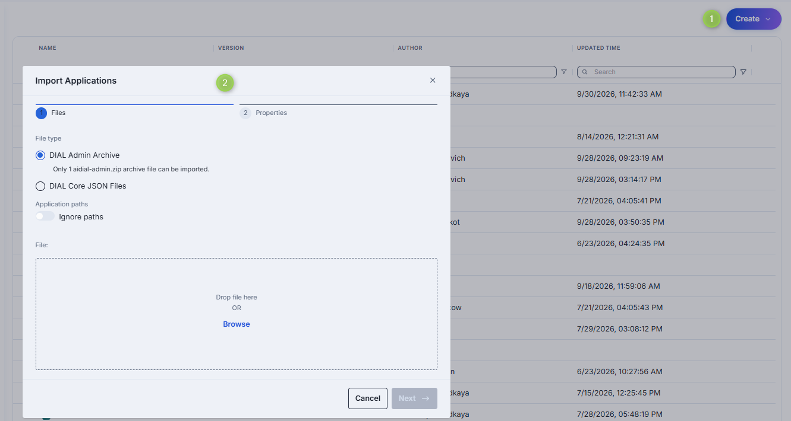

1. Click **Create** and select **Import**.
2. On the **Files** step, choose the file type and add your files (drag and drop or **Browse**):
   - **DIAL Admin Archive** — a single `aidial-admin.zip` archive (one at a time, max 4 MB).
   - **DIAL Core JSON Files** — up to 30 JSON files, max 4 MB per file and 64 MB in total.
3. Optionally enable **Ignore paths** to disregard the folder structure stored in the files (everything imports into the current folder).
4. On the **Properties** step, choose a **Conflict resolution** strategy:
   - **Skip** — keep existing applications; add only new ones.
   - **Override** — replace applications that have the same name and version.
5. Review the preview—items with validation errors or conflicts are flagged before import.
6. Click **Finish**.

## Configuration

Click any application to open its configuration screen. A header band shows the **Maintainer** (enabled in the public folder), **Updated Time**, **Creation Time**, and **Folder Storage** (the folder path, with a link that opens it in Folders Storage).

**Top bar controls**

| Control | Description |
|---------|-------------|
| **Version** | Dropdown to view and edit a specific version, or create a new one. Enabled in the public folder. |
| **Delete** | Delete the selected application. |
| **JSON Editor** (toggle) | Switch between the form UI and the raw [JSON view](#json-editor-applications). |
| **Save** / **Save as new version** / **Discard** | Appear when there are unsaved changes. **Save** updates the current version; **Save as new version** stores the edits as a new version; **Discard** reverts them (with confirmation). |

The screen is organized into sections: Properties, Features, Parameters, Catalog metadata, Interceptors, Dependencies, and App Routes. Conditional sections:
- **Tools Overview** appears only when the application exposes an MCP endpoint (its own, or from its Application Runner).
- **Roles** appears only for applications in the **platform** and **file** buckets.
- **Audit** appear for applications in the public folder.

Applications opened from the **file** bucket are read-only (a **READ ONLY** badge appears and the action buttons are hidden).

### Properties

In the **Properties** tab, you can define the application's identity, routing, UI metadata, and other basic runtime controls.

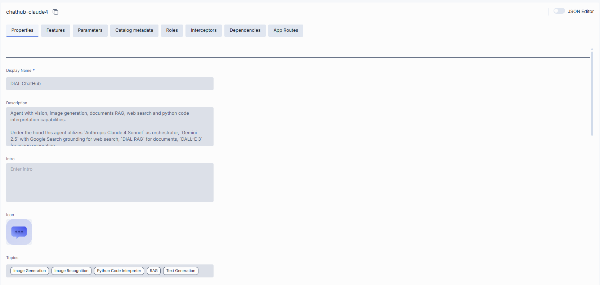

| Field | Required | Description |
|-------|----------|-------------|
| **Display Name** | Yes | Name shown on the UI. |
| **Description** | No | Free-text summary (e.g. tooling, supported inputs/outputs, SLAs). |
| **Intro** | No | Introductory text shown to users of the application. |
| **Icon** | No | Logo that visually distinguishes the app. |
| **Topics** | No | Semantic labels (e.g. "finance", "support"). Select existing ones or type to add. |
| **Folder Storage** | No | The folder that holds the application. Edit the path or click **Move to** to relocate it (the move is applied on save; the platform bucket is not a valid destination). Hidden for platform-bucket apps. |
| **Source Type** | Yes | **Interfaces**, **Endpoints**, **App Runner**, or **Code App**. The fields below depend on this choice—see [Source Types](#source-types). |
| **Override name** | No | The application name DIAL Core sends to the application endpoint instead of the application ID. DIAL Core rewrites the `model` field of the outgoing chat completion request and the `X-DIAL-OVERRIDE-NAME` header to this value. It does not change how requests are routed. Advanced—leave empty unless the application expects a different name. |
| **Base URL** | No | The deployment-level upstream root URL. Each entry in **Interfaces** that has no base URL of its own falls back to this one; in passthrough mode DIAL Core routes requests to it, appending the path the request arrived on. |
| **External Services** | No | External services the application authenticates to. Add each with its ID, display name, description, and auth settings. (Applications use per-service external-service auth rather than a single forward-auth-token setting.) |
| **Attachment types** | No | Which attachments the app accepts: **No attachments**, **All attachments types** (optionally capped), or **Specific attachments types** (choose/add [MIME types](https://developer.mozilla.org/en-US/docs/Web/HTTP/Basics_of_HTTP/MIME_types/Common_types)). |
| **Attachments max number** | No | Maximum number of input attachments. Shown when attachment types are set. When unset, the number is unlimited if attachment types are defined; if no attachment types are defined, attachments are not allowed. |
| **Completion Defaults** | No | Default parameters applied when a request to the OpenAI `chat/completions` API omits them. They are not applied to Responses API or Anthropic Messages requests. Defaults declared for a specific [interface](#source-types) replace these for that interface instead of being merged with them. |
| **Responses Defaults** | No | Default parameters for the OpenAI `openai/v1/responses` API. Shown only when the application has a responses endpoint. |
| **Default headers** | No | Key-value HTTP headers DIAL Core adds to a request to the application that doesn't already carry them. A header sent by the client, or set by DIAL Core itself (for example `Api-Key`), always takes precedence. |
| **Max retry attempts** | No | How many times DIAL Core [retries](../../4.operating-dial/4.configuration/7.load-balancer.md#fallbacks) a failed run (timeouts or 5xx). Values 1–5, default 1. |
| **Catalog schema** | No | The catalog schema that defines this application's catalog metadata. Click the selector to pick a schema, or **Browse** to choose one. Selecting a schema enables the [Catalog metadata](#catalog-metadata) section. |

#### Source Types

**Interfaces**

Applications can serve the OpenAI Chat Completions, OpenAI Responses and Anthropic Messages interfaces. To standard endpoints you can add alternatives.

When provided, DIAL Core forwards each request to that base URL followed by the path the request arrived on. An interface listed without a base URL of its own uses the app-level **Base URL**. If neither is set, requests to that interface fail with HTTP 503.

| Field | Required | Description |
| --- | --- | --- | 
| Base URL | Optional |The root URL that the matching ingress path is appended to. The app-level Base URL serves an entry that omits it. |
| Mode | No | Passthrough (default) or translator. It declares whether the request is forwarded in the shape it arrived in, or handed to a service that translates it into an API the app does speak. A translator interface does not touch the caller's role limits — neither checks nor charges them. The translator calls DIAL Core back to have the completion served, and that second call is the real request: it carries the tokens, the cost and the requestHour/requestDay slot, so a client call is counted once rather than twice. An exhausted quota is therefore enforced on the callback rather than on the translated call itself. |
| Translator | Optional | The translator serving this interface, required by mode: translator and rejected without it. An interface is served either by a base URL or by a translator, never by both — a app declaring both is rejected on config load. |
| Default Headers | No | Headers applied to requests for this interface only, laid over the app-level Default Headers. |
| Features | No | Feature fields that override [app-level features](#features) for this interface only. Unspecified fields inherit the app-level value, then Core defaults apply. |
| Defaults | No | Body parameters applied to requests for this interface only, replacing whichever app-level defaults would otherwise serve it. They are injected the same way the app-level ones are — a key the request already carries is never replaced. |
| Override Paths | No | Per-operation upstream paths that replace the default "base URL + ingress path" routing for this interface. |

> Refer to [DIAL Core](https://github.com/epam/ai-dial-core/blob/development/docs/dynamic-settings/applications.md#applicationsapplication_nameinterfaces) documentation to learn more about interfaces, how to configure them and how they work.

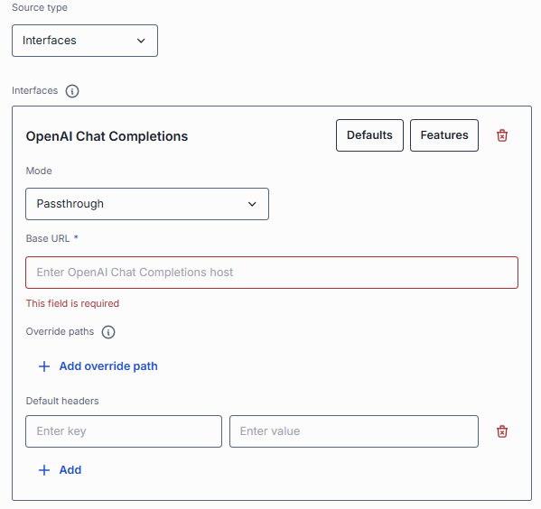

**Endpoints**

Application with this source type is a standalone application. DIAL Core communicates with it via the explicitly-provided chat completion, responses, and/or MCP endpoints.

- **Chat Endpoint** → **Completion endpoint** (required; processes chat completion requests) and **Responses endpoint** (optional; processes OpenAI Responses API calls).
- **MCP Endpoint** → **Endpoint** (required), **Transport** (fixed to HTTP), **Forward per request key** (toggle; forwards a [per-request key](../../3.building-with-dial/7.working-with-dial-resources/5.per-request-keys.md) so the MCP server can reach DIAL storage), **Configuration delivery** (**Header** or **Meta**—how the app's configuration is delivered to the MCP server).
- **Viewer URL** — URL of a custom end-user UI; when set, it overrides the standard DIAL Chat UI for this application.
- **Editor URL** — URL of a custom UI for configuring the application.

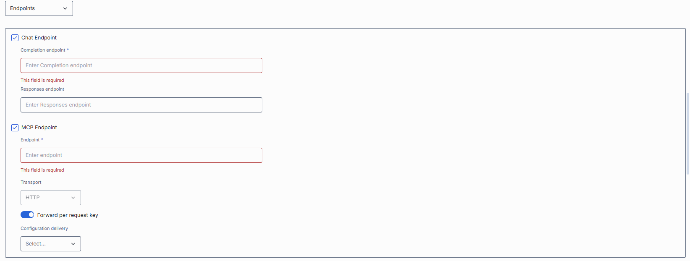

**App Runner**

Application runners can be seen as application factories, allowing users to create logical instances of apps with different configurations. Application runners are based on JSON schemas, which define structure, properties, and endpoints for applications. Select one of the available application runners. If the application is created based on an application runner, DIAL Core will forward all payloads to endpoints defined in the application runner configuration.

**Code App**

A single read-only **Editor URL** (the configured code-app editor).

#### External Services

External services the application authenticates to.

- Service ID: Service identifier.
- Display Name: Service name.
- Description: Service description.
- Authentication parameters: OAuth setting provided by the IDP provider or API key.

> Refer to [Toolsets Authentication](./3.toolsets.md#authentication) for fields description.

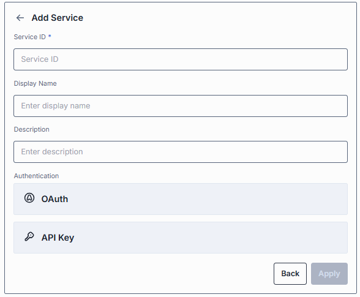

### Tools overview

**Important**
> This section is enabled for application deployments with **Source Type = Endpoints/MCP** or **Source Type = Application Runner** where the related Application Runner has the MCP endpoint enabled as the source type.

[Tools](https://modelcontextprotocol.io/specification/2025-06-18/server/tools) are functions supported by an MCP server that can be used by clients to perform specific actions. On this screen, you can discover, manage, and try all the available tools.

**Note**
> Refer to [Toolsets — Tools overview](./3.toolsets.md#tools-overview-tab) to learn more about the purpose and functionality of this section.

### Features

Control the application's optional capabilities. Values set on an Application Runner are inherited by applications built from it (shown with a "This value is inherited from Application Runner features" tooltip); setting them here overrides the runner.

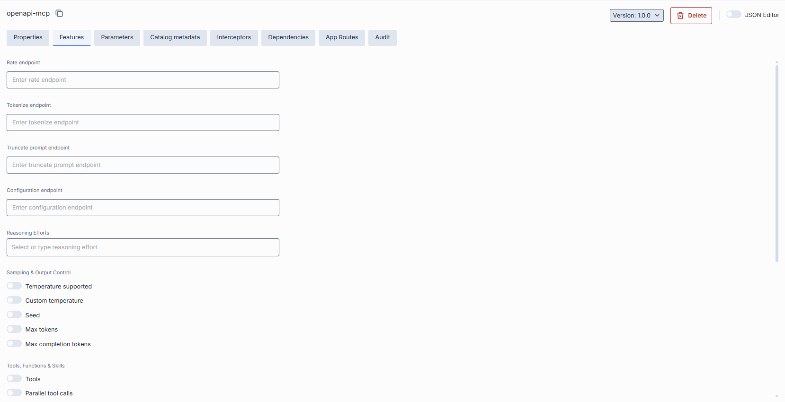

#### The difference between model and application features

While [model feature flags](./1.models.md#feature-flags-toggles) govern what each AI model integration can do, application feature flags define which of those capabilities your orchestrated service exposes to clients. You can also plug in custom preprocessing endpoints.

**Scope**

- **Model features** apply per AI model, controlling what the model endpoint itself supports (e.g. whether GPT-4 can accept system prompts or function calls).
- **Application features** apply per orchestrated service, governing what your composed workflow will accept and pass through — regardless of which models are called under the hood.

**Override capability**

- At the **application** level, you can disable a feature globally (even if models support it) or plug in custom endpoints that apply above all models.
- At the **model** level, toggles only reflect the true capabilities of that specific AI model integration.

**Use cases**

- **Model** toggles ensure you don't accidentally send unsupported parameters to a given model.
- **Application** toggles let you present a consistent API to your clients (e.g. always accept `temperature` or never allow attachments), even if different underlying models behave differently.

#### Endpoints

**Service endpoints** — optional URLs that extend the app's runtime behavior:

| Field | Description |
|-------|-------------|
| **Rate endpoint** | A custom rate-estimation API to compute cost or quota usage (e.g. per-tenant or complex billing). |
| **Tokenize endpoint** | A custom tokenization service for precise, app-wide token counting. |
| **Truncate prompt endpoint** | Your own prompt-truncation API for advanced context-window management. |
| **Configuration endpoint** | A URL returning a JSON Schema of the application's settings. DIAL Core exposes it as `GET v1/deployments/<deployment name>/configuration`. |

#### Reasoning 

**Reasoning Efforts** defines the reasoning effort levels the apps supports (e.g. `low`, `medium`, `high`). When configured, DIAL Chat displays a selector that lets users choose a reasoning effort for each request. Leave empty if the model does not support reasoning effort control.

#### Other Capabilities

**Capability toggles.** Each toggle tells DIAL (and clients) that the application supports a given request parameter or capability; when off, DIAL treats that feature as unavailable for the app.

By default, DIAL Core treats the following features as enabled: **System prompt**, **Parallel tool calls**, **Max tokens**, **Custom temperature**, **Allow resume** and **Accessible by request key**. The **Temperature supported**, **Seed**, **Max completion tokens**, **Tools**, **Skills**, **Content parts**, **URL Attachments**, **Folder Attachments** and **Assistant Attachments in request** toggles are disabled by default, and no **Reasoning Efforts** are set. The toggles are grouped by purpose:

| Group | Toggle | What it controls |
|-------|--------|------------------|
| **Sampling & Output Control** | Temperature supported | The app accepts `temperature`, which controls output randomness (lower = more deterministic, higher = more varied). Enable only if the underlying model honors it. |
| | Custom temperature | The app allows a custom temperature value instead of forcing a fixed/default one. |
| | Seed | The app accepts `seed`, so the same seed and inputs reproduce the same output—useful for testing and reproducibility. |
| | Max tokens | The app accepts `max_tokens`, capping the length of the generated completion. |
| | Max completion tokens | The app accepts `max_completion_tokens`, the newer cap on completion length used by reasoning-style models. |
| **Tools / Function Calling** | Tools | The app accepts `tools`/`functions`, letting the model call external functions you define in the request (e.g. calendar lookup, DB fetch). |
| | Parallel tool calls | The app accepts `parallel_tool_calls`, letting the model request several tool calls in one turn. |
| | Skills | The app supports skills. |
| **Prompt & Message Composition** | System prompt | The app accepts a system message that sets the assistant's role and instructions—useful for agent orchestration. |
| | Content parts | The app accepts multi-part message content (e.g. text plus images in one message) rather than plain text only. |
| **Attachments** | URL Attachments | The app accepts attachments referenced by URL instead of uploaded files. |
| | Folder Attachments | The app accepts a whole folder as an attachment, batching its files in one request. |
| | Assistant Attachments in request | DIAL keeps `attachments` on prior `role=assistant` messages when sending the conversation back, so the app can reuse files it generated earlier. See [chat completion requests](https://dialx.ai/dial_api#operation/sendChatCompletionRequest). |
| **Session & Access** | Allow resume | The app supports resuming a previously interrupted generation instead of restarting it. |
| | Accessible by request key | The app can be invoked with a [per-request API key](../../3.building-with-dial/7.working-with-dial-resources/5.per-request-keys.md), which is how one deployment calls another on a user's behalf. |
| | Consent required | Users must grant [consent](https://dialx.ai/dial_api#tag/User-Consent) before they can use the app the first time. |
| **Feedback** | Support comment in rate response | The app's rate endpoint can return a free-text `comment` alongside the numeric score. |

### Parameters

For applications built from an Application Runner, this section configures the parameters defined by the runner's schema. Use the **View** selector to choose how parameters are presented:

- **Table** — the parameters as a grid.
- **Generated form** — a form generated from the runner's JSON schema.
- **Application custom UI** — the application's own configuration UI, embedded from its editor URL.

**Note**
> Refer to [Schema-rich Applications](../../3.building-with-dial/1.apps/0.index.md#schema-based-apps) to learn more.

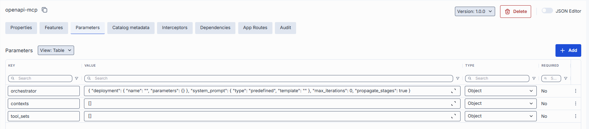

### Catalog metadata

Catalog metadata describes the application against a **catalog schema**—a structured set of fields defined centrally. The section is empty until you select a schema in the **Catalog schema** field on [Properties](#properties):

- **No schema selected** — the section shows "Select a catalog schema on the Properties tab to edit its catalog metadata."
- **Schema selected** — the schema's fields render for you to complete. Use the **View** selector to switch between a generated **Form** and raw **JSON**. A banner flags any stored properties the schema does not declare.

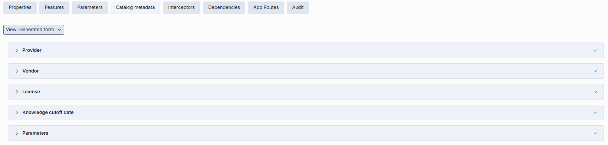

### Roles

Roles tab appears only for applications in the **platform** and **file** buckets.

In the Roles tab, you can add roles that have access to the selected application. Roles are defined in the [Governance](../6.governance/1.roles.md) section.

**Important**: If roles are not selected for a specific application or the **Make available to specific roles** toggle is disabled, it will be available to all user roles.

**Note**
> - Refer to [Access & Cost Control](../../2.understand-dial/4.security-and-governance/2.access-control-reference.md) to learn more about access control in DIAL.
> - Refer to [Roles](../../2.understand-dial/4.security-and-governance/2.access-control-reference.md) to learn more about roles in DIAL.
> - Refer to tutorials to learn how to configure access and limits for [JWT](../../4.operating-dial/5.auth-and-access-control/2.jwt.md) and [API keys](../../4.operating-dial/5.auth-and-access-control/1.api-keys.md).

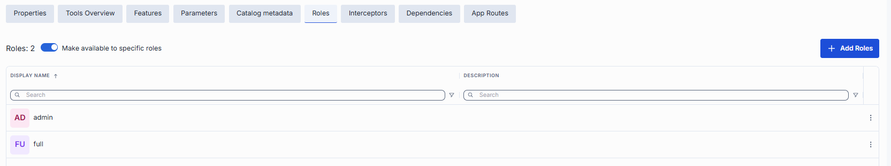

#### Roles grid

| Column | Description |
|--------|-------------|
| **Display Name** | Unique role name displayed on UI. |
| **Description** | Description of the role's purpose (e.g., "DIAL Prompt Engineering Team"). |

#### Role-specific access

Use the **Make available to specific roles** toggle to define access to the application:

- **Off**: Application is callable by any authenticated user. All existing user roles are in the grid.
- **On**: Application is restricted — only the roles you explicitly add to the grid can invoke it.

#### Add a role

You can add a role only if the **Make available to specific roles** toggle is **On**.

1. Click **+ Add** (top-right of the Roles grid).
2. Select one or more roles in the modal. The list of roles is defined in the [Governance](../6.governance/1.roles.md) section.
3. Confirm to add role(s) to the table.

### Interceptors

DIAL uses interceptors to add custom logic to inbound and outbound requests for models and applications, enabling PII obfuscation, guardrails, safety checks, and more.

You can define interceptors in the [Governance](../6.governance/4.interceptors.md) section to add them to the processing pipeline of DIAL Core.

**Note**
> Refer to [Interceptors](../../3.building-with-dial/2.interceptors/0.index.md) to learn more.

The section is split into collapsible groups, each showing its count:

- **Global Interceptors** — read-only. Interceptors from [System Properties](../1.config-backup-and-global-settings.md#system-properties) that apply to all deployments.
- **Runner Interceptors** — read-only. Inherited from the application's Application Runner. Shown only when the app has a runner source.
- **Local Interceptors** — editable. The application's own interceptors. Use **+ Add** to attach them, drag to reorder, and remove them from the row menu.

Request interceptors run in the listed order; response interceptors run in reverse. Each group's grid shows **Display Name** and **Description**.

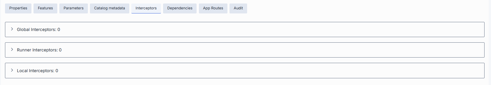

#### The difference between model and application interceptors

**Scope of invocation**

- **Model**: Interceptors are triggered with each request to a model (i.e. before/after the LLM invocation).
- **Application**: Interceptors wrap the entire orchestrated workflow, including multi-model sequences and branching logic.

**Use cases**

- **Model**: Ideal for prompt pre-processing or response transformations that are specific to each LLM.
- **Application**: Manage cross-cutting concerns across the whole application (e.g., tenant-based routing, unified logging, end-to-end policy enforcement).

#### Interceptors grid

| Column | Description |
|--------|-------------|
| **Order** | Execution sequence. Interceptors run in ascending order (1 → 2 → 3...). A request will flow through each interceptor in this order. Response interceptors are invoked in the reversed order. |
| **Display Name** | The interceptor's alias, matching the **Name** field in its definition. |
| **Description** | Free-text summary from the interceptor's definition, explaining its purpose. |
| **ID** | Unique identifier of the interceptor. |
| **Actions** | Additional interceptor-specific actions: open interceptor in a new tab, or [Remove](#remove-interceptor) the selected interceptor from the app's configuration. |

#### Add an interceptor

1. Click **+ Add** (in the upper-right of the interceptors grid).
2. In the **Add Interceptors** modal, choose one or more from the grid of [defined interceptors](../6.governance/4.interceptors.md).
3. Click **Apply** to append them to the bottom of the list (added in the same order as selected in the modal).

**Tip**
> If you need a new interceptor, first create it in the [Governance](../6.governance/4.interceptors.md) section and then revisit this tab to attach it to the application's configuration.

#### Reorder interceptors

1. Drag and drop the handle (⋮⋮⋮⋮) to reassign the order in which interceptors are triggered.
2. Release to reposition; order renumbers automatically.
3. Click **Save** to lock in the new execution sequence.

#### Remove an interceptor {#remove-interceptor}

1. Click the actions menu in the interceptor's row.
2. Choose **Remove** to detach it from this application.
3. Click **Save** to lock in the interceptors list.

### Dependencies

In interconnected systems, applications often rely on other applications or AI models to function, forming complex dependency chains. Access to sensitive data in such ecosystems can pose a challenge, especially when multiple applications interact and propagate requests, and may require explicit consent from a user to allow an application or AI model to access their data or perform actions on their behalf.

**Note**
> Refer to [Managing Authorization in Complex Application Ecosystems](../../3.building-with-dial/7.working-with-dial-resources/6.auth-matrix-for-apps.md) to learn more.

On this screen, you can find all dependencies configured for the selected application. Administrators can manually add new dependencies (by selecting from available AI models and applications) or remove the existing ones.

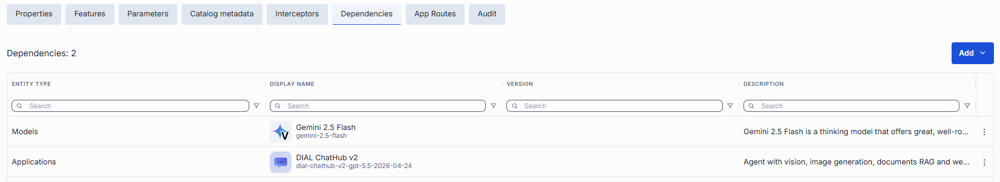

| Column | Description |
|--------|-------------|
| **Entity Type** | Indicates whether the dependent object is an Application or a Model. |
| **ID** | Identifier of the respective model or application. |
| **Display Name** | Descriptive name of the dependent model or application. |
| **Version** | Version of the dependent model or application. |
| **Description** | Additional textual details about the dependent model or application. |
| **Actions** | Allows opening the dependent object in a new tab or removing it from the list of dependencies. |

#### Add a dependency

1. Click **+ Add** (in the upper-right of the dependencies grid).
2. Select the type of object to add: Application or Model.
3. In the modal window, choose a model or application existing in DIAL from the grid.
4. Click **Add** to append them to the dependencies grid.

### App Routes

Define and manage routes that DIAL Core uses when interacting with this application via specified endpoints. The left panel lists the routes; click **+ Add** and enter a **Display Name** to create one. Route configuration mirrors [Routes](./4.routes.md).

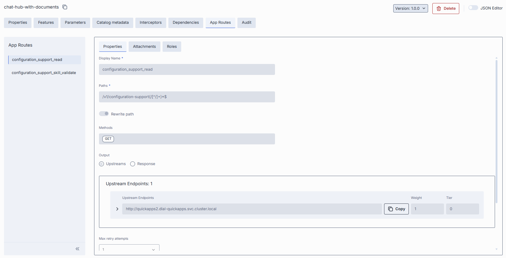

Each route is configured through three sections:

- **Properties** — Display Name, Paths, Rewrite path (toggle), Methods, Output (Upstreams or Response), Upstream Endpoints (with Weight and Tier), Max retry attempts, Permissions, and Order.
- **Attachments** — Request attachment paths and Response attachment paths.
- **Roles** — the **Inherit Application Roles** toggle and a Roles grid (when inheritance is off).

### Audit

In the **Audit** tab, you monitor usage, cost, performance, and change history for the selected application. It has four sub-sections: Dashboard, Traces, Conversations, and Activities.

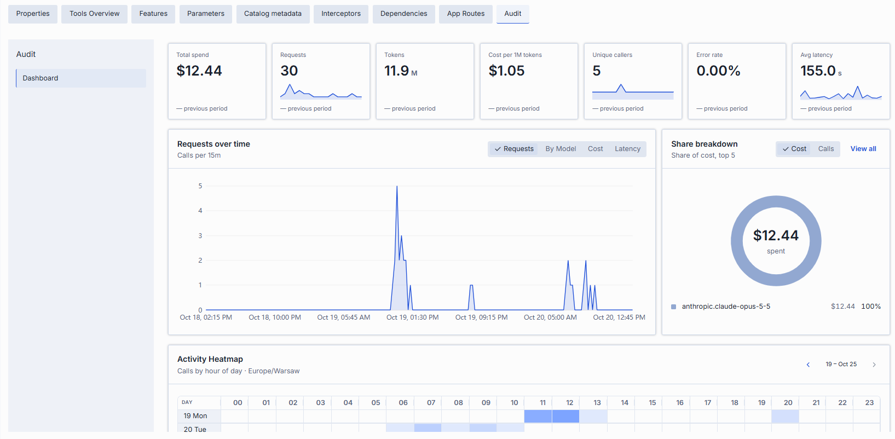

#### Dashboard

The Dashboard presents usage, cost, and performance analytics for the selected application over a chosen time range.

| Control | Description |
|---------|-------------|
| **View by** | Scope of the dashboard. For an application, this is **LLM**. |
| **Time Period** | Date range applied to all cards and charts. |
| **Compare Previous period** | Shows each metric's change against the preceding period of the same length. |
| **Refresh** | Reloads the dashboard data. |

Each metric card shows the current value, a sparkline, and (when comparison is on) the change versus the previous period:

| Metric | Description |
|--------|-------------|
| **Total spend** | Estimated cost in USD for this application's calls. |
| **Requests** | Number of requests. |
| **Tokens** | Total prompt and completion tokens. |
| **Cost per 1M tokens** | Average cost per million tokens. |
| **Unique callers** | Count of distinct users or API keys. |
| **Error rate** | Share of requests that failed. |
| **Avg latency** | Average response time. |

The Dashboard also includes:

- **Requests over time** — time-series chart. Toggle between **Requests**, **By Model** (requests broken down by the model called), **Cost**, and **Latency**.
- **Share breakdown** — donut chart of the top 5 contributors; toggle between **Calls** and **Cost**; **View all** opens the full list.
- **Activity Heatmap** — calls by hour of day across the week; toggle **Requests** / **Cost**; navigate week by week; the color scale runs Low → High.
- **Breakdown** — table grouped by the related deployments or projects, with columns Share of calls, Calls, Errors, Avg latency, and Cost.

### JSON editor

Advanced users with technical expertise can work with the application properties in a JSON editor view mode. It is useful for advanced scenarios of bulk updates, copy/paste between environments, or tweaking settings not exposed on UI.

**Tip**
> You can switch between UI and JSON only if there are no unsaved changes.

1. Navigate to **Applications**, then select the application you want to edit.
2. Click the **JSON Editor** toggle (top-right). The UI reveals the raw JSON.
3. Make changes and click **Save** to apply them.

## Delete

- Click **Delete** on the Configuration screen toolbar.
- Use **Delete** in the application's row actions menu.
- Delete the folder that contains the application.
- Select applications on the main screen and use the bulk-actions **Delete**.

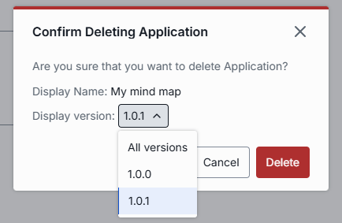

**Warning**
> Deleting an application is permanent. Applications that depend on it will stop working.

## Next steps

- [Manage AI model deployments](./1.models.md) — configure the AI models your applications rely on.
- [Manage interceptors](../6.governance/4.interceptors.md) — attach interceptors for content filtering and compliance across your application workflows.
- [Manage roles and access control](../6.governance/1.roles.md) — define who can access each application and at what rate limits.
