# Manage toolsets

Toolsets in DIAL enable connectivity with MCP servers and can be used as tools by any internal or external application to perform specific actions. 

In DIAL, you can use self-hosted toolsets based on deployed MCP containers and external toolsets deployed outside of DIAL using their endpoints.

The DIAL Core API allows you to [access](https://dialx.ai/dial_api#tag/Deployment-listing/operation/getToolSets) available toolset deployments and to [add and manage](https://dialx.ai/dial_api#tag/Toolsets) toolsets. You can also add toolsets via direct configuration of [DIAL Core](https://github.com/epam/ai-dial-core/blob/development/docs/dynamic-settings/toolsets.md).

## Use a toolset

A toolset is available to users and applications once it is registered, can reach its MCP server, and its roles allow access.

1. **Check the tools.** Open **Tools Overview** to see the tools the MCP server exposes, and use [**Try out**](#tools-overview-tab) to call a tool.
2. **Sign in if needed.** If the toolset uses authentication, [sign in](#authentication) at the personal or organization level.
3. **Control access.** In [Roles](#roles), add the roles that can use the toolset, or turn off **Make available to specific roles** to make it available to all users. A new platform toolset is unavailable to everyone until you do one of these.
4. **Connect it to applications and clients.**
   - **Quick Apps.** A Quick App references a registered toolset with the `dial-mcp` toolset type and its `dial_id`. Connection details and credentials stay with the administrator. In DIAL Chat, the Quick App wizard has an **Agents & Toolsets** picker for registered toolsets. See [Working with tools and agents](../../3.building-with-dial/1.apps/2.quick-apps/1.quick-app-2/4.working-with-tools-and-agents.md) and [What is a Toolset](../../3.building-with-dial/1.apps/2.quick-apps/1.quick-app-2/9.toolsets/0.index.md).
   - **Other clients.** Toolsets are served over the MCP Server API of DIAL Core. List them with the [deployment listing API](https://dialx.ai/dial_api#tag/Deployment-listing/operation/getToolSets) and call them with the [MCP Server API](https://dialx.ai/dial_api#tag/Toolsets).

## Main screen

The screen has a **folder tree** on the left and a grid of the selected folder's contents on the right. The header holds a **Create** dropdown.

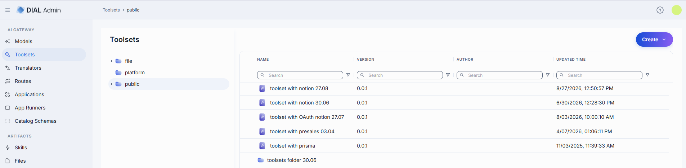

### Folders

The tree has three top-level (root) folders. Click a folder to list its contents in the grid.

| Root folder | What it is and how it behaves |
|-------------|------------------------------|
| **file** | Toolsets defined in the **DIAL Core configuration files** (as opposed to the database/API-managed assets in the other buckets). A **read-only**, names-only listing: no **Create** button and no row, bulk, or folder actions. Opening an entry shows its configuration in read-only mode, marked with a **READ ONLY** badge; it cannot be edited, deleted, duplicated, or moved. Use this to see which toolsets come from the static config rather than from published assets. |
| **platform** | Toolsets stored in DIAL Core platform blob storage. This is where you create, edit and delete toolsets in DIAL Admin. It also adds a **Roles** section on the configuration screen. |
| **public** | A public bucket. Toolsets get here when published by users or added by administrators. |

The grid columns, the **Create** menu, and the available row actions all change depending on which bucket you are browsing.

### Grid columns

Columns differ by bucket. There is no ID column—row identity is the **Name** cell. Each column (except in the file bucket) has an inline search/filter box; the grid has a fixed column set (no Columns panel).

**Public bucket**

| Column | Description |
|--------|-------------|
| **Name** | Name of the toolset or folder. Click to open. |
| **Version** | The published version. Becomes a version picker when rows are selected. |
| **Author** | Who created or last updated the toolset. |
| **Updated time** | Timestamp of the last modification. |

**Platform bucket** (platform toolsets have no versions, so there is no Version column)

| Column | Description |
|--------|-------------|
| **Name** | Name of the toolset. Click to open. |
| **Author** | Who created or last updated the toolset. |
| **Created time** | Creation timestamp. |
| **Updated time** | Timestamp of the last modification. |

**File bucket**

A single **Name** column (the config-entity name). No other columns, and no actions.

### Row actions

Open a row's actions menu (**⋮**). The actions depend on whether the row is a toolset or a folder, and on the bucket.

**Toolset (public bucket)**

| Action | What it does |
|--------|--------------|
| **Open in a new tab** | Opens the toolset's configuration screen in a new browser tab. |
| **Duplicate** | Copies the toolset. In public folder you can duplicate either as a **New Version** of the same toolset, or as a **New Toolset** (new ID, in a folder you choose). |
| **Move to** | Moves the toolset to another folder (platform is excluded as a destination). |
| **Export** | Downloads the toolset as a DIAL Admin Archive or JSON. |
| **Delete** | Permanently removes the toolset. |

**Folder (public bucket):** **Add sibling**, **Add child**, **Move to**, **Export**, **Manage permissions**, **Rename**, **Delete**.

**Toolset (platform bucket):** **Open in a new tab**, **Duplicate**, **Delete** only.

Select one or more rows to reveal the **bulk-actions** toolbar: **Move to**, **Export**, **Delete** (public) or **Delete** only (platform).

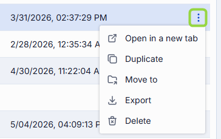

### Create: Folder, Toolset, or Import

The **Create** dropdown in the header is the single entry point for adding content. Its items depend on the bucket:

- **Public bucket:**
  - **Folder** — adds a new folder in the tree.
  - **Toolset** — opens the [Create Toolset modal](#create-a-toolset).
  - **Import** — opens the [Import modal](#import-toolsets).
- **Platform bucket:** only **Toolset**.
- **File bucket:** no Create button (read-only).

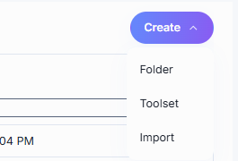

## Create

1. Select the target folder (either in platform or public folder), click **Create**, and select **Toolset**.
2. Fill in the form:

   | Field | Required | Description |
   |-------|----------|-------------|
   | **ID** | Yes | Unique identifier of the toolset. |
   | **Display Name** | Yes | Name displayed on the UI. |
   | **Version** | Yes | Semantic version (e.g. `1.0.0`, pre-filled). Hidden when creating in the platform bucket. |
   | **Description** | No | Description of the toolset. |
   | **External Endpoint** | Yes | Endpoint DIAL Core uses to communicate with the related MCP server. |

3. Click **Create**. The dialog closes and the new [toolset configuration screen](#configure-a-toolset) opens. The entry appears immediately in the listing.

   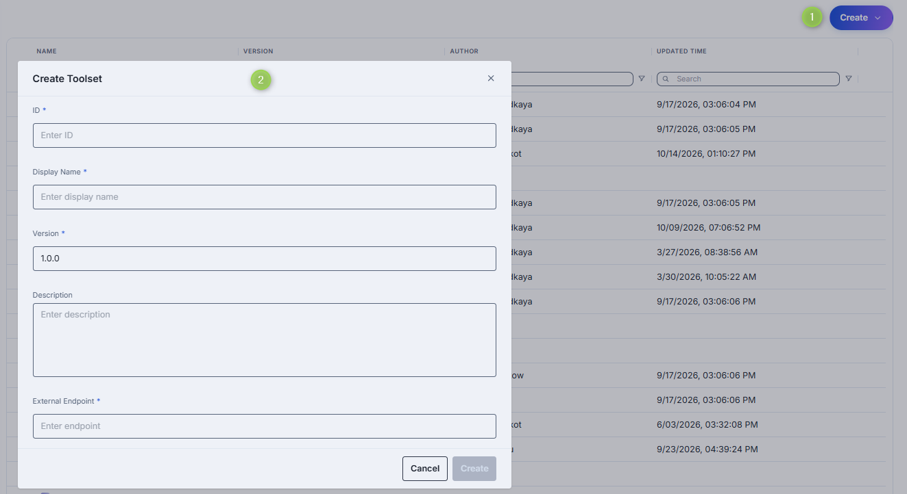

**Tip**
> You can quickly add new toolsets by duplicating existing ones. Use the **Duplicate** action in the toolset's row menu.

## Duplicate

Duplicate copies an existing toolset. The modal differs by bucket.

**Public bucket.** Choose a **Duplication type**:

- **New Version** — another version of the same toolset. **ID** is disabled; enter a **Display Name** and a **Version** (pre-filled with the next version).
- **New Toolset** — a clone as a new entity. Enter an **ID**, **Display Name**, **Version**, and a **Folder Storage** location (with a **Move to** picker).

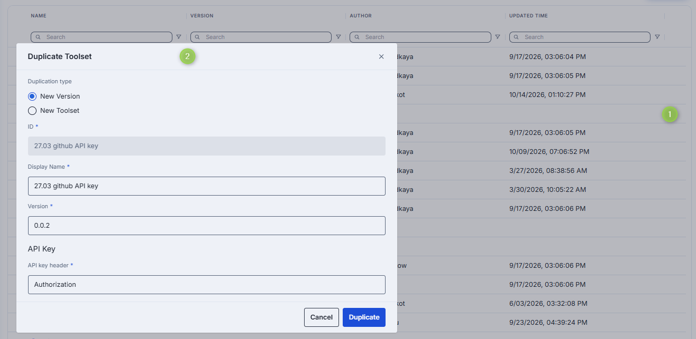

**Note**
> The duplicate does **not** prompt for OAuth credentials. If the source toolset uses **API Key** authentication, the modal adds an **API key header** field; if it uses **OAuth**, authentication is reset to **Without authentication** on the copy, and you re-configure it afterward.

**Platform bucket.** The modal prompts only for **ID** and **Display Name**; there is no version, folder, or authentication field.

## Export

You can export individual toolsets or whole folders (including nested folders).

- To export a folder or toolset, choose **Export** in its row actions menu.
- To export several items or specific versions, select them and use **Export** in the bulk-actions toolbar.
- In the Export dialog, choose the **Format**: **DIAL Admin Archive** (ZIP) or **JSON**.

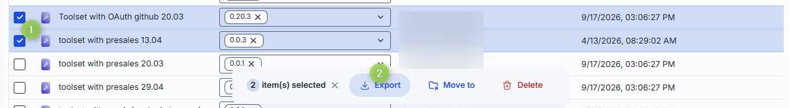

## Import

Importing lets you migrate, restore, or share toolset assets between DIAL instances.

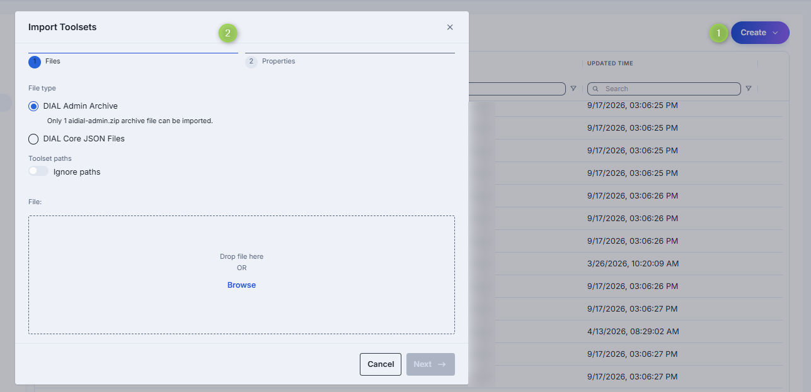

1. Click **Create** and select **Import**.
2. On the **Files** step, choose the file type and add your files (drag and drop or **Browse**):
   - **DIAL Admin Archive** — a single `aidial-admin.zip` archive (one at a time).
   - **DIAL Core JSON Files** — up to 30 JSON files, 64 MB in total.
3. Optionally enable **Ignore paths** (under **Toolset paths**) to disregard the folder structure stored in the files (everything imports into the current folder).
4. On the **Properties** step, choose a **Conflict resolution** strategy:
   - **Skip** — keep existing toolsets; add only new ones.
   - **Override** — replace toolsets that have the same name and version.
5. Review the preview—items with validation errors or conflicts are flagged, and you can edit a conflicting row's name or version inline before import.
6. Click **Finish**.

## Configuration

Click any toolset to open its configuration screen. At the top of the **Properties** tab, a header band shows **Updated Time**, **Creation Time**, the **Authentication** status (only when the toolset uses authentication), and **Folder Storage** (the folder path, with a link that opens it in [Folders Storage](../6.governance/3.folders-storage.md) on public toolsets; `platform` without a link on platform toolsets).

**Top bar controls**

| Control | Description |
|---------|-------------|
| **Version** | Dropdown to view a specific version, or **+ Create** a new one (opens a "Create new version" prompt with the next version pre-filled). Public bucket only. |
| **Log In** / **Log Out** | Sign in to or out of the toolset's MCP server. Shown only when the toolset uses authentication. See [Authentication](#authentication). |
| **Delete** | Delete the selected toolset. |
| **JSON Editor** (toggle) | Switch between the form UI and the raw [JSON view](#json-editor). |
| **Save** / **Save as new version** / **Discard** | Appear when there are unsaved changes. **Save** updates the current version; **Save as new version** stores the edits as a new version; **Discard** reverts them (with confirmation). |

The screen is organized into sections: **Properties**, **Tools Overview**, **Catalog metadata**, and **Audit**. **Roles** appears only for toolsets in the **platform** and **file** buckets. **Audit** appears only when the dashboard feature and the DIAL Admin API are enabled. Toolsets opened from the **file** bucket are read-only (a **READ ONLY** badge appears and the action buttons are hidden).

### Properties

Preview and modify the toolset's identity, endpoint, and authentication. Fields render in this order:

| Field | Required | Description |
|-------|----------|-------------|
| **Display Name** | Yes | Name displayed on the UI. |
| **Description** | No | Description of the toolset. |
| **Intro** | No | Introductory text shown to users of the toolset. |
| **Provider** | No | Name of the toolset provider (for example, the service or vendor that hosts the MCP server). |
| **Vendor Website** | No | URL of the provider's website. |
| **Icon** | No | Logo displayed on the UI. Opens a picker with a gallery of built-in icons and a **None** option (not a file upload). |
| **Topics** | No | Semantic labels (e.g. "finance", "support"). Opens a modal with a searchable checkbox list; use **Add Topic** to type a custom one. |
| **Folder Storage** | No | The folder that holds the toolset. Click **Move to** to relocate it. Hidden for platform-bucket toolsets. |
| **External Endpoint** | Yes | Endpoint DIAL Core uses to communicate with the related MCP server. |
| **Transport** | No | Transport the MCP server uses: **HTTP** or **SSE** (deprecated). When unset, the field shows **SSE**. |
| **Authentication** | No | The toolset's [authentication method](#authentication). |
| **Forward per request key** | No | Toggle. When on, a [per-request key](../../3.building-with-dial/7.working-with-dial-resources/5.per-request-keys.md) is forwarded to the toolset endpoint so the MCP server can access files in DIAL storage. Disabled when **Authentication** is **API Key**. |
| **Max retry attempts** | No | How many times DIAL Core [retries](../../4.operating-dial/4.configuration/7.load-balancer.md#fallbacks) a failed call (timeouts or 5xx). Selector with values 1–5, default 1. |
| **Catalog schema** | No | A catalog schema is a structured set of fields defined centrally. You create a schema in [Catalog schemas](./7.catalog-schemas.md) and attach it to the toolset here. Click the selector to pick a schema, or **Browse** to choose one. Selecting a schema enables the [Catalog metadata](#catalog-metadata) section. |

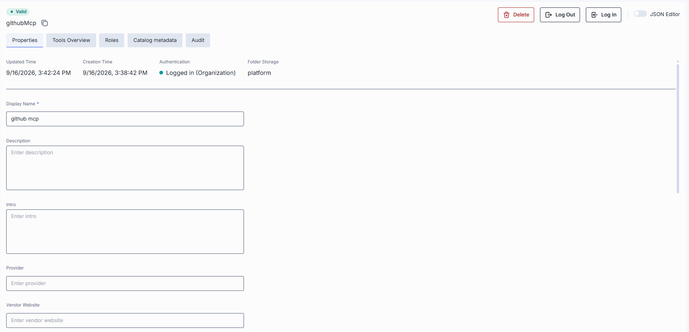
<!-- SCREENSHOT OUTDATED: Properties now includes Intro, Vendor Website, and the Catalog schema field; no ID/Author/Version fields in the body (FE 0.22.0-rc.0) -->

### Authentication

If the toolset requires authentication at the related MCP server, configure the method here, then sign in. A toolset can be published with organization credentials—in that case it may already show **Logged in (Organization)**; you can add personal credentials on top, and both levels remain active, showing **Logged in**.

**Note**
> Authentication settings cannot be modified while the toolset is logged in. Log out first to edit them. Refer to [DIAL Core toolset credentials documentation](https://github.com/epam/ai-dial-core/blob/development/docs/dynamic-settings/toolset_credentials_api.md) to learn more about toolset authentication.

**Step 1: Select and configure the authentication method**

Choose one of the method cards:

- **OAuth** — authenticate via OAuth 2.0 with an external identity provider. Choose one of two sub-modes:
  - **With login** — dynamic client registration. Providing the **External Endpoint** is sufficient; no further fields.
  - **With login & configuration** — static registration. Populate the form with values from your identity provider:

    | Field | Required | Description |
    |-------|----------|-------------|
    | **Client Registration Type** | No | Registration mode. Currently **Existing client**. |
    | **Token Endpoint Authentication Method** | No | How the client authenticates at the token endpoint: **Client secret (HTTP Basic)** (default), **Client secret (POST body)**, or **None**. |
    | **Client ID** | Yes | Unique identifier of the client requesting access. |
    | **Client Secret** | Yes | Confidential key the client uses to authenticate with the authorization server. |
    | **Scopes Supported** | No | Access-level scopes. Use **Add field** to list them. |
    | **Default authorization endpoint** | Yes | URL for performing authorization. |
    | **Default token endpoint** | Yes | URL where the client exchanges an authorization code for an access token. |
    | **PKCE method** | No | Proof Key for Code Exchange method: **- None -**, **plain**, or **S256**. |

- **API Key** — authenticate using an API key. Enter the **API key header** (the header name); the key value is entered at sign-in.
- **Without authentication** — no authentication required.

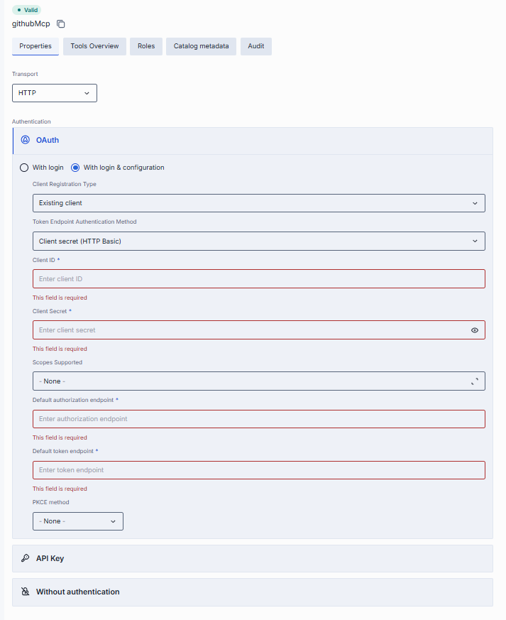

**Step 2: Sign in and choose the level**

Click **Log In** and select the levels (checkboxes):

- **Personal** — authenticates for your user only. Status becomes **Logged in (Personal)**.
- **Organization** — authenticates for all users in your organization. Status becomes **Logged in (Organization)**.
- Check **both** to authenticate at both levels simultaneously; status shows **Logged in**.

For API Key authentication, you are prompted for the **API key value** at this step. OAuth redirects you through the provider's sign-in flow.

To sign out, click **Log Out**. When you are signed in at both levels, a **Select logout levels** dialog lets you choose which to sign out from; with a single level, it signs out directly.

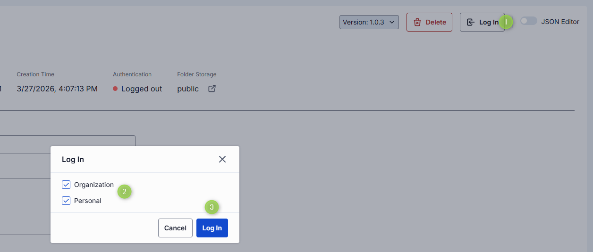

### Tools Overview {#tools-overview-tab}

[Tools](https://modelcontextprotocol.io/specification/2025-06-18/server/tools) are functions supported by an MCP server. Here you discover, manage, and test all tools the related MCP server exposes.

If the toolset was created from an MCP container deployed in DIAL, the content is inherited from the related [MCP container](../3.deployments/2.container-management.md#mcp-containers) and shows all **enabled** tools.

**Use all available tools**

Enable **Use all available tools** to automatically include every tool the MCP server supports. When on, tools cannot be added or removed manually and the filter and manage controls are hidden.

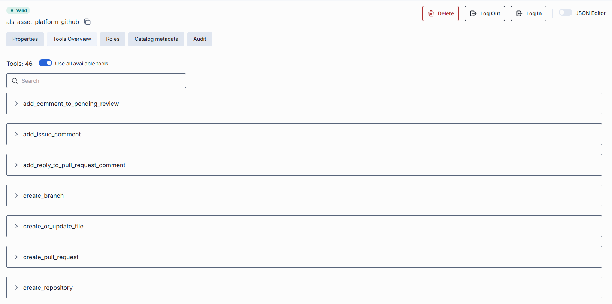

**Manage tools**

Disable **Use all available tools** to switch to manual management. This reveals:

- A **Filter** dropdown with **All tools**, **Auto-detected**, and **Added manually**.
- A **Manage tool** button that opens the **Manage tools** modal.

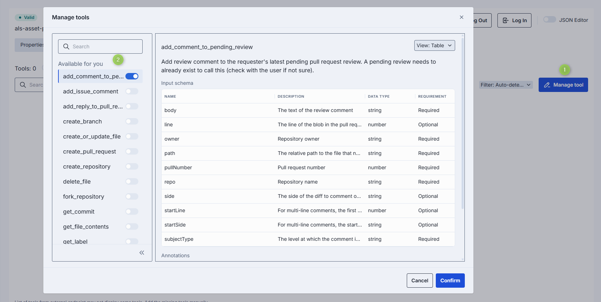

In the **Manage tools** modal:

- **Available for you** lists the auto-detected tools, each with an on/off toggle.
- **Others in a toolset** lets you **Add** a tool by exact name—useful for tools the MCP server supports but that are not visible to your user (they are labeled accordingly on the Tools Overview screen).
- Click **Confirm** to apply.

**Inspect a tool**

Click any tool to expand its details. Use the **View** selector (**Table** or **JSON**) to switch presentation. In Table view it shows:

- **Input schema** — a table of **Name**, **Description**, **Data type**, and **Requirement**.
- **Annotations** — a table of **Annotation** and **Value**.
- **Output schema** — a table with the same columns as the input schema.

**Try tools**

Click **Try out** on an enabled tool to open the request sidebar:

1. Populate the **Request body** using the **Generated form** or switch to **JSON**.
2. Click **Send Request**.
3. The server's reply appears in the **Response body**.

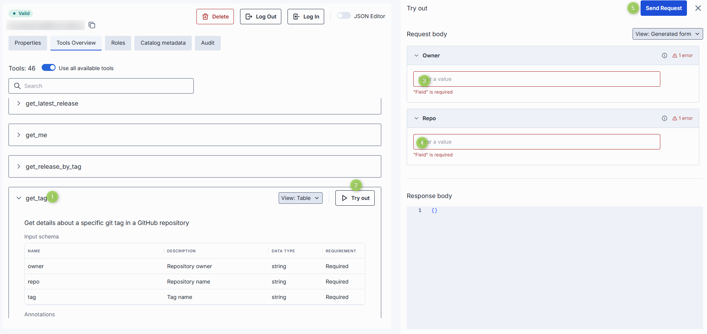

### Catalog metadata

Catalog metadata holds the values for the fields of the [catalog schema](#properties) attached to the toolset. The section is empty until you select a schema in the **Catalog schema** field on [Properties](#properties):

- **No schema selected** — the section shows "Select a catalog schema on the Properties tab to edit its catalog metadata."
- **Schema selected** — the schema's fields render for you to complete. Use the **View** selector to switch between a generated **Form** and raw **JSON**. A banner flags any stored properties the schema does not declare.

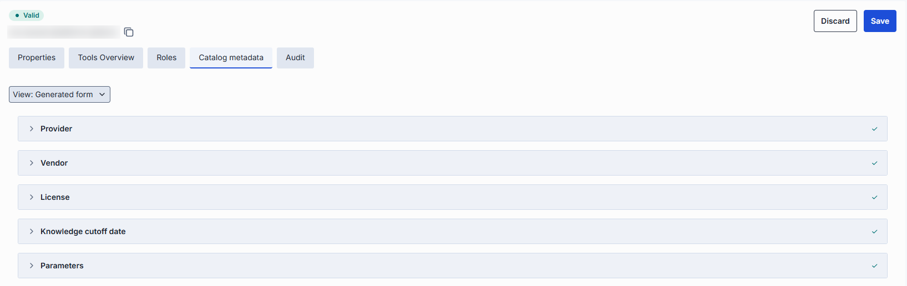

### Roles

Shown only for toolsets in the **platform** and **file** buckets (read-only in the file bucket). The **Make available to specific roles** toggle controls who can use the toolset:

- **Off** — any authenticated user can use it. The grid lists all roles and is read-only.
- **On** — only the roles you add can use it. With no roles in the grid, the toolset is not available to any end user, and a notification says so.

**Important**: A newly created platform toolset starts with the toggle **On** and no roles, so it is not available to any user until you add roles or turn the toggle off.

Click **+ Add Roles** to open a modal and select roles; the grid lists **Display Name**, **Description**, and **Source**. Each added role's row menu offers **Remove**.

> You can manage roles in the Governance section.

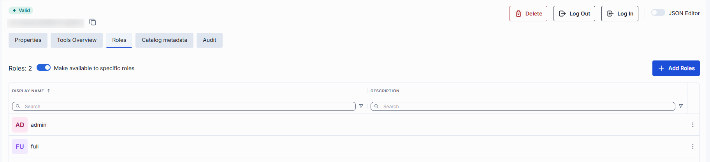

### Audit

The Audit section shows usage and consumption metrics for the selected toolset, in two sub-sections: Dashboard and Traces. It is shown only when the dashboard feature and the DIAL Admin API are enabled.

#### Dashboard

The Dashboard presents usage and performance analytics for the selected toolset over a chosen time range. A toolset shows the **MCP** view: tool calls made to the toolset, counted as **Total tool calls**. This view has no spend or cost figures.

| Control | Description |
|---------|-------------|
| **View by** | The kind of traffic the dashboard shows. For a toolset, this is **MCP**. |
| **Time Period** | Date range applied to all cards and charts. |
| **Compare** | Shows each metric's change against a previous period: **Off**, **Previous period**, **Previous month** or **Previous year**. |
| **Refresh** | Reloads the dashboard data. |

Each metric card shows the current value, a sparkline, and (when comparison is on) the change versus the previous period:

| Metric | Description |
|--------|-------------|
| **Total tool calls** | Number of tool calls (`tools/call`) made to the toolset. Connection handshakes and tool discovery requests are not counted. |
| **Unique callers** | Count of distinct users or API keys. Not shown when the callers can't be identified. |
| **Error rate** | Share of tool calls that failed. |
| **Avg latency** | Average response time. |

The Dashboard also includes:

- **Tool calls over time** — time-series chart. Toggle between **Requests**, a split by dimension (**By …**), and **Latency**. There is no **Cost** option, because the cost is offered only in the LLM view.
- **Share breakdown** — donut chart of the top 5 contributors by share of tool calls; **View all** opens the full list.
- **Activity Heatmap** — calls by hour of day across the week; navigate week by week; the color scale runs Low → High.
- **Breakdown** — table with three tabs: **Tools** (grouped by the tool called, on the server that served it), **Applications** (grouped by the calling application; a call made directly through **Try out** has no parent application) and **Projects** (grouped by the project of the calling key; calls outside any project are shown as **No Project**). Columns are Share of calls, Calls, Errors, and Avg latency.

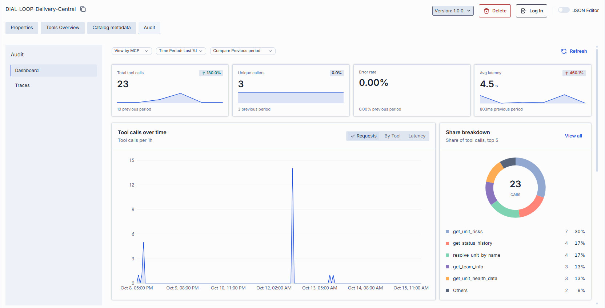

#### Traces

The Traces tab provides a detailed view of all requests processed by DIAL Core. Each row represents an individual request—whether initiated by an external or internal DIAL client. Use it to investigate specific interactions, troubleshoot issues, or analyze usage patterns.

| Column | Description |
|--------|-------------|
| **Completion Time** | Timestamp when DIAL Core finished processing the request. |
| **Number of request messages** | Chat conversation length (for chat completion requests) or input count (for embedding requests). |
| **Trace ID** | OpenTelemetry trace ID uniquely identifying the root request. All subsequent calls triggered by this request share the same Trace ID. |
| **Core span ID** | OpenTelemetry span ID for this request. |
| **Core span parent ID** | OpenTelemetry span ID of the DIAL Core request that called this request. |
| **Response ID** | Identifier of the response object returned for this request. |
| **Conversation ID** | DIAL Chat conversation identifier this request belongs to. |
| **Deployment ID** | Identifier of the DIAL deployment for this request. |
| **Parent Deployment ID** | Identifier of the DIAL parent deployment that triggered this request. |
| **Execution path** | List of DIAL Deployment IDs representing the call stack. For example, `['app1', 'app2', 'model1']` means `app1` called `app2`, which called `model1`. The last element equals the Deployment ID; the penultimate element (when present) equals the Parent Deployment ID. |
| **Prompt tokens** | Total tokens in prompts sent to AI models during this request. |
| **Cached prompt tokens** | Number of prompt tokens served from cache (prompt caching) in this request. |
| **Completion tokens** | Tokens generated by AI models as output. |
| **Deployment price** | Cost of this specific request, excluding costs of any requests it triggered. |
| **Total price** | Total cost of this request including all related requests it directly or indirectly triggered. Always: Total price ≥ Deployment price. |
| **Model** | Identifier of the underlying model or deployment used. |
| **Project** | Project ID corresponding to the DIAL API key used for this request. |
| **Upstream** | The upstream endpoint that served the request. |
| **User** | Unique hash identifying the user who initiated the request. |
| **User title** | Job title of the user (if available). |
| **Topic** | Auto-generated subject summarizing the request. |
| **Language** | Language detected in the request (e.g., `en`). |
| **Reactions** | Indication of user reactions (like/dislike) for this request. |

### JSON editor

Advanced users can work with the toolset's raw JSON—useful for bulk updates or editing settings not exposed in the form UI.

**Tip**
> You can switch between the form UI and JSON only if there are no unsaved changes.

1. Navigate to **Toolsets** and select the toolset you want to edit.
2. Click the **JSON Editor** toggle (top-right). The raw JSON is revealed.
3. Make changes and click **Save** to apply them. On a public toolset you can instead click **Save as new version**. Click **Discard** to revert the changes.

**Note**
> Saving is blocked while the JSON contains errors. For a toolset in the **file** bucket, the editor is read-only.

## Delete

> Deleting a toolset is permanent and will break any workflows that rely on it.

- Click **Delete** on the Configuration screen toolbar.
- Use **Delete** in the toolset's row actions menu.
- Delete the folder that contains the toolset.
- Select toolsets on the main screen and use the bulk-actions **Delete**.

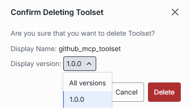

## Next steps

- [Manage MCP containers](../3.deployments/2.container-management.md#mcp-containers) — deploy and manage the MCP containers that power your toolsets.
- [Manage roles and access control](../6.governance/1.roles.md) — define who can access each toolset.
- [Manage applications](./2.applications.md) — configure application deployments that use toolsets via MCP.
