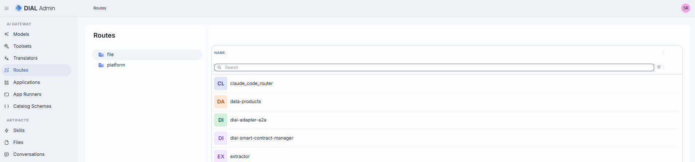
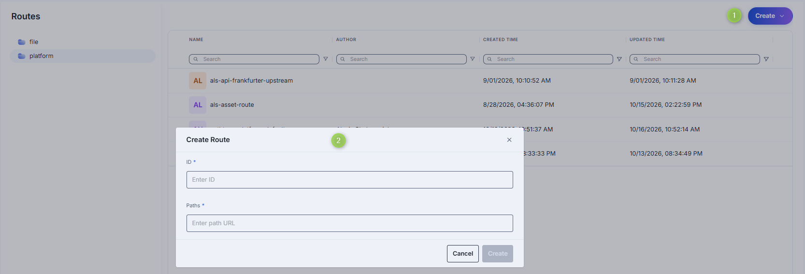
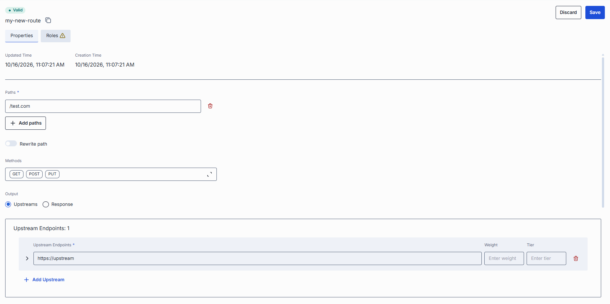
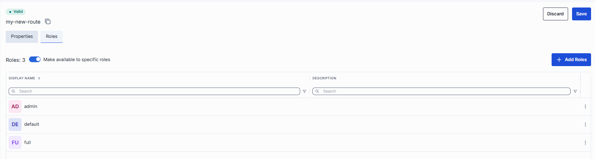

# Manage routes

This page explains how administrators use DIAL Admin to add and configure routes. It covers creating a route, configuring path matching and HTTP methods, setting upstream or static response outputs, assigning roles, and using the JSON editor. You need access to DIAL Admin with administrator permissions.

Routes in DIAL are used for communication with external services through registered endpoints in [DIAL Core](../../2.understand-dial/2.architecture/4.unified-api-overview.md). They act as a bridging mechanism between DIAL Core and external applications, facilitating seamless interactions.

Once a route with a designated endpoint is set up in DIAL Core, it allows client applications such as DIAL Chat to interact with that endpoint. DIAL Core functions as an intermediary, handling authentication, role-based authorization, rate limiting and request balancing between the client and the external application linked to the route.

### What a global route is

The routes managed on this page are **global routes** — routes defined for the whole platform in DIAL Core's top-level `routes` configuration. They apply across DIAL Core, which is why the **Order** field ranks them against each other.

The term "global" distinguishes them from **app-level routes**, which are attached to a single application and apply only to that application's requests. To define app-level routes, refer to [Applications](./2.applications.md#app-routes) and Application Runners.

### Example

A common use is to forward requests to an external service. For example, a route that matches the path `/v1/chat/completions` for `POST` requests and sends them to an external LLM provider lets a client call that provider through DIAL Core — DIAL Core attaches the provider's API key, so the client never handles it.

Other typical uses:

- **Return a static response.** Match a path such as `/v1/rate` and return a fixed payload (for example, status `200` with body `OK`) without contacting any backend — useful for health checks. See [Response configuration](#response-configuration).
- **Load-balance across endpoints.** Point one route at several upstreams to spread traffic and fail over automatically. See [Upstream configuration](#upstream-configuration).

### Calling a route

A client calls a route through DIAL Core with a request in this form:

```text
{HTTP method} /v1/deployments/{id}/route{route_path}
```

- `{id}` is the deployment ID.
- `{route_path}` must match one of the route's **Paths**, and the HTTP method must be one of its **Methods**.
- `{route_path}` must not contain the keyword `route`.

**Note**
> Refer to [DIAL Core](https://github.com/epam/ai-dial-core/blob/development/docs/dynamic-settings/routes.md) for full configuration examples.

## Main screen

On this screen, you can access all routes added in DIAL Admin or via direct modification of the DIAL Core configuration file.



The platform bucket grid displays the main properties of routes:

| Field | Description |
|-------|------------|
| **Name** | Route name. |
| **Author** | Name of the user who created the route definition. |
| **Creation Time** | Entity creation timestamp. |
| **Updated Time** | Timestamp of the latest update of the entity. |

### Folders

The left panel shows where each route definition is stored. It has two root folders:

- **file**: routes defined in the DIAL Core configuration file. This folder is read-only; it lists only the
  route names. To change these routes, edit the DIAL Core config file.
- **platform**: routes stored in DIAL Core platform blob storage. This is where you create, edit and delete routes in DIAL Admin.

Select a folder to list its routes in the grid. See [where an entity can be defined](./0.index.md#where-an-entity-can-be-defined) for how DIAL Core combines the two sources.

### Actions

The actions menu (**⋮**) at the end of each row in the platform bucket lets you work with an individual route.

| Action | What it does |
|--------|--------------|
| **Open in a new tab** | Opens the route's configuration screen in a new browser tab. |
| **Duplicate** | Copies the route. |
| **Delete** | Permanently removes the route. |


## Create

Follow these steps to add a new route in the platform folder:

1. Click **Create** to invoke the **Create Route** modal, where you can define route parameters:

    | Field | Required | Description |
    |-------|----------|-------------|
    | **ID** | Yes | Unique key under the Routes section of DIAL Admin. |
    | **Paths** | Yes | Path(s) this route should match. A path can be a plain string or a regular expression (e.g. `/chat`, `/v1/vector_store(/[^/]+)*$`). |

2. Once all required fields are filled, click **Create**. The dialog closes and the new [route configuration](#configuration) screen is opened. This entry will appear immediately in the listing once created. It may take some time for the changes to take effect after saving.

    

## Configuration

Click any route on the main screen to open the configuration section.

### Properties

In the **Properties** tab, you can define the identity and routing behavior.



#### Basic identification

| Field | Required | Editable | Description |
|-------|----------|----------|-------------|
| **ID** | - | No | Unique read-only key under the `routes` section of DIAL Admin and [dynamic settings of DIAL Core](https://github.com/epam/ai-dial-core?tab=readme-ov-file#dynamic-settings). |
| **Updated Time** | - | No | Date and time when the route's configuration was last updated. |
| **Creation Time** | - | No | Date and time when the route's configuration was created. |

#### Request matching: paths and methods

| Field | Required | Editable | Description |
|-------|----------|----------|-------------|
| **Paths** | Yes | Yes | One or more paths this route should match. If any path matches, the request is processed by this route. A path can be a plain string or a regular expression (e.g. `/chat`, `/v1/vector_store(/[^/]+)*$`). Click **+ Add paths** to register additional paths. Click the trash icon to remove a path. |
| **Rewrite path** | No | Yes | Toggle. When enabled, the path to the upstream server is replaced with the path of the original request. |
| **Methods** | No | Yes | Select one or more HTTP methods the route can accept, chosen in a popup and confirmed with **Apply**: GET, POST, PUT, PATCH, DELETE, and HEAD. |

#### Output mode

Use the output mode to define the response of a route.

| Option | Description |
|--------|-------------|
| **Upstreams** | One or more backend URLs (e.g., `http://`, `https://`, `ws://`, `wss://`) to which requests are sent. Supports HTTP and WebSocket protocols. When multiple endpoints are provided, round-robin load balancing and automatic fallback can be enabled among the hosts. Refer to [Upstream configuration](#upstream-configuration). |
| **Response** | Use to return a static, pre-defined payload. If the response is set, DIAL Core returns the response immediately. Useful for health checks or mock responses. Refer to [Response configuration](#response-configuration). |

#### Upstream configuration

A list of upstream servers with their parameters. Each upstream row has the main fields below; click the expand chevron on a row to reveal additional per-upstream fields.

| Field | Required | Editable | Description |
|-------|----------|----------|-------------|
| **Upstream Endpoints** | Yes | Yes | Full URL of the back-end service to receive the routed request (e.g. `https://dial-core.example.com/v1/chat`). |
| **Weight** | No | Yes | Relative traffic weight for [load balancing](../../4.operating-dial/4.configuration/7.load-balancer.md) among multiple endpoints. A positive number represents an endpoint capacity; zero or negative disables this endpoint from routing. Higher = more traffic share. Default value: 1. |
| **Tier** | No | Yes | Specifies an endpoint group. In a regular scenario, all requests are routed to endpoints with the lowest tier, but in case of an outage or hitting the limits, the next one in the line helps to handle the load. Only positive numbers allowed. Refer to [load balancing](../../4.operating-dial/4.configuration/7.load-balancer.md) to learn more. |
| **Base URL** | No | Yes | Per-interface base endpoint URL. When set, DIAL Core routes requests of the matching protocol type to this URL instead of deriving it from the source type. Revealed by the expand chevron. |
| **Keys** | No | Yes | API key, token, or credential to attach when calling the upstream. Stored securely and masked — click the eye icon to reveal. Revealed by the expand chevron. |
| **Auth type** | No | Yes | How the key is sent to the upstream: `API_KEY` sends `API-KEY: <key>`, `BEARER` sends `Authorization: Bearer <key>`. Requires a key. Applies only to global routes; routes defined under an application ignore it. |
| **Extra Data** | No | Yes | Additional metadata containing any information that is passed to the upstream's endpoint. It can be a JSON or string. Revealed by the expand chevron. |
| **Secret Extra Data** | No | Yes | Sensitive key-value metadata passed alongside Extra Data. Values are masked in the UI and in server logs. Use this for credentials or tokens the upstream needs at runtime. Revealed by the expand chevron. |
| **Interfaces** | No | Yes | Optional API interfaces exposed by this upstream. Click **+ Add interface** to add one. Revealed by the expand chevron. |
| **+ Add Upstream** | - | - | Append additional endpoints for failover or capacity scaling. |

#### Response configuration

Define parameters for a pre-configured route response. Both fields are required when the **Response** output mode is selected.

| Field | Required | Editable | Description |
|-------|----------|----------|-------------|
| **Status** | Yes | Yes | HTTP status code your route will return (e.g. `200`, `404`, `503`). |
| **Body** | Yes | Yes | Exact payload to send in the response body. You can enter plain text or raw JSON. |

#### Additional parameters

| Field | Required | Editable | Description |
|-------|----------|----------|-------------|
| **Order** | No | Yes | Priority among global routes. A lower value is checked first. See [Order and route priority](#order-and-route-priority). The value cannot be a negative integer. The default value is 2^31-1. |
| **Max retry attempts** | No | Yes | Determines how many times DIAL will retry if the upstream server returns an unsuccessful response code. In this case the load balancer will try to find another upstream from the list of available upstreams. |
| **Request attachment paths** | No | Yes | JSON paths in the request body. Click **+ Add paths** to add more. |
| **Response attachment paths** | No | Yes | JSON paths in the response body. Click **+ Add paths** to add more. |

##### Order and route priority

A request can match the **Paths** of more than one global route. **Order** decides which route wins: DIAL Core evaluates global routes from the lowest **Order** value to the highest and uses the first route whose path (and method) matches the request.

- A **lower** value means **higher** priority — it is checked earlier.
- Leave the default (2^31-1) unless a route must be evaluated before others. For example, give a specific route such as `/v1/chat/completions/special` a lower **Order** than a broad catch-all route such as `/v1/chat/completions/.*` so the specific route is matched first.
- **Order** applies only to global routes. App-level routes are scoped to their own application and are not ranked against global routes.

### Roles

In the **Roles** tab, you can define user groups that are authorized to invoke this route.

**Note**
> You can create and manage roles in the [Governance](../6.governance/1.roles.md) section.



#### Roles grid

| Column | Description |
|--------|-------------|
| **Display Name** | Name of the role displayed on UI. |
| **Description** | Description of the role (e.g., "Admin, Prompt Engineer, Developer"). |

#### Role-specific access

Use the **Make available to specific roles** toggle to define access to the route:

- **Off**: the route is callable by any authenticated user. All existing user roles are listed in the grid.
- **On**: the route is restricted — only the roles you explicitly add to the grid can invoke it. Click **+ Add** to add roles and use the row actions menu to remove them.

### JSON editor

Advanced users with technical expertise can work with the route properties in a JSON editor view mode. It is useful for advanced scenarios of bulk updates, copy/paste between environments, or tweaking settings not exposed on UI.

**Tip**
> You can switch between UI and JSON only if there are no unsaved changes.

1. Navigate to **Routes**, then select the route you want to edit.
2. Click the **JSON Editor** toggle (top-right). The UI reveals the raw JSON.
3. Make changes and click **Save** to apply them.

### Delete

Use the **Delete** button in the Configuration screen toolbar to permanently remove the selected route.

## Next steps

- [Manage applications](./2.applications.md) — define app-level routes for individual application deployments.
- [Manage roles and access control](../6.governance/1.roles.md) — control which roles can invoke each route.
- Builders and application runners — configure application runners that also support route definitions.
