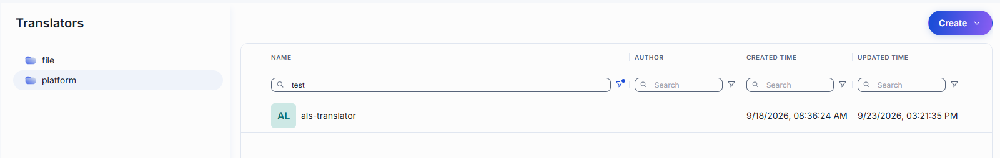
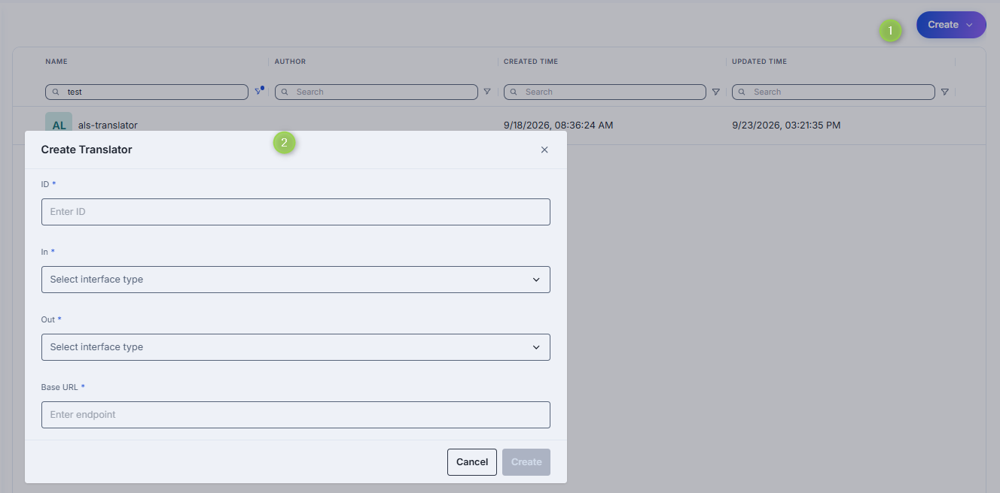
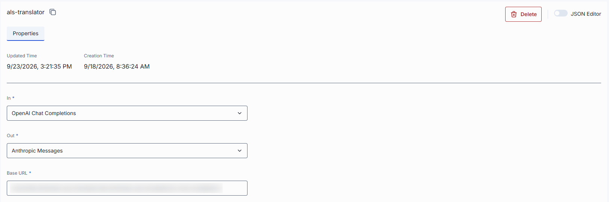

# Translators

A translator is a service that converts a request from one LLM API to another, so that a deployment can serve an API it does not speak itself. DIAL Core forwards the request to the translator; the translator converts it and calls DIAL Core back on an API the deployment does serve, then converts the answer back on the way out. For example, making
an Anthropic Messages model available through the OpenAI Chat Completions interface.

## How to use translators

Translators are configured through the Interfaces section for models and applications, where
each interface can operate in Proxy or Translator mode.

## Main screen

Navigate to **Translators** to see all platform translator definitions.

### Folders

The left panel shows where each translator definition is stored. It has two root folders:

- **file**: translator defined in the DIAL Core configuration file. This folder is read-only; it lists only the
  translator names. To change these translators, edit the DIAL Core config file.
- **platform**: translators stored in DIAL Core platform blob storage. This is where you create, edit and delete translators in DIAL Admin.

### Grid columns

Columns differ by bucket. There is no ID column—the row identity is the **Name** cell. Every column (except in the file bucket) has an inline search/filter box.

**File bucket:** a single **Name** column (the config-entity name). No other columns, and no actions.

**Platform bucket**

| Column | Description |
|--------|-------------|
| **Name** | Name of the translator. Click to open. |
| **Author** | Who created or last updated the translator. |
| **Created time** | Creation timestamp. |
| **Updated time** | Timestamp of the last modification. |

### Row actions

Open a row's actions menu (**⋮**).

| Action | What it does |
|--------|--------------|
| **Open in a new tab** | Opens the translator's configuration screen in a new browser tab. |
| **Duplicate** | Copies the translator. |
| **Delete** | Permanently removes the translator. |

## Create 

1. Click **Create** to invoke the **Create Translator** form.
2. Fill in the required fields: ID, Incoming interface type, outgoing interface type and Base URL.
3. Click Create.

## Properties

Click any translator row to open its properties screen.

< Refer to [DIAL Core documentation](https://github.com/epam/ai-dial-core/blob/development/docs/dynamic-settings/translators.md) to learn more about Translators.

**Tip**
> Use the configuration toggle (top-right) to view the raw JSON configuration.

| Property | Description |
|--------|-------------|
| **In** | The interface type the translator accepts — the API a client calls DIAL Core on. It has to differ from out. |
| **Out** | The interface type it converts to. The deployment referencing the translator has to serve out itself, and serve it pass-through: that is the API the translator calls DIAL Core back on. |
| **Base URL** | The root URL of the translator service. Each request is forwarded to baseUrl + the exact ingress path it was received on, exactly as a deployment's own base URL is. A trailing slash is normalized. |

## Delete

You can permanently delete a translator by clicking Delete in the configuration screen of in the action on the main screen.

## Next steps

- [Platform Models](1.models.md) — configure translator mode on model interfaces
- [Catalog overview](0.index.md) — return to the Catalog index
