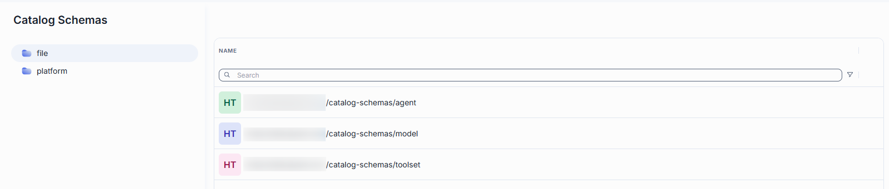
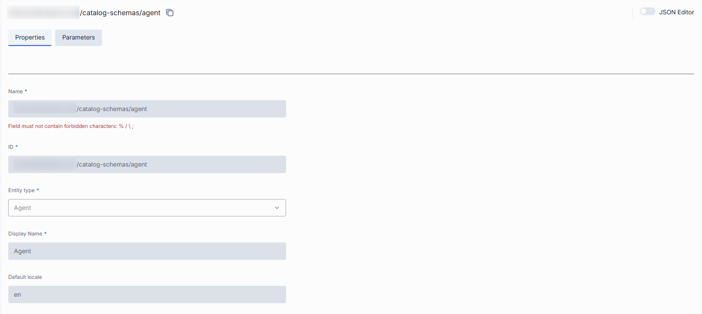
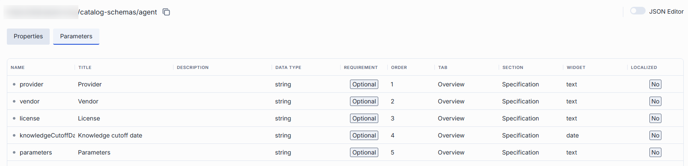

# Catalog Schemas

A catalog schema defines the metadata that a catalog entry of one entity type carries and how the DIAL Catalog shows it. It is a JSON Schema document: each property is a metadata field, such as a short summary, a license, a pricing table or an icon. Presentation hints on each field place it on a tab and a section of the entry's page and choose how it is rendered.

Administrators define a schema once. Authors then select it for a model, an application, a toolset or an interceptor and fill in its fields in the **Catalog metadata** section of that entity. DIAL Core validates the values against the schema, and the DIAL Catalog renders them without custom code.

## How to use Catalog Schemas

1. [Create a catalog schema](#create) for an entity type and define its [parameters](#parameters).
2. Open a model, an application, a toolset or an interceptor of that type, and select the schema in its **Catalog schema** property. The selector lists only the schemas created for the entity type.
3. Fill in the fields in the **Catalog metadata** section of the entity. The values are validated against the schema when you save.
4. The DIAL Catalog uses the schema to render the entity's catalog page.

Entity types are `model`, `agent`, `toolset` and `interceptor`. Applications use the `agent` type.

## Main screen

Navigate to **Catalog Schemas** to see all Catalog Schemas definitions.

### Folders

The left panel shows where each catalog schema definition is stored. It has two root folders:

- **file**: catalog schemas defined in the DIAL Core configuration file. This folder is read-only; it lists only the
  catalog schema names. To change these catalog schemas, edit the DIAL Core config file.
- **platform**: catalog schemas stored in DIAL Core platform blob storage. This is where you create, edit and delete catalog schemas in DIAL Admin.

The file folder has no **Create** button and no row actions. The columns differ by folder, as described below.

### Grid columns

Columns differ by bucket.

**File bucket:** a single **Name** column. No other columns, and no actions.

**Platform bucket**

| Column | Description |
|--------|-------------|
| **Name** | Name of the catalog schema. Click to open. |
| **Author** | Who created or last updated the catalog schema. |
| **Created time** | Creation timestamp. |
| **Updated time** | Timestamp of the last modification. |

### Row actions

Open a row's actions menu (**⋮**). 

| Action | What it does |
|--------|--------------|
| **Open in a new tab** | Opens the catalog schema's configuration screen in a new browser tab. |
| **Delete** | Permanently removes the catalog schema. |

## Create

Catalog schemas are created in the **platform** folder.

1. Select the **platform** folder and click **Create**.
2. Fill in the form:

   | Field | Required | Description |
   |-------|----------|-------------|
   | **Name** | Yes | Name of the schema. It cannot be changed after the schema is created. |
   | **ID** | Yes | Unique identifier of the schema. Entities refer to the schema by this ID. It cannot be changed after the schema is created. |
   | **Entity type** | Yes | The type of entity the schema describes: model, agent (for applications), toolset or interceptor. |
   | **Display Name** | Yes | Human-readable name of the entity type. |
   | **Default locale** | No | The fallback locale for localized fields. Defaults to `en`. |

3. Confirm. The new schema opens in its configuration screen, where you add its [parameters](#parameters).

## Configuration

Click any Catalog Schema row to open its detail view showing properties and
parameters.

**Tip**
> Use the configuration toggle (top-right) to view the raw JSON configuration.

### Properties

In this section, you can define basic properties of a schema.

**Tip**
> Name and ID are set when you create a schema in the platform folder and cannot be changed afterward.

| Property | Description |
|--------|-------------|
| **Name** | Name of the catalog schema in DIAL Admin and in platform storage. |
| **ID** | Unique identifier of the schema, a URI reference (the `$id` of the JSON Schema). Entities refer to the schema by this ID in their **Catalog schema** property. |
| **Entity type** | The type of entity the schema describes: model, agent (applications), toolset or interceptor. Only entities of this type can select the schema. |
| **Display Name** | Human-readable name of the catalog entity type, shown when you select a schema. |
| **Default locale** | BCP-47 locale (for example `en` or `de-DE`) used as the fallback for every localized field. Optional; defaults to `en` when omitted. |

### Parameters

In this section you define the metadata fields of the schema. Each field becomes an input in the **Catalog metadata** section of every entity that selects the schema, and the DIAL Catalog renders its value on the entity's page.

| Field | Description |
|--------|-------------|
| **Name** | Key of the field in the entity's catalog metadata. |
| **Title** | Label of the field shown to the author and in the DIAL Catalog. |
| **Description** | Help text that explains what to enter in the field. |
| **Data Type** | Type of the value: a JSON Schema type (string, number, integer, boolean, array or object). |
| **Requirement** | Whether the author must fill in the field. A required field must have a value for the metadata to be valid. |
| **Order** | Position of the field within its section. Fields with a lower number come first. |
| **Tab** | The tab of the catalog page where the field is shown, for example Summary, About, Overview, Pricing or API. |
| **Section** | The section within the tab that groups related fields, for example Capabilities or Specification. |
| **Widget** | How the generic catalog renderer displays the value: `text`, `richText` (formatted text), `badge`, `chips` (a list of short values), `url`, `boolean`, `image` or `date`. |
| **Localized** | Marks the value as a map from a BCP-47 locale to a text, so the field can be translated. The value must include the schema's **Default locale**. |

**Note**
> A field can also be marked as a DIAL file, for a value that is a reference to a file in DIAL storage (the type is a string with the `dial-file-encoded` format). Such files are copied when the entity is published or shared.

## Next steps

- [Models](./1.models.md) — select a catalog schema for a model and fill in its catalog metadata
- [Applications](./2.applications.md) — select a catalog schema for an application
- [Toolsets](3.toolsets.md) — select a catalog schema for a toolset and fill in its catalog metadata