# Test suites

A test suite bundles a target deployment, metrics, a linked [dataset](3.datasets.md), and a request
template into a single evaluation unit. Creating and configuring a test suite is the main setup step
before running an evaluation.

Test suites support deployments that use the **OpenAI Chat Completions**, **OpenAI Responses**, and
**Anthropic Messages** APIs, so evaluations can target the same interface used in production.

## Test suites grid

Open **Evaluation > Test Suites** to see all test suites. The grid is sorted by creation time, newest first.

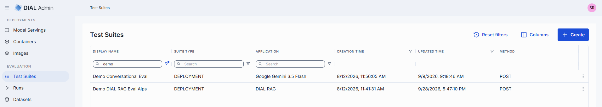

| Column | Description |
|--------|-------------|
| **Display Name** | Display name of the test suite. |
| **ID** | Test suite identifier. |
| **Suite Type** | Evaluation type of the test suite: DEPLOYMENT (for apps and models) or MCP_TOOL. |
| **Application** | The application, model or MCP toolset deployment associated with the test suite. |
| **Creation time** | Timestamp when the test suite was created. |
| **Updated time** | Timestamp of the last update. |
| **Created by** | Display name of the user who created the test suite. |
| **Method** | HTTP method of the request sent to the target. Hidden by default. |
| **URL** | Relative URL pattern of the request endpoint. Hidden by default. |
| **Actions** | Per-row actions: **Open in a new tab**, **Run**, **Duplicate** and **Delete**. |

## Create

To create a test suite, click **Create**. A multi-step wizard guides you through the following steps:

1. **Properties**: define the test suite name and description.
2. **Target**: select a target deployment among applications, models and MCP toolsets.
3. **Methods**: select a method supported by the selected deployment. For an MCP toolset, this step is called **Tool** and you select a tool of the toolset.

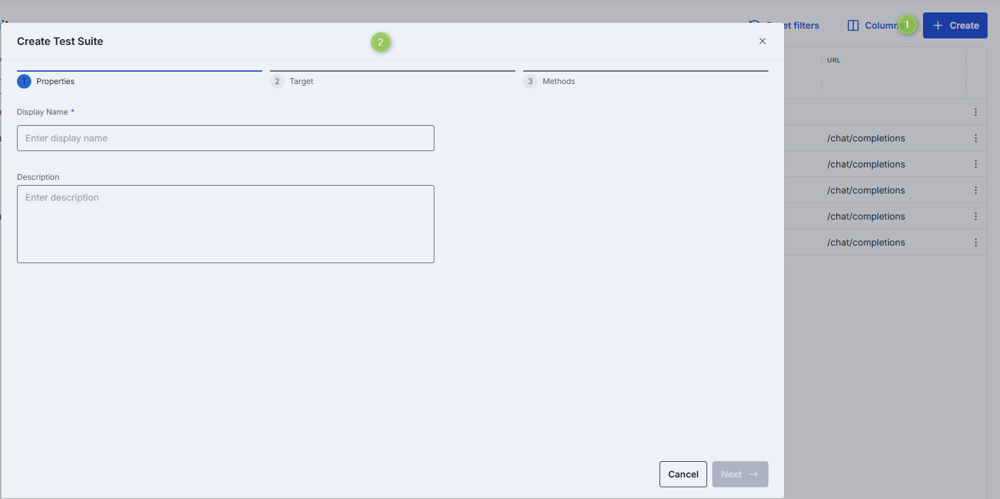

## Details

Click any test suite row to open its detail view. The detail view has six tabs.

### Properties

Basic information about the test suite. If the test suite has validation warnings, its status is shown next to the tab header and the warnings are listed in the status tooltip.

<!-- SCREENSHOT NEEDED: test suite properties tab -->
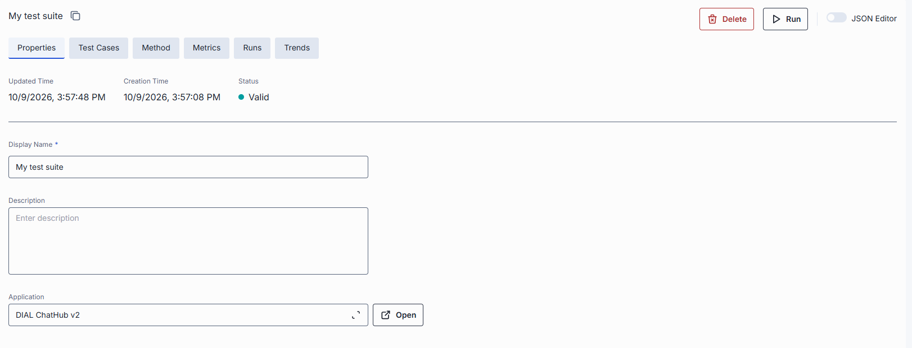

| Field | Required | Editable | Description |
|-------|----------|----------|-------------|
| **Display name** | Yes | Yes | Name of the test suite displayed on the UI. |
| **Description** | No | Yes | Free-text summary of the test suite's purpose. |
| **Application** | Yes | Yes | The model, MCP toolset or application deployment this suite evaluates, with its version if any. Click the field to change the target: the **Target** and **Methods** (or **Tool**) wizard steps open. Changing the method significantly affects the test suite, including configuration and results, so existing settings may be updated or reset. Click **Open** next to the field to open the deployment in a new tab. |

A test suite whose request template does not match the selected deployment is marked invalid. For
example, for the Anthropic Messages API, the `model` in the request body must be equal to the ID of the
selected deployment; otherwise the suite gets a `REQUEST_BODY_VALIDATION_ERROR` warning.

### Test cases

A test case is a single row of test data: the input for the target deployment and, optionally, the expected output. Test cases can carry custom schema fields (string, number, boolean, object, array, file) and can define multi-turn conversations for evaluating multi-step interactions.

Test cases can be added manually or by attaching an existing [dataset](3.datasets.md). Without a linked dataset, the tab shows "No dataset linked" and the suite can't be run.

The toolbar provides actions for working with test cases: **Add**, **Delete**, **Test case schema**, **Attach dataset**, **Publish to a new dataset**, **Import from PC** and **Export CSV**.

#### Add manually

To add test cases manually, click **Add** in the toolbar. A basic test case is added to the grid.

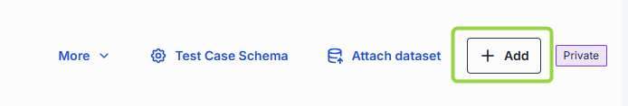

You can add additional fields to the test case by configuring the test case schema. Added fields are displayed in the main grid.

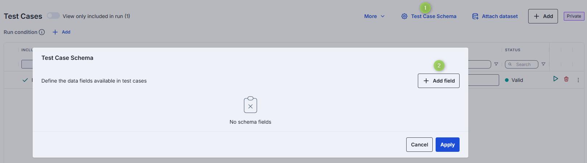

**Note**
> Test cases added manually are private to the test suite and the grid is marked as private. To share them with other test suites, [publish them to a new dataset](#publish-to-a-dataset) or attach an existing dataset.

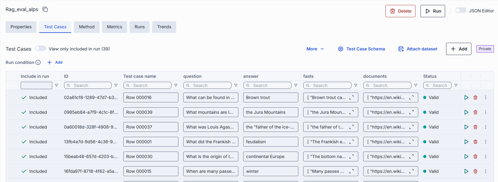

#### Attach dataset

The dataset provides the test case schema and data; the test suite consumes them as evaluation inputs.

1. Click **Attach dataset** in the toolbar. Complete the **Dynamic configuration** of the Method tab first: each field needs a constant value or a selected attribute.
2. Select a dataset among the available ones. Use **Preview test cases** to see its content.
3. Confirm.

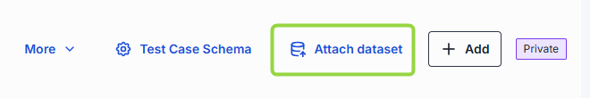

**Warning**
> Attaching a public dataset permanently removes all test cases that currently exist in the test suite.

When attached, the test cases grid is populated with test cases from the attached dataset and the test case schema is defined by the dataset. A banner above the grid lets you open the dataset (**Open dataset**), switch to another one (**Change dataset**), or detach it (**Detach from dataset**).

**Note**
> When a public dataset is attached, the test cases and their schema are read-only in the test suite view. To change them, open the dataset page (**Edit on Dataset page**) or detach the dataset. See [Datasets — Manage test cases](3.datasets.md#manage-test-cases) and [Datasets — Test case schema](3.datasets.md#schema).

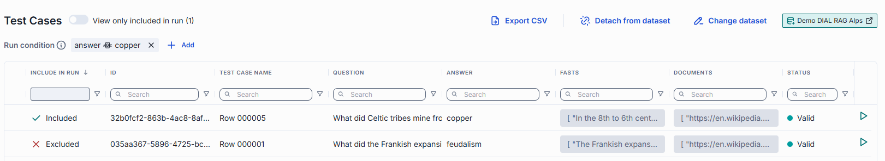

#### Detach dataset

When you click **Detach from dataset**, choose what happens to the test cases:

* **Keep current test cases**: switches the suite to manual mode and keeps the test cases. They become private to the test suite, so you can add, edit, or delete them without restrictions. The original dataset stays unchanged, so other suites using it aren't affected. The test case schema remains as defined by the previously attached dataset, but you can now edit it.
* **Start with empty table**: switches to manual mode and clears the test cases.

#### Publish to a dataset

To share private test cases, click **Publish to a new dataset** in the toolbar, enter the dataset details and click **Create**. The test cases are saved to a new dataset and the test suite is linked to it automatically.

#### Multi-turn test cases

Test cases can define a multi-step conversation instead of a single request/response pair. A
multi-turn test case carries ordered turns, where each turn contains a user message and optionally
an expected assistant response. When a multi-turn test suite runs, the framework sends each turn
in sequence, preserving conversation history between turns, and evaluates metrics per turn.

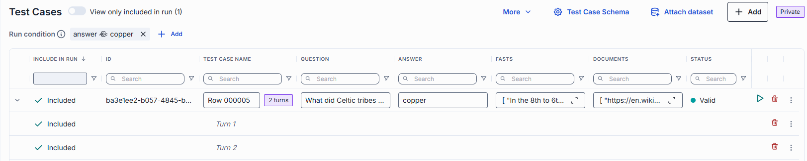

Multi-turn test cases are managed in the [dataset](3.datasets.md#schema): set the **Scope** of
a schema field to **Per turn** so that it has a value in each turn, and add, delete and reorder
the turns of a test case in the test cases grid. Multi-turn test cases can also be imported via CSV. The maximum number of turns per test case is configured on the
evaluation framework backend (`TEST_CASE_MULTI_TURN_MAX_TURNS`, default 30). Test cases exceeding
this limit are saved but marked invalid and excluded from runs.

#### Run conditions

You can define a run condition to select a subset of test cases for evaluation. When a condition is set, only matching test cases are included when the test suite runs. This is useful for running focused evaluations on specific categories or conditions within a large dataset.

The **Run condition** is shown above the test cases grid as filter chips. Click **Add** to define a filter on a test case field, click a chip to edit it, or remove it. The **Include in run** column shows whether each test case is **Included** or **Excluded**, and **View only included in run** limits the grid to the included ones.

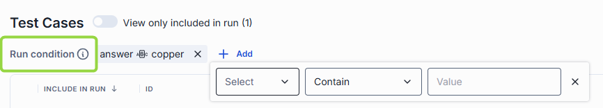

#### Try out a test case

You can run a selected test case against the target deployment without starting a full run.

1. Click **Run** in the test case row.
2. In the Try out side panel click **Send request**.

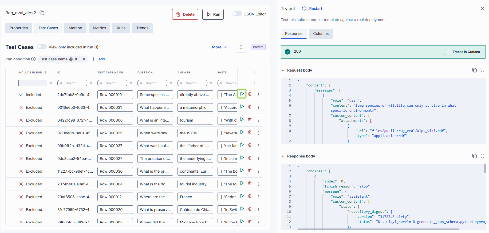

### Method

The Method tab configures how requests are sent to the target deployment. It includes the request
template with variable expression references that map test-case fields into the prompt.

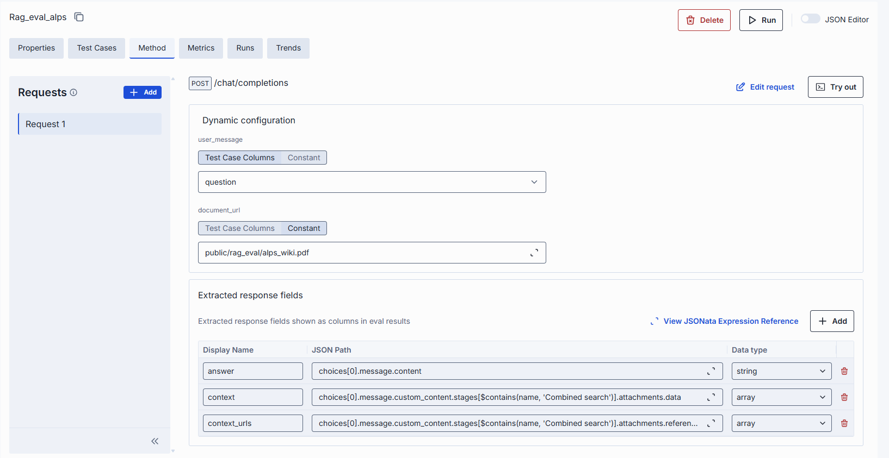

#### Multi-request test suites

A test suite can chain several requests per test case: the suite's own request followed by up to ten
additional requests, executed strictly in order. Each request step can reference the results of
previous steps. This is useful for evaluating workflows that require sequential actions — for
example, creating an item in one step and verifying it in the next.

Use the **Request chain** sidebar to **Add request**, rename or **Remove request**. Each request in
the chain appears as a separate tab in the Method configuration. Multi-request templates use JSONata
expressions to reference outputs from prior steps. Response column names must be unique across all
requests of the chain (up to 50 response columns in total).

Multi-request chains are not supported for MCP tool suites.

#### Try Out

The **Try Out** panel lets you execute the request template against a single test case without
starting a full run. For multi-turn test suites, Try Out sends each conversation turn in sequence
and displays the response per turn. For multi-request test suites, it shows extracted values for
each step in the chain.

### Metrics

The Metrics tab lists the metrics attached to the test suite. Each metric is a card with its name,
its description, **Edit** and **Delete** buttons, the metric **Condition** (**Always run** if none
is set), and the **Configuration** and **Inputs** bindings as `property:value` chips (`-` means the
binding has no value yet). Score settings are shown in a panel next to the list. Deleting a metric
asks for confirmation.

<!-- SCREENSHOT NEEDED: metrics tab -->
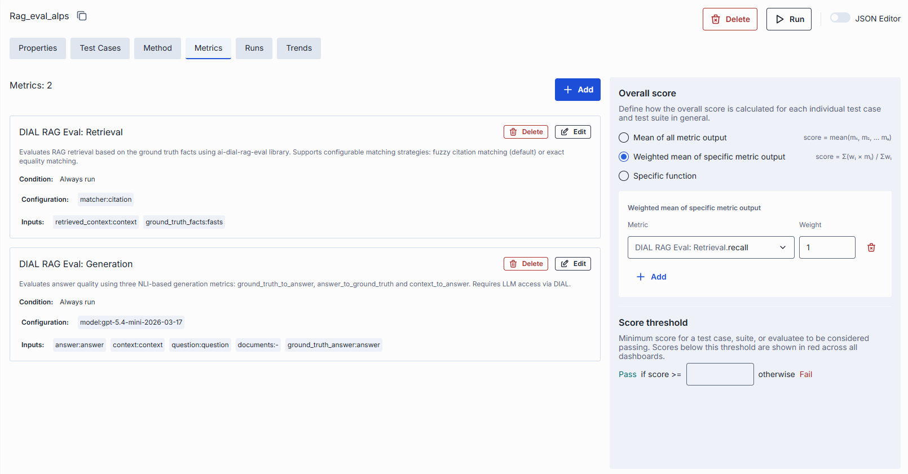

#### Add a metric

**Add** is disabled until a [dataset](3.datasets.md) is linked to the test suite, because input
bindings read the dataset's test case schema.

1. On the Metrics tab, click **Add**.
2. **Add metric** step: select a metric. The list shows the metric name, description and outputs; you can filter it and reorder its columns. 
3. **Configuration** step: set the name, optional condition, configuration and inputs.
4. Click **Finish**. In **Edit** mode only the **Configuration** step is shown, and the button is
   **Confirm**.

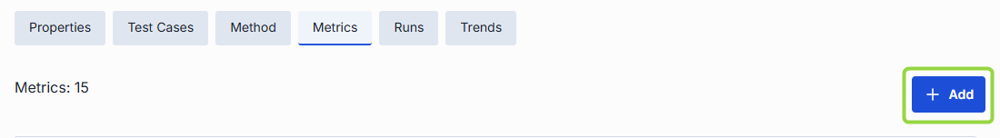

The **Configuration** step has these fields:

| Field | Required | Description |
|-------|----------|-------------|
| **Name** | Yes | Name of the metric in this test suite. Defaults to the metric's display name. Must not contain `::`. |
| **Condition** | No | JSONata expression evaluated per turn; the metric runs only when it is true. Leave blank to always run. Maximum 2000 characters. |
| **Configuration** | Depends on the metric | Metric parameters, for example the judge model. Prefilled with the metric's defaults. Values are constants. |
| **Inputs** | Depends on the metric | Data the metric evaluates. Each input is bound to a source (see below). |
| **Outputs** | — | Read-only list of the values the metric produces (name, type, description). |

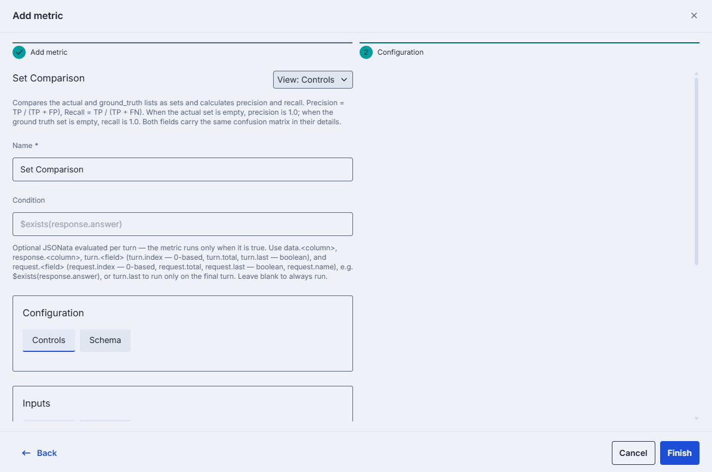

In **Condition**, reference values with `data.<column>`, `response.<column>`, `turn.<field>` and
`request.<field>`:

* `turn.index` (0-based), `turn.total`, `turn.last` (boolean).
* `request.index` (0-based), `request.total`, `request.last` (boolean), `request.name`.

For example, `$exists(response.answer)` runs the metric only when the `answer` response column is
present, and `turn.last` runs it only on the final turn of a multi-turn test case. System
functions such as `name()` are not supported yet and are rejected.

**Configuration** and **Inputs** each have a **Controls** tab and a **Schema** tab. **Schema**
shows the metric's JSON schema and can be opened fullscreen. Use the **View** switch to edit the
whole configuration as **Controls** or as **JSON** (name, condition, and both binding lists).

**Finish** is enabled when the name is valid, the condition is valid, and every required
parameter and input has a value. In **JSON** view, the binding check is skipped.

#### Input sources

Each input is bound to one source, selected with the tabs under the input name. Changing the
source clears the previous value.

| Source | Description |
|--------|-------------|
| **Test cases** | A field from the linked dataset's test case schema (for example, `expected_output`). |
| **Response column** | A response column extracted from the target's response, defined in the [Method](#method) tab. For multi-request suites, columns of all requests in the chain are available. |
| **Constant** | A fixed value. The control matches the input type: dropdown (enum), text, number (with min and max), switch, list, or a map of keys to lists. |

#### Available metrics

The metrics come from the evaluation metrics service, so the list in the **Add metric** step is
the list your installation provides. The service ships with the following metrics.

Metrics marked **LLM** use a language model deployed in DIAL as a judge. Their **Configuration** has
a **model** parameter: you choose among the models the metrics service is configured with, and a default
model is preselected. Rule-based metrics need no model.

| Metric | What it measures | Judge |
|--------|------------------|-------|
| **DeepEval: Answer Relevancy** | How relevant the answer is to the input. | LLM |
| **DeepEval: Faithfulness** | Whether the answer is factually supported by the retrieved context. Options: truth extraction limit, penalize ambiguous claims. | LLM |
| **DeepEval: Contextual Precision** | Whether relevant retrieved context items are ranked higher than irrelevant ones. | LLM |
| **DeepEval: Contextual Recall** | How well the retrieved context covers the expected output. | LLM |
| **DeepEval: Contextual Relevancy** | How relevant the retrieved context is to the input overall. | LLM |
| **DeepEval: G-Eval** | Any custom criteria. Give a natural-language criteria description or explicit evaluation steps, the fields it refers to, and optionally a rubric of score bands. | LLM |
| **Ragas: Answer Relevancy** | How well the response addresses the question, without checking factual accuracy. Also needs an embeddings model. | LLM |
| **Ragas: Faithfulness** | Whether all claims of the response are supported by the retrieved contexts. | LLM |
| **Ragas: Context Precision** | Whether relevant retrieved chunks are ranked at the top. | LLM |
| **Ragas: Context Recall** | How many of the relevant pieces of information were retrieved. | LLM |
| **Ragas: Noise Sensitivity** | How often the system gives incorrect answers when it uses retrieved documents (relevant or irrelevant, set by the mode). **Lower is better.** | LLM |
| **Ragas: Tool Call Accuracy** | How accurately an agent's tool calls match the reference tool calls: the order (optional strict order) and the arguments. | Rule-based |
| **Ragas: Tool Call F1** | Precision, recall and F1 between the agent's tool calls and the reference tool calls; the order is ignored. | Rule-based |
| **DIAL RAG Eval: Retrieval** | Retrieval quality against ground truth facts: recall, precision, F1 and MRR. The matcher is fuzzy citation matching (default) or exact equality. | Rule-based |
| **DIAL RAG Eval: Generation** | Answer quality with three natural-language-inference scores: ground truth to answer, answer to ground truth, and context to answer. | LLM |
| **DIAL RAG Eval: NLI** | The proportion of statements in a hypothesis that are entailed by a premise. | LLM |
| **DIAL RAG Eval: Full Evaluation** | The retrieval and generation scores of the two metrics above in one metric. | LLM |
| **Exact Match** | Whether the actual value exactly equals the expected one. | Rule-based |
| **Regex Match** | Whether the actual value matches a regular expression. | Rule-based |
| **DeepDiff** | Whether strings, numbers, lists or nested objects are equal: 1.0 when equal, 0.0 otherwise, with mismatch details. Options: ignore list order, numeric precision and tolerance. | Rule-based |
| **Set Comparison** | Precision and recall of an actual list against an expected list, compared as sets. | Rule-based |
| **Multiple Sets Comparison** | Per-key set comparison of two objects of lists: macro-averaged precision and recall, and a relaxed `precision_soft`. | Rule-based |

The RAG metrics (retrieval, faithfulness, context) take the retrieved context as an input. To evaluate
an application, bind that input to a [response column](#input-sources) that extracts the context from the
application's response.

#### Score settings

Score settings define how metric results are combined into a run score.

* **Overall score**: how a single score is computed from the metrics.
  * **Mean of all metric output**: `score = mean(m₁, m₂, … mₙ)`.
  * **Weighted mean of specific metric output**: `score = Σ(wᵢ × mᵢ) / Σwᵢ`. Add one row per
    metric output and set its **Weight**. At least one row is required, each weight must be
    greater than 0, and the same metric output can't be added twice. Rows are removed
    automatically when you delete their metric.
* **Score threshold**: a value from 0 to 1 (step 0.01). A score greater than or equal to the
  threshold is **Pass**, otherwise **Fail**. Scores below the threshold are shown in red on
  dashboards.

### Runs

The Runs tab lists all runs that have been executed for this test suite. Click a row to open the run in a new tab. Run statuses update automatically while the tab is open. Use **Columns** to show or hide columns.

| Column | Description |
|--------|-------------|
| **Status** | Execution status: Pending, Running, Completed, Failed, Cancelling or Cancelled. |
| **Test suite run name** | Run name, with the run ID below it. |
| **Runs** | Number of runs per test case configured when the run was started. |
| **Test cases** | Number of test cases in the run. |
| **Metrics** | Metrics used in the run. |
| **Start Date** | Timestamp when the run began. |
| **End Date** | Timestamp when the run finished. |
| **Duration** | Run duration. |
| **Cost** | Run cost. |
| **Overall score** | Overall score of the run, computed as configured in [Score settings](#score-settings). |
| **Target** | Evaluated deployment. Hidden by default. |
| **Actions** | Per-row actions: **Open in a new tab**, **Export** and **Compare** (completed runs only), **Cancel** and **Delete**. |

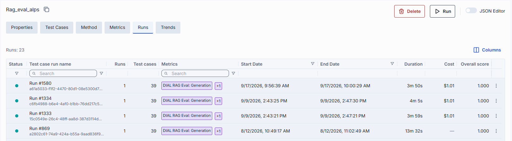

#### Start run

To start a new run, click the **Run** button in the test suite header. The **Run Evaluation** modal
shows how many test cases will be evaluated (**Selected test cases**, for example `8 of 10` when a
[run condition](#run-conditions) or invalid test cases exclude some) and lets you set the **Number of runs** per
test case (default 1). When test cases are run more than once, some evaluation results may be
unavailable or displayed differently. **Run** is disabled when no test case is selected.

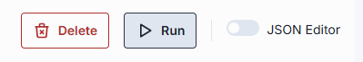

### Trends

The Trends tab visualizes how results change across runs of the test suite. It shows:

* Key figures: **Avg Test Suite Run Time**, **Score Range** (with the latest score) and
  **Runs Passed Threshold**, the share of runs that meet the [score threshold](#score-settings).
* **Overall score trend** across runs.
* **Metric Trends**: score trends per metric.
* **Test Case Stability**: how consistently each test case passes across runs.

Until the first run completes, the tab shows "No runs yet" with a **Run** button. With a single
run, a trend can't be displayed.

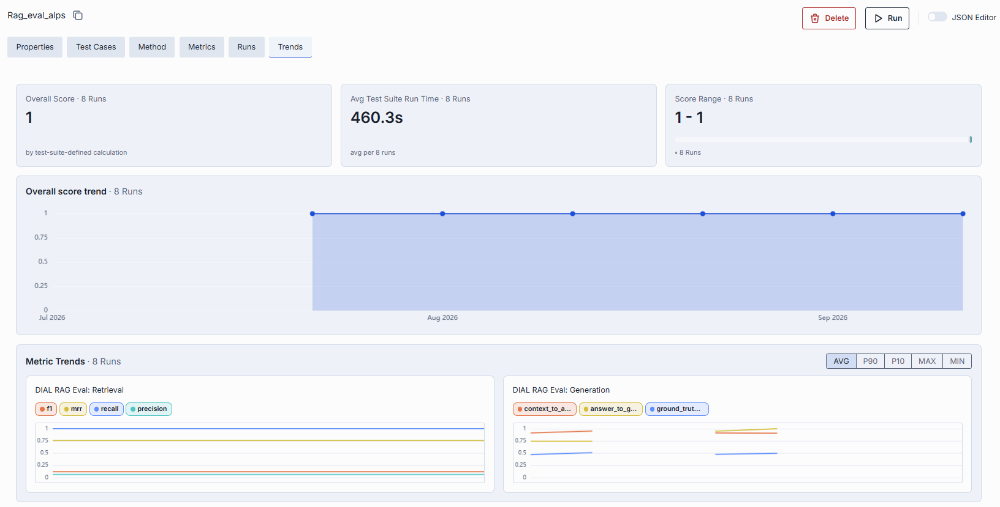

## Delete

Select **Delete** in the **Actions** column of a test suite row. A confirmation dialog appears.
Deleting a test suite also deletes its runs. A public dataset linked to the test suite is not deleted.
Test cases that are private to the test suite are deleted with it.
