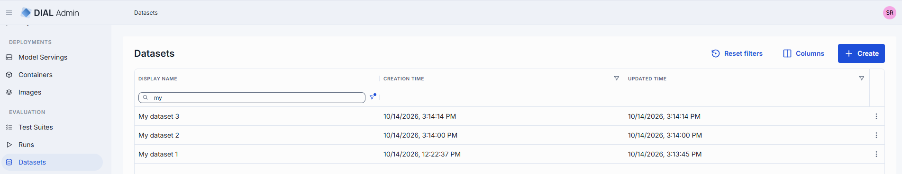
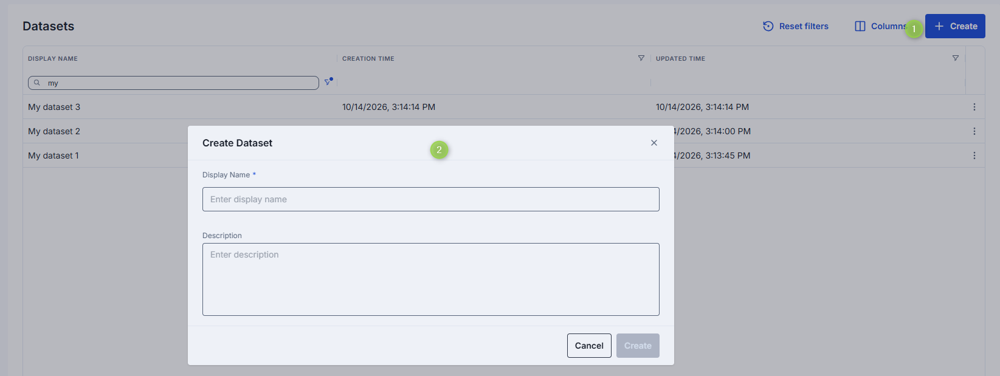
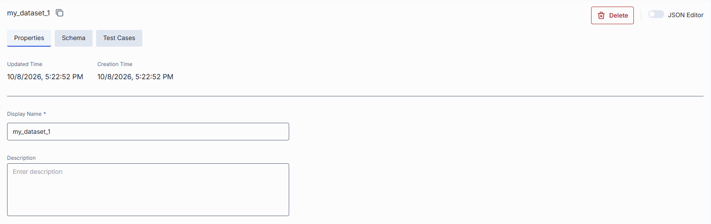
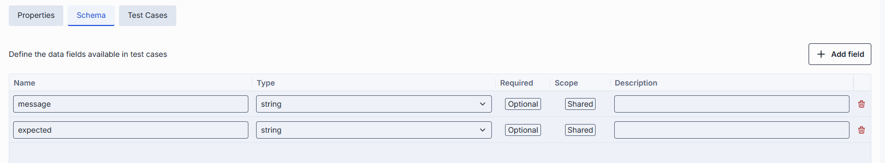
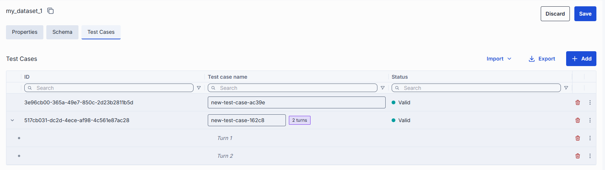

# Datasets

A dataset is a reusable collection of test cases with a defined schema. The dataset owns the schema
and the test case data; a [test suite](1.test-suites.md) only consumes them as evaluation inputs.
This decoupling lets you maintain test data separately from evaluation logic, reuse the same dataset
across different test suites, and update test cases without modifying the test suites that reference
them.

## How datasets are used

1. [Create a dataset](#create) and define its [schema](#schema): the fields each test case has, for
   example `question` and `expected_answer`.
2. Add [test cases](#test-cases) manually or [import](#import) them from a file.
3. Click **Save**.
4. In a test suite, [attach the dataset](1.test-suites.md#attach-dataset). The test suite then
   uses the dataset's schema to bind test case fields to the request template and to metric inputs.

A test suite can run only when a dataset is attached.

## Datasets and private test cases

The datasets in the **Evaluation > Datasets** grid are public: any test suite can use them, and you
edit them on the Datasets page. In a test suite that uses a public dataset, its test cases and schema
are read-only.

Test cases that you add manually in a test suite, without a dataset, are **private** to that test
suite. They don't appear on the Datasets page and other test suites can't use them. The Test cases tab
shows a **Private** label for them. To share them, [publish them to a new dataset](1.test-suites.md#publish-to-a-dataset);
the new dataset appears in the Datasets grid.

## Datasets grid

Open **Evaluation > Datasets** to see all public datasets.

| Column | Description |
|--------|-------------|
| **Display Name** | Display name of the dataset. |
| **Description** | Description of the dataset. |
| **Creation time** | Timestamp when the dataset was created. |
| **Updated time** | Timestamp of the last update. |
| **Actions** | Per-row actions: **Open in a new tab**, **Duplicate**, **Delete**. |

## Create

To create a dataset, click **Create**. A dialog prompts you to enter the dataset name and description.
The name is required and must be unique. A new dataset is public and has no schema or test cases yet.

## Details

Click any dataset row to open its detail view. The detail view has three tabs: **Properties**,
**Schema** and **Test cases**. Use the JSON toggle in the header to edit the dataset as JSON.

Changes on all tabs are saved together; see [Save changes](#save-changes).

### Properties

Basic information about the dataset, with the creation and update timestamps.

<!-- SCREENSHOT NEEDED: dataset properties -->

| Field | Required | Editable | Description |
|-------|----------|----------|-------------|
| **Display name** | Yes | Yes | Name of the dataset displayed on the UI. Must be unique across all datasets. |
| **Description** | No | Yes | Free-text summary of the dataset's purpose. |

### Schema

The **Schema** tab defines the data fields of the test cases. Every test case in the dataset has these
fields, and the test suites that use the dataset see them as the available input for the request template and
for metric bindings.

Each field has these properties:

| Property | Description |
|----------|-------------|
| **Name** | Field name. Must be unique within the schema. It cannot be changed after the field is created. |
| **Type** | String, Number, Integer, Boolean, Object, Array or File. A **File** field refers to a file stored with the dataset. |
| **Required** / **Optional** | A test case that misses a required field is invalid. |
| **Scope** | **Shared**: one value for the test case. **Per turn**: a separate value in each turn of a multi-turn test case. See [Multi-turn test cases](1.test-suites.md#multi-turn-test-cases). |
| **Description** | Free-text description of the field. |

| Action | Description |
|--------|-------------|
| **Add a field** | Specify a name, type, whether it is required, and a description. |
| **Edit a field** | Change its type, required flag, scope, or description. The name is read-only. |
| **Remove a field** | Delete a field from the schema. Its values are removed from the test cases. |

When you change the schema and save, the test cases are revalidated in the background. A notification
says "Test cases are being revalidated, please refresh shortly". Test cases that no longer match the
schema become invalid.

**Note**
> If a public dataset is attached to a test suite, you can't remove or rename its fields: the
> save is rejected with an error. Adding fields, and changing the type, requirement, scope or
> description of a field, is allowed. Test suites that use a changed field may become invalid and
> need to be updated.

### Test cases

The **Test cases** tab lists the test cases of the dataset. Each row is one test case. Columns are
defined by the dataset's schema.

<!-- SCREENSHOT NEEDED: dataset test cases -->

| Column | Description |
|--------|-------------|
| **Expander** | For a multi-turn test case, expands or collapses its turns. |
| **ID** | Test case identifier. |
| **Name** | Test case name. Used to match test cases on import and in run comparisons. |
| **Schema fields** | One column per field of the schema. Click a cell to edit it. |
| **Status** | Shows whether the test case is valid. For an invalid test case, point to the icon to see the error. Invalid test cases are excluded when a linked test suite runs. |

A test case can be invalid because it does not match the schema, for example when a required field is
empty, or because it has more turns than the allowed maximum (`TEST_CASE_MULTI_TURN_MAX_TURNS`,
configured on the evaluation framework backend, default 30).

Test cases are edited in the grid. New and changed test cases are not stored until you
[save the dataset](#save-changes). Which test cases take part in a run is controlled in the test suite with a
[run condition](1.test-suites.md#run-conditions).

#### Manage test cases

| Action | Description |
|--------|-------------|
| **Add** | Add a new test case row and fill in its fields. For a multi-turn test case, use the row actions to add, delete and reorder turns. |
| **Import** | Bulk-import test cases from a file. See [Import](#import). |
| **Export** | Download the test cases as a CSV file. The schema is not included. |
| **Delete** | Remove the selected test cases. A confirmation dialog appears before deletion. A new row that is not saved yet is removed immediately. |

#### Import

Click **Import > From PC** to import test cases from a CSV or ZIP file. The import wizard has two steps.

1. **File**: select the file. A preview of the test cases and a list of warnings are shown.
2. **Options**: choose how the data is applied.

| Option | Value | Description |
|--------|-------|-------------|
| **Import mode** | **Override** | Replaces all existing test cases. The schema is replaced with the columns of the file. |
| | **Append** | Adds the test cases to the existing ones. The current schema is kept; file columns that are not in the schema are discarded. |
| | **Merge** | Adds the test cases to the existing ones. The schema is expanded with the new columns of the file. |
| **On name collision** | **Fail** (default) | Rejects the whole import at the first test case whose name already exists. |
| | **Skip** | Skips test cases whose name already exists; the existing test case is kept. |
| | **Override** | Replaces the existing test case with the imported one. |

**Note**
> **Override** can remove fields from the schema. For a public dataset attached to a test suite, such an
> import is rejected, because fields of a dataset that test suites use can't be removed.

After the import, the test case list refreshes automatically.

### Save changes

The dataset header has **Save** and **Discard**, which become active when you change anything on any
tab. **Save** stores the properties, the schema and the test case changes in one operation. Before saving
a new name, the UI checks that the name is not already used. If the dataset was changed by someone else
in the meantime, the save fails and you need to reload it.

## Duplicate

You can duplicate an existing dataset to create a copy with the same schema, test cases and files.
The copy is a new public dataset that is not attached to any test suite.

1. Click the actions menu on any dataset row and select **Duplicate**.
2. Enter a new name and, optionally, a description for the duplicate.
3. Click **Duplicate**. The new dataset appears in the grid.

## Delete

Select **Delete** in the **Actions** column of a dataset row, or use **Delete** in the detail view. A
confirmation dialog shows the **Related Test Suites** that use this dataset.

**Warning**
> The dataset and all its test cases are permanently deleted. Test suites that use it are not deleted:
> they are unlinked from the dataset, have no test cases, and can't run until you attach another dataset.

## Next steps

- [Test suites](1.test-suites.md) — link a dataset to a test suite and configure evaluation bindings
- [Runs](2.runs.md) — review the results of test suite runs that use the dataset
