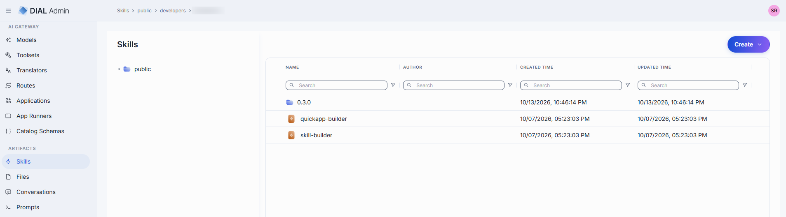
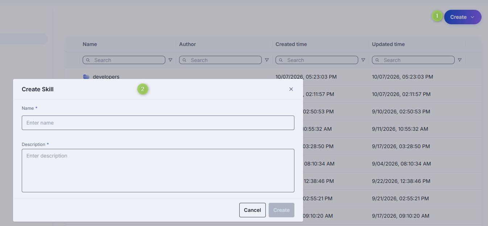
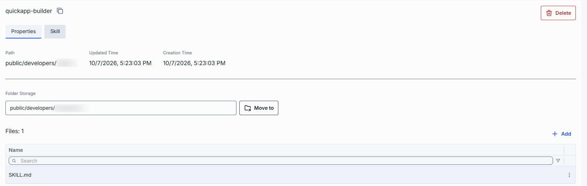
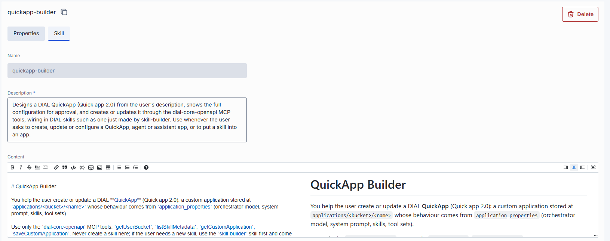

# Skills

Skills are reusable agent capabilities that applications can invoke at runtime. In DIAL Admin, the
Skills section under Assets lets administrators manage skills in the Public folder — creating,
editing, and organizing them alongside other asset types.

Skills can also arrive via user publication requests (see
[Publications and review](../6.governance/5.publications-and-review.md)). Published skills appear in the Assets
listing alongside administrator-created ones.

## Main screen

The main screen displays all skills located in the Public folder. The grid shows skill name, author, and creation and update timestamps. 

Context-menu actions include **Open in a new tab** and **Delete** actions.



## Create

1. Select the target folder, click **Create** in the toolbar, and select **Skill**. You can also select **Folder** to add a nested folder for a new skill.
2. Define skill parameters (Name and Description).
3. Click **Create**. The skill configuration screen opens.



## Configure

Click any skill to open its configuration screen.

### Properties

In properties, you can define the location of the skill in the public folder and attach skill files.

| Property | Description |
| --- | ---| 
|Path| A path to the skill in the public folder in the DIAL file system. |
|Updated Time| Timestamp of the last update. |
|Creation Time| Creation timestamp. |
|Folder Storage| A folder where the skill is located. |
|Files| Files attached to the skill. |



You can upload skill files — bring in files you already have. The primary file must be a SKILL.md with YAML frontmatter — name and description fields between --- fences — followed by the instructions in Markdown:

```yaml
---
name: email-composer
description: This skill triggers whenever you need to compose a business email.
---

Your instructions in Markdown…
```

### Skill

In the skill tab you can define the content of your skill: name, description and the actual instructions of the skill.



## Delete

You can delete a skill from the skills actions menu and by clicking Delete in skills properties. Delete action removes the skill from the public folder.

**Note**

> Be aware, that removing a skill may break any workflow that uses the deleted skill.

## Next steps

- [Conversations](./3.conversations.md) — review published conversations
- [Prompts](./4.prompts.md) — manage shared prompt templates
- [Files](./2.files.md) — manage shared files