# Application Runners

An Application Runner is an application factory that allows end users to create individual logical instances of applications, each with its own configuration. An Application Runner definition includes a JSON configuration schema that enforces the data structure persisted for each instance. The JSON schema of Application Runners conforms to the main [meta schema](https://github.com/epam/ai-dial-core/blob/development/config/src/main/resources/custom-application-schemas/schema.json).

Quick Apps, Code Apps, and Mind Maps are Application Runners available in DIAL out of the box. You can use DIAL SDK to create custom Application Runners.

For example, a custom RAG Application Runner may allow an end user to configure a personalized RAG agent by connecting it to chosen data sources—such as internal knowledge bases, document repositories, or external APIs—and then share it with other users and groups.

**Note**
> - You can also define routes for specific application deployments and Application Runners. Refer to [Applications](../2.entities/2.applications.md#app-routes) to learn how to do this.
> - Refer to [Schema-rich Applications](../../3.building-with-dial/1.apps/0.index.md#schema-based-apps) to learn more.

## Main screen

In **Builders → Application Runners**, you can add and manage all Application Runners registered in your DIAL instance.

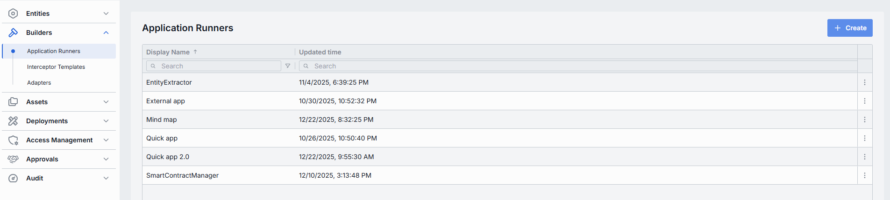

The grid lists every registered runner. Each column has an inline search box and a filter menu, and you can sort by clicking a column header.

| Column | Description |
|--------|-------------|
| **Display Name** | Name of the Application Runner rendered on the UI (e.g. "Python Lambda Runner", "NodeJS App Service"). |
| **ID** | Unique identifier of the Application Runner. Typically the base URL of the service (e.g. `https://my-runner.example.com`). DIAL Core uses this endpoint to POST orchestration payloads. |
| **Description** | Description of the Application Runner capabilities, cluster location, version, or SLA (e.g. "v2 on GKE, 2 vCPU, 8 GB RAM"). |
| **Topics** | Tags associated with the Application Runner for identification and filtering in DIAL Admin (e.g. "finance", "support"). |
| **Creation Time** | Timestamp of when the Application Runner was created. |
| **Updated Time** | Timestamp of the last update to this runner's configuration. |

The actions menu (**⋮**) at the end of each row lets you work with an individual runner.

## Create an Application Runner

1. Click **+ Create** to open the **Create Application Runner** modal.
2. Define key parameters for the new Application Runner:

   | Field | Required | Description |
   |-------|----------|-------------|
   | **ID** | Yes | Unique identifier. Typically the base URL of the service (e.g. `https://my-runner.example.com`). DIAL Core uses this endpoint to POST orchestration payloads. |
   | **Display Name** | Yes | Name rendered on the UI. |
   | **Description** | No | Description of capabilities, cluster location, version, or SLA. |
   | **Source type** | Yes | Where DIAL Core sends orchestration payloads for applications built on this runner. **Chat Endpoint** and **MCP Endpoint** are independent checkboxes—you can enable either or both, but at least one must stay enabled. **Chat Endpoint** is selected by default. See the sub-fields each one reveals below. |

   **Chat Endpoint** reveals:
   - **Completion endpoint** (required) — endpoint that processes chat completion requests (e.g. `https://my-runner.example.com/v1/execute`).
   - **Responses endpoint** — endpoint that processes OpenAI Responses API calls.

   **MCP Endpoint** reveals:
   - **Endpoint** (required) — the MCP endpoint of the Application Runner.
   - **Allowed tools** — restricts which tools of the MCP server applications may use. Click **+ Add tools** to add tool names; leave empty to allow all tools.
   - **Transport** — transport used by the MCP server. Fixed to **HTTP** (the only available option).
   - **Forward per request key** — toggle. When on, DIAL forwards a [per-request key](../../3.building-with-dial/7.working-with-dial-resources/5.per-request-keys.md) to the MCP server so it can access files in DIAL storage. Enabling **MCP Endpoint** turns this on automatically.
   - **Configuration delivery** — how application properties are sent to the MCP server: **Header** delivers them in an HTTP header; **Meta** includes them in the `_meta` field of the MCP message payload.

3. Click **Create**. The dialog closes and the new runner's [configuration screen](#configure-an-application-runner) opens. The new runner appears immediately in the listing, though changes may take some time to propagate to DIAL Core.

   <!-- SCREENSHOT OUTDATED: MCP Endpoint now reveals an "Allowed tools" (+ Add tools) field above Transport -->
   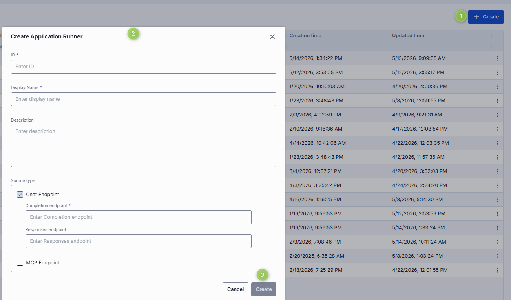

## Configure an Application Runner

Click any Application Runner on the main screen to open its configuration page. At the top, a status badge shows the synchronization state with DIAL Core and the runner's read-only ID (click the copy icon to copy it).

**Top bar controls**

| Control | Description |
|---------|-------------|
| **Create** | Create an application with the current runner. **Application**: creates a deployment in [Entities → Applications](../2.entities/2.applications.md). **Asset Application**: creates a public-folder application in [Assets → Applications](../4.assets/1.applications.md). |
| **Delete** | Permanently removes the selected runner. All applications still bound to it are deleted as well. A confirmation is required. |
| **JSON Editor** (toggle) | Switch between the form UI and the raw [JSON view](#json-editor-application-runners). A format selector (Admin / Core) appears next to it in JSON mode. |
| **Save** | Commits unsaved changes. Appears only when there are changes. Changes may take time to propagate to DIAL Core. |
| **Discard** | Reverts unsaved changes. Appears only when there are changes, and asks for confirmation before discarding. |

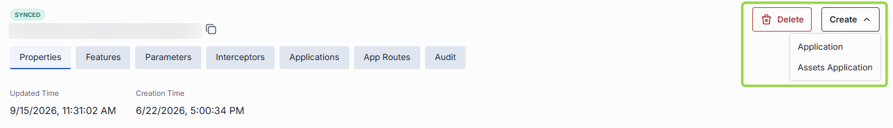

The configuration page is organized into sections: Properties, Features, Parameters, Interceptors, Applications, App Routes, and Audit.

### Properties

In **Properties**, configure the core identity, metadata, and integration endpoints for your Application Runner.

**Synchronization status badge.** A badge at the top of the page shows whether the runner's configuration is in sync with DIAL Core. Synchronization runs automatically every 2 minutes (configurable via `CONFIG_AUTO_RELOAD_SCHEDULE_DELAY_MILLISECONDS`). States:

- **Synced** — states are identical in Admin and Core for valid entities, or the entity is missing in Core for invalid entities.
- **Sync in progress** — sync conditions are not met and changes were applied within the last 2 minutes (configurable via `CONFIG_EXPORT_SYNC_DURATION_THRESHOLD_MS`).
- **Out of sync** — sync conditions are not met and changes were applied more than 2 minutes ago. An icon opens a diff view of the pending changes.
- **Sync unavailable** — the entity's state in Core cannot be determined, or sync state is not available for sensitive information (API keys, tokens, auth settings).

| Field | Required | Editable | Description |
|-------|----------|----------|-------------|
| **Updated Time** | — | No | Timestamp of the last configuration update. |
| **Creation Time** | — | No | Timestamp of when the configuration was created. |
| **Display Name** | Yes | Yes | Name displayed on the UI (e.g. "Python Lambda Runner" or "NodeJS Service Worker"). |
| **Description** | No | Yes | Description of the runner, including its environment (staging vs. prod), resource profile (2 vCPU, 8 GB RAM), or special instructions. |
| **Source type** | Yes | Yes | Where DIAL Core sends orchestration payloads for applications built on this runner. **Chat Endpoint** and **MCP Endpoint** are independent checkboxes; enable either or both (at least one is required). See [Source type fields](#source-type-fields). |
| **Viewer URL** | No | Yes | URL of an alternative end-user UI. If set, overrides the standard DIAL Chat UI for applications built on this runner. |
| **Editor URL** | No | Yes | URL of a UI screen for configuring application settings when creating or updating an application instance. |
| **Schema endpoint** | No | Yes | Endpoint that returns the JSON schema defining parameters of the application type. When set, the [Parameters](#parameters) section is populated from this endpoint and is read-only. |
| **Icon** | No | Yes | Icon representing the runner visually in the UI. Choose one with the icon picker. |
| **Topics** | No | Yes | Semantic tags for grouping and filtering. Select one or more from the list. |
| **Title** | No | Yes | Title of the Application Runner. |
| **Bucket copy** | No | Yes | Dropdown (**Enabled** / **Disabled**, default **Disabled**). Determines whether files stored in the application's file storage bucket are copied when the application is copied, moved, or published. |

<!-- SCREENSHOT OUTDATED: field order is Display Name, Description, Source type, Viewer URL, Editor URL, Schema endpoint, Icon, Topics, Title, Bucket copy; "Sync with core" is a header badge, not a field; Bucket copy is an Enabled/Disabled dropdown; MCP reveals an Allowed tools field -->
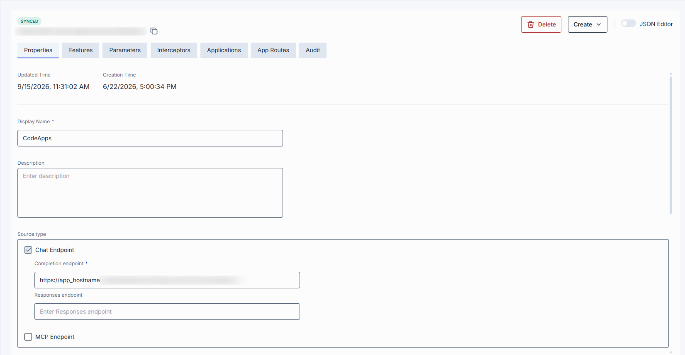

#### Source type fields {#source-type-fields}

**Chat Endpoint** reveals:

| Field | Required | Description |
|-------|----------|-------------|
| **Completion endpoint** | Yes | Processes chat completion requests. |
| **Responses endpoint** | No | Processes OpenAI Responses API calls. |

**MCP Endpoint** reveals:

| Field | Required | Description |
|-------|----------|-------------|
| **Endpoint** | Yes | The MCP endpoint of the Application Runner. |
| **Allowed tools** | No | Restricts which MCP tools applications may use. Click **+ Add tools** to add tool names; leave empty to allow all. |
| **Transport** | — | Transport used by the MCP server. Fixed to **HTTP** (the only available option). |
| **Forward per request key** | — | Toggle. When on, DIAL forwards a [per-request key](../../3.building-with-dial/7.working-with-dial-resources/5.per-request-keys.md) to the MCP server so it can access files in DIAL storage. Turned on automatically when MCP Endpoint is enabled. |
| **Configuration delivery** | No | How application properties are sent to the MCP server: **Header** (HTTP header) or **Meta** (the `_meta` field of the MCP message payload). |

### Features

In **Features**, define additional capabilities of applications created with this Application Runner. Features defined here are propagated to all applications created from this runner. Features left undefined at the runner level can be set per-application in [Entities → Applications](../2.entities/2.applications.md#features).

| Field | Control | Description |
|-------|---------|-------------|
| **Configuration endpoint** | Text | URL to fetch a JSON Schema describing the application's settings. DIAL Core exposes this as `GET v1/deployments/<deployment name>/configuration`. Clients must provide a JSON value matching this schema in `custom_fields.configuration` on chat completion requests. |
| **Rate endpoint** | Text | URL of a custom rate-estimation API to compute cost or quota usage (e.g. grouping by tenant, complex billing rules). |
| **Tokenize endpoint** | Text | URL of a custom tokenization service for precise, app-wide token counting (for mixed-model or multi-step prompts). |
| **Truncate prompt endpoint** | Text | URL of your own prompt-truncation API for advanced context-window management (e.g. dynamic summarization). |
| **Application properties header** | Toggle | When on, DIAL appends the app's configuration to chat completion request headers. |
| **Playback support** | Toggle | Enables [Playback](../../6.chat-user-guide/1.conversations.md), which lets users simulate a conversation without invoking model responses, for review and analysis. |
| **Assistant attachments in request** | Toggle | When on, DIAL Chat preserves `attachments` in `messages` from `role=assistant` in [chat completion requests](https://dialx.ai/dial_api#operation/sendChatCompletionRequest). Useful for apps that generate and consume attachments. |

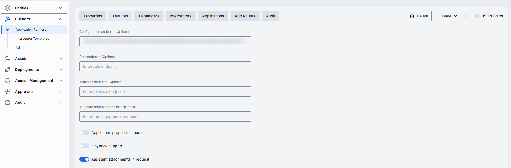

### Parameters

**Parameters** shows the JSON schema that defines the [parameters configured](../2.entities/2.applications.md#parameters) when creating an application instance based on this runner. Parameters are rendered as a nested, expandable grid—expand a row to see its child properties.

| Column | Description |
|--------|-------------|
| **Name** | The property key (the leaf name in the schema). Nested properties are shown as expandable rows. |
| **Title** | Human-readable title of the property. |
| **Description** | Description of the property's purpose. |
| **Data type** | The property type (e.g. `string`, `boolean`, `object`, `array:object`). |
| **Requirement** | Whether the property is **Required** or **Optional**. |
| **Order** | The display order of the property within its group. |
| **Property kind** | How the property is sourced (e.g. `server`). |

The schema is editable in the UI when defined inline (via `properties`, `required`, and `$defs`), and read-only when supplied by the **Schema endpoint** in [Properties](#properties). When no schema is defined, the section shows a "No configuration schema" message.

**Note**
> JSON schema of Application Runners conforms to the main [meta schema](https://github.com/epam/ai-dial-core/blob/development/config/src/main/resources/custom-application-schemas/schema.json). Refer to [Schema-rich Applications](../../3.building-with-dial/1.apps/0.index.md#schema-based-apps) to learn more.

<!-- SCREENSHOT OUTDATED: Parameters is a schema grid with columns Name, Title, Description, Data type, Requirement, Order, Property kind -->
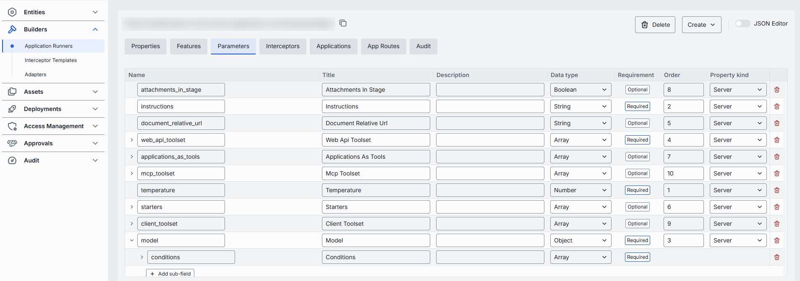

### Interceptors

In **Interceptors**, review and manage the [interceptors](https://github.com/epam/ai-dial-core/blob/development/docs/dynamic-settings/interceptors.md#application-type-interceptors) that process requests and responses for all applications built on this runner. The section is split into collapsible groups, each showing its count:

- **Global Interceptors** — read-only. Interceptors defined in [System Properties](../1.config-backup-and-global-settings.md#system-properties) that apply to all deployments in DIAL. You cannot add or remove them here.
- **Runner Interceptors** — read-only. Interceptors inherited from the source runner. This group appears only when the runner has a schema source to inherit from.
- **Local Interceptors** — editable. The runner's own interceptors. Use **+ Add** to attach them, drag rows to reorder, and remove them from the row actions menu. These appear as **runner interceptors** in the [configuration of each application](../2.entities/2.applications.md#interceptors) built on this runner.

Request interceptors run in the listed order; response interceptors run in reverse order.

<!-- SCREENSHOT OUTDATED: Interceptors now has three collapsible groups (Global / Runner / Local); grid columns are Display Name + Description -->
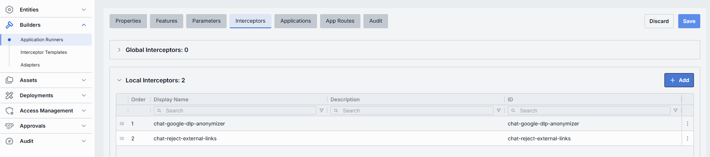

Each interceptor group's grid shows:

| Column | Description |
|--------|-------------|
| **Display Name** | The interceptor's display name from its definition. |
| **Description** | Free-text summary from the interceptor's definition. |

To add local interceptors:

1. Click **+ Add** in the **Local Interceptors** group.
2. In the **Add Interceptors** modal, select one or more interceptors from the list of [available interceptors](../2.entities/4.interceptors.md).
3. Click **Apply** to insert them into the group.

To remove a local interceptor, open the **⋮** actions menu in its row and choose **Remove**.

### Applications

**Applications** shows which DIAL applications are bound to this runner. Binding an application here tells DIAL Core to dispatch that app's orchestration payloads to the runner's endpoints. The header shows the count, and each column has inline search and filtering.

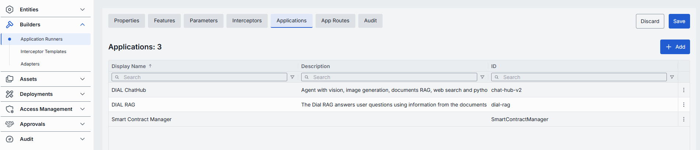

| Column | Description |
|--------|-------------|
| **Display Name** | Name displayed on the UI. The application's ID is shown as a subtitle beneath the name. |
| **Description** | Description of the application. |

To bind applications (defined in [Entities → Applications](../2.entities/2.applications.md)):

1. Click **+ Add** (top-right of the grid).
2. Select one or more applications in the modal.
3. Click **Apply**.

Each row's **⋮** actions menu offers **Open in a new tab** (opens the application's configuration) and **Remove** (unbinds it from this runner).

### App Routes

In **App Routes**, define and manage routes that DIAL Core uses when interacting with applications created from this runner. Applications created from this runner inherit these routes automatically—their [App Routes section](../2.entities/2.applications.md#app-routes) is pre-populated and read-only.

The left panel lists the runner's routes; select one to edit it, or click **+ Add** to create a new route. Each row's **⋮** menu lets you delete a route.

**Note**
> Refer to [DIAL Core documentation](https://github.com/epam/ai-dial-core/blob/development/docs/dynamic-settings/routes.md) to learn more about routes.

To create a route:

1. Click **+ Add** at the top of the App Routes panel.
2. Enter the route **Display Name** (alphanumeric characters and underscores only).
3. Click **Create**.

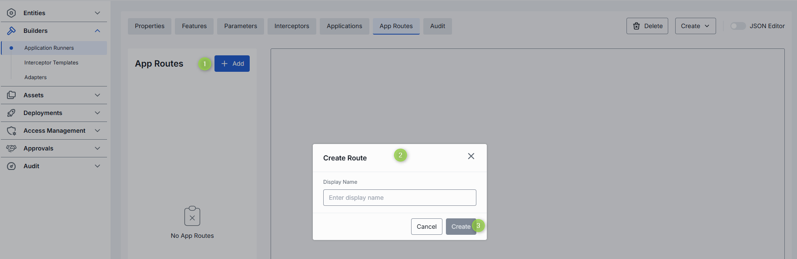

Each route is configured through three sections: Properties, Attachments, and Roles. Route configuration mirrors [Entities → Routes](../2.entities/5.routes.md).

**Properties**

Configure the route's identity and request-handling behavior.

| Field | Required | Description |
|-------|----------|-------------|
| **Display Name** | Yes | Name of the route (alphanumeric and underscores). |
| **Paths** | Yes | One or more URL path patterns the route matches. Click **+ Add paths** to add more. |
| **Rewrite path** | — | Toggle. When on, the path to the upstream server is replaced with the path of the original request. |
| **Methods** | Yes | HTTP methods the route accepts, chosen from a multi-select: `GET`, `POST`, `PUT`, `PATCH`, `DELETE`, `HEAD`. |
| **Output** | — | Choose **Upstreams** (proxy to backend servers) or **Response** (return a static response). |
| **Status**, **Body** | Yes (for Response) | HTTP status code and body returned when **Response** output is selected. |
| **Upstreams** | Yes (for Upstreams) | Backend servers that receive the routed request. |
| **Max retry attempts** | — | How many times DIAL retries another upstream when a request fails. Default 1. |
| **Permissions** | No | Resource permissions required to call the route: **Read**, **Write**. |
| **Order** | Yes | Route priority. A lower value is checked first. Default is the maximum value; use **Reset to default** to restore it. |

<!-- SCREENSHOT OUTDATED: Properties now includes Permissions (Read/Write) and Order (with Reset to default); Rewrite path is a toggle; Methods is a multi-select -->
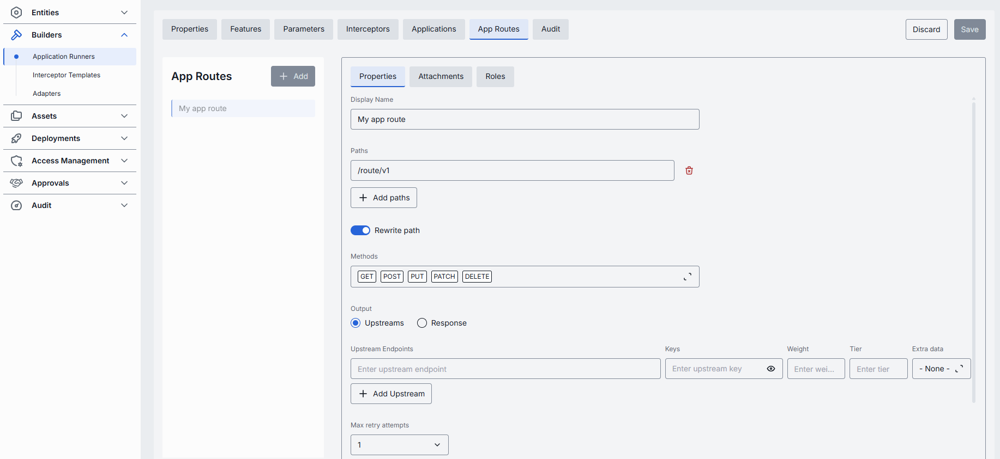

**Attachments**

Configure the JSON paths where DIAL finds attachments to auto-share, for both requests and responses.

| Field | Description |
|-------|-------------|
| **Request attachment paths** | JSON paths in the request body. Click **+ Add paths** to add more. |
| **Response attachment paths** | JSON paths in the response body. Click **+ Add paths** to add more. |

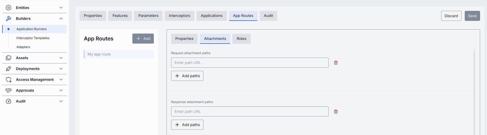

**Roles**

Control which roles can access this route.

- **Inherit Application Roles** — toggle. When on, the route uses the roles of the application built on this runner, and the roles grid is disabled.
- **Roles grid** — when inheritance is off, click **+ Add** to grant access to specific roles. The grid shows **Display Name** and **Description**; remove a role from its row actions menu.

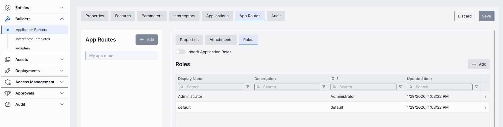

### Audit

**Audit** shows a detailed history of changes to this Application Runner and lets you revert any of them. It has a single **Activities** view. Use the **Time Period** dropdown to change the range and **Refresh** to reload.

| Column | Description |
|--------|-------------|
| **Activity type** | The kind of change recorded. |
| **Time** | When the activity occurred. |
| **Initiated** | Who initiated the change. |
| **Activity ID** | Unique identifier of the activity. |
| **Parent ID** | Identifier of the parent activity, when applicable. |

**Tip**
> This section mirrors the global [Audit → Activities](../8.audit/1.activity-and-rollback.md) view, scoped to the selected runner.

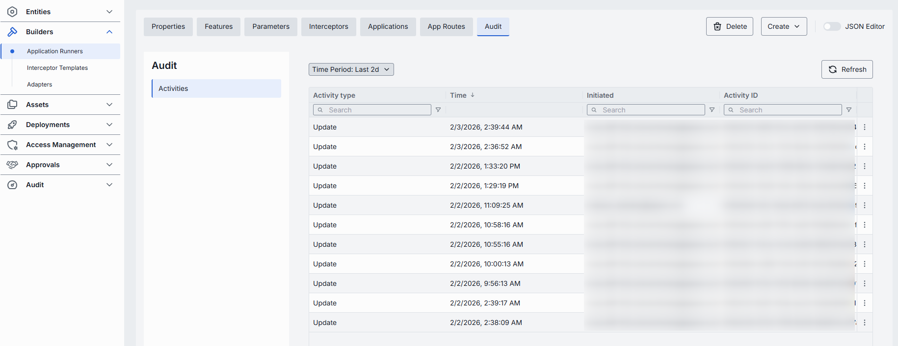

### JSON editor (Application Runners) {#json-editor-application-runners}

Advanced users can work with the raw JSON of the Application Runner configuration. JSON mode is useful for bulk updates, copying configuration between environments, or editing settings not exposed in the form UI.

**Tip**
> Switching modes is disabled when there are unsaved changes.

In JSON editor mode, use the format selector to switch between **Admin** format and **Core** format. These formats are for convenience only and do not change the configuration stored in DIAL Core. After saving, the status badge shows the synchronization state.

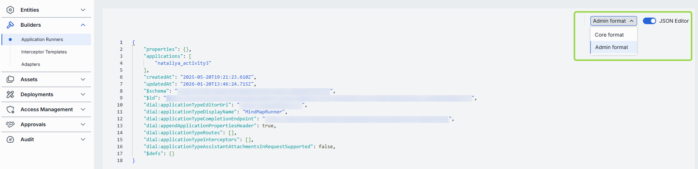

To use the JSON editor:

1. Navigate to **Builders → Application Runners** and select the runner you want to edit.
2. Click the **JSON Editor** toggle (top-right). The raw JSON is revealed.
3. Choose between Admin and Core format. **Note**: Core format does not show the configuration stored in DIAL Core—it shows the Admin configuration rendered in Core format.
4. Make your changes and click **Save**.
5. Monitor the status badge to confirm propagation.
