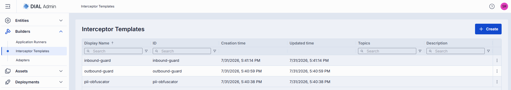
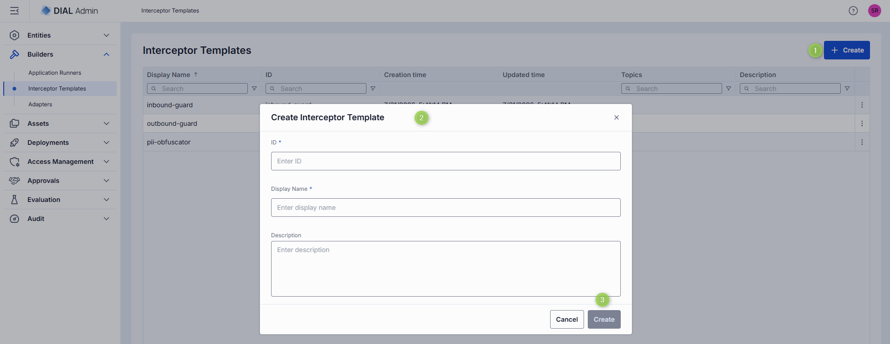
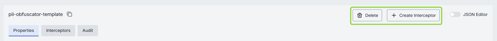
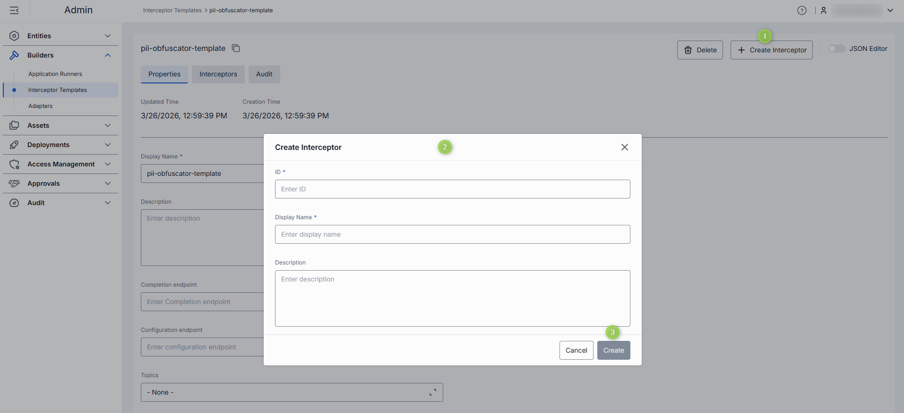
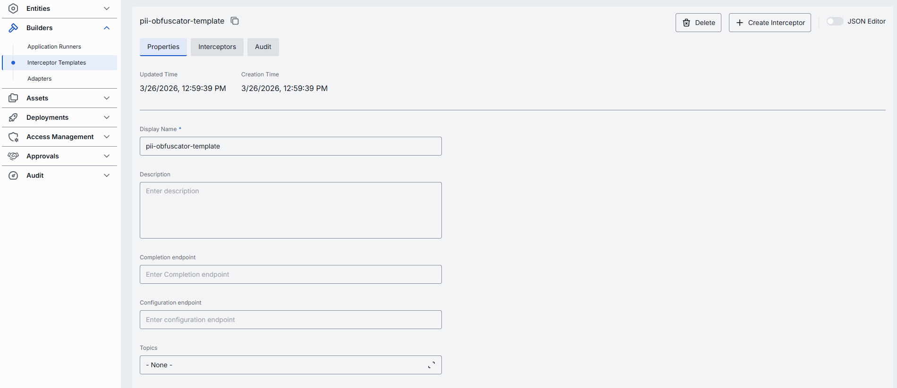
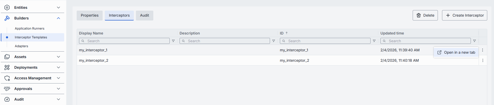
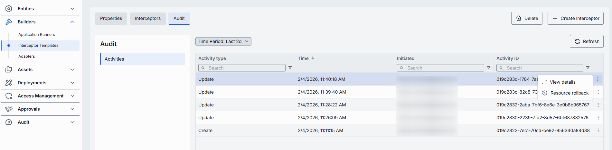

# Interceptor Templates

Interceptor templates are reusable blueprints that streamline the creation of interceptors in DIAL. They save time by eliminating repetitive configuration when setting up similar interceptors.

Once created, interceptor templates can be [selected as a source type](../2.entities/4.interceptors.md#create) when creating new interceptor entities.

**Note**
> To learn more about interceptors, refer to [Interceptors](../../3.building-with-dial/2.interceptors/0.index.md).

## Main screen

In **Builders → Interceptor Templates**, you can add and manage all Interceptor Templates in your DIAL instance.

Each column has an inline search box and a filter menu, and you can sort by clicking a column header.

| Column | Description |
|--------|-------------|
| **Display Name** | Name displayed on the UI (e.g. "PII Obfuscator", "Words Blacklist"). |
| **Description** | Description of the interceptor template. |
| **Topics** | Semantic tags for identification and filtering on the UI. |
| **Creation Time** | Creation timestamp. |
| **Updated Time** | Timestamp of the latest update. |

The actions menu (**⋮**) at the end of each row lets you:

- **Open in a new tab** — open the template's configuration in a new browser tab.
- **Duplicate** — create a copy of the template. In the **Duplicate Interceptor Template** dialog, provide a new **ID** and **Display Name** (the name defaults to `<name>_(copy)`), then click **Duplicate**.
- **Delete** — permanently remove the template.

## Create an interceptor template

1. Click **+ Create** to open the **Create Interceptor Template** modal.
2. Define key parameters:

   | Field | Required | Description |
   |-------|----------|-------------|
   | **ID** | Yes | Unique identifier. |
   | **Display Name** | Yes | Name displayed on the UI. |
   | **Description** | No | Description of the interceptor template. |

3. Click **Create**. The dialog closes and the new template's [configuration screen](#configure-an-interceptor-template) opens. The new template appears immediately in the listing, though changes may take some time to propagate to DIAL Core.

   

## Configure an interceptor template

Click any interceptor template on the main screen to open its configuration page. The header shows the template's read-only ID (click the copy icon to copy it).

**Top bar controls**

| Control | Description |
|---------|-------------|
| **+ Create Interceptor** | Creates an interceptor entity from this template. Created interceptors appear in [Entities → Interceptors](../2.entities/4.interceptors.md). See [Create interceptor from template](#create-interceptor-from-template). |
| **Delete** | Permanently removes the template. All related interceptors still bound to it are deleted as well. A confirmation is required. |
| **JSON Editor** (toggle) | Switch between the form UI and the raw [JSON view](#json-editor-interceptor-templates). |
| **Save** | Saves changes to the template. Appears only when there are unsaved changes. |
| **Discard** | Reverts unsaved changes. Appears only when there are unsaved changes. |

<!-- SCREENSHOT OUTDATED: top bar now includes a JSON Editor toggle (Delete, + Create Interceptor, JSON Editor) -->

The configuration page is organized into three sections: Properties, Interceptors, and Audit.

### Create interceptor from template {#create-interceptor-from-template}

On the configuration screen, click **+ Create Interceptor** to create a new [interceptor entity](../2.entities/4.interceptors.md) based on this template.

1. Click **+ Create Interceptor** and fill in the pop-up form: **ID** (required), **Display Name** (required), and **Description**.
2. Click **Create**. The configuration of the new interceptor entity opens. Its **Interceptor Template** source is pre-populated with this template, so you don't need to choose a source.

### Properties

In **Properties**, preview and modify the identity, metadata, and endpoints of the interceptor template.

| Field | Required | Editable | Description |
|-------|----------|----------|-------------|
| **ID** | — | No | Unique ID of the template, shown in the header (copyable). Cannot be changed after creation. |
| **Updated Time** | — | No | Timestamp of the last update, for change tracking and audit. |
| **Creation Time** | — | No | Creation timestamp. |
| **Display Name** | Yes | Yes | Name displayed on the UI (e.g. "PII Obfuscator", "Words Blacklist"). |
| **Description** | No | Yes | Description of the template and how it can be used. |
| **Completion endpoint** | No | Yes | URL of the interceptor service. DIAL Core uses this to handle requests and responses for interceptors created from the template. |
| **Configuration endpoint** | No | Yes | URL that exposes the interceptor's configuration as a JSON schema. |
| **Topics** | No | Yes | Semantic tags associated with this template. Select one or more, or type to add a new tag. |

### Interceptors

A read-only grid showing all interceptor instances created from this template. Use it to assess the potential impact before editing or deleting the template. Each column has inline search and filtering, and the grid is sortable.

| Column | Description |
|--------|-------------|
| **Display Name** | Name of the interceptor instance. |
| **Description** | Description of the interceptor instance. |

To open an instance, use its **⋮** actions menu and choose **Open in a new tab** — this opens the interceptor's configuration in [Entities → Interceptors](../2.entities/4.interceptors.md#configuration). When the template has no interceptors, the grid shows "No Interceptors".

### Audit

View a detailed history of changes to this interceptor template and revert any of them. The section has a single **Activities** view. Use the **Time Period** dropdown to change the range and **Refresh** to reload.

| Column | Description |
|--------|-------------|
| **Activity type** | The kind of change recorded. |
| **Time** | When the activity occurred. |
| **Initiated** | Who initiated the change. |
| **Activity ID** | Unique identifier of the activity. |
| **Parent ID** | Identifier of the parent activity, when applicable. |

**Tip**
> This section mirrors the global [Audit → Activities](../8.audit/1.activity-and-rollback.md) view, scoped to the selected template.

### JSON editor (Interceptor Templates) {#json-editor-interceptor-templates}

Advanced users can work with the raw JSON of the interceptor template configuration. JSON mode is useful for bulk updates, copying configuration between environments, or inspecting settings not surfaced in the form UI.

**Tip**
> Switching modes is disabled when there are unsaved changes.

Click the **JSON Editor** toggle (top-right) to reveal the raw JSON (name, display name, description, completion endpoint, timestamps, and the list of bound interceptors). Make your changes and click **Save**.
