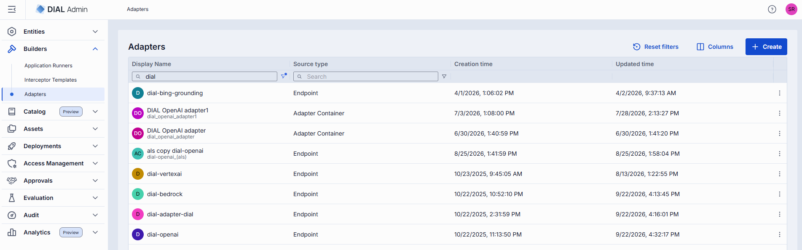
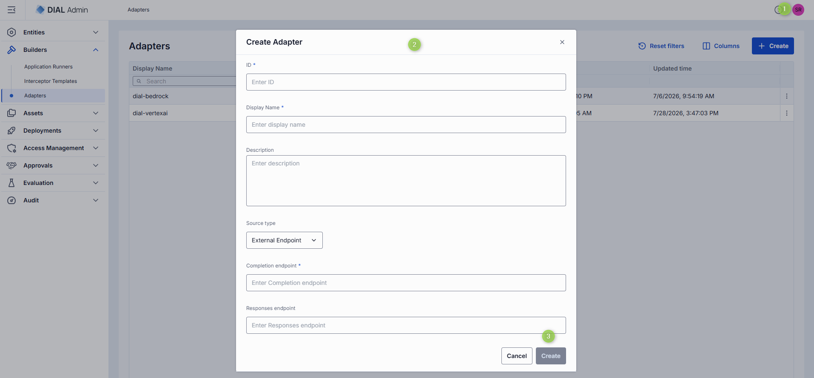
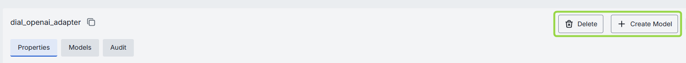
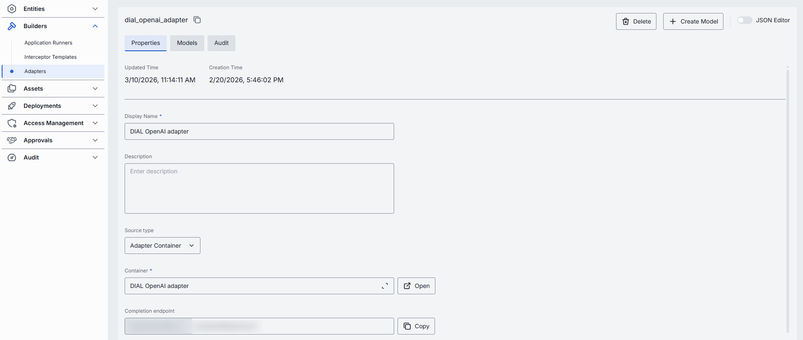
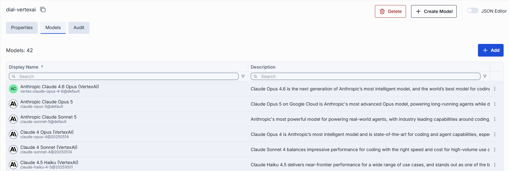
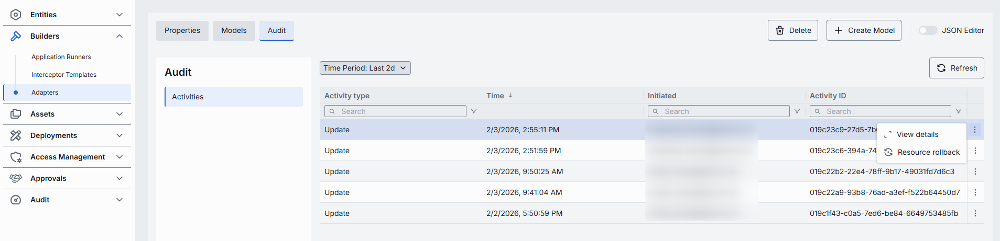

# Adapters

Model Adapters unify provider-specific model APIs with the Unified Protocol of DIAL Core. Each adapter consists of:

- **Coded implementation** that communicates with the AI model and implements the Unified Protocol.
- **Metadata object** managed in **Builders → Adapters**, which establishes the relationship to models.

DIAL includes adapters for [Azure OpenAI](https://github.com/epam/ai-dial-adapter-openai), [GCP Vertex AI](https://github.com/epam/ai-dial-adapter-vertexai/?tab=readme-ov-file#supported-models), and [AWS Bedrock](https://github.com/epam/ai-dial-adapter-bedrock) models. Compatibility with the Azure OpenAI API makes it straightforward to add new adapters for language models or develop them with [DIAL SDK](https://github.com/epam/ai-dial-sdk).

DIAL supports both [self-hosted](../5.deployments/2.container-management.md) adapters (deployed within the DIAL infrastructure, as **Adapter Container** sources) and external adapters (reachable at a URL, as **External Endpoint** sources).

## Main screen

In **Builders → Adapters**, you can add and manage all registered adapters in your DIAL instance.

Each column has an inline search box and a filter menu, and you can sort by clicking a column header. Use the **Columns** button (top-right) to show, hide, and reorder columns, or reset them to defaults.

| Column | Description |
|--------|-------------|
| **Display Name** | Name displayed on the UI. The adapter's ID is shown as a subtitle beneath the name. |
| **Description** | Brief description of the adapter (e.g. "Adapter for OpenAI models"). |
| **Topics** | Semantic tags associated with the adapter. |
| **Source type** | Type of the adapter source: **Endpoint** (external) or **Adapter Container** (self-hosted). |
| **Source** | URL for externally-deployed adapters, or the container for self-hosted adapters. |
| **Creation Time** | Creation timestamp. |
| **Updated Time** | Timestamp of the last update. |

The actions menu (**⋮**) at the end of each row lets you:

- **Open in a new tab** — open the adapter's configuration in a new browser tab.
- **Duplicate** — create a copy of the adapter. In the **Duplicate Adapter** dialog, provide a new **ID** and **Display Name**, then confirm.
- **Delete** — permanently remove the adapter.

## Create an adapter

1. Click **+ Create** to open the **Create Adapter** modal and define the adapter:

   | Field | Required | Description |
   |-------|----------|-------------|
   | **ID** | Yes | Unique identifier. |
   | **Display Name** | Yes | Unique name displayed on the UI. |
   | **Description** | No | Description of the adapter. |
   | **Source type** | Yes | **External Endpoint** for externally-deployed adapters; **Adapter Container** for self-hosted adapter images. Defaults to External Endpoint. (Adapter Container is available only when deployments are enabled.) |

   The remaining fields depend on the **Source type**:

   **External Endpoint**

   | Field | Required | Description |
   |-------|----------|-------------|
   | **Completion endpoint** | Yes | Endpoint that processes chat completion requests. Implements the Unified Protocol (format: `{ADAPTER_ORIGIN}/openai/deployments/`). |
   | **Responses endpoint** | No | Endpoint supporting the OpenAI Responses API. Currently only OpenAI adapters support this. When set, DIAL Core routes `POST /openai/v1/responses` requests here. Only basic Responses API behavior is supported—background requests, `previous_request_id`, conversations, prompts, and files are not supported. |

   **Adapter Container**

   | Field | Required | Description |
   |-------|----------|-------------|
   | **Container** | Yes | The running [adapter container](../5.deployments/2.container-management.md) to use as the source. Select it from the list. |
   | **Completion endpoint path** | Conditional | Path appended to the container's base URL for chat completion requests. |
   | **Responses endpoint path** | Conditional | Path appended to the container's base URL for the OpenAI Responses API. |

   For the Adapter Container source, the endpoint-path fields appear after you select a container, and at least one of them is required.

2. Click **Create**. The dialog closes and the new adapter's configuration screen opens. The new adapter appears immediately on the main screen.

   

## Configure an adapter

Click any adapter on the main screen to open its configuration page. The header shows the adapter's read-only ID (click the copy icon to copy it).

**Top bar controls**

| Control | Description |
|---------|-------------|
| **+ Create Model** | Create a model deployment that uses this adapter as its source. The new model's source is pre-wired to this adapter. Created models appear in [Entities → Models](../2.entities/1.models.md). |
| **Delete** | Remove the adapter and all models using it. After confirmation, the adapter and all related models are deleted. |
| **JSON Editor** (toggle) | Switch between the form UI and the raw [JSON view](#json-editor-adapters). |
| **Save** | Save and apply changes. Appears only when there are unsaved changes. |
| **Discard** | Discard unsaved changes. Appears only when there are unsaved changes, and asks for confirmation. You can also revert changes via the [Audit](#audit-adapters) section. |

The configuration page is organized into three sections: Properties, Models, and Audit.

### Properties

In **Properties**, view and define the identity, source, and metadata of the selected adapter.

| Field | Required | Editable | Description |
|-------|----------|----------|-------------|
| **ID** | — | No | Unique read-only identifier of the adapter, shown in the header (copyable). |
| **Updated Time** | — | No | Timestamp of the last configuration update. |
| **Creation Time** | — | No | Adapter creation timestamp. |
| **Display Name** | Yes | Yes | Unique name displayed on the UI. |
| **Description** | No | Yes | Brief description of the adapter. |
| **Source type** | Yes | Yes | **External Endpoint** for externally-deployed adapters; **Adapter Container** for self-hosted adapter images. The fields below depend on this choice. |
| **Topics** | No | Yes | Semantic tags. Select one or more, or type to add a new tag. |

If the selected **Adapter Container** is not running, a banner at the top of Properties warns you.

**External Endpoint source**

| Field | Required | Editable | Description |
|-------|----------|----------|-------------|
| **Completion endpoint** | Yes | Yes | Endpoint URL that processes chat completion requests. Implements the Unified Protocol (format: `{ADAPTER_ORIGIN}/openai/deployments/`). |
| **Responses endpoint** | No | Yes | Endpoint URL supporting the OpenAI Responses API (OpenAI adapters only). |

**Adapter Container source**

| Field | Required | Editable | Description |
|-------|----------|----------|-------------|
| **Container** | Yes | Yes | The running [adapter container](../5.deployments/2.container-management.md) backing this adapter. Click to pick from available containers; the **Open** button jumps to the selected container. |
| **Completion endpoint** | Yes | Yes | Chat completion endpoint. The base URL comes from the selected container; the path is editable. |
| **Responses endpoint** | No | Yes | OpenAI Responses API endpoint. The base URL comes from the container; the path is editable. |

### Models

**Models** shows the AI models exposed by the selected adapter. The header shows the count, each column has inline search and filtering, and the grid is sortable.

| Column | Description |
|--------|-------------|
| **Display Name** | Name of the model displayed on the UI. The model's ID is shown as a subtitle beneath the name. |
| **Description** | Description of the model. |

To add models processed by this adapter:

1. Click **+ Add**.
2. Select one or more available models in the modal. You can review all models in [Entities → Models](../2.entities/1.models.md). Use **+ Create Model** in the [top bar](#configure-an-adapter) to create a new model on the fly.
3. Click **Apply**.

Each row's **⋮** actions menu offers **Open in a new tab** (opens the model's configuration) and **Remove** (detaches the model from this adapter).

### Audit {#audit-adapters}

View a detailed history of changes to this adapter and revert any of them. The section has a single **Activities** view. Use the **Time Period** dropdown to change the range and **Refresh** to reload.

| Column | Description |
|--------|-------------|
| **Activity type** | The kind of change recorded. |
| **Time** | When the activity occurred. |
| **Initiated** | Who initiated the change. |
| **Activity ID** | Unique identifier of the activity. |
| **Parent ID** | Identifier of the parent activity, when applicable. |

**Tip**
> This section mirrors the global [Audit → Activities](../8.audit/1.activity-and-rollback.md) view, scoped to the selected adapter.

### JSON editor (Adapters) {#json-editor-adapters}

Advanced users can work with adapter properties in a JSON editor view mode. Useful for bulk updates, copying configuration between environments, or editing settings not exposed in the form UI.

**Tip**
> Switching modes is disabled when there are unsaved changes.

To use the JSON editor:

1. Navigate to **Builders → Adapters** and select the adapter you want to edit.
2. Click the **JSON Editor** toggle (top-right). The raw JSON is revealed (name, display name, base endpoint, description, timestamps, and the list of bound models).
3. Make your changes and click **Save**.
