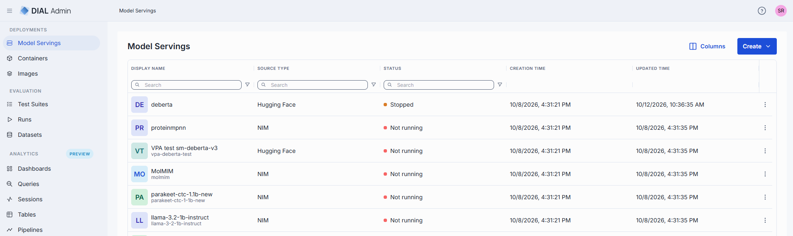
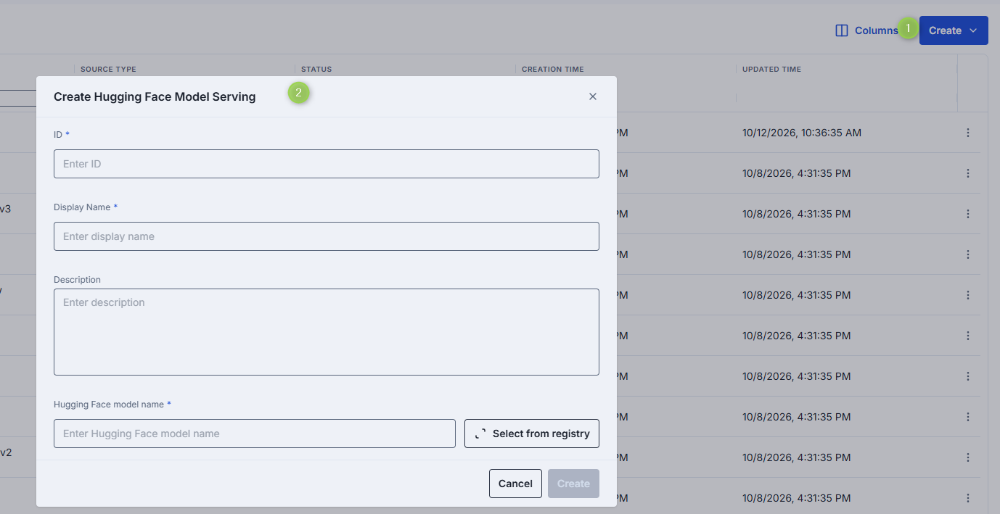
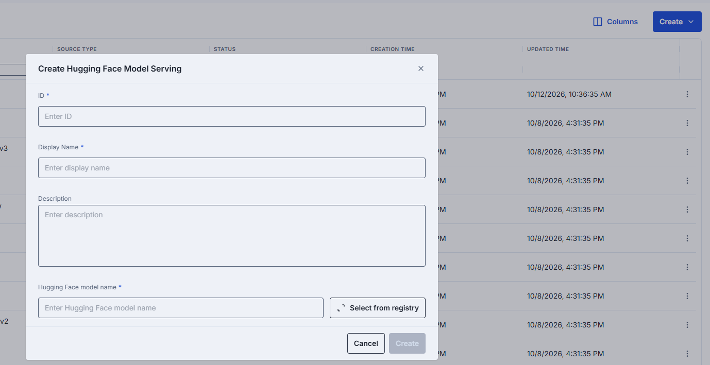
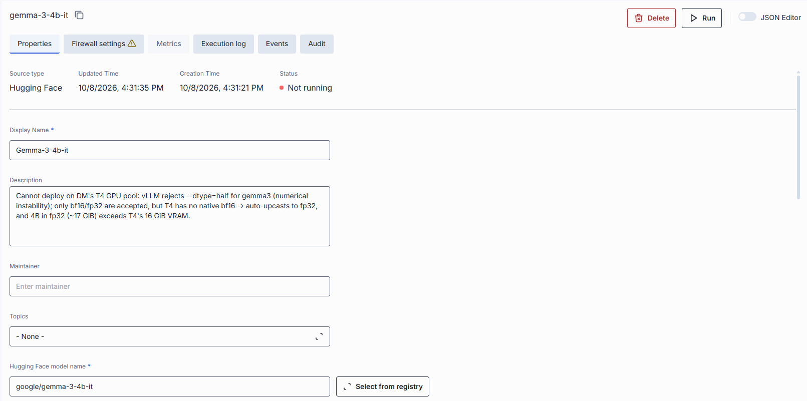
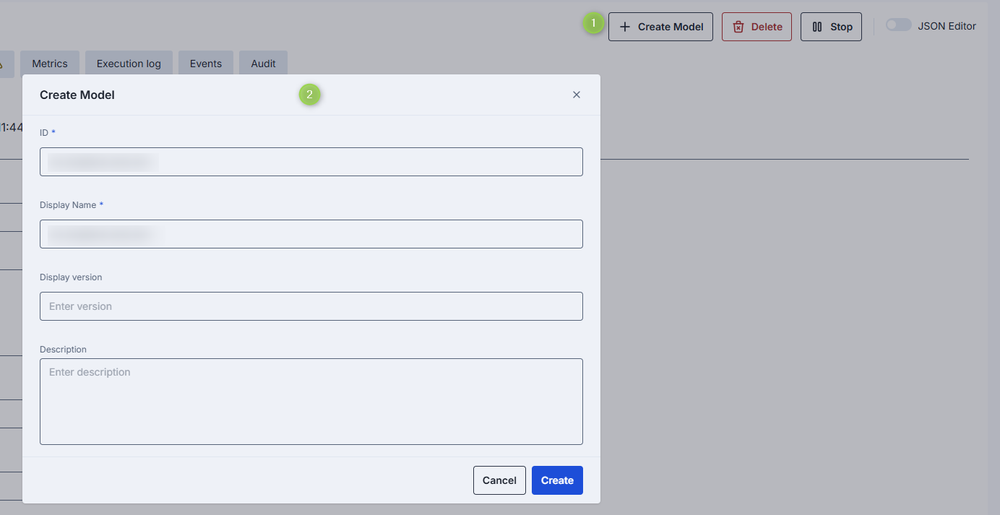

# Model serving containers

Model serving containers deploy AI models from [NVIDIA NIM](https://build.nvidia.com/models) and [Hugging Face](https://huggingface.co/models) within DIAL infrastructure. After a model serving container is running, you can register it as a DIAL model entity.

> Refer to [Containers](./2.container-management.md) to learn abou container properties.

In Model Servings you can find all available model serving conainers and add new ones.

The model servings grid includes the standard [container grid columns](./2.container-management.md#container-grid-columns) plus:

| Column | Description |
|--------|-------------|
| Source Type | NIM or Hugging Face. |

### How to use models in DIAL

To make an AI model available in DIAL, you need an adapter that aligns the model's API with the DIAL Unified API. DIAL includes adapters for [Azure OpenAI](https://github.com/epam/ai-dial-adapter-openai), [GCP Vertex AI](https://github.com/epam/ai-dial-adapter-vertexai/?tab=readme-ov-file#supported-models), and [AWS Bedrock](https://github.com/epam/ai-dial-adapter-bedrock) models. You can create custom adapters for other models using the [DIAL SDK](https://github.com/epam/ai-dial-sdk).

For OpenAI-compatible models on Hugging Face or NVIDIA NIM, use the DIAL OpenAI adapter. For models that are not OpenAI-compatible, create a custom adapter.

**Full enablement flow:**

1. Create and run a model serving container with an OpenAI-compatible model from Hugging Face or NIM.
2. If not already part of your DIAL setup, create a new adapter based on the [DIAL Azure OpenAI Adapter](https://github.com/epam/ai-dial-adapter-openai) and add it in Builders/Adapters.
3. In [Models](../1.ai-gateway/1.models.md), create a new model entity:
   - Set **Source Type** to your OpenAI adapter.
   - Set **Override Name** to the model name from the running container. Find it in the container logs.
   - Add an **Upstream Endpoint** following the pattern: `http://<container_url>/openai/v1/chat/completions`.
4. The AI model is now available to users and applications according to your permissions configuration.

### Create a model serving container

**Note**
> Available deployment options depend on the current setup.

Click **Create** on the main screen and select the type of model serving (Hugging Face or NIM).

Fill in the form:

- **ID**: Unique identifier for the model serving.
- **Display Name**: Name displayed in the UI.
- **Description**: Brief description.
- **Hugging Face Model Name**: Applies to Hugging Face source type. Start typing to see suggestions, or click **Select from registry** to pick from the modal.
- **Docker Image URI**: Applies to NIM source type. Docker image URI for the model.

Click **Create** to submit the form.

### Model serving properties

Click any model serving on the main screen to navigate to the properties secreen.

In addition to the [shared properties](./2.container-management.md#properties), model serving containers include:

| Property | Required | Editable | Description |
|----------|----------|----------|-------------|
| Hugging Face model name | Conditional | Yes | Applies to Hugging Face models. Start typing to see suggestions, or click **Select from registry** to pick from the modal. |
| Docker Image URI | Conditional | Yes | Applies to NIM models. The Docker image URI for the model. |
| Autoscaling | No | Yes | **Note** > Autoscaling controls for **scale to zero** are available only for Hugging Face model servings. NIM and Hugging Face model servings default to 1 replica for both Min and Max. Existing containers retain their current configuration. |

### Model serving actions

Click any model serving container to access the configuration screen. On the configuration screen, you can find several actions you can perform on the selected model serving container.

| Action | Description |
|--------|-------------|
| **Create Model** | Available for running model servings. Creates a new [model entity](../1.ai-gateway/1.models.md) from this container. |
| **Run / Stop** | Start or stop the model serving. |
| **Delete** | Remove the model serving. Deleting affects model entities created from it. |

#### Create a model from a running container

1. In the configuration screen of the running model serving, click **Create Model**.
2. Fill in the dialog:
   - **ID**: Unique identifier. Auto-populated from the model serving.
   - **Display Name**: Name shown in the UI. Auto-populated from the model serving.
   - **Display Version**: Version of the model.
   - **Description**: Brief description.
3. Click **Create**. The model appears in [Entities/Models](../1.ai-gateway/1.models.md). Repeat to create additional models.

Refer to [How to use models in DIAL](#how-to-use-models-in-dial) for the full enablement flow.

## HuggingFace auto-detection

When creating a Hugging Face model serving container, the Deployment Manager can automatically
detect **text-classification** models and configure the appropriate KServe transformer chain.

| Behavior | Description |
|----------|-------------|
| **Auto-detection** | The Deployment Manager identifies `text-classification` models from HuggingFace metadata and configures the appropriate task type automatically. |
| **KServe transformer chaining** | For detected text-classification models, the system sets up a KServe transformer chain (predictor + transformer), removing the need for manual model task type configuration. The transformer image is configured via the `INFERENCE_TEXT_CLASSIFICATION_TRANSFORMER_IMAGE` environment variable on the Deployment Manager. |

**Note**
> The `INFERENCE_TEXT_CLASSIFICATION_TRANSFORMER_IMAGE` environment variable is **required** for
> chained text-classification deployments. If it is not set, the deployment fails with an HTTP 5xx
> error. Default resource allocations for the transformer: CPU 100m–500m, Memory 256Mi–512Mi.

## Next steps

- [Manage deployment images](./3.images.md) — build and version the images that containers are based on
- [Manage MCP containers](./2.container-management.md#mcp-containers) — deploy MCP server containers and create toolsets
- [Manage entities — models](../1.ai-gateway/1.models.md) — register and configure AI models in DIAL
