# Manage containers

This page explains how to create, run, stop, configure, and delete containers for AI model adapters, applications, interceptors, and MCPs in DIAL Admin. Administrators use this page to deploy self-hosted workloads and register the resulting endpoints as DIAL entities. Familiarity with DIAL deployment images is assumed.

**Prerequisite**: The Deployments section requires the [Deployment Manager Backend](https://github.com/epam/ai-dial-admin-deployment-manager-backend) to be installed and configured in your DIAL environment.

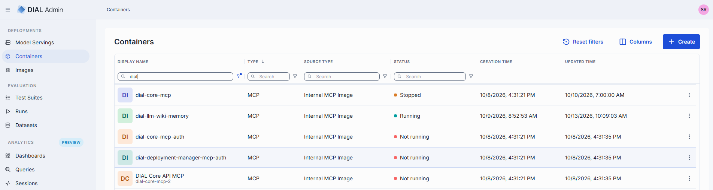

## Shared container lifecycle

The following steps, properties, and behaviors apply to all container types (adapter, application, interceptor, and model serving) unless a per-type section below states otherwise.

### Container grid columns

Each container list screen shows the following columns:

| Column | Description |
|--------|-------------|
| Display Name | Name of the container rendered in the UI. |
| Description | Brief description of the container. |
| Status | Current status (e.g., Running, Stopped). |
| Type | Type of the container: Adapter, Application, Interceptor, MCP. |
| Source type | **Docker Image Reference** for external Docker images; **Internal \<Type\> Image** for DIAL self-hosted images. |
| Source Name | Docker image name or ID of the internal image. |
| Container URL | URL to access the running container. |
| Author | Email address of the container creator. |
| Creation Time | Container creation timestamp. |
| Updated Time | Timestamp of the last update. |
| Topics | Semantic labels associated with the container. |
| CPU request | The minimum CPU guaranteed for the container; used for scheduling. |
| CPU limit | 	The maximum CPU the container is allowed to use. |
| Memory request | The minimum memory guaranteed for the container; used for scheduling. |
| Memory limit | The maximum memory the container is allowed to consume. |
| Actions | Per-row actions: **Open in a new tab**, **Duplicate**, **Stop/Run**, **Delete**. |

### Create a container

On the main screen, click **Create** to create containers of several types: Adapter, Application, Interceptor, MCP.

- **From Internal \<Type\> Image**: Select the desired [image](./3.images.md) from the list and choose an installed version (marked with a green indicator).
- **From Docker Image Reference** (or **External Docker Image Reference**): Provide the URI of the external Docker image you want to use.
- **From MCP Registry**

Specify **ID**, **Display Name**, and **Description**, then click **Finish** (or **Create**) to create the container. The configuration screen opens. You can modify settings, run, stop, or delete the container from there.

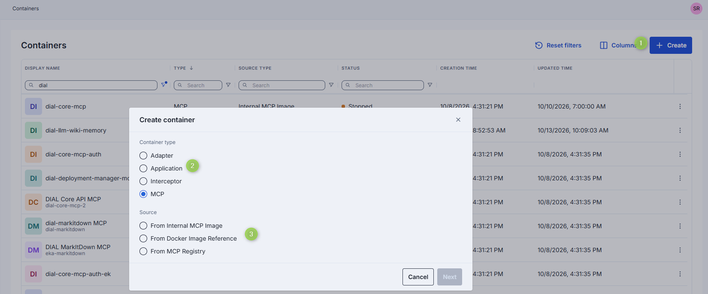

### Container actions

Click any container to access the configuration screen.

The configuration screen header provides the following actions for all container types:

| Action | Description |
|--------|-------------|
| **Create \<Entity\>** | Available for running containers. Opens a dialog to create the corresponding DIAL entity (adapter, application, interceptor, toolset or model). See per-type sections for details. |
| **Run / Stop** | Start or stop the container. |
| **Delete** | Remove the container. Deleting a container affects entities created from it. |

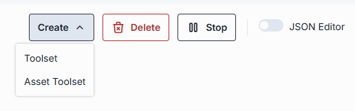

### Properties

Click any container to access the configuration screen.

The **Properties** tab contains the following fields for all container types. Per-type differences are noted in each type's section.

**Note**
> Configuration fields are disabled for editing when a container is in a transition state (pending or stopping).

| Property | Required | Editable | Description |
|----------|----------|----------|-------------|
| ID | — | No | Unique read-only identifier. 2–36 characters. Lowercase letters, numbers, and hyphens only. |
| Source Type | — | No | Read-only source type used to create the container. |
| Creation Time | — | No | Container creation timestamp. |
| Updated Time | — | No | Timestamp of the last update. |
| Status | — | No | Current status (e.g., Running, Stopped). |
| URL | — | No | URL to access the running container. |
| Restarts | — | No | Restart counter for launching containers. Use to identify crash loops. Details are in the [Execution log](#execution-log). |
| Display Name | Yes | Yes | Name rendered in the UI. 2–255 characters. |
| Description | No | Yes | Brief description of the container. |
| Maintainer | No | Yes | Email address of the maintainer. |
| Topics | No | Yes | Semantic labels (e.g., "finance", "support") for navigation. Custom topics: maximum 255 characters, no leading or trailing spaces. |
| Image reference | Conditional | Yes | The internal image, MCP image or external Docker image used for this container. See per-type sections for exact field names. Changing the internal image redeploys the container. |
| Endpoint Configuration | No | Yes | Endpoint and port settings for the container. Changes to a running container trigger a RollingUpdate restart. |
| Autoscaling | No | Yes | Replica scaling settings: - **Automatic scale to zero**: Reduce replicas to zero after a period of inactivity (default: 5-minute delay for new containers). - **Min and Max Replicas**: Minimum and maximum number of running instances. Default for new containers: 0 to 1 replica. - **Pending requests to trigger autoscaling**: Queue depth that triggers scale-up. **Note** > Existing containers retain their current autoscaling configuration after an upgrade. |
| Environment Variables | No | Yes | Environment variables for the container. Changes trigger a RollingUpdate restart. - **Name**: 1–253 characters. Letters, numbers, dots (`.`), hyphens (`-`), and underscores (`_`). - **Value**: 1–253 characters. Letters, numbers, dots (`.`), hyphens (`-`), and underscores (`_`). |
| Resources | No | Yes | CPU, memory, and GPU resource requests and limits. Changes trigger a RollingUpdate restart. Validation rules: - Values must be numeric and greater than 0. - Maximum allowed values for `cpu`, `memory`, and `nvidia.com/gpu` are defined on the backend. - For each resource key (e.g., `cpu`), the limit must not be less than the request. |
| Compute | No | Yes | The Compute section groups resource requests/limits and the node pool selector. See [Node pool selection](#node-pool-selection). |
| Configuration | No | Yes | Executable command and arguments used to launch the container. |
| Startup probe | No | Yes | Health check that signals when the container is ready to serve traffic. - **Type**: HTTP (GET request; success = HTTP 200–399) or TCP (connection success). - **Port**: Container port for the probe. - **Path**: Request path. Applies to HTTP type only. - **Initial delay seconds**: Wait time after container start before the first probe. - **Period seconds**: Interval between consecutive probes. - **Timeout seconds**: Maximum time allowed for a single probe to complete. - **Failure threshold**: Consecutive failures before the container is marked as failed. |

**Note**
> Advanced users can switch to the JSON editor view for bulk updates, copying configuration between environments, or adjusting settings not exposed in the form UI.

### Firewall settings

The firewall settings for a container specify which external domains the container is allowed to connect to. This controls outgoing traffic, restricting communication to trusted domains only.

**Domain name requirements**: Enter domain names without a protocol prefix, for example `github.com`. Each domain must contain at least one dot. Labels may include letters, numbers, and hyphens (1–63 characters each, not starting or ending with a hyphen). The top-level domain must be at least two letters.

### Execution log

The **Execution Log** tab shows real-time logs generated by the container, including errors and operational events.

When a container starts with more than one pod, logs are shown per pod:

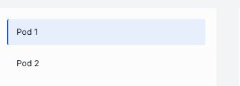

When issues occur, health indicators appear:

| Indicator | Description |
|-----------|-------------|
| Restarts | Restart counter. Use to identify crash loops. |
| Last restarted at | Timestamp of the last restart. |
| Last reason | Restart failure reason. |
| Termination message | The message from the pod's last terminated state, if available. Shows why the container was terminated (for example, OOMKilled or an application-level error). |

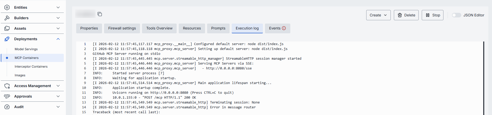

### Events

The **Events** tab shows significant state changes, such as start and stop actions, errors, and configuration changes.

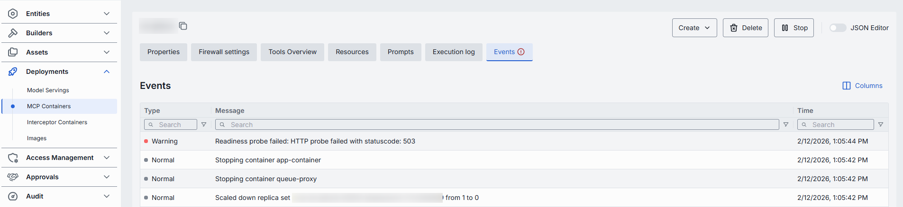

### Audit

The **Audit** tab shows activity, usage, and operational metrics for the container, including configuration changes and runtime actions.

**Note**
> This tab shows the same data as the global Activity section, scoped to the selected container.

### Metrics

The **Metrics** tab displays live operational metrics for a running container. The tab is disabled
when the container is not in Running status. Metrics are organized into sections:

| Section | Availability | Metrics |
|---------|-------------|---------|
| **Scale & Health** | All container types | Ready replicas (ratio of ready to total), request error ratio (Model Servings with text-generation inference task only). |
| **Throughput** | Model Servings only | Tokens per second (prompt and generation), requests per second. |
| **Compute** | All container types | CPU usage (millicores), memory usage, GPU memory usage and GPU utilization percentage (Model Servings only). |
| **Latency** | Model Servings only | Time to first token (TTFT), inter-token latency, end-to-end latency, request latency (text-classification only). Shown as p50/p95/p99 distribution. |
| **Load** | Model Servings only | Running requests, queue depth, KV-cache usage (gauge with color-coded zones). |

Metrics are filtered by inference task type when applicable. Data is provided by the Deployment
Manager metrics endpoint and refreshed automatically.

**Note**
> The Metrics tab requires `METRICS_SCRAPE_ENABLED` and a [metrics-server](https://github.com/kubernetes-sigs/metrics-server) in the cluster for resource metrics. GPU metrics require additional Deployment Manager configuration (`GPU_METRICS_SCRAPE_*` environment variables).

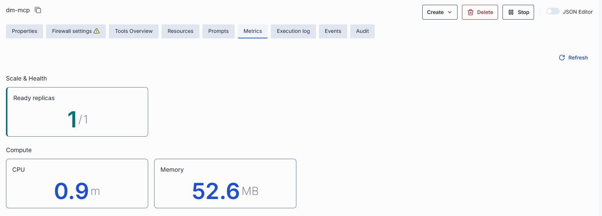

### Node pool selection

When node pools are configured in the Deployment Manager, the **Compute** section of a container's
properties displays a **Node Pool** selector. Node pools let you pin workloads to specific
infrastructure — for example, GPU-backed pools for model servings and CPU pools for adapters.

<!-- SCREENSHOT NEEDED: node pool selector in Compute section -->

| Field | Description |
|-------|-------------|
| **Node Pool** | Select a node pool from the dropdown to assign the container to that pool. If no pool is selected, the container uses the system default. |

The system default is configured via Deployment Manager environment variables:

| Variable | Description |
|----------|-------------|
| `NODE_POOL_DEFAULT` | Catch-all default pool ID for containers created without an explicit node pool. |
| `NODE_POOL_DEFAULT_MODEL` | Default pool ID for model serving workloads (NIM and KServe-Inference). Takes precedence over `NODE_POOL_DEFAULT`. |

## Adapter containers

Adapter containers host self-hosted AI model adapters. Once running, use to register Ai models in DIAL.

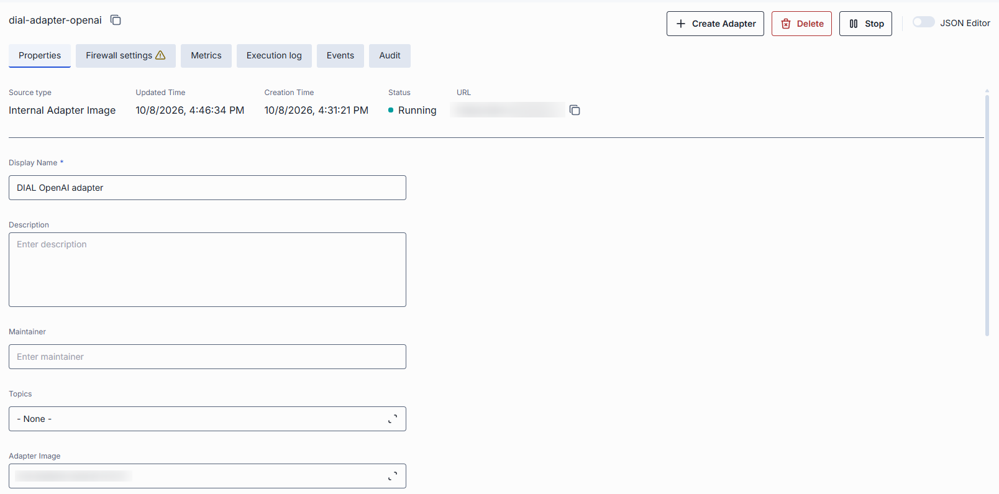

### Create an adapter container

Follow the [shared creation steps](#create-a-container). Select from **Internal Adapter Image** or **External Docker Image Reference**.

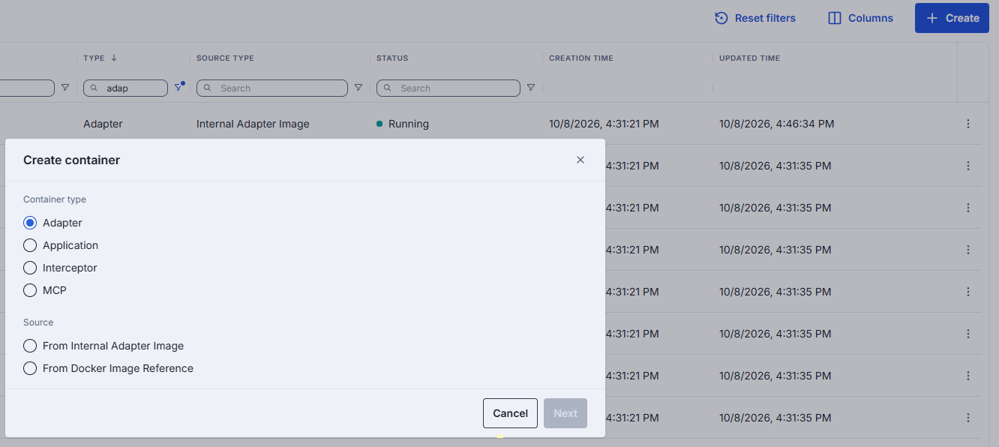

### Adapter-specific actions

| Action | Description |
|--------|-------------|
| **Create Adapter** | Available for running containers. Opens a dialog to create a new adapter in DIAL Builders. |

### Create an adapter from a running container

1. In the configuration screen of the running container, click **Create Adapter**.
2. Fill in the dialog:
   - **ID**: Unique identifier. Auto-populated from the container.
   - **Display Name**: Name shown in the UI. Auto-populated from the container.
   - **Description**: Brief description.
3. Click **Create**. The adapter appears in Builders/Adapters. Repeat to create additional adapters.

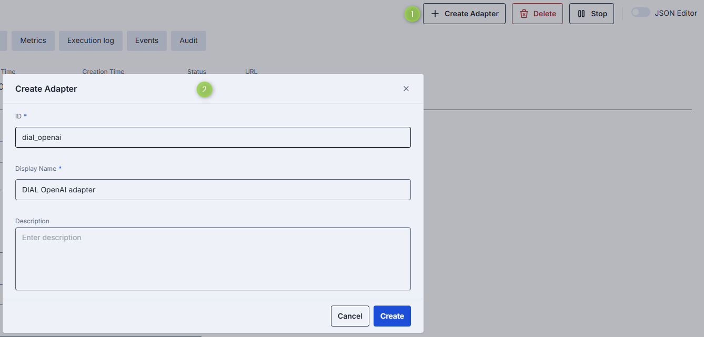

### Adapter-specific properties

In addition to the [shared properties](#properties), adapter containers include:

| Property | Editable | Description |
|----------|----------|-------------|
| Adapter Image | Yes | Internal Adapter image used to create the container. Click to change the source image. Changing the image redeploys the container. |
| Docker Image Reference | Yes | External Docker image reference. Available only when the container was created from an external image. |

## Application containers

Application containers host self-hosted DIAL applications. Once running, register the exposed endpoint as an application entity in DIAL.

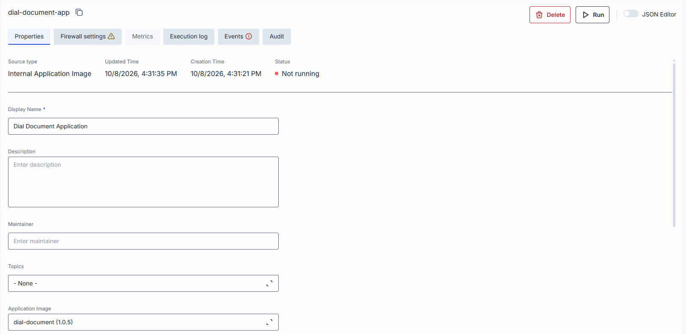

### Create an application container

Follow the [shared creation steps](#create-a-container). Select from **Internal Application Image** or **Docker Image Reference**.

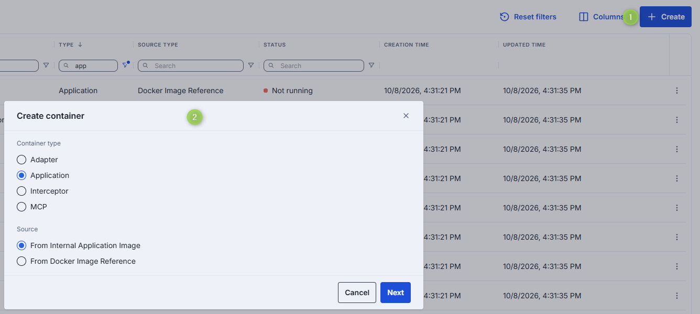

### Application-specific actions

| Action | Description |
|--------|-------------|
| **Create Application** | Available for running containers. Opens a dialog to create a new application in DIAL Entities. |

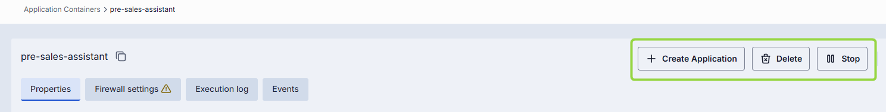

### Create an application from a running container

1. In the configuration screen of the running container, click **Create Application**.
2. Fill in the dialog:
   - **ID**: Unique identifier. Auto-populated from the container.
   - **Display Name**: Name shown in the UI. Auto-populated from the container.
   - **Description**: Brief description.
3. Click **Create**. The application appears in [Entities/Applications](../1.ai-gateway/2.applications.md). Repeat to create additional applications.

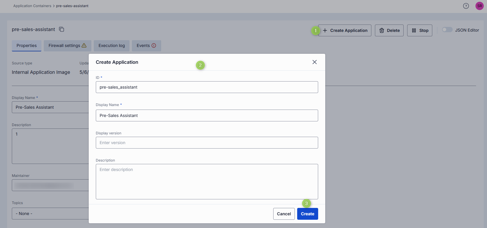

### Application-specific properties

In addition to the [shared properties](#properties), application containers include:

| Property | Editable | Description |
|----------|----------|-------------|
| Application Image | Yes | Internal application image used to create the container. Disabled when an external Docker image was used. |
| Docker Image Reference | Yes | External Docker image reference. Disabled when an internal image was used. |

**Note**
> For new application containers, autoscaling defaults to **scale to zero** enabled with a 5-minute inactivity delay and a replica range of 0 to 1.

## Interceptor containers

Interceptors are middleware components that modify incoming or outgoing requests to or from applications and AI models. Use cases include PII obfuscation, guardrails, and safety checks. Interceptor containers host self-hosted interceptors deployed from Docker images.

There are three ways to add interceptors in DIAL:

- Provide the endpoint of your custom interceptor directly using the External Endpoint source type in [Entities/Interceptors](../6.governance/4.interceptors.md).
- Define Interceptor Templates and use them as a source type.
- Deploy custom interceptors using Docker [images](./3.images.md), create containers, and use the container as a source type — as described on this page.

**Tip**
> Use the [Interceptors SDK](https://github.com/epam/ai-dial-interceptors-sdk) to create custom interceptors.

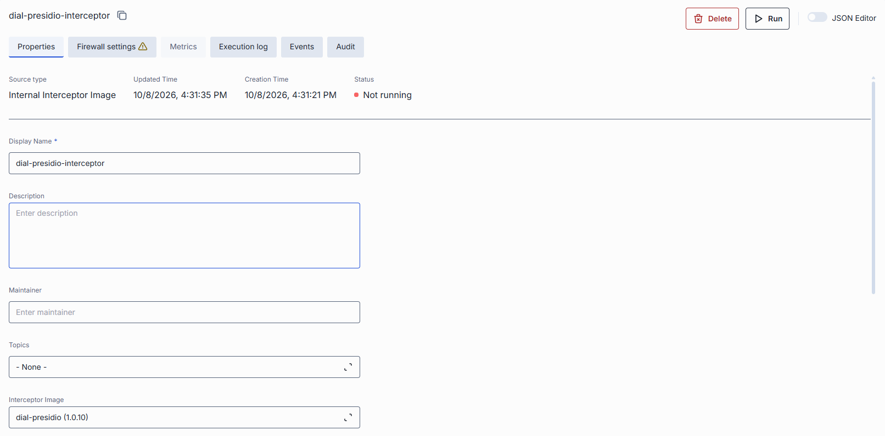

### Create an interceptor container

Follow the [shared creation steps](#create-a-container). Select from **Internal Interceptor Image** or **Docker Image Reference**.

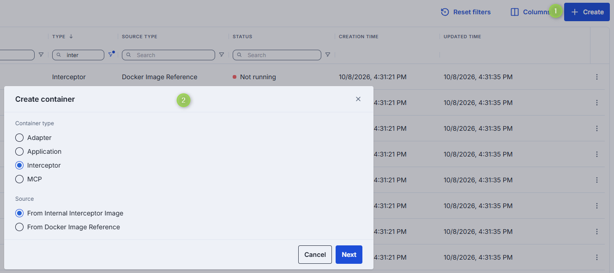

### Interceptor-specific actions

| Action | Description |
|--------|-------------|
| **Create Interceptor** | Available for running containers. Opens a dialog to create a new interceptor in DIAL Entities. |

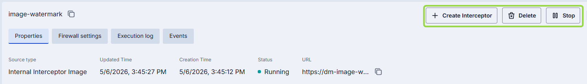

### Create an interceptor from a running container

1. In the configuration screen of the running container, click **Create Interceptor**.
2. Fill in the dialog:
   - **ID**: Unique identifier. Auto-populated from the container.
   - **Display Name**: Name shown in the UI. Auto-populated from the container.
   - **Description**: Brief description.
3. Click **Create**. The interceptor appears in [Entities/Interceptors](../6.governance/4.interceptors.md) and can be used by DIAL applications, toolsets, and models, or set as a [global interceptor](../1.config-backup-and-global-settings.md). Repeat to create additional interceptors.

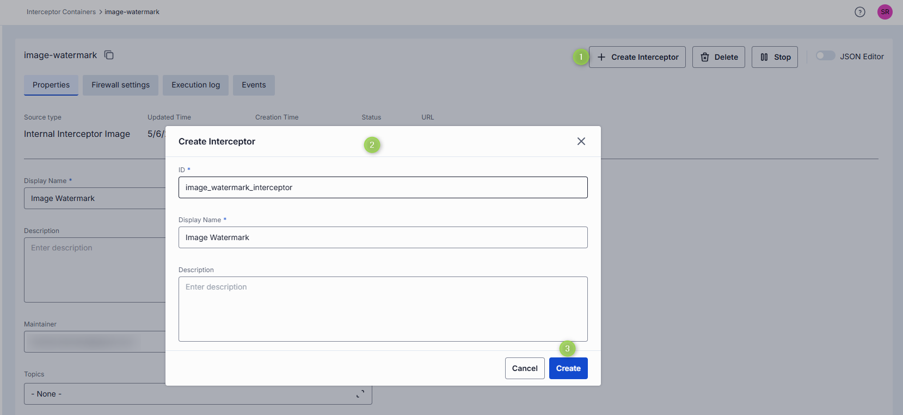

### Interceptor-specific properties

In addition to the [shared properties](#properties), interceptor containers include:

| Property | Editable | Description |
|----------|----------|-------------|
| Docker Image Reference | Yes | External Docker image reference. Available only when the container was created from an external image. |
| Interceptor Image | Yes | Internal Interceptor image used to create the container. Click to change the source image. Changing the image redeploys the container. |

## MCP containers

Administrators can add MCP containers from internal images, external Docker references, or the MCP Registry, and then expose their capabilities as toolsets to DIAL users. Familiarity with DIAL deployment images is assumed.

**Prerequisite**: The Deployments section requires the [Deployment Manager Backend](https://github.com/epam/ai-dial-admin-deployment-manager-backend) to be installed and configured in your DIAL environment.

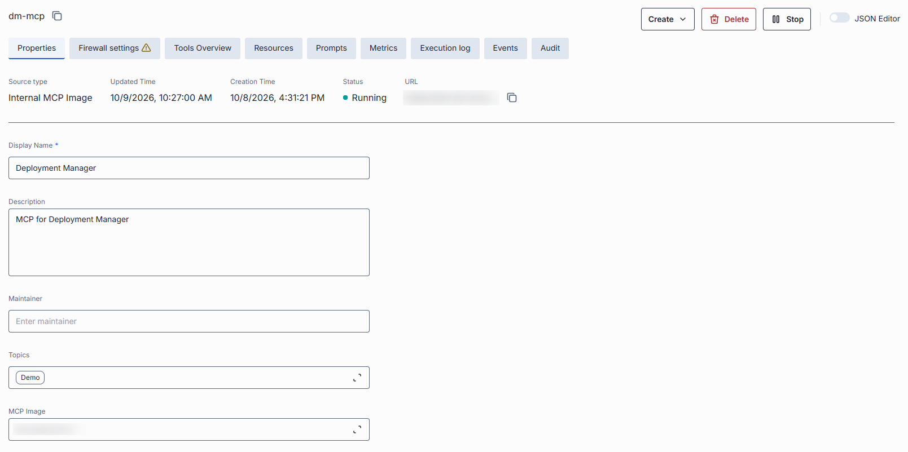

### Create an MCP container

Follow the [shared creation steps](#create-a-container). Select from **Internal MCP Image** or **Docker Image Reference** or **MCP Registry**.

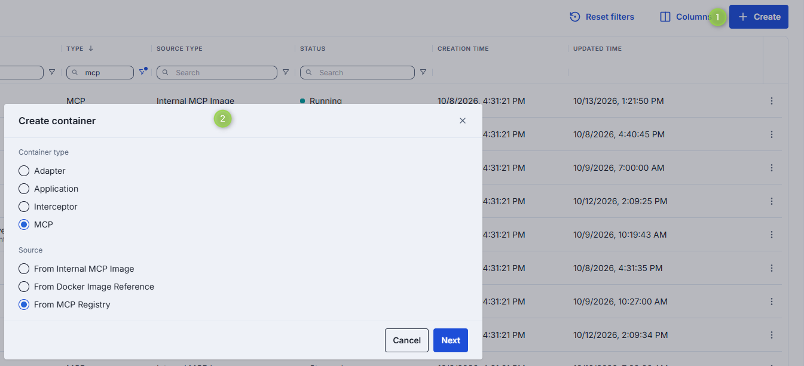

- **From Internal MCP Image**: Select the desired [image](./3.images.md) from the list and choose an installed version (marked with a green indicator).
- **From Docker Image Reference**: Provide the URI of the external Docker image you want to use.
- **From MCP Registry**: Enter the name of an MCP server from the [MCP Registry](https://registry.modelcontextprotocol.io/). Start typing to search, or click **Select from registry** to browse available servers and their details.

**Warning**
> When creating from MCP Registry, the selected MCP server must have an OCI package and must support Remote transport: `streamable-http` or `sse`.

Specify **ID**, **Display Name**, and **Description**, then click **Finish** to create the container. The configuration screen opens immediately.

### MCP-specific actions

The configuration screen header provides the following actions:

| Action | Description |
|--------|-------------|
| **Create** | Available for running containers. Opens a dropdown to create a [Toolset](#create-a-toolset) or [Asset Toolset](#create-an-asset-toolset). |

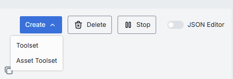

### Creating a toolset from a running container

You can create a new toolset from a running MCP container. The toolset uses the container as its source and appears in [Entities/Toolsets](../1.ai-gateway/3.toolsets.md).

The high-level flow for making an MCP server available to DIAL users as a toolset is:

1. [Deploy an image](./3.images.md) of type MCP.
2. Create an MCP container from the installed image (described on this page).
3. In the running container's configuration screen, use the [Create](#create-a-toolset) button to create a toolset.
4. The toolset appears in [Entities/Toolsets](../1.ai-gateway/3.toolsets.md).

Toolsets created this way can be used in Quick Apps workflows to perform specific tasks.

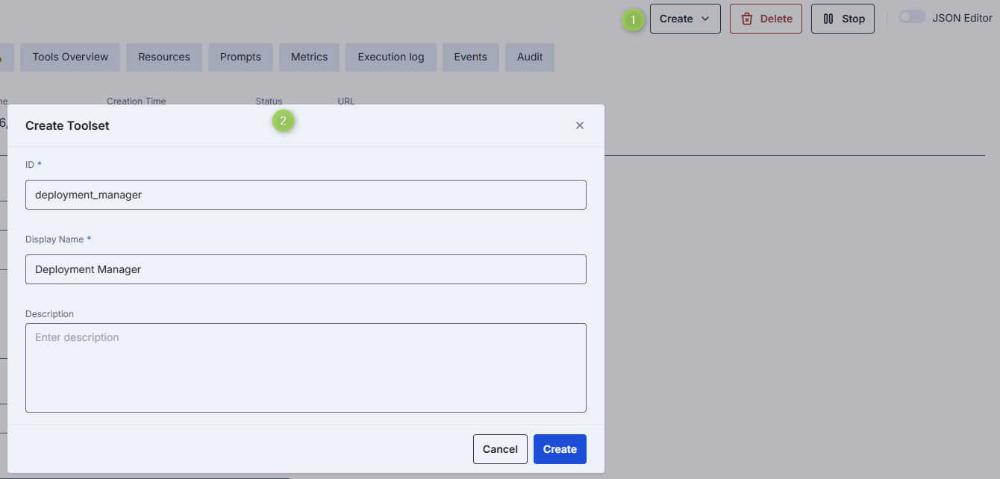

### MCP-specific properties

The **Properties** tab shows the container's properties.

| Property | Required | Editable | Description |
|----------|----------|----------|-------------|
| Source Type | — | No | Source type used to create the container: - **Internal MCP Image** - **Docker image reference** - **MCP Registry**  |
| MCP Image | Conditional | Yes | Internal MCP image used to create the container. Available for containers created from internal images. |
| Docker Image Reference | Conditional | Yes | URI of the external Docker image. Available when an external image was used to create the container. |
| MCP server name | Conditional | Yes | Name of the MCP server from the MCP Registry. Start typing to search, or click **Select from registry** to browse. Available when the container was created from the MCP Registry. |

**Note**
> Advanced users can switch to the JSON editor view for bulk updates, copying configuration between environments, or adjusting settings not exposed in the form UI.

### Tools overview

[Tools](https://modelcontextprotocol.io/specification/2025-06-18/server/tools) are specific functions supported by the MCP server that clients can invoke to perform actions such as processing, transforming, or analyzing data.

This tab shows the list of tools supported by the selected MCP server along with their details. Toolsets created from this container inherit these tools in the [Tools Overview](../1.ai-gateway/3.toolsets.md) configuration tab.

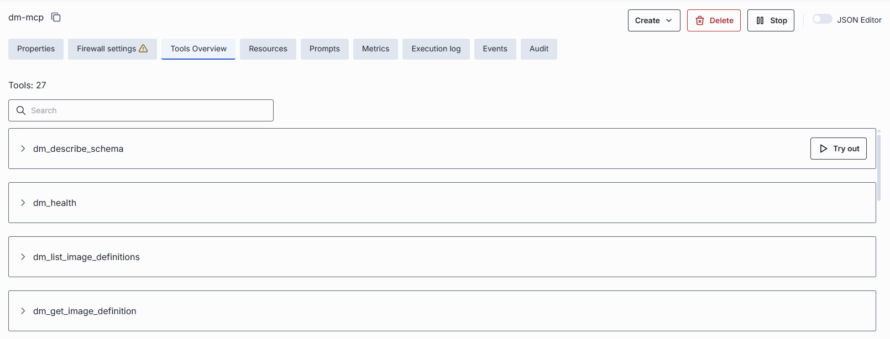

### Try a tool

Click or hover over any enabled tool and click **Try out** to enter test mode.

In test mode you can send a request to the server using either the rendered form UI or a raw JSON mode.

**To try a tool:**

1. Click a tool to view its description and input schema parameters. Toggle between table and JSON view modes.
2. Click **Try out** to open the request sidebar.
3. Populate the **Request body** using the table or JSON view.
4. Click **Send Request**. The server's response appears in the **Response body** area.

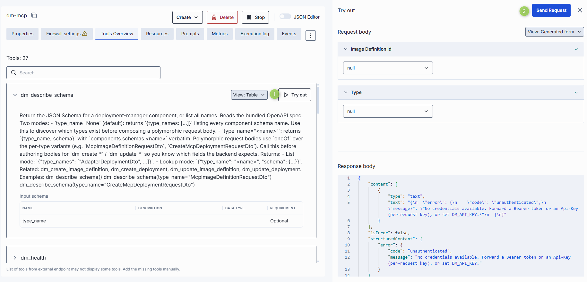

### Resources

The **Resources** tab shows contextual data attached to and managed by the MCP server. This data provides additional context to AI models.

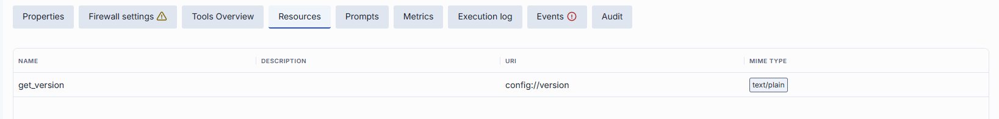

### Prompts

The **Prompts** tab shows pre-defined templates or instructions that guide language model interactions. These are defined by the MCP server.

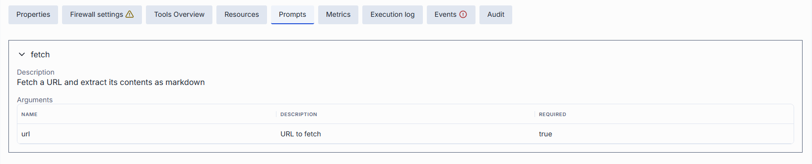

## Next steps

- [Manage deployment images](./3.images.md) — build and version the images that containers are based on
- [Manage MCP containers](./2.container-management.md#mcp-containers) — deploy MCP server containers and create toolsets
- [Manage models](../1.ai-gateway/1.models.md) — register and configure AI models in DIAL