# Manage deployment images

An image is the build source for MCP server, adapter, application, and interceptor containers. It points to a Docker image or a source code repository, and DIAL Admin builds it when you install it. This page explains how to add, configure, and install images in DIAL Admin.

Once an image is installed, you can:

- [Create containers](#create-a-container-from-an-image) from it, or link existing containers to it.
- Save a modified copy as a [new version or a new image](#save-changes), or [duplicate](#duplicate-an-image) it.
- Update its Description, Maintainer, and Topics in place. Other changes to an installed version require saving a new version or image.
- Review its build log and audit history.

**Prerequisite**: The Deployments section requires the [Deployment Manager Backend](https://github.com/epam/ai-dial-admin-deployment-manager-backend) to be installed and configured in your DIAL environment.

## Images grid

The main screen lists all available images and their current state.

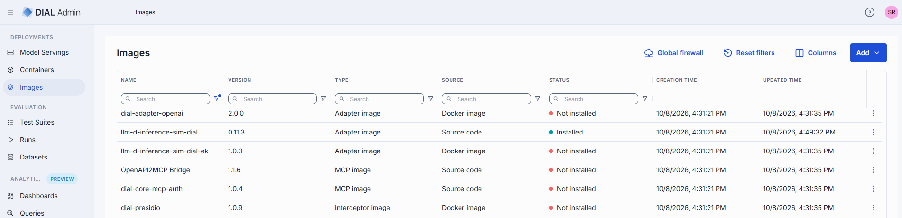

| Column | Description |
|--------|-------------|
| ID | Unique identifier of the image. |
| Version | Version of the image. |
| Name | Name of the image. |
| Author | Email address of the creator. |
| Description | Brief description of the image. |
| Type | Type of the image: MCP, Adapter, Application, or Interceptor. |
| Source | Image source type: Docker image or source code repository. |
| Status | Current build/install status of the image. |
| Updated Time | Timestamp of the last update. |
| Creation Time | Creation timestamp. |
| Topics | Topics associated with the image. |
| Transport type | Applies to MCP images only. Transport type used: - **Remote**: HTTP (default) or SSE (deprecated) - **Local** (STDIO) |
| Actions | Per-row actions: - **Open in a new tab**: Open image properties in a new browser tab. - **Delete**: Remove the image. - **Duplicate**: Create a [copy of the image](#duplicate-an-image). |

## Add an image

Use this flow to add images for MCP servers, AI model adapters, applications, and interceptors. After creating and installing an image, use it to deploy containers for specific entities.

**To add a new image:**

1. Click **Add** on the main screen and select **Add Image**.
2. Fill in the required fields in the **Add Image** form and click **Add**.

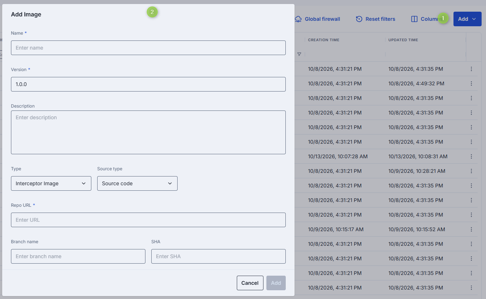

| Field | Required | Description |
|-------|----------|-------------|
| Name | Yes | Name of the image. |
| Version | Yes | Version of the image. |
| Description | No | Brief description of the image. |
| Type | Yes | Type of the image: MCP, Adapter, Application, or Interceptor. |
| Source type | Yes | **Docker Image**: Use an external Docker image as the source. **Source Code**: Use a source code repository as the source. |
| Docker Image URI | Conditional | URI of the Docker image. Available when **Source type = Docker Image**. |
| Repo URL | Conditional | URL of the source code repository. Available when **Source type = Source Code**. |
| Branch name | Conditional | Branch name in the source code repository. Available when **Source type = Source Code**. |
| SHA | Conditional | The 40-character hexadecimal Git commit SHA that uniquely identifies a commit in the repository's history. Available when **Source type = Source Code**. |

## Add an image from MCP Registry

You can add images for MCP servers directly from the [MCP Registry](https://registry.modelcontextprotocol.io/), a centralized catalog of MCP servers that provides server details and simplifies discovery.

**To add an image from MCP Registry:**

1. Click **Add** on the main screen and select **From MCP Registry**.
2. Fill in the required fields and click **Add**.

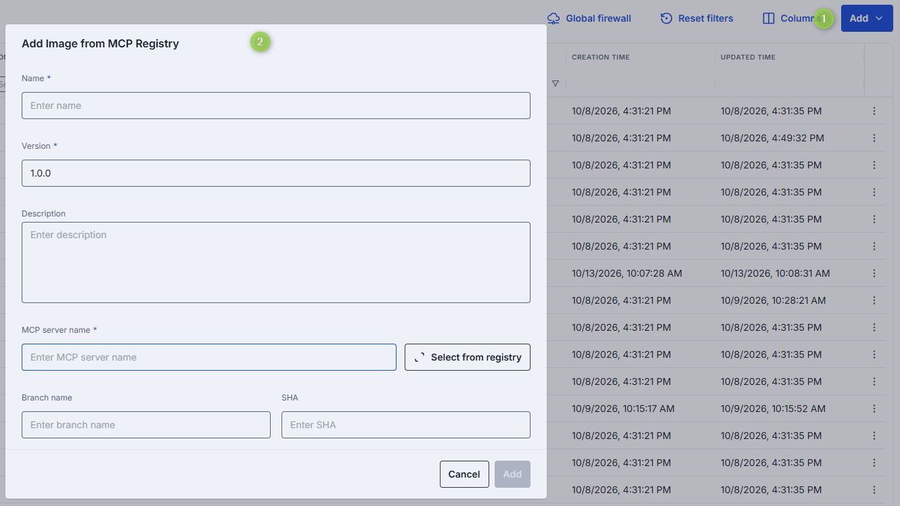

| Field | Required | Description |
|-------|----------|-------------|
| Name | Yes | Name of the image. |
| Version | Yes | Version of the image. |
| Description | No | Brief description of the image. |
| MCP server name | Conditional | Name of the MCP server from the MCP Registry. Start typing to search, or click **Select from registry** to browse available servers. |
| Source type | Conditional | Applies when the selected MCP server has both an OCI package and a source code repository. **Docker Image**: Deploy from the Docker image in the OCI package. **Source Code**: Deploy from the source code repository. Open server details in the registry dialog to see which options are available. |
| Branch name | Conditional | Branch name in the source code repository. Available when **Source type = Source Code**. |
| SHA | Conditional | The 40-character hexadecimal Git commit SHA. Available when **Source type = Source Code**. |

## Duplicate an image

Use **Duplicate** to copy an image, for example to try a different source or settings without changing the original.

**To duplicate an image:**

1. In the **Actions** column of the images grid, click the row menu and select **Duplicate**.
2. Select the **Duplication type**:
   - **New Version**: Keeps the name and sets the version to the next patch version.
   - **New Image**: Sets a new name based on the original and resets the version to `1.0.0`.
3. Adjust **Name** and **Version** if needed and click **Duplicate**.

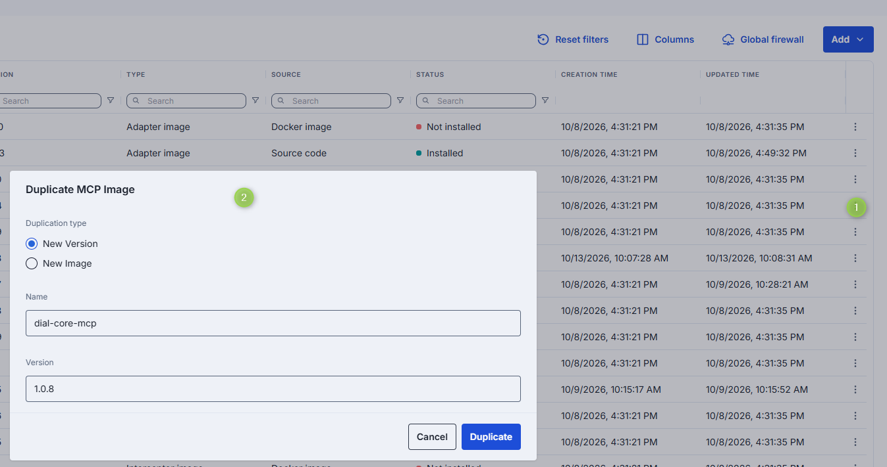

The copy keeps the settings of the original image. The version must be a valid semantic version that doesn't already exist for that name.

## Global firewall

Global firewall settings define an allowed-domains list that applies to all image builds in the environment. This avoids repeating common allowed domains on every individual image. [Per-image firewall rules](#firewall-settings) extend the global list.

To edit the list, click **Global firewall** on the images grid, add or remove domains, and click **Apply**. Changes are recorded in the Activity Audit; use **View in Activity Audit** in the dialog to open it.

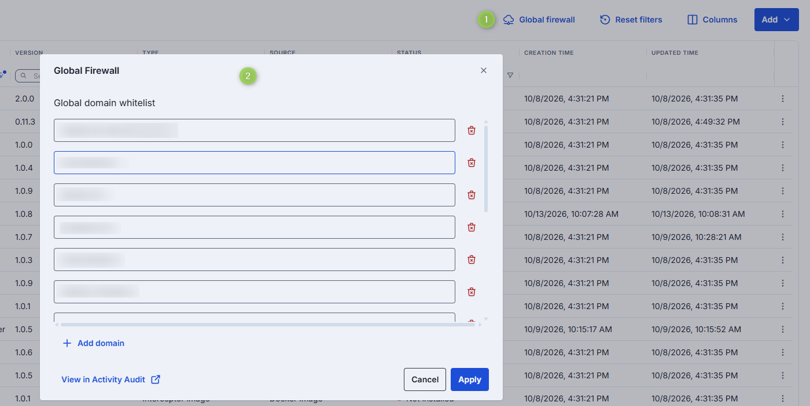

**Domain name requirements**: Enter domain names without a protocol prefix, for example `github.com`. Each domain must contain at least one dot. Labels may include letters, numbers, and hyphens (1–63 characters each, not starting or ending with a hyphen). The top-level domain must be at least two letters. Labels must not include leading or trailing hyphens.

## Image configuration

Click any image on the main screen to open its configuration screen, where you can view and edit all image settings.

### Image statuses

The **Status** of an image changes what you can do on the configuration screen.

| Status | Meaning | Available |
|--------|---------|-----------|
| **Not installed** | The image is new and hasn't been built. | **Install**. Any change can be saved in place. **Installation log** and **Related Containers** tabs are disabled. |
| **Installing...** | The build is in progress. The screen refreshes until it finishes. | **Stop**. In-place **Save** is unavailable. |
| **Installed** | The build succeeded. The version is locked. | **Create … Container**, linking containers on **Related Containers**. In-place **Save** only for Description, Maintainer, and Topics. |
| **Installation failed** | The build failed. See the **Installation log** tab. | **Install** to retry. Any change can be saved in place. |
| **Build stopped** | The build was stopped with **Stop**. | **Install** to start again. Any change can be saved in place. |

In every status you can edit the form, use **Save as new version** or **Save as new image**, and **Delete** the image. A container that uses an image that is *Not installed* or has *Installation failed* shows a warning and can't be started until the image is installed. [Container creation](./2.container-management.md) lists only images that have an installed version.

### Actions

The header shows the image name, and under it the image's Type, Creation Time, **Source type** (Docker image or Source code), and Status. It provides the following actions:

| Action | Description |
|--------|-------------|
| **Version** | Switch between versions of this image, or create a new version. Versioning logic: - New image with a new name: version defaults to `1.0.0`. - New image whose name already exists: version is patch-bumped from the highest existing version for that name. - New version of the same image name: version is patch-bumped from the current image name's highest version. |
| **Create Interceptor / MCP / Adapter / Application Container** | Available for installed images. [Creates a container](#create-a-container-from-an-image) from the selected image version. |
| **Install / Stop** | **Install**: Available for images not yet installed. Click to install the selected version. After installation, the version can't be edited. **Stop**: Appears during installation and can interrupt the process. |
| **Delete** | Remove the selected image. **Warning** > Deleting an image affects all related containers. |

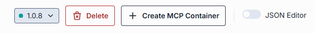

### Save changes

After you change a field, the header shows **Discard** and the save buttons. Which buttons you can use depends on the image status and on what you changed:

| Button | When it applies |
|--------|-----------------|
| **Save** | Saves changes to the current version. For images that aren't installed, any change can be saved. For installed images, only changes to Description, Maintainer, and Topics can be saved. **Save** is also unavailable while the image is building, and when you rename the image to a name that already has this version. |
| **Save as new version** | Shown when the Name is unchanged. Saves your changes as a new version of the same image. In the **Save new version** dialog, enter the version; it defaults to the next patch version of the highest existing one. Use this for installed images when you change anything other than Description, Maintainer, or Topics. |
| **Save as new image** | Shown when you changed the Name. Saves your changes as a separate image with the new name. In the **Save new image** dialog, enter the version; it defaults to `1.0.0` if no image with that name exists. The original image stays unchanged. |

In both cases, the new image or version is created without being installed, and DIAL Admin opens it.

### Create a container from an image

1. Open an installed image and click **Create … Container** in the header.
2. Fill in the container's ID, Display Name, and optionally Description, then click **Create**.

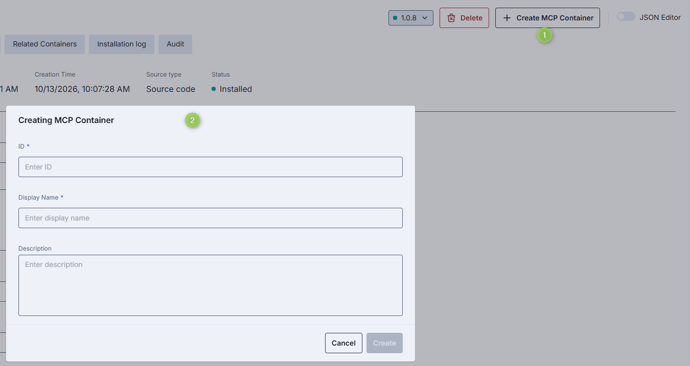

The container is linked to this image version automatically. After creation, DIAL Admin opens the new container so you can configure it. For container settings, see [Manage containers](./2.container-management.md).

### Properties

The **Properties** tab shows the image's configuration fields.

| Field | Required | Editable | Description |
|-------|----------|----------|-------------|
| ID | — | No | Unique read-only identifier of the image. |
| Type | — | No | Image type: MCP, Adapter, Application, or Interceptor. |
| Creation Time | — | No | Creation timestamp. |
| Updated Time | — | No | Timestamp of the last update. |
| Status | — | No | Current build/install status. See [Image statuses](#image-statuses). |
| Name | Yes | Yes | Display name. 2–255 characters. Letters, numbers, spaces, underscores, and hyphens only. |
| Description | No | Yes | Brief description of the image. |
| Maintainer | No | Yes | Email address of the person or team responsible for this image. |
| Topics | No | Yes | Semantic labels for filtering and navigation. Custom topics: maximum 255 characters, no leading or trailing spaces. |
| Build privileges | Yes | Yes | Privileges of the builder that builds the image. Not shown in the **Add Image** dialog. - **Rootless (recommended)**: Builds without root privileges, for improved security and reduced risk. Default. - **Root**: Builds with root privileges, which increases security risks. Use it only when rootless limitations prevent the image from building and you trust the image source. The builders are the BuildKit rootless and root images configured in the Deployment Manager Backend (`app.builder-rootless-image`, `app.builder-root-image`). The setting affects only the build, not containers created from the image. |
| Source type | Conditional | No | Read-only. **Docker Image** or **Source Code**. Also shown in the header. |
| Docker image URI | Conditional | Yes | Valid Docker image URI; must not start or end with `/`. Applies to MCP (when source type = Docker image), Adapter, Application, and Interceptor images. Auto-populated and read-only for images created from MCP Registry. |
| Source code repository parameters | Conditional | Yes | Parameters for the source code repository. Applies when source type = Source Code for MCP, Adapter, Application, and Interceptor images. For MCP Registry images, some values may be read-only. - **Repo URL** (required): Must not start or end with `/`. Read-only for MCP Registry images. - **Branch name**: Branch in the repository. - **SHA**: The 40-character hexadecimal Git commit SHA. - **Base directory**: Path containing the Dockerfile. Must not start or end with `/`. Private repositories are supported when the Deployment Manager is configured with `TRUSTED_PRIVATE_GIT_REPOS`. Credentials can be scoped per repository path (most-specific match wins), allowing separate credentials for different repositories on the same domain. |
| MCP server name | Conditional | Yes | Applies to MCP images only. MCP server name from the MCP Registry. Start typing to search, or click **Select from registry** to browse. |
| MCP transport type | Conditional | Yes | Applies to MCP images only. **Remote**: HTTP (default) or SSE (deprecated). **Local** (STDIO). |

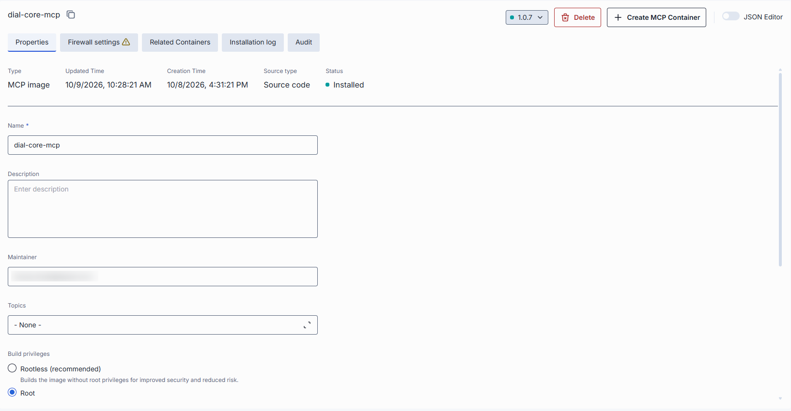

**Note**
> Advanced users can switch to the JSON editor view for bulk updates, copying configuration between environments, or adjusting settings not exposed in the form UI.

### Firewall settings

The firewall settings for an individual image specify which external domains the build process can reach — for example, to download dependencies or pull files during image creation. These rules apply only during the build and do not affect containers created from the image.

Under **Domain access policy**, select:

- **All domains**: The build can reach any domain. DIAL Admin shows a warning because this reduces security.
- **Specific domains (recommended)**: The build can reach only the listed domains.

With **Specific domains**, the tab can show two lists:

- **Global domain whitelist** (read-only): The domains set for all image builds in [Global firewall](#global-firewall) on the images grid. Shown only if that list contains domains. To change it, edit the global firewall.
- **Image domain whitelist**: Domains for this image only. Click **Add domain** to add entries.

A build can reach the domains in both lists.

**Note**
> These firewall rules do not apply to containers created from this image. Containers can have their own firewall settings.

**Domain name requirements**: Enter domain names without a protocol prefix, for example `github.com`. Each domain must contain at least one dot. Labels may include letters, numbers, and hyphens (1–63 characters each, not starting or ending with a hyphen). The top-level domain must be at least two letters.

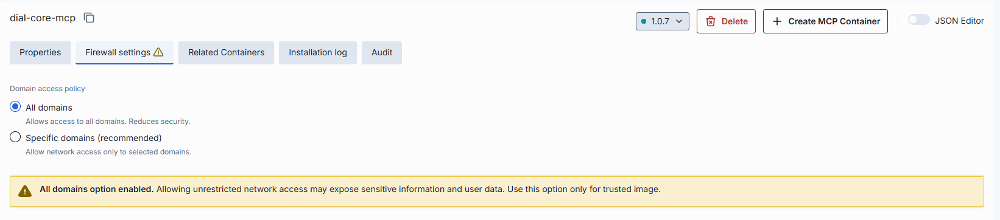

### Related containers

**Note**
> This tab is disabled for images that are not installed. **Add** is available only for installed images.

The **Related Containers** tab shows all MCP, adapter, application, or interceptor containers linked to the selected image version.

Use **Add** to link containers that currently use a different image or version, for example to move them to this version.

**To link containers to this image version:**

1. Click **Add** to open the container selection modal. It lists containers of the same type that aren't linked to this version yet.
2. Use the **Show containers related to this image** toggle to choose which containers are listed:
   - **On** (default): Only containers linked to other versions of this image.
   - **Off**: All containers of this type that aren't linked to this version, including those that use other images.
3. Select one or more containers and click **Apply**.

**Warning**
> Running containers are restarted when their associated image changes.

**Note**
> Every container must be linked to an image version. Once linked, a container cannot be removed from this list — you can only change which image it uses.

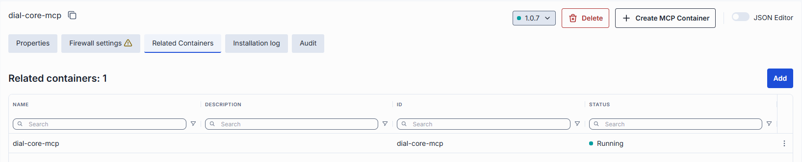

### Installation log

**Note**
> This tab is disabled for images that are not installed. It is available during and after installation, including failed and stopped builds.

The **Build Log** tab shows the complete output from the image build process, including step-by-step command output, warnings, and errors that occurred during creation.

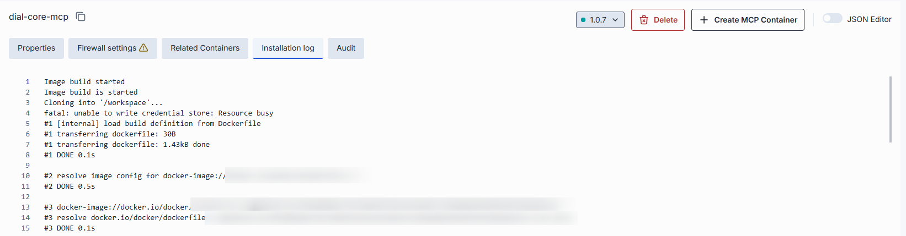

### Audit

The **Audit** tab shows activity, usage, and operational metrics for the selected image version, including build history and configuration change history.

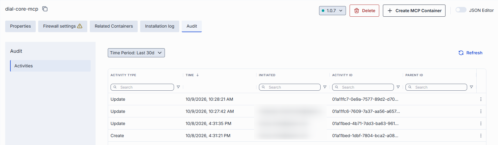

## Next steps

- [Manage containers](./2.container-management.md) — deploy and manage adapter, application, and interceptor containers based on your images
- [Manage MCP containers](./2.container-management.md#mcp-containers) — deploy MCP server containers and create toolsets from them
- [Manage models](../1.ai-gateway/1.models.md) — register AI models that use adapter containers as their source
