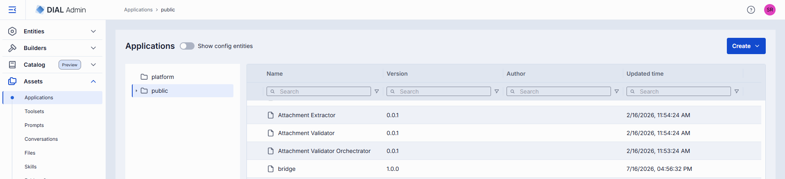
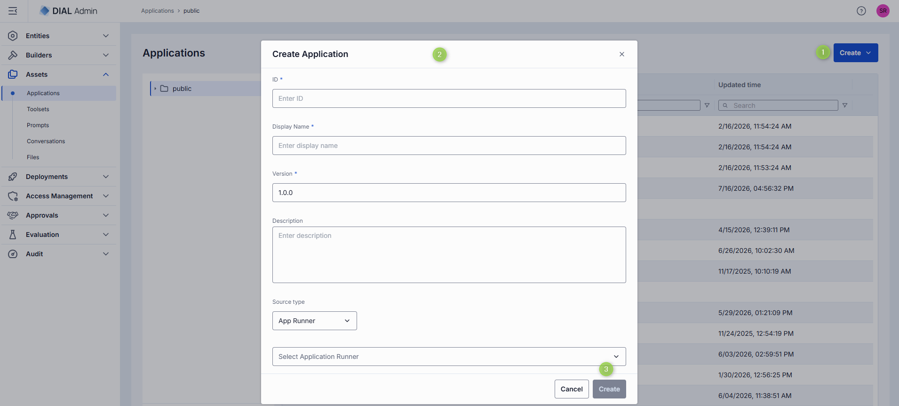
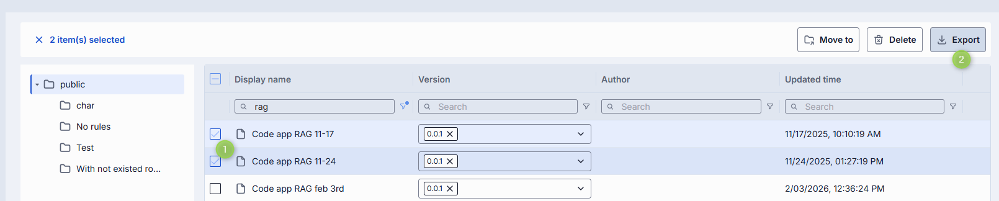
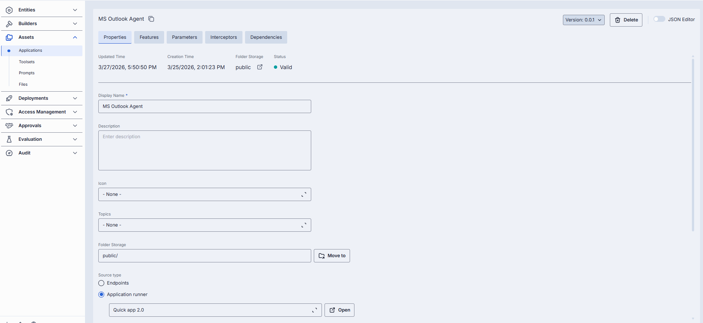
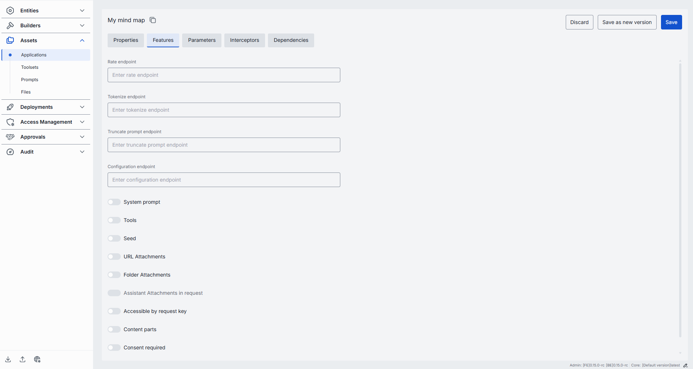
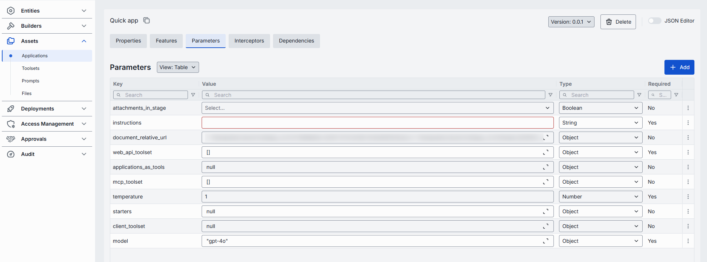
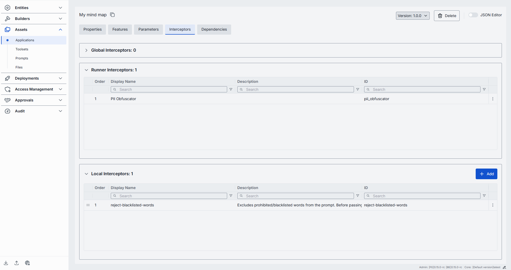
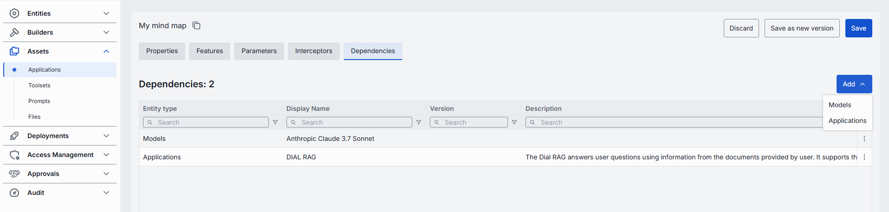
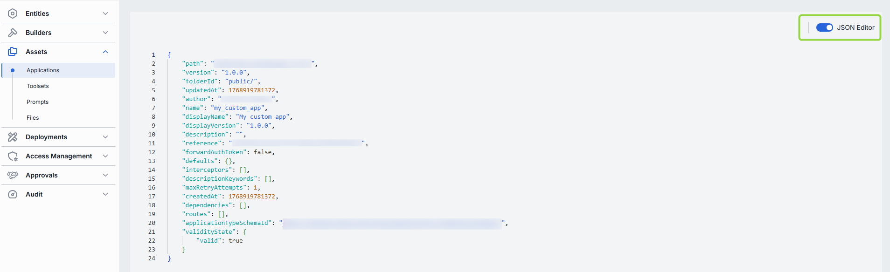

# Applications

In DIAL, applications created by users—via the DIAL Core API or UI—are stored in each user's private folder in DIAL file storage and are not accessible to others. To make an application broadly available, its owner publishes it, or an administrator manages it here in **Assets → Applications**.

**Note**
> Refer to [Entities → Applications](../2.entities/2.applications.md) to learn about application deployments in DIAL. Refer to [Chat User Guide](../../6.chat-user-guide/6.sharing-and-publishing.md) for how end users publish applications. Refer to [DIAL Core API Publications](https://dialx.ai/dial_api#tag/Publications) for managing publication requests via API.

## Main screen

The screen has a **folder tree** on the left and a grid of the selected folder's contents on the right. The header holds a **Create** dropdown.

<!-- SCREENSHOT OUTDATED: tree now shows three roots (file, platform, public) and the "Show config entities" toggle has been removed (FE 0.22.0-rc.0) -->

### Folder tree and views

The tree has three top-level (root) folders. Click a folder to list its contents in the grid.

| Root folder | What it is and how it behaves |
|-------------|------------------------------|
| **file** | Applications defined in the **DIAL Core configuration files** (as opposed to the database/API-managed assets in the other buckets). A **read-only**, names-only listing: no **Create** button and no row, bulk, or folder actions. Opening an entry shows its configuration in read-only mode, marked with a **READ ONLY** badge; it cannot be edited, deleted, duplicated, or moved. Use this to see which applications come from the static config rather than from published assets. |
| **platform** | Platform-level applications, managed centrally. A **flat, unversioned** bucket: no sub-folders and no versions. You cannot move items into it, and it exposes a reduced set of actions. It also adds a **Roles** section on the configuration screen (see [Roles](#roles)). Appears when the Catalog menu group is enabled. |
| **public** | The standard asset bucket. A **versioned**, hierarchical tree: applications live in folders (nesting up to 4 levels deep) and each can have multiple versions. You can create folders, move, duplicate, rename, and manage permissions here. |

The grid columns, the **Create** menu, and the available row actions all change depending on which bucket you are browsing.

### Grid columns

Columns differ by bucket. There is no ID column—the row identity is the **Name** cell. Every column (except in the file bucket) has an inline search/filter box.

**File bucket:** a single **Name** column (the config-entity name). No other columns, and no actions.

**Public bucket**

| Column | Description |
|--------|-------------|
| **Name** | Name of the application or folder. Click to open. |
| **Version** | The published version. Becomes a version picker when rows are selected. |
| **Author** | Who created or last updated the application. |
| **Updated time** | Timestamp of the last modification. |

**Platform bucket** (platform apps have no versions, so there is no Version column)

| Column | Description |
|--------|-------------|
| **Name** | Name of the application. Click to open. |
| **Author** | Who created or last updated the application. |
| **Created time** | Creation timestamp. |
| **Updated time** | Timestamp of the last modification. |

### Row actions

Open a row's actions menu (**⋮**). The actions depend on whether the row is an application or a folder, and on the bucket.

**Application (public bucket)**

| Action | What it does |
|--------|--------------|
| **Open in a new tab** | Opens the application's configuration screen in a new browser tab. |
| **Duplicate** | Copies the application—either as a **New Version** of the same application, or as a **New Application** (new ID, in a folder you choose). |
| **Move to** | Moves the application to another folder (platform is excluded as a destination). |
| **Export** | Downloads the application as a DIAL Admin Archive or JSON. |
| **Delete** | Permanently removes the application. |

**Folder (public bucket)**

| Action | What it does |
|--------|--------------|
| **Add sibling** | Creates a new folder next to this one (same parent). |
| **Add child** | Creates a new folder inside this one. |
| **Move to** | Moves the folder (and its contents) elsewhere. |
| **Export** | Downloads the folder and everything in it. |
| **Manage permissions** | Opens permission management for the folder. |
| **Rename** | Renames the folder. |
| **Delete** | Deletes the folder and its contents. |

**Application (platform bucket):** **Open in a new tab**, **Duplicate**, **Delete** only.

Select one or more rows to reveal the **bulk-actions** toolbar: **Move to**, **Export**, **Delete** (public) or **Delete** (platform).

### Create: Folder, Application, or Import

The **Create** dropdown in the header is the single entry point for adding content. Its items depend on the bucket:

- **Public bucket:**
  - **Folder** — adds a new folder in the tree.
  - **Application** — opens the [Create Application modal](#create-an-application).
  - **Import** — opens the [Import modal](#import-applications).
- **Platform bucket:** only **Application**.
- **File bucket:** no Create button (read-only).

## Create an application

1. Select the target folder, click **Create**, and select **Application**.
2. Fill in the form. The top fields are always shown:

   | Field | Required | Description |
   |-------|----------|-------------|
   | **ID** | Yes | Unique identifier of the application. |
   | **Display Name** | Yes | Name shown on the UI (e.g. "Customer Support Bot"). |
   | **Version** | Yes | Semantic version (e.g. `1.0.0`, pre-filled). Hidden when creating in the platform bucket. |
   | **Description** | No | Free-text description of the application. |
   | **Source Type** | Yes | **Endpoints**, **App Runner**, or **Code App** (default Endpoints). Determines how DIAL Core reaches the application. **Code App** appears only when the code-app editor URL is configured. |

3. The fields below **Source Type** change with the selected type:

   - **Endpoints** — two independent checkboxes (at least one must stay checked):
     - **Chat Endpoint** → **Completion endpoint** (required; processes chat completion requests) and **Responses endpoint** (optional; processes OpenAI Responses API calls).
     - **MCP Endpoint** → **Endpoint** (required), **Transport** (fixed to HTTP), **Forward per request key** (toggle; forwards a [per-request key](../../3.building-with-dial/7.working-with-dial-resources/5.per-request-keys.md) so the MCP server can reach DIAL storage), **Configuration delivery** (**Header** or **Meta**—how the app's configuration is delivered to the MCP server).
   - **App Runner** — a single **Select Application Runner** dropdown. The runner acts as a factory; DIAL Core forwards payloads to the endpoints defined in the [Application Runner configuration](../3.builders/1.application-runners.md).
   - **Code App** — a read-only **Editor URL** (pre-filled from the configured code-app editor); nothing else to enter.

4. Click **Create**. The dialog closes and the new [application configuration screen](#configure-an-application) opens. The entry appears immediately under the selected folder.

   

**Tip**
> You can quickly add applications by duplicating an existing one—use **Duplicate** in its row menu, then choose **New Version** or **New Application**.

## Export applications

You can export individual applications or whole folders (including nested folders).

- To export a folder or application, choose **Export** in its row actions menu.
- To export several items at once, select them and use **Export** in the bulk-actions toolbar.
- In the Export dialog, choose the **Format**: **DIAL Admin Archive** or **JSON**.

## Import applications

Importing lets you migrate, restore, or share application assets between DIAL instances.

1. Click **Create** and select **Import**.
2. On the **Files** step, choose the file type and add your files (drag and drop or **Browse**):
   - **DIAL Admin Archive** — a single `aidial-admin.zip` archive (one at a time, max 4 MB).
   - **DIAL Core JSON Files** — up to 30 JSON files, max 4 MB per file and 64 MB in total.
3. Optionally enable **Ignore paths** to disregard the folder structure stored in the files (everything imports into the current folder).
4. On the **Properties** step, choose a **Conflict resolution** strategy:
   - **Skip** — keep existing applications; add only new ones.
   - **Override** — replace applications that have the same name and version.
5. Review the preview—items with validation errors or conflicts are flagged before import.
6. Click **Finish**.

## Delete an application

- Click **Delete** on the Configuration screen toolbar.
- Use **Delete** in the application's row actions menu.
- Delete the folder that contains the application.
- Select applications on the main screen and use the bulk-actions **Delete**.

**Warning**
> Deleting an application is permanent. Applications that depend on it will stop working.

## Configure an application

Click any application to open its configuration screen. A header band shows the **Maintainer**, **Updated Time**, **Creation Time**, and **Folder Storage** (the folder path, with a link that opens it in [Folders Storage](7.folders-storage.md)).

**Top bar controls**

| Control | Description |
|---------|-------------|
| **Version** | Dropdown to view and edit a specific version, or create a new one. |
| **Delete** | Delete the selected application. |
| **JSON Editor** (toggle) | Switch between the form UI and the raw [JSON view](#json-editor-applications). |
| **Save** / **Save as new version** / **Discard** | Appear when there are unsaved changes. **Save** updates the current version; **Save as new version** stores the edits as a new version; **Discard** reverts them (with confirmation). |

The screen is organized into sections: Properties, Features, Parameters, Catalog metadata, Interceptors, Dependencies, and App Routes. Conditional sections:
- **Tools Overview** appears only when the application exposes an MCP endpoint (its own, or from its Application Runner).
- **Roles** appears only for applications in the **platform** and **file** buckets.

Applications opened from the **file** bucket are read-only (a **READ ONLY** badge appears and the action buttons are hidden).

### Properties

Define the application's identity, source, and behavior. Fields render in this order:

| Field | Required | Description |
|-------|----------|-------------|
| **Display Name** | Yes | Name shown on the UI. |
| **Description** | No | Free-text summary (e.g. tooling, supported inputs/outputs, SLAs). |
| **Intro** | No | Introductory text shown to users of the application. |
| **Icon** | No | Logo that visually distinguishes the app. |
| **Topics** | No | Semantic labels (e.g. "finance", "support"). Select existing ones or type to add. |
| **Folder Storage** | No | The folder that holds the application. Edit the path or click **Move to** to relocate it (the move is applied on save; the platform bucket is not a valid destination). Hidden for platform-bucket apps. |
| **Source Type** | Yes | **Interfaces**, **Endpoints**, **App Runner**, or **Code App**. The fields below depend on this choice—see [Source Type fields](#source-type-fields). |
| **Override name** | No | An alternate name for the application's deployment. Advanced—leave empty unless an integration requires the deployment to be exposed under a different name. |
| **Base URL** | No | The deployment-level upstream root URL. Each entry in **Interfaces** that has no base URL of its own falls back to this one; in passthrough mode DIAL Core routes requests straight to it. |
| **Interfaces** | No | API interfaces the application exposes: OpenAI Chat Completions, OpenAI Responses, Anthropic Messages. Click **+ Add interface**; each can set its own base URL and mode, or inherit **Base URL** above. |
| **External Services** | No | External services the application authenticates to. Add each with its ID, display name, description, and auth settings. (Assets Applications use per-service external-service auth rather than a single forward-auth-token setting.) |
| **Attachment types** | No | Which attachments the app accepts: **No attachments**, **All attachments types** (optionally capped), or **Specific attachments types** (choose/add [MIME types](https://developer.mozilla.org/en-US/docs/Web/HTTP/Basics_of_HTTP/MIME_types/Common_types)). |
| **Attachments max number** | No | Maximum number of input attachments. Shown when attachment types are set. |
| **Completion Defaults** | No | Default parameters applied when a request to the OpenAI `chat/completions` API omits them. |
| **Responses Defaults** | No | Default parameters for the OpenAI `openai/v1/responses` API. Shown only when the application has a responses endpoint. |
| **Default headers** | No | Key-value HTTP headers sent with every request to the application. |
| **Max retry attempts** | No | How many times DIAL Core [retries](../../4.operating-dial/4.configuration/7.load-balancer.md#fallbacks) a failed run (timeouts or 5xx). Values 1–5, default 1. |
| **Catalog schema** | No | The catalog schema that defines this application's catalog metadata. Click the selector to pick a schema, or **Browse** to choose one. Selecting a schema enables the [Catalog metadata](#catalog-metadata) section. |

#### Source Type fields {#source-type-fields}

The controls under **Source Type** differ by the selected type:

- **Endpoints** — the same **Chat Endpoint** and **MCP Endpoint** checkboxes described under [Create an application](#create-an-application), followed by two URL fields that appear only on the configuration screen:
  - **Viewer URL** — URL of a custom end-user UI; when set, it overrides the standard DIAL Chat UI for this application.
  - **Editor URL** — URL of a custom UI for configuring the application.
- **App Runner** — the selected Application Runner, shown as a picker with an **Open** button that opens the runner in a new tab. (On this screen the runner is labelled by its ID.) Viewer/Editor URL are not shown for this source type.
- **Code App** — a single read-only **Editor URL** (the configured code-app editor).

<!-- SCREENSHOT OUTDATED: Properties now ends with the Catalog schema field (FE 0.22.0-rc.0) -->

### Tools Overview

Shown only when the application has an MCP endpoint (its own, or from its Application Runner). [Tools](https://modelcontextprotocol.io/specification/2025-06-18/server/tools) are functions exposed by an MCP server; here you discover, manage, and try them.

**Note**
> Refer to the [Toolsets section](2.toolsets.md#tools-overview-tab) for the **Use all tools**, **Manage tools**, and **Try tools** workflows—the functionality is identical.

### Features

Control the application's optional capabilities. Values set on an Application Runner are inherited by applications built from it (shown with a "This value is inherited from Application Runner features" tooltip); setting them here overrides the runner.

**Service endpoints** — optional URLs that extend the app's runtime behavior:

| Field | Description |
|-------|-------------|
| **Rate endpoint** | A custom rate-estimation API to compute cost or quota usage (e.g. per-tenant or complex billing). |
| **Tokenize endpoint** | A custom tokenization service for precise, app-wide token counting. |
| **Truncate prompt endpoint** | Your own prompt-truncation API for advanced context-window management. |
| **Configuration endpoint** | A URL returning a JSON Schema of the application's settings. DIAL Core exposes it as `GET v1/deployments/<deployment name>/configuration`. |

**Reasoning Efforts** — the set of reasoning-effort values the application accepts (type or select them).

**Capability toggles.** Each toggle tells DIAL (and clients) that the application supports a given request parameter or capability; when off, DIAL treats that feature as unavailable for the app. Grouped by purpose:

| Group | Toggle | What it controls |
|-------|--------|------------------|
| **Sampling & Output Control** | Temperature supported | The app accepts `temperature`, which controls output randomness (lower = more deterministic, higher = more varied). Enable only if the underlying model honors it. |
| | Custom temperature | The app allows a custom temperature value instead of forcing a fixed/default one. |
| | Seed | The app accepts `seed`, so the same seed and inputs reproduce the same output—useful for testing and reproducibility. |
| | Max tokens | The app accepts `max_tokens`, capping the length of the generated completion. |
| | Max completion tokens | The app accepts `max_completion_tokens`, the newer cap on completion length used by reasoning-style models. |
| **Tools / Function Calling** | Tools | The app accepts `tools`/`functions`, letting the model call external functions you define in the request (e.g. calendar lookup, DB fetch). |
| | Parallel tool calls | The app accepts `parallel_tool_calls`, letting the model request several tool calls in one turn. |
| **Prompt & Message Composition** | System prompt | The app accepts a system message that sets the assistant's role and instructions—useful for agent orchestration. |
| | Content parts | The app accepts multi-part message content (e.g. text plus images in one message) rather than plain text only. |
| **Attachments** | URL Attachments | The app accepts attachments referenced by URL instead of uploaded files. |
| | Folder Attachments | The app accepts a whole folder as an attachment, batching its files in one request. |
| | Assistant Attachments in request | DIAL keeps `attachments` on prior `role=assistant` messages when sending the conversation back, so the app can reuse files it generated earlier. See [chat completion requests](https://dialx.ai/dial_api#operation/sendChatCompletionRequest). |
| **Session & Access** | Allow resume | The app supports resuming a previously interrupted generation instead of restarting it. |
| | Accessible by request key | The app can be invoked with a [per-request API key](../../3.building-with-dial/7.working-with-dial-resources/5.per-request-keys.md), which is how one deployment calls another on a user's behalf. |
| | Consent required | Users must grant [consent](https://dialx.ai/dial_api#tag/User-Consent) before they can use the app the first time. |
| **Feedback** | Support comment in rate response | The app's rate endpoint can return a free-text `comment` alongside the numeric score. |

### Parameters

For applications built from an Application Runner, this section configures the parameters defined by the [runner's schema](../3.builders/1.application-runners.md#parameters). Use the **View** selector to choose how parameters are presented:

- **Table** — the parameters as a grid.
- **Generated form** — a form generated from the runner's JSON schema.
- **Application custom UI** — the application's own configuration UI, embedded from its editor URL.

**Note**
> Refer to [Schema-rich Applications](../../3.building-with-dial/1.apps/0.index.md#schema-based-apps) to learn more.

### Catalog metadata

Catalog metadata describes the application against a **catalog schema**—a structured set of fields defined centrally. The section is empty until you select a schema in the **Catalog schema** field on [Properties](#properties):

- **No schema selected** — the section shows "Select a catalog schema on the Properties tab to edit its catalog metadata."
- **Schema selected** — the schema's fields render for you to complete. Use the **View** selector to switch between a generated **Form** and raw **JSON**. A banner flags any stored properties the schema does not declare.

### Interceptors

Review and manage the [interceptors](../../3.building-with-dial/2.interceptors/0.index.md) that process requests and responses for this application. The section is split into collapsible groups, each showing its count:

- **Global Interceptors** — read-only. Interceptors from [System Properties](../1.config-backup-and-global-settings.md#system-properties) that apply to all deployments.
- **Runner Interceptors** — read-only. Inherited from the application's Application Runner. Shown only when the app has a runner source.
- **Local Interceptors** — editable. The application's own interceptors. Use **+ Add** to attach them, drag to reorder, and remove them from the row menu.

Request interceptors run in the listed order; response interceptors run in reverse. Each group's grid shows **Display Name** and **Description**.

**Note**
> Define interceptors in [Entities → Interceptors](../2.entities/4.interceptors.md) before attaching them here.

To add local interceptors: click **+ Add**, choose one or more in the **Add Interceptors** modal, and click **Apply**. To remove one, use its row menu → **Remove**. Click **Save** to apply.

### Dependencies

Applications often rely on other applications or models, forming dependency chains. Here you view, add, and remove the selected application's dependencies.

**Note**
> Refer to [Managing Authorization in Complex Application Ecosystems](../../3.building-with-dial/7.working-with-dial-resources/6.auth-matrix-for-apps.md) to learn more.

| Column | Description |
|--------|-------------|
| **Entity Type** | Whether the dependency is an Application or a Model. |
| **ID** | Identifier of the dependent model or application. |
| **Display Name** | Descriptive name of the dependent object. |
| **Version** | Version of the dependent object. |
| **Description** | Additional details about the dependent object. |
| **Actions** | Open the dependent object in a new tab, or remove it. |

To add a dependency: click **+ Add**, choose **Application** or **Model**, pick the item in the modal, and click **Add**.

### Roles

Shown only for applications in the **platform** and **file** buckets (read-only in the file bucket). The **Make available to specific roles** toggle controls who can use the application:

- **Off** — any authenticated user can use it.
- **On** — only the roles you add can use it. Click **+ Add Roles** to choose them.

### App Routes

Define and manage routes that DIAL Core uses when interacting with this application via specified endpoints. The left panel lists the routes; click **+ Add** and enter a **Display Name** to create one. Route configuration mirrors [Entities → Routes](../2.entities/5.routes.md).

Each route is configured through three sections:

- **Properties** — Display Name, Paths, Rewrite path (toggle), Methods, Output (Upstreams or Response), Upstream Endpoints (with Weight and Tier), Max retry attempts, Permissions, and Order.
- **Attachments** — Request attachment paths and Response attachment paths.
- **Roles** — the **Inherit Application Roles** toggle and a Roles grid (when inheritance is off).

### JSON editor (Applications) {#json-editor-applications}

Advanced users can work with the application's raw JSON—useful for bulk updates, copying configuration between environments, or editing settings not exposed in the form UI.

**Tip**
> Switching modes is disabled when there are unsaved changes.

1. Navigate to **Assets → Applications** and select the application you want to edit.
2. Click the **JSON Editor** toggle (top-right). The raw JSON is revealed.
