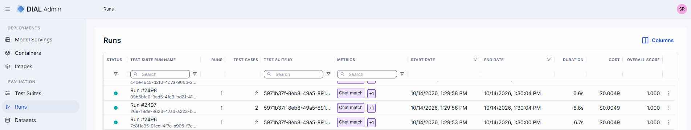
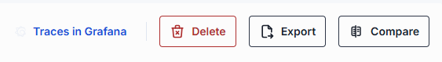
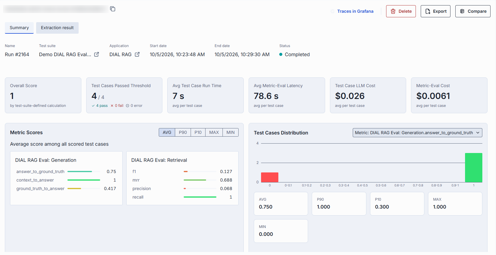
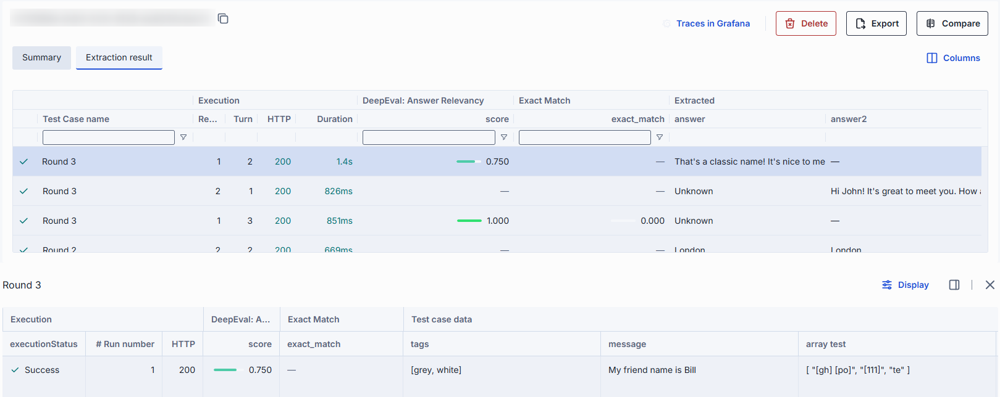
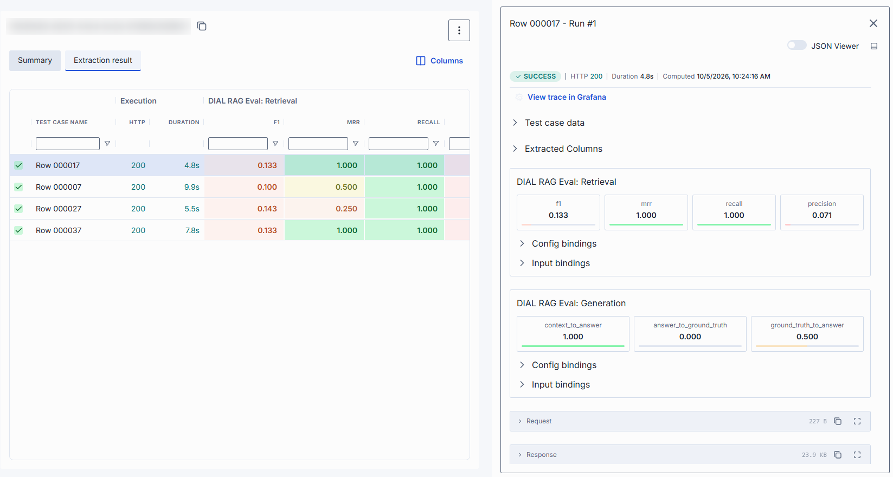
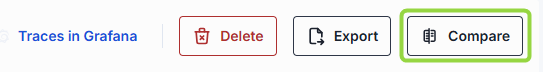
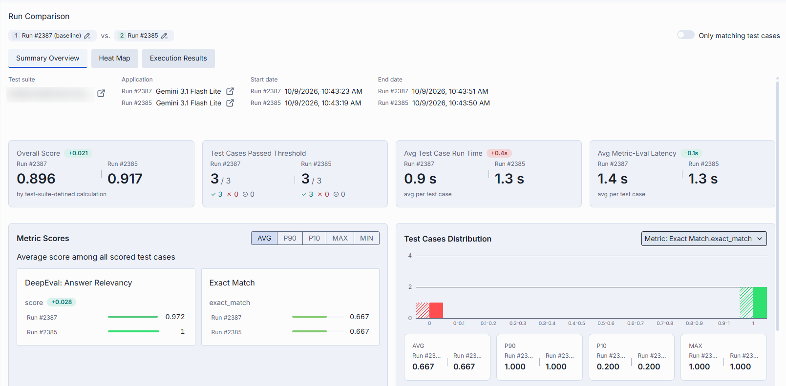
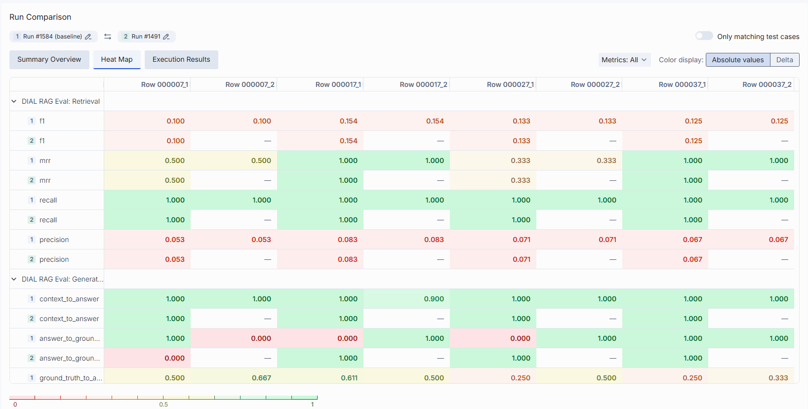
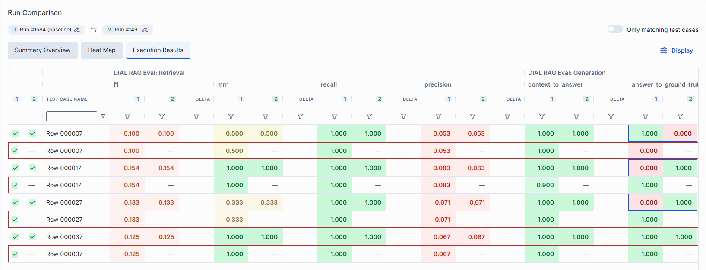

# Runs

A run is the result of executing a test suite. It records per-test-case metric scores, execution
status, timing, cost, and optionally links to Grafana traces. Use the Runs section to review results,
compare two runs side by side, or export results to CSV.

To read a run, start with the [Summary](#summary) tab to see whether the run passed and how scores are
distributed, then open the [Extraction result](#extraction-result) tab to find the test cases behind
the numbers. To find regressions between two runs of the same test suite, use [Compare runs](#compare-runs).

## Run statuses

| Status in the UI | Meaning | Available actions |
|------------------|---------|-------------------|
| **Pending** | The run is created and waits for execution. | **Stop**, **Delete** |
| **Running** | Test cases are being executed and evaluated. | **Stop**, **Delete** |
| **Stopping** | A stop was requested. In-flight requests complete, then the run stops. | **Delete** |
| **Stopped** | The run was stopped. Results collected before the stop are preserved. | **Delete** |
| **Completed** | The run finished. | **Export**, **Compare**, **Delete** |
| **Failed** | The run finished with an error. | **Delete** |

**Export** and **Compare** are available only for completed runs. If a stop fails, the run returns to
**Running** and a "Run not stopped" notification appears.

## Reading run results

Read this section once; the screens below use these rules everywhere.

### Scores and colors

Score cells, metric cards and the heat map are colored on a 0 to 1 scale in ten 0.1 bands: red for
scores near 0, through orange and yellow in the middle, to green for scores near 1. The colors assume
that a higher score is better. A metric can use another scale or direction: for example, the score of
the Ragas Noise Sensitivity metric is better when it is lower. Check the metric description (hover over the
metric title on the Summary tab) before judging a color.

In a comparison, a **Delta** is the compared run's score minus the baseline score. Green means the
score went up and red means it went down. A darker shade means a larger change (the scale steps at 0.25,
0.5, 0.75 and 1), and no change has a neutral color.

### How the numbers relate

| Value | Where it comes from |
|-------|---------------------|
| **Metric score** | One value per metric output for each row of the Extraction result grid. |
| **Test case score** | Calculated from the test case's metric scores with the test suite [score settings](1.test-suites.md#score-settings) (mean or weighted mean). A test case passes when its score is greater than or equal to the **Score threshold**. |
| **Metric Scores statistics** | Calculated across test cases, with one value per test case. When a test case has several rows (iterations, requests or turns), its value is, by default, the average of those rows. |
| **Overall Score** | The same calculation applied to the whole run. It is a score, not a count: it is separate from **Test Cases Passed Threshold**, which counts test cases. |

Because of iterations, request chains and multi-turn test cases, the Extraction result grid can have
more rows than the run has test cases.

### Failed, skipped and missing values

* **Pass** and **fail**: the test case was scored and the score was compared with the score threshold.
* **Error**: the test case's execution failed. A test case counts as failed if any of its rows failed: the
  request to the target returned an error or timed out, or a metric evaluation failed or timed out (a
  metric result that does not arrive in time is marked as failed). A failed test case gets no score, so it is
  neither passed nor failed, and it is not part of the score statistics. Check the **HTTP** and
  **Duration** columns and the metric error message in the row details to find the cause.
* **Dash in a metric cell**: the metric has no value for that row. The reasons are that the metric failed or
  that its **Condition** was false for that row. A skipped metric does not make the row fail.
* **No score for a test case**: a test case with no numeric metric values has no score.

### Find and fix problems in a run

1. On the Summary tab, check **Status**, the **Overall Score** and **Test Cases Passed Threshold**. If
   many test cases are in **error**, fix the cause (target availability, timeouts, the request template)
   before you read the scores.
2. In **Metric Scores**, switch the statistic. A good **Avg** with a low **P10** or **Min** means a group of
   test cases scores badly.
3. In **Test Cases Distribution**, select the weak metric and check whether scores are spread out or
   concentrated near 0.
4. On the Extraction result tab, sort the metric column ascending, then open the lowest rows.
5. In the row details, compare the test case data, the extracted columns and the response to find why the
   score is low. Use **Config bindings** and **Input bindings** to check that the metric was given the
   data you expect.
6. To see whether the score changed between runs, use [Compare runs](#compare-runs). To follow scores
   over many runs of the same test suite, use the **Trends** tab of the [test suite](1.test-suites.md#trends).

## Runs grid

Open **Evaluation > Runs** to see all runs across all test suites. Click any run row to open its
detail view. Use the **Status** column filter to show runs in selected statuses. The same grid, scoped
to one test suite, is the Runs tab of a [test suite](1.test-suites.md#runs).

| Column | Description |
|--------|-------------|
| **Status** | Execution status (see [Run statuses](#run-statuses)). |
| **Test suite run name** | Run name, with the run ID below it. The name is generated when the run starts, unless it is set when the run is created through the API. It is unique within a test suite. |
| **Runs** | Number of runs executed per test case (the **Number of runs** value from the start run dialog). |
| **Test cases** | Number of test cases in the run. |
| **Test Suite ID** | ID of the test suite that produced this run. |
| **Target** | Evaluated deployment, with its kind (for example, Application or Model) below the name. |
| **Metrics** | Metrics used in the run. |
| **Start Date** | Timestamp when the run began. |
| **End Date** | Timestamp when the run finished. |
| **Duration** | Duration of the run. |
| **Cost** | The total run's cost. A dash means no cost figure is available. |
| **Overall score** | The overall score of the run, calculated as configured in the test suite [score settings](1.test-suites.md#score-settings). A dash means the score is not available. |
| **Actions** | Per-row actions: **Open in a new tab**, **Compare**, **Export**, **Stop** and **Delete**. |

## Details

The detail view of a run has a header with actions and two tabs: **Summary** and **Extraction result**.

### Controls

| Control | Description |
|---------|-------------|
| **Stop** | Stop a running evaluation. Visible only while the run is **Pending** or **Running**. After you confirm, the run transitions to **Stopping** while in-flight requests complete, then to **Stopped**. Results collected before the stop are preserved. |
| **Delete** | Remove this run. |
| **Export** | Open the Export run popup. See [Export to CSV](#export-to-csv). Enabled only for completed runs. |
| **Traces in Grafana** | Open the linked Grafana Explore view for this run's traces. Visible only when a Grafana URL is configured. |
| **Compare** | Compare this run with another completed run of the same test suite. Enabled only for completed runs. See [Compare runs](#compare-runs). |

### Summary

The Summary tab answers the question "how did this run go overall?". It has four parts, from top to bottom.

**Run information.** The header shows the run **Name**, the **Test suite** and the **Application** (each
with a link that opens it in a new tab), **Start date**, **End date** and **Status**. For a test suite
with chained requests, **Requests in chain** shows how many requests are sent per test case. The
header reflects the test suite as it was when the run started.

**Key figures.** Cards summarize the whole run:

| Card | How to read it |
|------|----------------|
| **Overall Score** | The run's single score, calculated as configured in the test suite [score settings](1.test-suites.md#score-settings) (mean or weighted mean of metric outputs). Shown only when a score exists. |
| **Test Cases Passed Threshold** | Number of test cases that passed, as a fraction of all test cases, with a breakdown of **pass**, **fail** and **error**. Shown only when the test suite has a score threshold; a test case passes when its score is greater than or equal to the threshold. |
| **Avg Test Case Run Time** | Average time to execute one test case, in seconds. |
| **Avg Metric-Eval Latency** | Average time to evaluate the metrics of one test case, in seconds. |
| **Test Case LLM Cost** | Average cost per test case. A "Calculating…" label (usually under 10 minutes) means cost aggregation is still running. A dash means no figure is available, for example when the evaluated model has no pricing configured. **Cost data unavailable** means the cost request failed. Costs are not calculated for MCP toolset test suites. |
| **Metric-Eval Cost** | Average cost per test case of evaluating the metrics. It is a dash for a run without metrics. |

**Metric Scores.** One group of bars per metric (one bar per metric output). Use the statistic
selector to switch what the bars show; a short description under the title explains the selected statistic:

| Statistic | Meaning |
|-----------|---------|
| **Avg** | Average score among all scored test cases. |
| **P90** | Score higher than 90% of scored test cases. |
| **P10** | Score higher than 10% of scored test cases. |
| **Max** / **Min** | Highest / lowest score among all scored test cases. |
| **Med** | Median score among all scored test cases. |
| **Count** | Number of scored test cases. |

Hover over a metric title to see its description. Click a bar to select that metric in the
distribution panel. If no metric was scored, the panel shows "No metric scores available for this run."

**Test Cases Distribution.** Select a metric in the **Metric** list to see a histogram of how many test
cases got each score. The bars cover an exact `0`, ten 0.1-wide bands (`0–0.1` … `0.9–1`) and an exact
`1`. Below the histogram, cards show the statistics listed above for the selected metric. Use the
histogram to see whether a good average hides a group of failing test cases.

### Extraction result

The Extraction result tab displays a grid of per-test-case results: one row per test case,
iteration, request and turn. Use it to find the test cases behind the numbers on the Summary tab.

| Column group | Description |
|--------------|-------------|
| **Status and name** | Execution status icon and **Test Case name**. |
| **Execution** | **# Run number** (iteration of the test case), **Request** and **Turn** (position in a request chain or multi-turn test case), **HTTP** (response status code) and **Duration**. **Total requests** and **Total turns** are hidden by default. A column whose value is the same in every row starts hidden. |
| **Metrics** | One group per attached metric, with one column per metric output. Score cells are colored by score, and a dash means the metric has no value for the row. Failed metric evaluations are marked as failed. |
| **Input bindings** | Test case data used as input. Hidden by default. |
| **Extracted** | Extracted response fields (the response columns of the test suite). |

Sort metric columns to find the weakest test cases first; rows without a score are sorted last. Click
**Columns** in the tab header to open the columns panel, where you can show, hide and reorder columns
and column groups.

#### Row details

Click a row to open the **row details** for that result. If you click a cell, the details open with
that field in focus. By default the details open in a panel at the bottom of the screen; use the
layout button in the panel header to switch to a sidebar on the right, and back.

**Bottom panel.** A pivot table of one result: section headers (**Execution**, one section per
metric, test case data, extracted columns), field names below them, and the values of the selected
result in one row. Click a value to open it in a popup, for example to read a long response. Click
**Display** to open the fields tree and show or hide individual fields; **Duration** is hidden by
default. Your selection is kept while you move between rows.

**Sidebar.** The same result, laid out top to bottom:

* An execution bar with the execution status, HTTP code, duration, computation time and a link to the
  trace in Grafana.
* **Test case data** and **Extracted Columns**.
* One block per metric with score cards. Click a score card to see the metric details. If the metric
  failed, its error message is shown under the cards.
* **Request** and **Response** viewers.
* A **JSON viewer** switch that shows the raw result.

The standardized layout is the same for all metric types.

#### Metric bindings

In the sidebar, each metric block has expandable **Config bindings** and **Input bindings** sections.
They show how each metric parameter and input was bound (**Constant**, **TestCase**, or **Response**) and
the resolved value, making it easy to verify the evaluation setup. To open them, click any metric
score in the grid, then switch the panel to the sidebar layout.

### Compare runs

You can compare two runs from the same test suite to identify regressions or improvements.

Use one of the following methods:

- **From the run detail view**: Click **Compare**.
- **From the runs grid**: Select a run's **Compare** action.

In both cases the **Compare Against** dialog opens with a grid of the other completed runs of the same
test suite. Select a run and click **Confirm**. The comparison opens in a new browser tab. The run you
started from is the baseline.

#### Compare view

The view title is **Run Comparison**. The two runs are shown as tags: `[1] name (baseline)` and
`[2] name`. Use **Flip runs order** to swap the baseline and the compared run, or open a tag to pick a
different run.

All differences are calculated as compared run minus baseline. A positive change is shown in green
and a negative change in red. A value that exists in only one run is shown as added or removed.

| Control | Description |
|---------|-------------|
| **Only matching test cases** | When enabled, hides test cases that exist in only one of the two runs, showing only rows present in both. Test cases are matched by test case ID, iteration, request and turn; if IDs differ (for example, a public dataset versus its detached private copy), by test case name instead. |
| **Display** | Opens the fields tree where you toggle the visibility of column groups and fields (Identification, Execution, individual metrics) and the **Differences** options below. |
| **View differences only** | When enabled, the grid shows only rows with score differences. The diff counter recalculates based on visible columns. |
| **Hide highlights** | Disables highlighting of differences. |

The view has three tabs.

**Summary Overview** tab: High-level comparison of the two runs. It shows the run information of both
runs and the same panels as the run [Summary](#summary) (key figures, metric scores and the score
distribution) for both runs next to each other. Use this tab for a quick regression check. If no test
cases match, the tab shows "No results".

**Heat Map** tab: A visual matrix. Rows are metrics (expand a metric group to see its outputs) and
columns are test cases; when the runs have several iterations, requests or turns, the column header
shows the position. Cells are color-coded by score value. Hover over a cell to see the test case,
metric, input, run, score and delta (**N/A** means the value is missing). Use the toolbar to configure it:

* **Color display**: **Absolute values** (raw scores) or **Delta** (score differences between runs).
* **Metrics** filter: select which metrics appear. At least one metric must stay selected; a search box
  appears when there are many metrics.

**Execution Results** tab: Three-level column layout where each metric and execution column group splits into **Current** and **Compared** sub-groups, showing values from both runs side by side, with a delta badge when a metric score changed. Rows are joined by test case identity; unmatched test cases show a dash (`—`).

#### Row details in compare view

Click any row in the Execution Results tab to open the comparison details of that test case. The
layout button in the panel header switches between two views:

* **Pivot** (bottom panel, default): fields are columns, and the value of each run is shown side by side.
* **Table** (sidebar): one row per field, with the value of each run and the difference. Use the filter
  row to find a field by name.

Both views show side-by-side metric scores with score colors, and difference highlighting. The **Diff**
legend at the bottom counts the fields that **improved**, **changed** or **regressed**. **Display**
opens the same fields tree and **Differences** options as the grid (**View differences only** and
**Hide highlights**). **Run number** and **HTTP** are hidden by default. Click a value to open it in
a popup that shows both runs.

#### Find regressions between two runs

1. On **Summary Overview**, check whether the **Overall Score** and the metric statistics went down. Turn on
   **Only matching test cases** so that test cases added to or removed from the dataset don't distort the
   comparison.
2. On **Heat Map**, switch **Color display** to **Delta**. Red cells are test cases and metrics that got worse;
   a column of red cells points to a test case that regressed on several metrics, and a row of red cells to a metric
   that regressed broadly.
3. On **Execution Results**, turn on **View differences only** and sort by the metric to list the changed
   test cases, then open a row to compare the test case data, extracted columns and scores of both runs.
   The **Diff** counts show how many fields improved, changed or regressed.

## Export to CSV

You can export a run's results to a CSV file for offline analysis, reporting, or integration with
external tools.

1. Click the **Export** button in the run detail header, or select **Export** in the **Actions** column
   of the runs list.
2. In the **Export run** popup:

   | Section | Description |
   |---------|-------------|
   | **Columns accordion** | Select which columns to include. The header shows how many columns are selected. Columns are grouped by type (Identification, Data, Response, Metrics, Body). Use group-level checkboxes to select or deselect entire groups. Body columns (requestBody, responseBody, extractionWarnings) are unchecked by default. Within Metrics, columns are sub-grouped by metric name. |
   | **Preview accordion** | A live preview grid showing up to 10 rows with the currently selected columns. The preview updates instantly as you toggle columns. The full export includes all rows. |

3. Click **Export CSV**. The popup closes, an "Export started" notification appears while the file is
   prepared, and the file downloads automatically.

**Note**
> In the exported CSV, column groups use `::` as a delimiter (for example,
> `Metrics::Faithfulness::score`).

**Note**
> The Export button is disabled until the run is completed, so you can't export a pending, running,
> stopped or failed run.

## Delete

Select **Delete** in the **Actions** column of a run row, or click the **Delete** button in the run
detail header. A confirmation dialog appears before deletion.

## Next steps

- [Test suites](1.test-suites.md) — configure the target, request, metrics and score settings
- [Datasets](3.datasets.md) — create and manage test cases and their sch