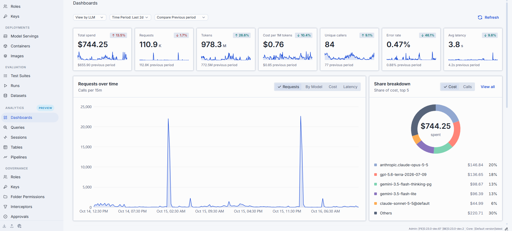
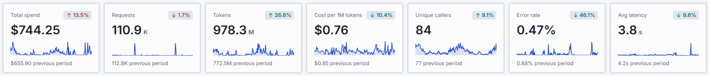
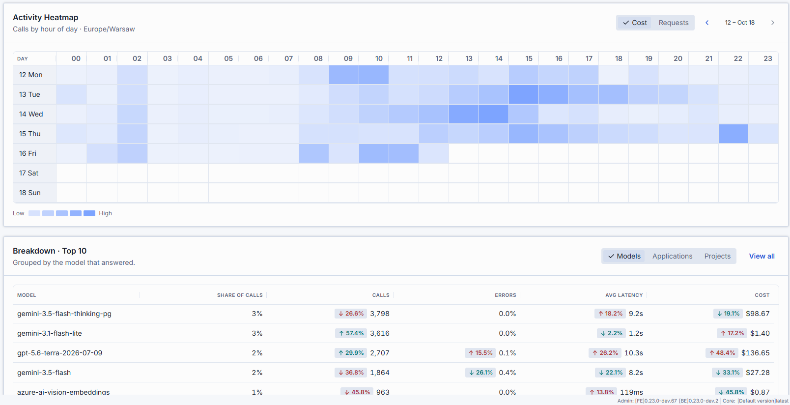

# Dashboards [Preview]

Navigate to **Analytics → Dashboards** for a system-wide, read-only view of usage, cost, latency,
callers, and errors across your DIAL deployment. The dashboard runs aggregate queries over the hop log
(`dial_usage_log`) — it is not a separate data store.

**Note**
> Dashboards is a [Preview] feature, served when `ANALYTICS_ENABLED` and `ANALYTICS_USAGE_ENABLED` are
> set. The same dashboard appears, scoped to a single entity, in each model, application, and toolset's
> **Audit → Dashboard** tab.

## Controls

| Control | Description |
|---------|-------------|
| **View by** | The top-level lens: **LLM**, **MCP**, or **Routes**. Each lens scopes the metrics and breakdowns to that workload type. |
| **Time Period** | Date range applied to all cards and charts. Choose a preset or a custom range. |
| **Compare Previous period** | Adds a period-over-period comparison to each card (previous period, month, or year). |
| **Refresh** | Reloads the dashboard data. |

## Metric cards

Each card shows the current value, a sparkline, and — when comparison is on — the change versus the
previous period.

| Metric | Description |
|--------|-------------|
| **Total spend** | Estimated cost in USD over the selected window. |
| **Requests** | Number of requests. |
| **Tokens** | Total prompt and completion tokens. |
| **Cost per 1M tokens** | Average cost per million tokens. |
| **Unique callers** | Count of distinct users or API keys. |
| **Error rate** | Share of requests that failed. |
| **Avg latency** | Average response time. |

## Charts and tables

| Element | Description |
|---------|-------------|
| **Requests over time** | Time-bucketed chart. Toggle between **Requests**, a **by-dimension** breakdown (for example By Model), **Cost**, and **Latency**. |
| **Share breakdown** | Donut chart of the top contributors; toggle between **Calls** and **Cost**; **View all** opens the full list. |
| **Activity Heatmap** | Calls by hour of day across the week; toggle **Requests** / **Cost**; navigate week by week. The color scale runs Low → High. |
| **Breakdown** | Sortable table grouped by **Models**, **Applications**, **Projects**, **MCP servers**, or **Tools** (depending on the selected view), with per-row drill-in. |

## Next steps

- [Sessions](5.sessions.md) — investigate individual conversations
- [Queries](4.queries.md) — ask your own questions of the data
- [Tables](2.tables.md) — define the data Analytics works with
- [Pipelines](3.pipelines.md) — enrich and aggregate that data
