# Tables [Preview]

Navigate to **Analytics → Tables** for the catalog of analytics tables. A table is a named, fixed set of
**columns** (the fields it holds) plus the **rows** (the records) stored under them. Pipelines, queries,
dashboards, and sessions all read and write tables, so a table is where you define what data DIAL Admin
analytics can store and how it is read.

Create a table when you want to keep your own data next to the built-in analytics, for example records sent
by your own application, or results derived from existing data by a [pipeline](3.pipelines.md). There are two kinds:

- **Source** tables — landing tables for raw data. A client writes rows to them (for example the hop log `dial_usage_log`).
- **Enrichment** tables — derived tables, keyed on a *grain* of a source table, populated by an
  enrichment [pipeline](3.pipelines.md) (for example `session_insights`).

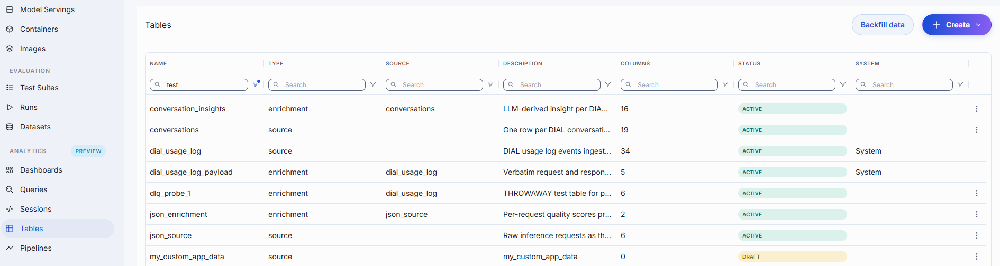

## Columns and rows

| | What it is | Defined where | Added how |
|---|---|---|---|
| **Column** | One field of the table: a name, a type, and whether it may be empty. | In the table's schema, on the table detail page. | **+ Column** while defining the schema, or **Add columns** on an active table. |
| **Row** | One stored record, with a value for each column. | Not defined — rows follow the schema. | Written by a client through the table's API (see [Add rows](#add-rows) and [Connect](#connect)). |

For example, a source table `support_tickets` with the columns `ticket_id`, `created_at`, `customer_email`,
and `status` stores one row per ticket:

| ticket_id | created_at | customer_email | status |
|---|---|---|---|
| T-1001 | 2026-10-01T09:30:00.000Z | alice@example.com | open |
| T-1002 | 2026-10-01T10:05:00.000Z | bob@example.com | closed |

An enrichment table `ticket_insights` on top of `support_tickets`, with the grain key `ticket_id`, adds
columns such as `sentiment` and `summary`, one row per ticket, filled in by a pipeline.

## Tables grid

| Column | Description |
|--------|-------------|
| **Name** | Table identifier (snake_case). |
| **Type** | `source` or `enrichment`. |
| **Source table** | For an enrichment table, the source table it derives from. |
| **Description** | Free-text summary. |
| **Columns** | Number of columns in the table. |
| **Status** | `Draft` (schema not yet defined), `Active` (schema materialized, table in use), or `Failed` (the schema could not be activated). |
| **System** | Marked **System** for built-in tables; blank for user-created tables. System tables are read-only. |

## Create a table

Creating a table takes two stages:

1. **Create** the table: name it and choose its kind. This stores only the table's identity. The popup does not ask for columns or keys.
2. **Define its schema** on the table's detail page: columns, keys, and the other settings. The table stays in **Draft** status until you save the schema. Saving makes it **Active**.

Only full administrators can create tables.

### Create source table

Use **Create source** in the toolbar to add a new source table.

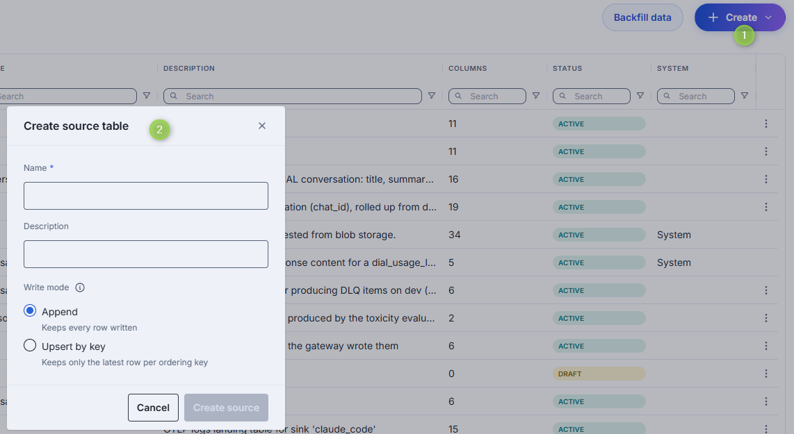

1. Click **Create** and select **Source**.
2. Enter **Name** and optionally a Description.
3. Select the **Write mode**, which defines how the table stores rows and cannot be changed after the table is created:
    - **Append**: keeps every row written.
    - **Upsert by key**: keeps only the latest row per ordering key, so the ordering key becomes the table's unique key. You choose the ordering key when you define the schema.
4. Click **Create source**. The table opens in **Draft** status.

### Create enrichment table

Use **Create enrichment** in the toolbar to add a new enrichment table.

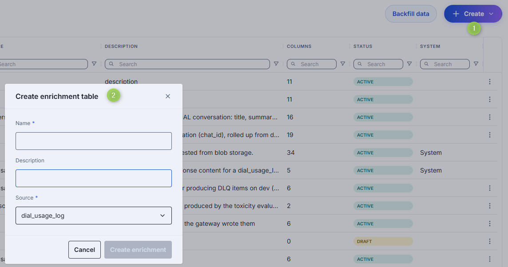

1. Click **Create** and select **Enrichment**.
2. Enter **Name** and optionally a Description.
3. Select the **Source** table from the dropdown list.
4. Click **Create enrichment**. The table opens in **Draft** status.

An enrichment table keeps one row per value of its grain key, so it has no write mode.

### Define the schema

A table in **Draft** (or **Failed**) status shows the **Draft schema** editor on its detail page.

1. In **Columns**, click **+ Column** to add a column to the form. Each line sets:
    - **Name** — the column identifier (snake_case, max 64 characters).
    - **Type** — see [Column types](#columns-grid). An `array` column also needs an element type. An `enum` column needs a list of allowed values.
    - **Nullable** — whether the column may be empty. This is fixed when the column is created. `array` and `object` columns cannot be nullable.
    - **Sensitive** — see [Sensitive columns](#sensitive-columns).
    - Optionally a **Tag**, **Display name** (max 128 characters), and **Description** (max 1024 characters).
2. Under **Keys**, set the table's keys (see [Keys and settings](#keys-and-settings)). Keys are set once, when the table is created, and fixed afterwards.
3. Click **Save** in the header.

**+ Column** only adds a line to this form. Nothing is stored until you click **Save**. Use **Discard** in the header to drop unsaved changes. You can also edit the whole definition as [JSON](#json-editor).

If activation fails, the table gets **Failed** status. Fix the draft and save again.

Example, the `support_tickets` source table:

| Setting | Value |
|---|---|
| Columns | `ticket_id` string, not nullable · `created_at` timestamp, not nullable · `customer_email` string, nullable, **Sensitive** · `status` string, not nullable |
| Ordering key | `created_at`, `ticket_id` |
| Partition column / Granularity | `created_at` / `Month` |
| Identity column / Version column | `ticket_id` / `created_at` |

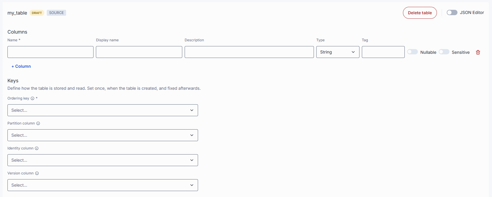

## Backfill data

Use the backfill button to manage data re-ingestion directly from the analytics console UI, eliminating the need to call upstream services manually. Use this feature to re-ingest raw logs into source tables or fix missing days.

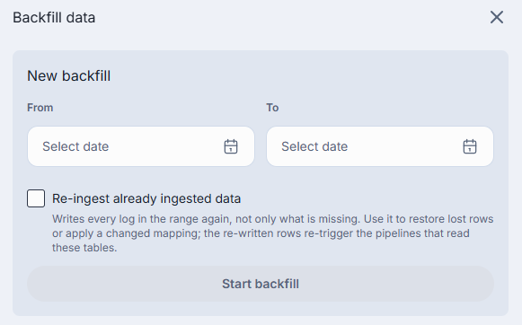

1. Open the Drawer: Click the **Backfill data** toolbar button (visible only to full admins and hidden while a run is active) to open the side panel.
2. Start a New Backfill:
    - Select start and end UTC dates (up to a 366-day span limit).
    - Toggle "Re-ingest" on to force re-ingestion of every log in the range (note: this triggers dependent pipelines).
3. Track Progress: Monitor active runs via the In-Progress Banner above the Tables listing.
4. Handling Failures: For finished or failed runs with missing days, click "Re-run from the first failed day" (skips already-ingested data by default).

## Detail view

Click any table to open its detail view. The header shows the table's name, status, kind, and description, and the actions you may use: **Delete table**, **Add columns**, **Add rows**, and **Connect**. Which actions appear depends on your permissions and on the table. System tables show a read-only indicator instead.

The tabs are **Properties**, **Access**, and **Audit**.

### Properties

The Properties tab shows the table's keys and settings and its column schema.

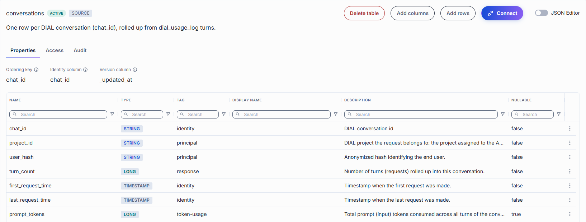

#### Keys and settings

These values are set once, when the table is created.

| Field | Type of table | Description |
|-------|-------- | -----|
| **Source**| Enrichment | The source table. |
| **Grain key** | Enrichment | Links the enrichment to its source table. A row attaches to every source row with the same value, for example `chat_id`. Only one row is kept per value: a repeated key replaces the previous row. Columns of type `object` cannot be the grain key. |
| **Ordering key** | Source | The columns the rows are stored in order of. Queries that filter or sort by the leading columns of the key read only part of the table, so put the most-filtered columns first. Eligible columns are non-nullable and not `object`. |
| **Partition column** | Source | Optional. Groups rows into time chunks, so a query filtered on this column skips the chunks it does not cover. Most tables need no partition. Only non-nullable `date` and `timestamp` columns are eligible. |
| **Granularity** | Source | How much time one chunk covers: `day`, `month`, or `year`. Shown only when a partition column is set. `month` suits almost every table. `year` fits a small table or queries over long periods. `day` fits only a fast-growing table queried a day at a time, because thousands of tiny chunks read slower, not faster. |
| **Identity column** | Source | Optional, set together with the Version column. The value must differ in every row. Together with the Version column it lets pipelines read the table in batches without handling a row twice. Uniqueness is not validated, and repeated values cause rows to be skipped. Eligible columns are non-nullable and not sensitive. |
| **Version column** | Source | Optional, set together with the Identity column. Records when a row was written or last changed, so a pipeline can tell which rows are new since its last pass. The value must never move backwards. This is not validated, and a backdated value causes rows to be missed. Eligible columns are non-nullable, non-sensitive `timestamp` columns. |

A source table without an Identity and Version column shows that it is *not scannable*: pipelines cannot read it incrementally.

#### Columns grid

| Column | Description |
|--------|-------------|
| **Name** | Column identifier (snake_case, max 64 chars). A marker after the name flags a [**Sensitive**](#sensitive-columns) column. |
| **Type** | Data type: `uuid`, `string`, `enum`, `integer`, `long`, `decimal`, `boolean`, `date`, `timestamp`, `object`, or `array`. |
| **Tag** | Semantic role of the column (for example `identity`, `insight`, `provenance`). |
| **Display name** | Human-readable label shown in other screens. |
| **Description** | What the column holds. |
| **Nullable** | Whether the column may be empty. |

For an enrichment table the grid pins the grain key as the first row. It cannot be edited.

On an active table, use the row actions to edit or delete a column, or edit the name in place. Limits:

- A column used as the ordering key, partition column, grain key, Identity column, or Version column cannot be deleted.
- The name of an ordering key, partition, grain key, or system (`_`-prefixed) column cannot be changed.
- **Nullable** is read-only after the column is created.
- The value list of an `enum` column cannot be changed. To change it, delete the column and add it again.

#### Sensitive columns

**Sensitive** is a switch on a column that marks it as holding data not every role should see. A role sees
sensitive columns only when it has the **sensitive clearance** on that table (see [Access](#access)). The
analytics service withholds sensitive columns from roles without it.

A column used as the Identity or Version column cannot be marked sensitive. Changing a column's sensitivity needs the sensitive clearance on that table.

#### Add columns

On an **Active** table, click **Add columns** in the header to open a form with the same column lines as the Draft schema editor. Unlike the draft, **Save** applies the change at once and the grid refreshes.

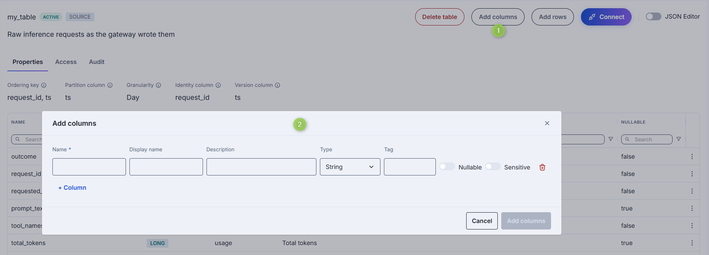

### Access

The **Access** tab controls which roles can use the table and what they can do. Roles are the DIAL Core roles; manage them in [Governance](../6.governance/1.roles.md). The tab is hidden when the analytics service refuses your request to read the table's access.

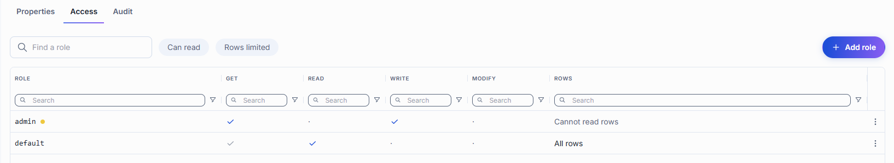

The grid lists every role with a grant on the table, and shows **Get**, **Read**, **Write**, **Modify**, and **Rows** for each. Use the search box and the **Can read** and **Rows limited** filters to narrow it.

| Privilege | Allows |
|---|---|
| **Get** | Access to the table. Included automatically with **Read** and **Modify**. |
| **Read** | Reading the table's rows. |
| **Write** | Adding rows. Not available on system tables. |
| **Modify** | Changing the table: columns, description. Not available on system tables. |
| **Sensitive clearance** | Seeing the table's sensitive columns. It belongs to the role and covers everything the role can do on this table. Offered only with Get, Read, or Modify. |

#### Add roles

1. Click **Add role** to open the side panel.
2. **1 · Role** — select a role from the dropdown list.
3. **2 · What it can do** — use the checkboxes to set **Get**, **Read**, **Write**, and **Modify**.
4. **3 · Sensitive columns** — activate **Grant the sensitive clearance** to give the role access to the table's sensitive columns. The panel lists the columns this covers.
5. **4 · Which rows can it read?** — shown for **Read**. Choose **All rows**, or **Only some rows** to add a row limit: a filter built from conditions and groups, edited with the **Visual** form or as **JSON**. The limit applies to every way of reading the table: queries, SQL, CSV export, and Flight SQL.
6. Click **Save role**, then **Done** to exit the side panel.

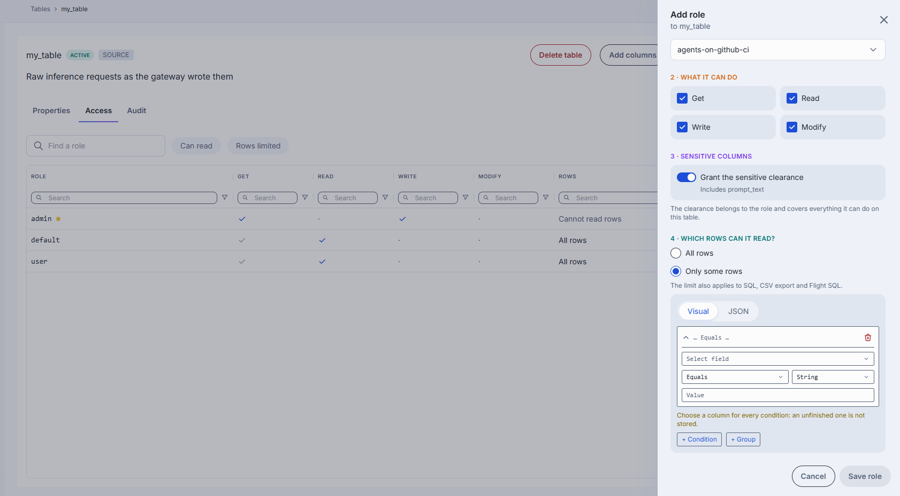

When a row limit applies to your own role, the table shows a **Rows restricted** badge in the catalog and in its header.

#### Edit and remove roles

Click any role in the grid to preview or edit its permissions in the side panel. **Remove role** deletes all of the role's grants on the table together with its row limit. If the role also reads every table through its privilege mapping, its users then see every row of this table.

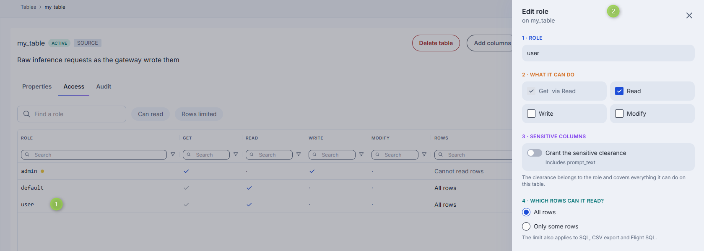

### Audit

The Audit tab records configuration changes to the table (available when the Admin API is enabled and offered for active tables).

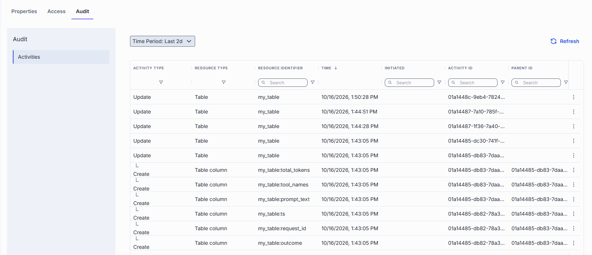

### Add rows

Click **Add rows** in the header to insert rows by hand. It is for checking that the schema accepts what you expect, not for loading data.

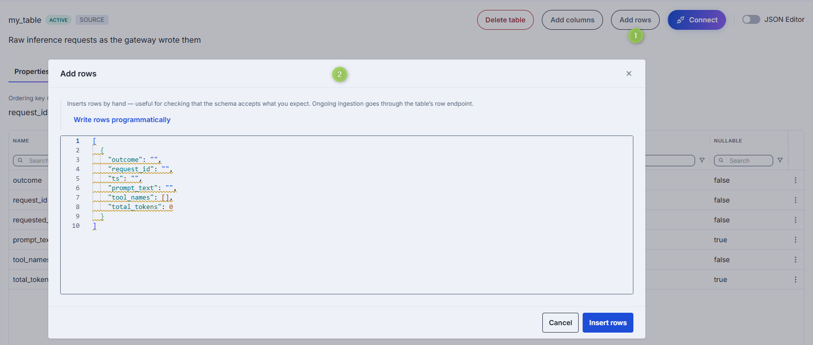

1. Edit the JSON array. It is prefilled with one example row. Each key is a column's **Name** (not its Display name), and each value matches the column's type.
2. Click **Insert rows**.

The button is not offered for enrichment tables (a pipeline writes their rows) or system tables, and it needs the **Write** privilege on the table.

To load data on an ongoing basis, write rows programmatically: a client sends rows to the table's row endpoint with a DIAL API key. Click **Write rows programmatically** in the popup to open the **Write data** tab of [Connect](#connect).

### Connect

Click **Connect** to open the **Connect to** panel for the table, which generates ready-to-run code for reading or writing the table from outside DIAL Admin. Use it when you build an application, script, or job that sends data to a table or queries it, since DIAL Admin does not load data for you.

The panel has two tabs:

- **Write data** — a Python and a cURL example that send rows with `POST /v1/tables/{name}/rows`. The body is `{"rows": [...]}`, up to 10000 rows per request. It lists the roles a key must carry to write, and the value formats for the table's columns. It also explains how to read rejection errors.
- **Read data** — a Python, cURL, and Flight SQL (pandas) example that run a query. Without an explicit `LIMIT` a query returns 100 rows. Reading is not restricted per table: any key with analytics access can query the table.

Every example sends a DIAL API key in the `Api-Key` header. Set it in the `DIAL_API_KEY` environment variable, and replace the endpoint placeholders with your DIAL Analytics endpoint. The panel never shows a real key.

A key with administrator access can write to the table regardless of its roles. For a job that only appends rows, use a key whose role has **Write** on this table.

For enrichment and system tables only the **Read data** tab is shown, because their rows are produced by the platform.

### JSON Editor

Use the JSON view mode to edit the table's definition, including its columns, as JSON. For a table in **Draft** status you can edit and save the JSON. For an **Active** table the JSON view is read-only and can be copied. You can paste a copied definition into a newly created table to quickly create a similar table.

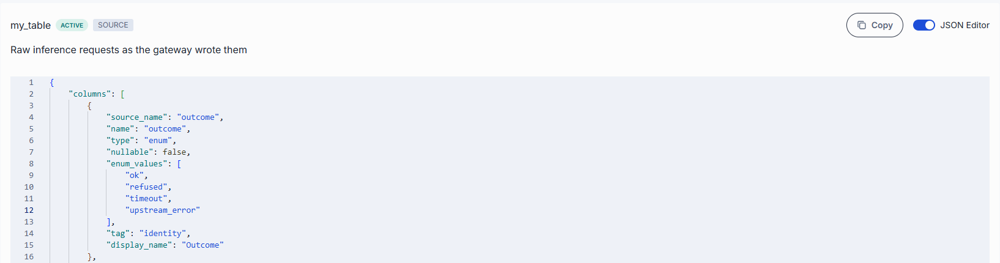

## Next steps

- [Pipelines](3.pipelines.md) — populate enrichment and rollup tables
- [Queries](4.queries.md) — query the data stored in tables
- [Analytics overview](0.index.md) — return to the Analytics index
