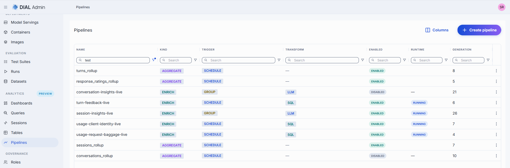
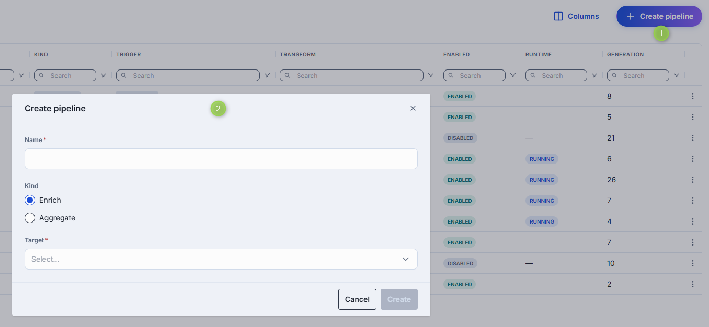
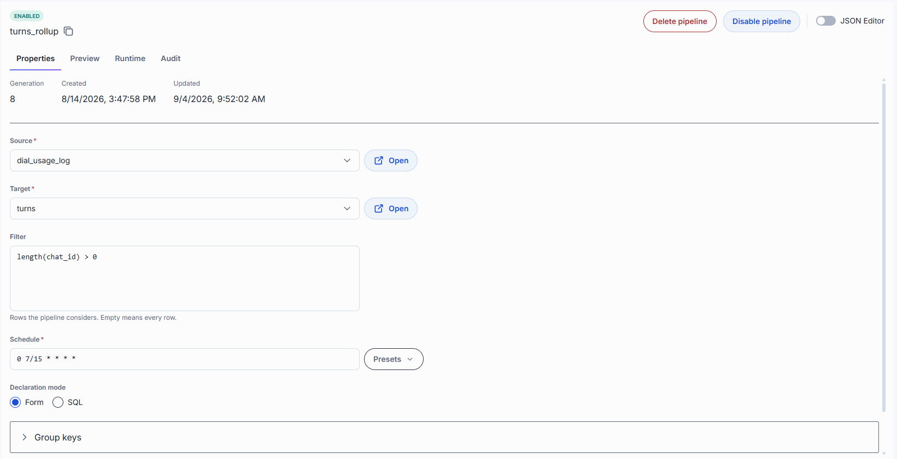
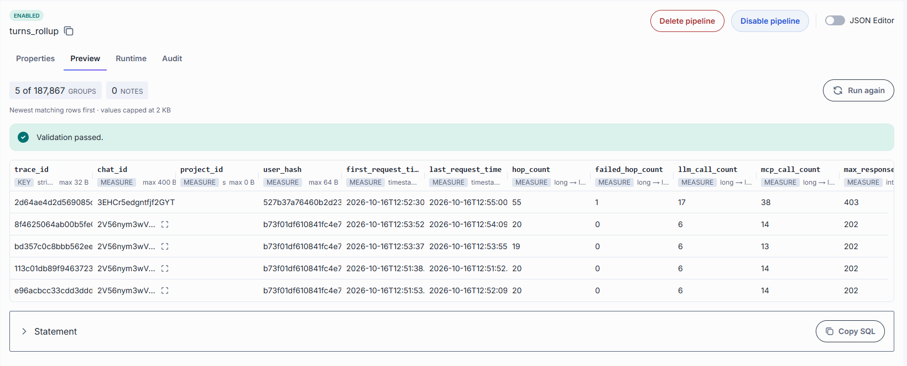
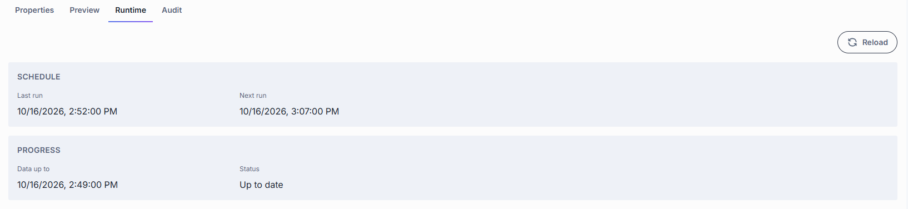

# Pipelines [Preview]

Navigate to **Analytics → Pipelines** to define the standing processes that read data from a source
[table](2.tables.md) and write derived data into a **target** table. A pipeline does not run once and finish:
after you enable it, it keeps running on its trigger and processes whatever data arrives.

Use a pipeline when you want data that is not stored as such, for example:

- a **daily rollup** of a source table, so dashboards and queries read a small table instead of every row;
- a **model-generated value** for each row or group of rows, for example a sentiment label per support ticket;
- a **derived column** computed from other columns of the same row.

## Pipeline types

A pipeline has a **kind**, and an Enrich pipeline also has a **transform type**.

| Kind | Type | What it does | Runs |
|---|---|---|---|
| **Enrich** | **LLM** transform | Sends data from the source to a model and writes the answer into columns of an enrichment table. | Per row on a **Schedule**, or per **Group** of rows. |
| **Enrich** | **SQL** transform | Computes columns of an enrichment table from SQL expressions over the source row. It calls no model. | On a **Schedule** or per **Group**, the same as LLM. |
| **Aggregate** | **Form** declaration | Groups the source rows by keys and computes measures, writing a rollup table. | On a cron **Schedule**. |
| **Aggregate** | **SQL** declaration | The same rollup, written as one `INSERT INTO … SELECT …` statement. | On a cron **Schedule**. |

Examples (illustrative; table and column names are yours to choose):

| Goal | Pipeline |
|---|---|
| Tickets per day | **Aggregate**, Form. Source `support_tickets`. Target `tickets_per_day`. One group key: `created_at` truncated to a `day`. One measure: `ticket_count`, function `count`. |
| Sentiment per ticket | **Enrich**, LLM. Target `ticket_insights`, an enrichment table on `support_tickets`. Model with a request template, an input bound to the ticket text column, and one output `sentiment`. |
| Label from existing columns | **Enrich**, SQL. Target an enrichment table. One output whose **Produced by** expression combines source columns. |

Rules that apply to every pipeline:

- A table can be the target of **at most one** pipeline. A table that is already a target is not offered in the **Target** list.
- Deleting a pipeline leaves the target table and its rows untouched.
- Creating, saving, enabling, pausing, backfilling, and deleting require full administrator rights. Other users see only the **Properties** and **Audit** tabs, read-only.

## How a pipeline runs

There is no *Run now* button. A pipeline runs because it is **enabled** and its **trigger** fires.

1. **Create** the pipeline: name, kind, and target. See [Create a pipeline](#create-a-pipeline).
2. **Configure** it on the **Properties** tab and **Save**. A disabled pipeline may be saved with an incomplete declaration. The service refuses the declaration when you enable it.
3. **Preview** it on the **Preview** tab to see what it would write, without writing anything.
4. **Enable** it. The pipeline starts running on its trigger. The runtime service takes an Enrich pipeline on within about a minute. Until then its status reads **Not running**. Click **Reload** on the **Runtime** tab to read it again.
5. **Monitor** it on the **Runtime** tab. An Aggregate pipeline is run by the registry service itself and shows no runtime status.
6. **Operate** it:
    - **Pause / Resume** an Enrich pipeline to stop and restart consuming input.
    - **Backfill** to replay a window of history through an Enrich pipeline.
    - **Queue evaluation** for one group of a group-triggered pipeline.
    - **Retry** failed rows of an LLM pipeline.
7. **Disable** it to stop it running on its trigger. A manual scan and a backfill still work while it is disabled.

## Pipelines grid

| Column | Description |
|--------|-------------|
| **Name** | Pipeline identifier. Click to open the pipeline. |
| **Kind** | `Enrich` or `Aggregate`. |
| **Trigger** | `Schedule` or `Group`. |
| **Transform** | For Enrich pipelines, the transform type: `LLM` or `SQL`. |
| **Enabled** | Whether the pipeline is enabled. |
| **Runtime** | What the runtime service is doing with an enabled Enrich pipeline: running, paused, held, over budget, backpressured, or not running. |
| **Generation** | Increments each time the pipeline's declaration is saved. |
| **Target** | The table the pipeline writes to. Hidden by default. |
| **Source** | The table the pipeline reads. Hidden by default. |
| **Updated at** | Timestamp of the last change. Hidden by default. |

Use the **Columns** button to show the hidden columns. Every column can be sorted and filtered from its column menu.

## Create a pipeline

1. Click **Create pipeline** (top-right).
2. Enter a **Name**. The name is the pipeline's identity and cannot be changed afterwards.
3. Choose the **Kind**: **Enrich** or **Aggregate**.
4. Select the **Target** table. The list depends on the kind and offers only tables no other pipeline writes.
5. Click **Create**. The pipeline opens on its page. Registration stores only the name, kind, and target. You then configure the rest and **Enable** it.

## Pipeline page

Click any pipeline to open its page. The header shows the pipeline's name, an **Enabled** or **Disabled** badge, and for an Enrich pipeline a runtime status chip. Two statuses are shown separately because they are different things: *enabled* is the declaration, the runtime status is what the runtime service does with it.

| Control | Description |
|---|---|
| **Enable pipeline** / **Disable pipeline** | Starts or stops the pipeline on its trigger, after a confirmation. Save or discard your changes first. |
| **Pause** / **Resume** | Enrich only. See [Runtime](#runtime). |
| **Backfill** | Enrich only. Opens the [Backfill](#backfill) drawer. |
| **Delete pipeline** | Stops and removes the pipeline. The target table and its rows stay. For an Enrich pipeline the transform (prompt, parameters, outputs) is deleted with it. |
| **JSON Editor** toggle | Shows the whole declaration as one JSON document. See [JSON Editor](#json-editor). |
| **Save** / **Discard** | Appear when you change a field. |

Under the header, alerts appear when they apply: a pause banner, a backfill banner, and for an Enrich pipeline the last run failure, a **Rebuild needed** warning (the enrichment it reads was rebuilt after the pipeline last wrote), and a **Waiting for its input** notice (the pipeline has read everything its input has written).

The tabs are **Properties**, **Preview**, **Runtime**, **Groups** (only for a group-triggered pipeline the runtime service holds groups for), and **Audit**. Users without full administrator rights see only **Properties** and **Audit**.

### Properties

The Properties tab holds the declaration. Fields that change by kind are marked.

#### Facts derived by the service

Read-only values: **Grain key** and **Version column** (the target table's), **Generation**, **Created**, and **Updated**. A group trigger groups by the grain key.

#### Scope

| Field | Kind | Description |
|-------|------|-------------|
| **Source** | Enrich | The table the pipeline reads. **Follow target enrichment** (the default) reads the source table of the target enrichment. Pick a source table to pin one. |
| **Source** | Aggregate | Required. The source table to roll up. |
| **Target** | Both | The table the pipeline writes to. |
| **Filter** | Both | A SQL condition selecting the rows the pipeline considers. Empty means every row. It is written over the columns of the source, with columns of its enrichments flattened in, and does not allow joins, subqueries, or CTEs. The service checks it when you save. In an Aggregate pipeline's SQL mode the field is hidden, because the SQL statement has its own `WHERE`. |

#### Trigger

An Enrich pipeline has a choice of trigger. An Aggregate pipeline always runs on a **Schedule**.

**Schedule**

| Field | Description |
|-------|-------------|
| **Schedule** | A six-field cron expression: seconds, minutes, hours, day of month, month, day of week. A five-field expression is rejected, because it would be read as a different schedule. Choose a preset, or enter a custom expression. Presets: **Every minute** (Enrich only), **Every 5 minutes**, **Hourly**, **Daily at midnight**. |

For an Enrich pipeline the schedule is optional: when empty, the service uses an every-minute schedule. For an Aggregate pipeline the schedule is required.

**Group**

A group trigger processes rows that belong together (for example all rows of one chat) in one step.

| Field | Description |
|-------|-------------|
| **Group by** | The column that identifies a group. It is prefilled with the target's grain key and should keep that value. If the source reaches the key through an enrichment, write it as `enrichment.grain_key`. |
| **A group is ready when** | At least one condition is required, otherwise a group never becomes ready and the pipeline never runs. Whichever happens first wins. |
| **Member selection** | Which rows of a ready group the transform receives. |

**A group is ready when** conditions:

| Condition | Description |
|---|---|
| **it has gone quiet for** | No new row for the chosen duration. Pick a preset or enter a duration such as `30m` or `PT30M`. |
| **a row marks it finished** | A SQL condition over the source's columns, for example `event_kind = 'conversation_end'`. The group is ready as soon as a row satisfies it. |
| **its result is older than** | Evaluates the group again, even with no new rows, once its last result is older than the duration. |
| **Stop after** (cost ceiling) | Optional. A positive whole number: the maximum evaluations of the same group per day (UTC). Empty means no cap. It limits spending and does not decide readiness. |

**Member selection** choices:

| Choice | Description |
|---|---|
| **All of them** | Newest first, up to the deployment's configured maximum. |
| **A selected few** | Cheaper, and puts the most interesting rows first. Sets **Preferred members**, **Order by**, and **Member limit**. |

| Field | Description |
|---|---|
| **Preferred members** | A SQL condition. It is a preference, not a filter: when no member satisfies it, every member is a candidate. |
| **Order by** | One or more columns, each ascending or descending. The source's own order is appended last, so an unchanged group selects the same members. |
| **Member limit** | Required once member selection is declared. The maximum members fetched per group. It cannot exceed the deployment's configured maximum. |

#### Transform (Enrich)

**Type** is **LLM** or **SQL**. The fields below depend on the type.

**LLM**

| Field | Description |
|-------|-------------|
| **Model** | The model that runs the transform. |
| **Model parameters** | Key-value settings passed to the model, such as `max_tokens` and `temperature`. |
| **Request template** | The request sent to the model, as JSON. Use placeholders written with double curly braces. For a per-row pipeline, a placeholder names an **input**. For a group pipeline the template must contain `{{members}}`, and may also use `{{members_included}}`, `{{members_omitted}}`, `{{members_truncated}}`, and `{{members_notice}}`. |
| **Inputs** | The values the template uses. Each input has a **Name**, a binding (**Column** or **Transform (JSONata)**), and a **Value**: the source column, or a JSONata expression. The editor marks placeholders that no input covers. In a group pipeline each input is a field of every member. |
| **Outputs** | What the model returns, one entry per target column. See below. |

The placeholders for a group trigger:

| Placeholder | Meaning |
|---|---|
| `{{members}}` | The group's members. Required. Without it the prompt carries no group data. |
| `{{members_included}}` | How many members the request carried. |
| `{{members_omitted}}` | How many member selection left out. |
| `{{members_truncated}}` | Whether a member was cut short to fit. |
| `{{members_notice}}` | A ready-made sentence stating what was left out. |

Each LLM output has:

| Field | Description |
|---|---|
| **Target column** | The column that receives the value. System columns and columns used by another output are not offered. The column owns the type. |
| **What the model is told** | A description of the field for the model. Optional. It defaults to the column's description. |
| **Refine with** | **Allowed values** (a closed list; not offered when the column already declares its own enum values) or **Transform (JSONata)**. Leave empty to take the model's field of the same name as is. |

The model fills the outputs in the listed order, so put a field after the ones it derives from.

**SQL**

A SQL transform has no model, parameters, request template, or inputs. It has only **Outputs**, one per target column:

| Field | Description |
|---|---|
| **Target column** | The column that receives the value. |
| **Produced by** | A required SQL expression over the source row. |

#### Advanced (Enrich)

Open the **Advanced** accordion to set throughput limits. All are optional.

| Field | Description |
|-------|-------------|
| **Rows per scan** | How many rows each scan reads. |
| **Rows per call** | How many rows each transform call carries. |
| **Rate limit (rpm)** | The maximum calls per minute. |
| **Sample fraction** | The share of eligible rows to process: above 0 and up to 1. To process nothing, disable the pipeline. |

#### Declaration (Aggregate)

An Aggregate pipeline is declared in one of two **Declaration modes**. Choose **Form** or **SQL**. A new pipeline opens in Form mode. Switching mode discards what you wrote in the current mode and starts the other empty, with nothing converted. The page asks you to confirm.

**Form**

| Field | Description |
|-------|-------------|
| **Group keys** | The columns the source is grouped by, in order. Leave empty to derive them from the target table's ordering key. Otherwise they must match it. Each key is **The column itself** or **A truncated period** (**Period**: `hour`, `day`, `week`, or `month`; `hour` only for a timestamp column, the others for a date or timestamp). Each key may have an **Alias**: the target column it writes. |
| **Measures** | The values computed for each group. |

Each measure has:

| Field | Description |
|---|---|
| **Name** | The target column the measure writes. |
| **Function** | An aggregate function from the list the service provides, limited to functions that take at most one column. |
| **Column** | The source column the function reads. It defaults to the measure's name, except for a `count` over rows. |
| **Only over rows where** | A SQL condition limiting the rows the measure sees. A measure that matches nothing yields null. |
| **Aggregate** | Optional **distinct**: aggregate each distinct value rather than every row. It needs a **Column**. |

**SQL**

| Field | Description |
|-------|-------------|
| **SQL declaration** | One `INSERT INTO target (columns) SELECT …` statement into the pipeline's target. The service checks it when the pipeline is enabled or previewed, and refuses unsupported forms, for example joins and `HAVING`. Use SQL mode for rollups the Form cannot express, such as expression keys or expression measures. |

#### Saving

Saving replaces the declaration. The page blocks a save only for a value that is present and contradictory:

- a cron expression that is not six fields;
- a sample fraction outside 0 to 1, or a cost ceiling that is not a positive whole number;
- a member selection without a limit, or a group trigger with no readiness condition or no **Group by**;
- two outputs writing the same column, or a `distinct` measure with no column.

Missing members are allowed on a disabled pipeline. The service refuses them when you enable it.

### JSON Editor

Turn on the **JSON Editor** toggle to read or edit the whole declaration as one JSON document. This is the way to set a member the form does not offer. While the JSON editor is on, the tabs are hidden. A JSON document that does not parse blocks the save and reports where. Removing a member from the document removes it from the pipeline.

### Preview

The Preview tab is a **dry run**. It shows what the pipeline would produce from real rows, writes nothing, moves no position, and works while the pipeline is disabled. It is offered to full administrators for every pipeline kind.

1. Open the tab and click **Run preview**. Nothing runs until you click it.
2. Read the result. Later visits show the last result with **Run again**.

The preview runs on the **saved** declaration. A banner warns when you have unsaved edits that the preview does not include, and another when the result is older than the pipeline's current generation.

| Pipeline | What the preview shows |
|---|---|
| **Aggregate** | The whole input grouped the way a refresh would group it: a sample of the resulting groups, with **N of M groups**. |
| **SQL** (Enrich) | The result of the pipeline's `SELECT` on up to 5 of the newest matching rows. |
| **LLM**, per row | The inputs the model would receive for up to 5 of the newest matching rows. The model is not called. |
| **LLM**, group | The members of one group as the model would receive them, up to 5. The service picks the group with the newest matching row. The model is not called. |

The result is a grid of the sampled rows. Each column header states the column's role (**Key**, **Measure**, **Grain key**, **Output**, **Input**) and its types. Values are capped at 2 KB. Above the grid, chips count the groups, sample rows, outputs, and notes. Below it:

- **Notes** from the service, with a severity, for example **No matching rows**, **Waiting on an enrichment**, **Values may be narrowed** (a value would be narrowed or wrapped to fit the target column), **The group was cut by the fetch limit**, and **Output without a description**.
- **Statement** (Aggregate and SQL pipelines): the `SELECT` that produced the sample, with **Copy SQL**.
- **Outputs** (LLM pipelines): what the pipeline writes, from the saved declaration. No values are shown, because the model is not called.

Preview runs the same checks as enabling, so a declaration problem appears as **Fix the declaration before previewing**, one problem at a time. If the tab says **No data yet** or **No matching rows**, check the source and the **Filter** and run again. If you see **You can't preview this pipeline**, your role is not allowed to run previews.

### Runtime

The Runtime tab shows what the runtime service is doing with an **Enrich** pipeline and lets you keep it healthy. For an Aggregate pipeline it shows only the registry's own state: schedule and position.

#### Runtime status

| Status | Meaning |
|---|---|
| **Running** | The runtime service has taken the pipeline on and schedules it. It does not mean rows are moving this second. |
| **Paused** | Paused by an operator or by the circuit breaker. |
| **Held** | Waiting on the registry across a contract change. |
| **Over budget** | Over its daily spend budget. It continues the next UTC day. |
| **Backpressured** | Holding back because its queue is full. It continues when the queue drains. |
| **Not running** | The runtime service does not hold the pipeline. Normal for a minute after enabling or saving. If it persists, the service cannot execute the declaration, and its log names the reason. |

#### Pause and resume

Click **Pause** to stop the pipeline consuming input. Input keeps arriving, and the backlog is worked through after you click **Resume**. The pipeline stays enabled and its declaration is unchanged. A banner shows while it is paused, with the age and reason. Note:

- A pause is a runtime action. It is not recorded as a change to the pipeline.
- A pause does not survive a restart of the runtime service.
- The dead-letter **circuit breaker** can pause a pipeline too. The banner says so and when it lifts.

#### Cards

| Card | Description |
|---|---|
| **Schedule** | When the pipeline last ran and when it runs next, consecutive failures, and the last error. |
| **Progress** | **Behind its input** (lag), **Status** (**Up to date** or **Catching up**), **Data up to**, **Caught up at**, and **Last write**. A lag of zero while the queue still holds items is normal. |
| **State** | The cursor and materialized-through positions (version and identity), and **Drained at**. |
| **Queue** | Items **Computing** and items **Awaiting write**. |
| **Groups** | For a group pipeline: groups **Pending**, **Ready**, **Waiting on idle window**, and **At daily cost ceiling**. |
| **Spend today** | **Calls**, **Tokens**, and **Failed calls** for the current UTC day. |

#### Failures

Only **LLM** pipelines record failed rows. A SQL enrichment and an Aggregate pipeline are all-or-nothing, so they have no failures list. Failed rows are kept in a dead-letter list.

| Item | Description |
|---|---|
| **Stage** | Where it failed: building the request from the row, calling the model through DIAL Core, validating the answer against the output schema, mapping the answer onto target columns, writing to the target, or, for a group trigger, loading or mapping the group's members. |
| **Scope** | What a retry re-runs: a **Chunk** (every row in it), a **Row** (that row alone), or a **Write** (the write-back, from rows already computed). |
| **Path** | **Live** or **Backfill**: which kind of run produced it. |
| **Retry**, **Retry all** | Send the failures back to the queue. **Retry all** includes failures the list is not showing and ignores the filters. Retried items compete with live work, and wait while the pipeline is paused. |

Filter the list by **Path** and **Run**, or search by error text or grain key.

### Groups

The Groups tab is offered for a group-triggered pipeline that the runtime service holds groups for. It shows the **Readiness rule** (the conditions from **A group is ready when**) and a grid of groups.

| Column | Description |
|---|---|
| **Group key** | The group's value of the **Group by** column. |
| **State** | **Up to date**, **At cap**, **Ready**, or **Waiting**. |
| **Last activity** | When the last row arrived. |
| **Last evaluated** | When the group was last evaluated. |
| **Evaluations today** | Evaluations in the current UTC day. |

| State | Meaning |
|---|---|
| **Up to date** | The last evaluation saw every row the group now holds. |
| **At cap** | The group reached the cost ceiling for the day. It resumes at 00:00 UTC. |
| **Ready** | At least one readiness condition holds. The runtime service takes it on its next pass. |
| **Waiting** | The group has new rows, but no condition holds yet. |

Click a group to see which conditions are **Met** or **Not met**. Use **Queue evaluation** to evaluate the group now without waiting for its triggers. That spends a model call, even if no rows have arrived since the last evaluation, and counts toward the daily ceiling. It works while the pipeline is paused. It is unavailable at the cap.

### Backfill

**Backfill** replays a window of history through an Enrich pipeline, for example after you change its declaration. Click **Backfill** in the pipeline header to open the drawer. The button is offered to full administrators once the runtime service has answered for the pipeline.

1. Under **New backfill**, set **From** and **To**. These are whole UTC days and both are included. The window cannot end in the future. There is no length limit and no option to replay everything.
2. Click **Start backfill**.

Only one backfill runs per pipeline at a time. While one is running or paused, a banner appears above the tabs, and the start form is hidden. A pipeline that evaluates groups reports **Queued** where others report **Done**: the run marks groups, and evaluation follows the pipeline's schedule.

| Run state | Meaning |
|---|---|
| **Running**, **Paused** | In progress, or paused by an operator or by its pipeline. |
| **Queued** | Groups are marked for evaluation, and evaluation follows on the schedule. |
| **Done**, **Failed**, **Cancelled** | Finished. |

The run shows its **Run ID**, **Window**, **Started**, **Finished**, and **Rows done**. Use **Pause**, **Resume**, and **Cancel backfill**. A cancelled run cannot be resumed: rows it already processed stay processed, and you start a new run to cover the rest. **Resume** is unavailable while the pipeline itself is paused, so resume the pipeline first. A run pauses on its own when its pipeline is paused, the daily spend budget is used up, the pipeline is disabled or deleted, or its definition changed mid-run.

A finished run with failed rows shows **Dead letters** and **Requeue failed rows**, which re-runs only that run's failures. **Recent runs** lists the latest runs.

This is separate from the table-level **Backfill data** button on the [Tables](2.tables.md#backfill-data) page, which re-ingests raw logs into source tables.

### Audit

The Audit tab records configuration changes to the pipeline (available when the Admin API is enabled).

## Next steps

- [Tables](2.tables.md) — the source and target tables pipelines read and write
- [Sessions](5.sessions.md) — where model-generated insights appear for each session
- [Analytics overview](0.index.md) — return to the Analytics index
