# Queries [Preview]

Navigate to **Analytics → Queries** to author, save, and run read-only queries against any analytics
[table](2.tables.md) — source, enrichment, or rollup. Use queries to answer questions the pre-built
[dashboards](1.dashboards.md) don't cover, and to keep the answers reusable.

Every query is a **saved query**: you create it first, then author and run it on its own page. There is no
ad-hoc, unsaved query mode.

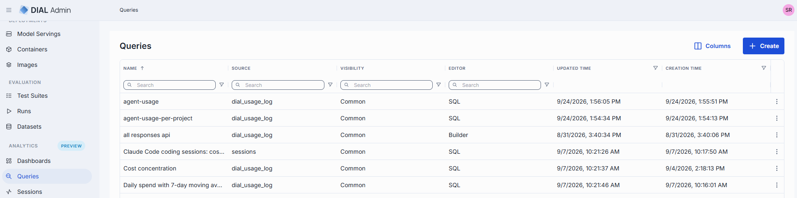

## Personal and Common queries

| Visibility | Who sees it | Who can change it |
|------------|-------------|-------------------|
| **Personal** | Only you. | You. |
| **Common** | Everyone with access to Analytics. | Full administrators only. For other users, **Save**, **Edit**, and **Delete** are not available. |

New queries are **Personal** by default. Choose **Common** when you create the query, or change it later in
[Edit a query's details](#edit-a-querys-details).

## Queries grid

| Column | Description |
|--------|-------------|
| **Name** | Query name. |
| **Description** | Free-text summary. |
| **Source** | Every table the query reads, comma-separated. |
| **Tag** | Optional label for grouping and filtering. |
| **Visibility** | **Personal** or **Common**. |
| **Editor** | The view the query opens in: **SQL** for a SQL query; **Builder** for a structured query the visual builder can show; **JSON** for any other structured query. Derived from the saved query, not set by you. |
| **Saved by** | The query's author. |
| **Created time** / **Updated time** | When the query was created and last changed. |

The grid lists your Personal queries and all Common queries together. Sorting and filtering happen in the
browser. Click a row to open the query.

Row actions: **Open in new tab**, **Duplicate**, **Edit**, and **Delete**. **Edit** and **Delete** are not
offered on Common queries unless you are a full administrator. Use **Create** to start a new query.

## Create a query

Use this to start a new query. You name it here and author it afterwards.

1. Go to **Analytics → Queries** and click **Create**.

   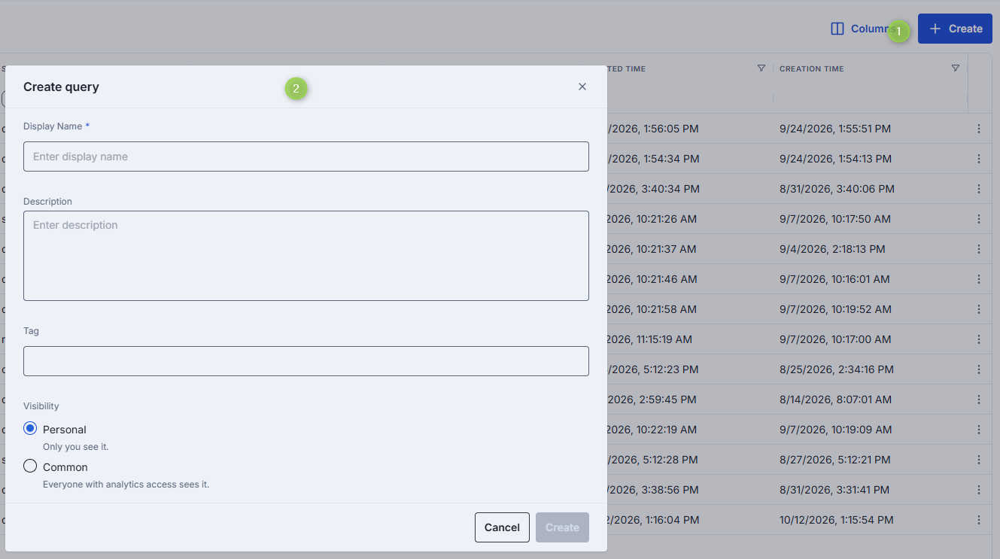

2. Enter a **Display Name** (required). Optionally add a **Description** and a **Tag**.
3. Under **Visibility**, keep **Personal** (only you see it) or select **Common** (everyone with Analytics
   access sees it).
4. Click **Create**. The modal does not ask for a source. You choose it on the query page.

DIAL Admin creates a row-mode query on the first available table, with the visibility you chose, and opens
its page. If creation
fails, the modal stays open with your values and an error shows the message and request ID.

## The query page

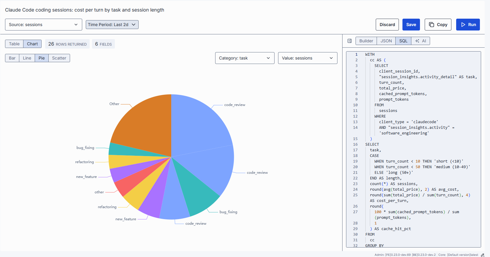

The page shows the query name, a toolbar, the results area, and an authoring panel on the right. The
toolbar contains, left to right:

- **Source** — the table the query reads.
- **Time Period** — the time window. See [Set the time period](#set-the-time-period).
- **Edit** — change name, description, tag, and visibility. Shown only if you may write the query.
- **Discard** and **Save** — shown only while there are unsaved changes.
- **Copy** — copies the query text (JSON for Builder and JSON views, SQL for the SQL view).
- **Run** — runs the query. It is disabled until the table's schema loads and while the JSON is invalid.

The authoring panel has these views of the same query:

| View | Use it to |
|------|-----------|
| **Builder** | Build the query with a form. |
| **JSON** | Edit the structured query as JSON. |
| **SQL** | Write raw SQL, with auto-completion for the selected table. |
| **AI** | Draft a query from a plain-language request. Shown only when `DIAL_QUERY_ASSISTANT_DEPLOYMENT` is configured. |

You can collapse the panel to give the results more room.

## Build a query in the Builder

Use the Builder to define a query with a form instead of code. Start by choosing a mode at the top of the
panel:

- **Row** — returns individual records. Use it to look at the data.
- **Aggregate** — groups records and computes a number per group, such as a count or a sum. Use it for
  totals and trends. Only aggregate results can be [charted](#run-a-query-and-read-the-results).

### Which sections do I need?

Most queries need only a few sections. The rest are optional.

| Section | Mode | Use it to | Needed? |
|---------|------|-----------|---------|
| **Select** | Row | Choose which columns to show. If empty, all columns are returned. | Optional |
| **Filters** | Both | Keep only rows that match conditions. | Common |
| **Group by** | Aggregate | Split results into groups, such as per status or per day. | Required for grouped results |
| **Aggregate** | Aggregate | Compute a number for each group, such as a count, sum, or average. | Required |
| **Having** | Aggregate | Filter the groups after the numbers are computed, such as "only groups with more than 100 rows". | Rare |
| **Sort** | Both | Order the results by a field, ascending or descending. | Optional |
| **Page** | Both | Return a limited number of rows, or step through rows. | Rare |

### List rows

Example: list the 50 most recently created tickets from a `tickets` table with the columns `ticket_id`,
`created_at`, `customer_email`, and `status`.

1. Open a query and select **Builder**. Make sure **Row** is selected.
2. In **Source**, select the table. In **Time Period**, select the window to look at.
3. In **Select**, add `ticket_id`, `created_at`, and `status`.
4. In **Filters**, add a condition, for example `status` equals `open`.
5. In **Sort**, add `created_at` and set the direction to **Descending**.
6. In **Page**, turn on paging and set the limit to 50.
7. Click **Run**.

### Summarize data

Example: count tickets per status.

1. Open a query and select **Builder**. Select **Aggregate**.
2. In **Source**, select the table. In **Time Period**, select the window to look at.
3. In **Group by**, add `status`.
4. In **Aggregate**, add a count. The result column gets an alias automatically; change it if you want a
   clearer name.
5. Optionally add **Sort** on the count, **Descending**.
6. Click **Run**, then switch to **Chart** to see the counts as a bar or pie chart.

### Advanced options

- **Filter groups** — group conditions to combine them. Groups can nest one level.
- **DISTINCT** — appears on an aggregate only if its function supports it. Counts each value once.
- **Nulls first / last** — in **Sort**, controls where empty values appear.
- **Page: Offset or Cursor** — **Offset** takes an offset and a limit, with an optional total. **Cursor**
  takes a cursor and a limit.
- **Functions** — the functions in dropdowns come from the analytics service, so the list depends on your
  deployment.
- **Sensitive fields** — marked in the field dropdowns.
- **Warnings** — an incomplete aggregate, such as a missing function argument, shows a warning that clears
  when you fix it. Incomplete function entries are left out of the query.
- **Contains** filters are case-insensitive.

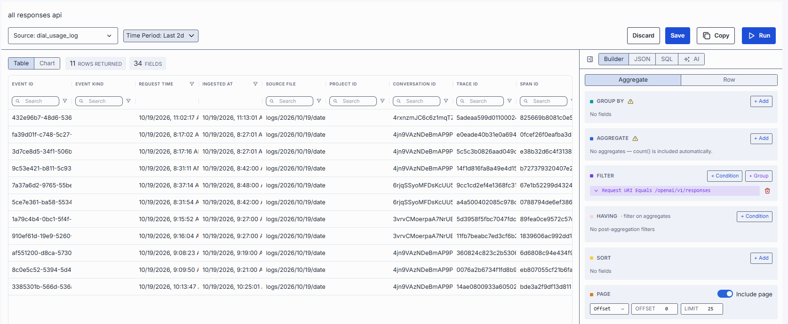

## Switch between Builder, JSON, and SQL

The three views edit the same query. Use JSON or SQL for queries the form can't express.

- **JSON** shows the current query. Edit it and the Builder follows, as long as the builder can represent
  it. Invalid JSON is flagged and disables **Run**. Valid JSON the builder can't represent, such as
  filters nested deeper than two levels, still runs as written and shows an informational message.
- **SQL** starts empty or with the SQL you last wrote. Run sends the SQL to the analytics service, which
  validates it and reports errors. If you leave SQL for JSON or Builder, DIAL Admin translates it to a
  structured query.
- Switching to **Builder** from SQL or JSON asks for confirmation when the query can't be shown in the
  form. Confirming drops the written query and resets the builder to its defaults. Cancel to stay in the
  written view.

While the JSON view is open, changing **Source** or **Time Period** updates the JSON. If you have edited
the JSON into a form the builder can't show, it is no longer overwritten.

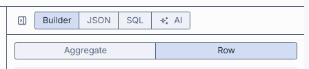

## Draft a query with AI

Use this to start from a plain-language question instead of a blank form. The **AI** view appears only when
`DIAL_QUERY_ASSISTANT_DEPLOYMENT` is set to the assistant's DIAL Core deployment ID and Analytics is
enabled.

1. Select **AI**.
2. Type a request, or click a suggested prompt to fill the input. Click **Send**.
3. Read the reply. If it contains SQL, the SQL is shown under the message with **Copy** and **Run**.
4. Click **Run** on a message to load that SQL into the builder and run it. If the builder can't show the
   query, it stays in the SQL view and still runs.
5. Continue the conversation to refine the query.

Notes:

- DIAL Admin sends only the conversation to the assistant deployment. It sends no schema and no row data.
- Changing **Source** clears the conversation.
- **Run** and **Copy** in the toolbar are hidden in the AI view. Use the buttons on each message.
- If a request fails, an error appears and your message stays in the conversation, so you can retry.

## Set the time period

Use **Time Period** to limit the query to a window.

- A **preset** period, such as the last N days, is saved as a *relative* period. When you reopen or re-run
  the query later, the window moves with the current time.
- A **custom range** is saved as fixed start and end times.

The period is applied as a filter on the table's first timestamp field. If the table has none, the query
has no time bound. The time filter never changes SQL text. In the Builder it does not appear in the
**Filters** section, because **Time Period** is its editor.

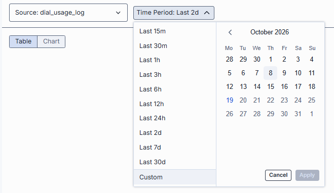

## Run a query and read the results

1. Click **Run**. Before the first run, the results area shows an empty state.
2. Check the tiles above the results:
   - **Rows** — rows returned.
   - **Fields** — columns returned.
   - **Total** — shown only for row-mode queries with offset paging and the include-total option on.
     Aggregate and SQL results have no Total.
3. Switch between **Table** and **Chart**.

**Table**. Columns use the field's display name. SQL runs use the returned column names. Hover a cell to
see the full value. A value too large for a tooltip shows a preview and a control that opens it in a
dialog with search, folding, and **Copy**. Large numbers are shortened and timestamps show in local time.
The exact value stays in the tooltip.

**Chart** is available when the result has at least one group-by column and one aggregate column. Choose
the type and columns:

| Type | Columns | Notes |
|------|---------|-------|
| **Bar**, **Line** | **X axis** (group-by), **Y axis** (aggregate) | Numeric and date X values are ordered along the axis. |
| **Pie** | **Category**, **Value** | Top 10 categories by value; the rest are grouped as **Other**. |
| **Scatter** | **X axis**, **Y axis** | Needs at least two numeric columns, otherwise the type is hidden. One point per row. |

When Chart is unavailable, a hint states why: no group-by column, no value column, no rows, or no valid
column selected. Row-mode results can't be charted. A SQL run is charted when the SQL can be translated to
a grouped query. Otherwise every returned column is offered as a dimension and only all-numeric columns as
values.

A failed run shows an error and keeps the previous result.

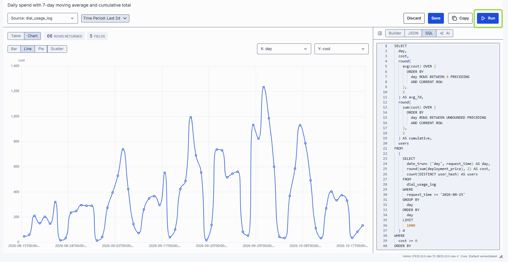

## Save a query

1. Change the query, time period, result view (**Table** or **Chart**), or chart settings.
2. Click **Save**. The button is available only while there are unsaved changes.

Save stores the query body (Builder, JSON, or SQL), the time period, the result view, and the chart
configuration. Name, description, tag, and visibility are changed with **Edit**. If saving fails, an error
is shown and your edits are kept.

To undo, click **Discard** and confirm. The page returns to the last saved version.

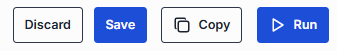

## Edit a query's details

1. Open the query and click **Edit**, or use **Edit** in the grid row menu.
2. Change **Display Name**, **Description**, **Tag**, or **Visibility**. The modal has the same fields as
   [Create a query](#create-a-query). Display Name is required.
3. Confirm.

This changes only the details. The query body stays as it was.

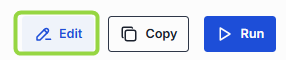

## Duplicate a query

Use this to start a variation of an existing query without changing the original.

1. In the grid, open the row menu and select **Duplicate**.
2. Adjust **Display Name**, **Description**, **Tag**, and **Visibility**. The name is pre-filled with the original name plus a copy
   suffix, and the description and tag are copied. Names don't have to be unique.
3. Confirm. The copy opens on its own page.

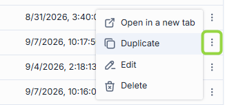

The copy keeps the original's query body, time period, result view, and chart settings. If the analytics
service no longer accepts the stored query body, the duplicate fails with the service's message and no copy
is created.

## Delete a query

1. In the grid, open the row menu and select **Delete**.
2. Confirm. The query is removed from the list.

Delete is not offered on Common queries unless you are a full administrator.

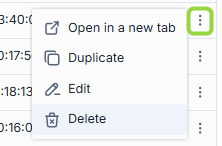

## Next steps

- [Dashboards](1.dashboards.md) — monitor usage, cost, and errors
- [Sessions](5.sessions.md) — investigate individual conversations
- [Tables](2.tables.md) — define the data Analytics works with
- [Pipelines](3.pipelines.md) — enrich and aggregate that data

