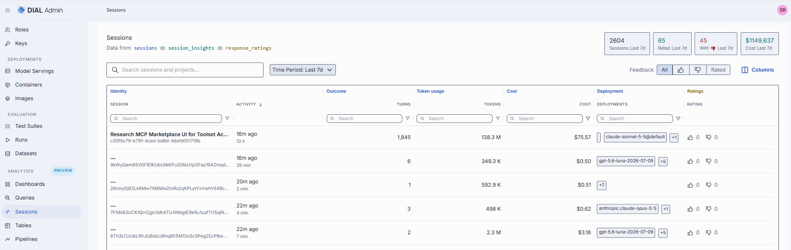
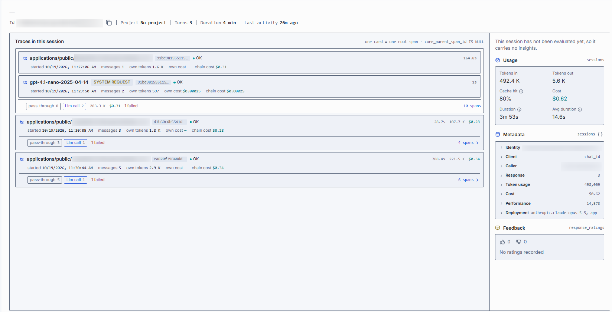
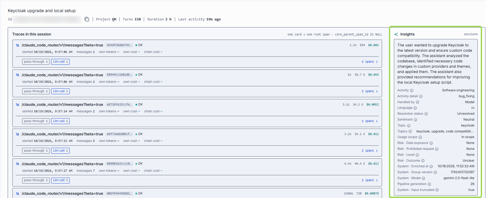
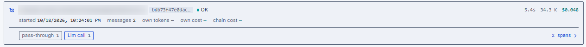
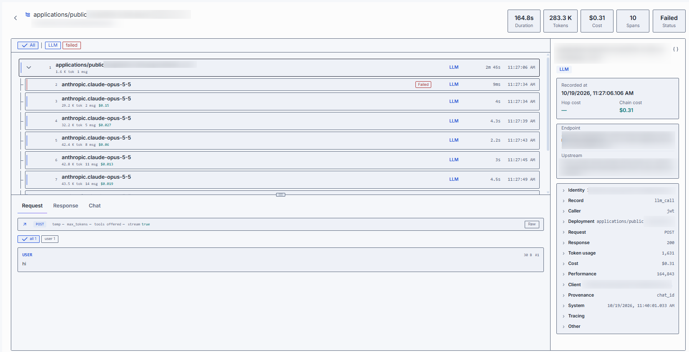
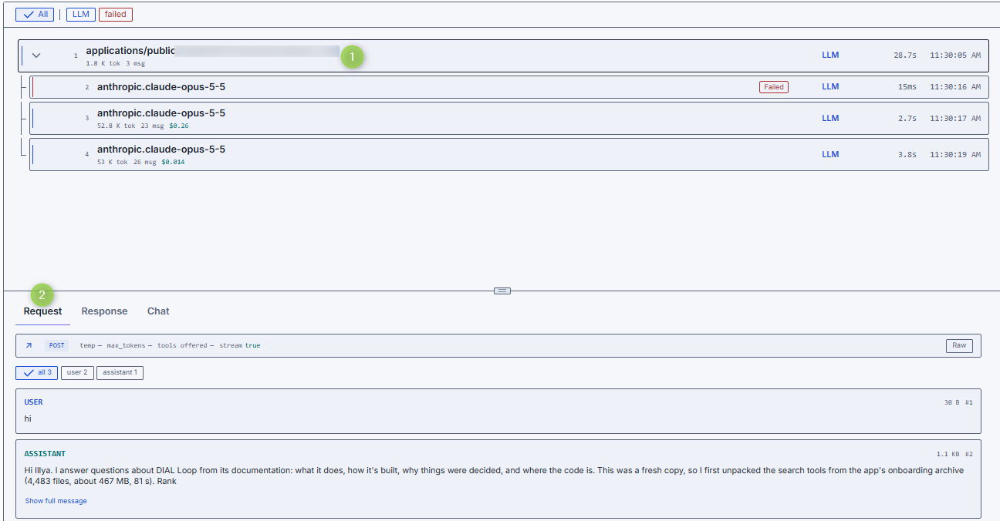
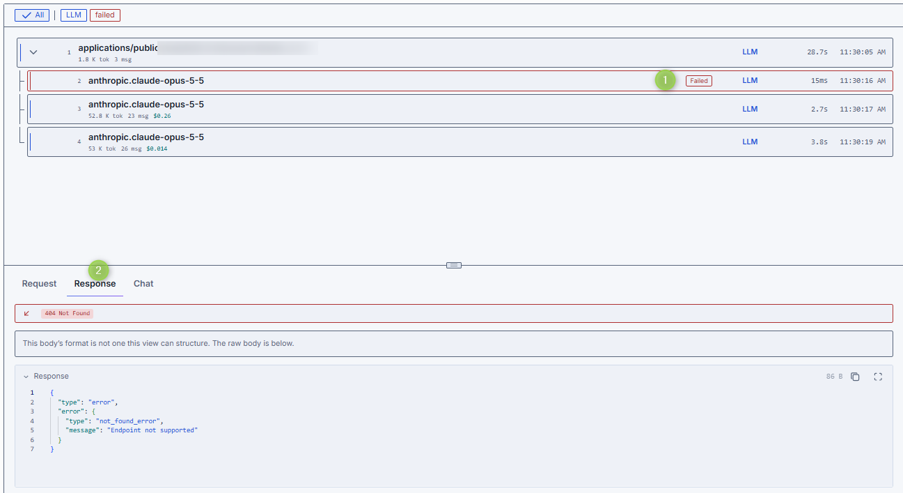

# Sessions [Preview]

Navigate to **Analytics → Sessions** to investigate what happened in user conversations. Each row is one
**session** — a chat conversation. Open a session to see who ran it, what it cost, how users rated it, and
every call DIAL made to answer it, down to the request and response of each call.

Use Sessions to:

- find conversations with negative feedback, high cost, or failures;
- understand what a conversation was about, using [insights](#read-the-insights);
- trace a slow, expensive, or failed answer to the exact call that caused it.

The screen is read-only. There is nothing to create or edit.

**Note**
> Sessions is a [Preview] feature, shown when `ANALYTICS_ENABLED` and `ANALYTICS_SESSIONS_ENABLED` are
> set. **Insights** come from an enrichment [pipeline](3.pipelines.md) (an *evaluator*). Sessions that the
> pipeline has not processed show no insights.

## Key terms

| Term | Meaning |
|------|---------|
| **Session** | One chat conversation, made of one or more turns. |
| **Turn** | One request in the conversation: a user message and the answer to it. A turn is the same thing as a **trace**, so the **Turns** count is the number of traces. |
| **Trace** | Everything DIAL did to answer one request. For example, an application receives the request, calls a model, and the model calls a toolset. |
| **Span** | One call recorded by DIAL Core inside a trace: a request to a model, an application, a toolset (MCP) server, or an embedding deployment. Each row in the span tree is one span. |
| **Root span** | The first call of a trace, made by the client. It has no parent. The trace list shows one card per root span. |
| **Child span** | A call made by another span. It is nested under its parent in the span tree. |
| **Own** vs **chain** | *Own* figures (tokens, cost) belong to that one span. *Chain* figures cover the span and every call it triggered. An application span can show no own cost while its chain cost is high, because the cost was incurred by the models and tools it called. |

## Sessions list

The line under the title shows which tables the view reads: `sessions`, the `session_insights` enrichment,
and `response_ratings`, the per-response rollup of user ratings. It follows the enrichments your instance
has.

### Summary tiles

The tiles at the top describe the selected **Time Period**: **Sessions**, **Rated**, **With 👎**, and
**Cost**. They are exact figures for the whole period. Search, column filters, and the feedback filter
narrow the grid but do not change the tiles.

### Controls

| Control | Description |
|---------|-------------|
| **Search** | Filter by text across sessions and projects. |
| **Time Period** | The period the list and tiles cover. |
| **Feedback** | **All** (default), 👍 (positive), 👎 (negative), or **Rated** (any rating). One option at a time. |
| **Columns** | Show or hide columns. |

### Grid

Columns are grouped into bands:

| Band | Column | What it tells you |
|------|--------|-------------------|
| **Identity** | **Session** | The conversation's title and id. The title comes from [insights](#read-the-insights); without insights it shows **—** and you identify the session by its id. |
| **Identity** | **Activity** | When the session's last request happened, and how long the session lasted. Sort by it to see the newest or the oldest conversations. |
| **Outcome** | **Turns** | How many requests the session has. A high count is a long conversation. |
| **Token usage** | **Tokens** | Total tokens processed in the session (input and output). Sort by it to find the heaviest conversations. |
| **Cost** | **Cost** | The session's total cost as recorded by DIAL. Sort by it to find the most expensive conversations. |
| **Deployment** | **Deployments** | Every deployment that handled a call in the session: models, applications, toolsets, and embedding deployments. It is not a list of models only. Extra values show as a **+N** badge. |
| **Ratings** | 👍 / 👎 | How many positive and negative ratings users gave to responses in the session. |
| — | **Project**, **User** | Available from **Columns**. The project the session ran under, and the user who ran it. |

The list is not limited to these. **Columns** also offers every field your instance's schema reports,
including insight fields such as title, summary, sentiment, topic, language, and resolution status. New
insight fields appear automatically.

Sorting and filtering run on the server across the whole result, not just the rows on screen:

| Column | Sort | Filter |
|--------|------|--------|
| Session, Project, User | Yes | Text |
| Turns, Tokens, Cost | Yes | Number |
| Activity | Yes | None |
| Deployments, Topics | No | Text |
| Rating | No | None |

A session without an insight title shows **—** as its name. Its id is shown below.

## Investigate a session

Use this to find out what a conversation was and whether it went well.

1. Go to **Analytics → Sessions** and set **Time Period**.
2. To find problem conversations, set **Feedback** to 👎, or sort **Cost**, **Tokens**, or **Turns**
   in descending order. To find a specific conversation, paste its id or title into **Search**.
3. Click the row. The page shows the session header:

   - **Id** — with a copy control, for use in other tools.
   - **Project**, **Turns**, **Duration**, **Last activity**.
   - The session title, taken from insights. If there are no insights, it shows **—**.

4. Read the panels on the right:

   | Panel | What it tells you |
   |-------|-------------------|
   | **Insights** | What the conversation was about. See [Read the insights](#read-the-insights). |
   | **Usage** | How much the session consumed. **Tokens in** is what was sent to models, **Tokens out** is what they generated. **Cache hit** is the share of input tokens served from the provider's prompt cache. A higher share means cheaper, faster calls. **Cost** is the session total. **Duration** is the total time of the session. **Avg duration** is the average time per request. |
   | **Metadata** | The session's recorded fields in collapsible groups (such as Identity, Client, Caller, Response, Token usage, Cost, Performance, Deployment). Open a group to see its fields. |
   | **Feedback** | Positive and negative rating counts for the session, and the listed ratings and comments that users submitted on responses. A session with no ratings shows `0` and **No ratings recorded**. |

5. To see how the answer was produced, go on to [Drill into a trace](#drill-into-a-trace).

## Read the insights

The **Insights** panel shows what an evaluator pipeline inferred about the conversation. It lists every
field the enrichment provides, such as title, summary, sentiment, topic, language, and resolution status.
The fields depend on how the pipeline is configured, so your instance may show more or fewer.

Use insights to:

- decide whether a conversation is worth opening (title and summary);
- spot problems at a glance (sentiment and resolution status);
- group sessions by subject (topic and language), using the insight columns in the grid or a
  [query](4.queries.md).

What the panel can tell you when it has no values:

- **This session has not been evaluated yet, so it carries no insights.** — the evaluator has not
  processed this session. Check the [pipeline](3.pipelines.md) status or wait for the next run.
- **Unavailable** — the enrichment is not set up on this instance.

An empty field next to other filled fields can mean the evaluator found nothing, or that it did not run on
that input. If the panel shows which evaluator produced the row, use that to tell the two apart.

Insights are generated by a model. Treat them as a guide for where to look and confirm in the trace.

## Drill into a trace

The **Traces in this session** list shows what DIAL did for each request. See [Key terms](#key-terms) for
trace, span, and root span. Drill down when the session-level figures look wrong, for example a high cost,
a slow answer, or a failure.

### Read the trace list

The list has one card per root span. Each card shows:

- The deployment that received the call. If none is recorded (a *pass-through* call), the card is named
  by its endpoint instead.
- The trace id and the status: **OK**, or the failure.
- When the call started and how many messages the request carried.
- **own tokens** and **own cost** — what this call consumed on its own. A dash means it recorded none.
- **chain cost** — the cost of this call and everything it triggered.
- At the right: the duration, total tokens, and cost of the whole chain.
- Chips that count the spans in the trace by kind, such as **pass-through** and **Llm call**, with the number
  that **failed**. **Llm call** is a call to a model. **pass-through** is a call DIAL forwarded
  without a deployment recorded on it.
- A **spans** link with the total number of spans. Click it to open the trace.

A card marked **SYSTEM REQUEST** was made by the platform, not by the client. It is recorded under a
different project than the session's, for example when DIAL generates a conversation title. It is a real
call with its own tokens and cost, and it counts in the session's totals.

### Open a trace

1. Click a card, or its **spans** link. The trace opens in place of the list.
2. Check the figures at the top. They cover the whole trace: **Duration** (time from the first call to the
   last), **Tokens** and **Cost** (all spans together), **Spans** (number of calls), and **Status**
   (**Failed** if any span failed).
3. In the span tree, find the call you are looking for. Each row is one span and shows its order number,
   the deployment, how many tokens and messages it carried, its cost, its kind (such as **LLM**), its
   duration, and when it ran. Child spans are nested under the span that made them. A **Failed** tag
   marks a span that failed.
4. Use the filters **All**, **LLM**, and **failed** to narrow the tree. Use **failed** to jump to the
   failure.
5. Click a span to read it. Drag the divider to give more room to the tree or to the span details.
6. Use the back arrow to return to the session.

### Read a span

The lower half shows the selected span. Before you open a body, check the call's outcome: the HTTP status,
the size of each side, and the duration.

| Tab | What it shows |
|-----|---------------|
| **Request** | The message history sent, one row per message with its role, position, and size. A line above lists the method and the settings the call carried: `temp`, `max_tokens`, `tools`, and `stream`. A parameter that was not sent shows a placeholder, which means the deployment's default applied. Use the role chips (such as **all** and **user**) to filter messages. |
| **Response** | The assembled response, as the client received it. |
| **Chat** | The conversation as this call saw it, followed by its answer. Use it to see what history a deep call received. For a failed call it shows the recorded error, marked as a failure. |

The **Raw** control shows the body exactly as recorded. A tab with no content for the span is hidden. The
tab you picked stays selected as you click other spans, so you can compare the same side across calls.

Other kinds of calls state their own facts. A tool (MCP) call shows its method, tool name, toolset,
arguments, and result.

The panel on the right lists the span's recorded fields:

- **Recorded at** — the exact time of the call, to the millisecond. Use it to order spans that start in the
  same second.
- **Hop cost** — the cost of this span alone. **Chain cost** — the cost of this span plus every call it
  triggered. They differ for spans that call other spans.
- **Endpoint** — the DIAL Core endpoint the request arrived on. It can name a different deployment than the
  tree row.
- **Upstream** — the address DIAL forwarded the call to, such as a model provider. It is the same for every
  span of one deployment.
- Collapsible groups such as Identity, Record, Caller, Deployment, Request, Response, Token usage, Cost,
  and Performance.
- The `{ }` button, which opens the record as JSON. Use it to copy the row into a ticket or a
  [query](4.queries.md).

### Find the cause of a problem

1. Open the session and the trace that matches the complaint.
2. Click **failed** to find the failing span, or look for the span with the longest duration or highest
   cost.
3. On **Request**, check the messages and settings the call received.
4. On **Response** or **Chat**, read the answer or the error.
5. Open the right panel to see the endpoint, upstream, caller, and deployment.

## Next steps

- [Dashboards](1.dashboards.md) — monitor usage, cost, and errors
- [Queries](4.queries.md) — ask your own questions of the data
- [Tables](2.tables.md) — define the data Analytics works with
- [Pipelines](3.pipelines.md) — enrich and aggregate that data

