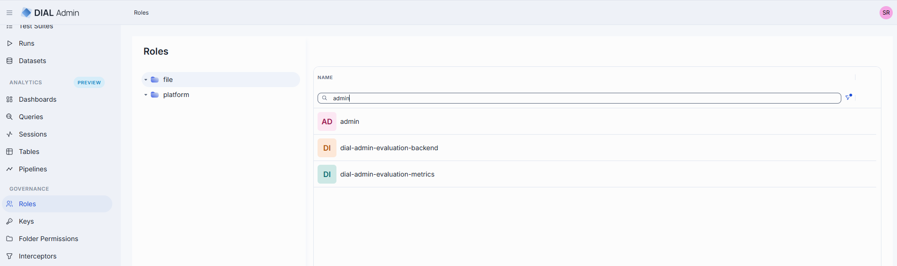
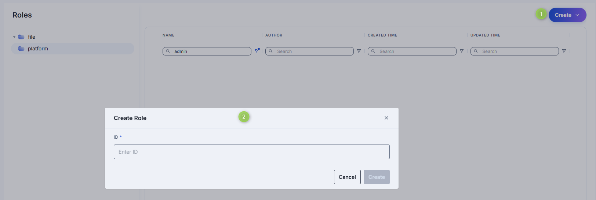
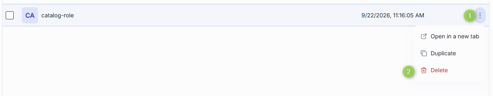
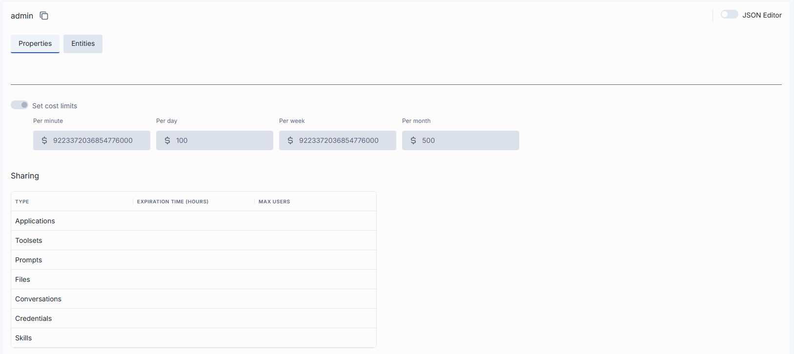
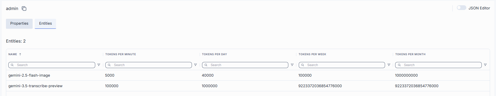

# Manage roles

This page explains how to create, configure, and delete roles in DIAL Admin. A role sets per-model token limits, cost limits, and sharing limits for a user group. You need administrator access to DIAL Admin to perform these tasks.

**Note**
> Roles can also be defined directly in [DIAL Core configuration](https://github.com/epam/ai-dial-core/blob/development/docs/dynamic-settings/roles.md). Roles defined in the configuration file appear in the **file** folder and are read-only in DIAL Admin. Roles you create in DIAL Admin are stored in the **platform** folder.

For background on how roles work in the platform, see [Authentication and access control](../../2.understand-dial/4.security-and-governance/1.authentication-and-access-control.md). To configure roles for API keys or JWT, see [Roles and rate limits](../../4.operating-dial/5.auth-and-access-control/3.roles-and-rate-limits.md).

## Roles grid

Navigate to **Roles** to see all roles defined in your DIAL instance.

### Folders

The left panel shows where each role definition is stored. It has two root folders:

- **file**: roles defined in the DIAL Core configuration file. This folder is read-only. To change these roles, edit the DIAL Core config file.
- **platform**: roles stored in DIAL Core platform storage. This is where you create, edit and delete roles in DIAL Admin.

Select a folder to list its roles in the grid. See [AI Gateway](../1.ai-gateway/0.index.md#where-an-entity-can-be-defined) for how DIAL Core combines the two sources, including what happens when a **file** role and a **platform** role have the same name.

| | **file** folder | **platform** folder |
|---|---|---|
| **Columns** | Name | Name, Author, Created Time, Updated Time |
| **Create** | Not available. No **Create** button. | Available. |
| **Duplicate, Delete** | Not available. | Available in the row's actions menu. |
| **Open a role** | Read-only: the role cannot be changed or saved. | Editable. |
| **Entities tab** | View only: no **Add**, **Remove**, **Set unlimited**, and limit values can't be edited. | Add, remove and edit entities and limits. |

## Create

Select the **platform** folder first. Roles can't be created in the **file** folder.

1. Click **Create** to open the **Create Role** modal.
2. Enter a unique role identifier.
3. Click **Create**. The modal closes and the new role's [configuration screen](#configure-a-role) opens. The role appears immediately in the listing.

    

## Delete

Click **Delete** in the role's actions menu on the main screen, or use the **Delete** button on the role's configuration screen, to permanently remove the selected role. Delete is available only for roles in the **platform** folder.

## Configuration

Click any role on the main screen to open its configuration screen. It has two tabs: **Properties** and **Entities**. Roles from the **file** folder open in read-only mode.

### Properties

The Properties tab defines the identity and metadata for the role.

| Field | Required | Description |
|-------|----------|-------------|
| **ID** | — | Unique role identifier. |
| **Maintainer** | — | Role creator. |
| **Updated Time** | — | Last update timestamp. |
| **Creation Time** | — | Creation timestamp. |
| **Set cost limits** | No | Token usage limits for this role. Available periods: Tokens per minute, Tokens per day, Tokens per week, Tokens per month. If no limits are set for this role, the **default** role limits apply. If no **default** role limits are set, the value is unlimited. See [DIAL Core documentation](https://github.com/epam/ai-dial-core/blob/development/docs/dynamic-settings/roles.md) for all available options. |
| **Sharing** | No | Sharing limits for specific resource types. **Expiration time** sets the TTL of the sharing link (default: 72 hours). **Max users** sets the maximum number of users who can accept a sharing link (default: 10 for APPLICATION; unlimited for other resource types). See [DIAL Core documentation](https://github.com/epam/ai-dial-core/blob/development/docs/dynamic-settings/roles.md#rolesrole_nameshare) for details. |

### Entities

The Entities tab lists the models this role has token limits for. A model with empty limits is unlimited for this role.

| Column | Description |
|--------|-------------|
| **Name** | Model name. |
| **Tokens per minute** | Maximum tokens this role may consume per minute when calling this model. |
| **Tokens per day** | Maximum tokens this role may consume per day when calling this model. |
| **Tokens per week** | Maximum tokens this role may consume per week when calling this model. |
| **Tokens per month** | Maximum tokens this role may consume per month when calling this model. |

| Action | Description |
|--------|-------------|
| **Add** | Add a model to the role's limits. |
| **Remove** | Remove the model from the role's limits. |
| **Set unlimited** | Clear the token limits of the model. |

These actions are not available for roles in the **file** folder.

### JSON editor

Advanced users can view and edit role properties as raw JSON. This is useful for bulk updates, copying configuration between environments, or modifying settings not exposed in the UI.

**Tip**
> You can switch between UI and JSON only when there are no unsaved changes.

To use the JSON editor:

1. Navigate to **Roles**, select the **platform** folder, and select the role you want to edit.
2. Click the **JSON Editor** toggle (top-right). The raw JSON is revealed.
3. Make your changes and click **Save**.

Roles in the **file** folder open read-only.

## Next steps

- [Manage API keys](./2.keys.md) — create and rotate API keys, assign roles to keys
- [Manage models](../1.ai-gateway/1.models.md) — add models to a role's entity list
- [Manage folders access](3.folders-storage.md) - manage access to files in folders
