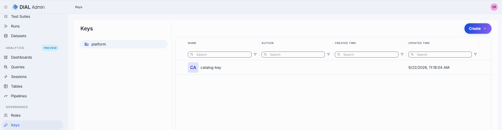
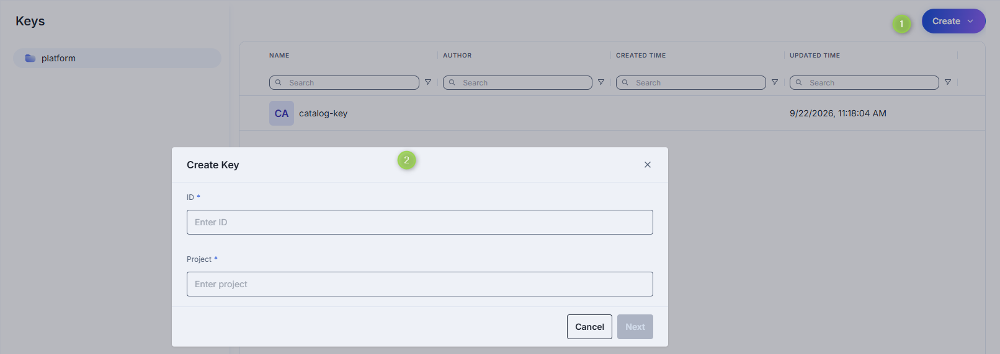
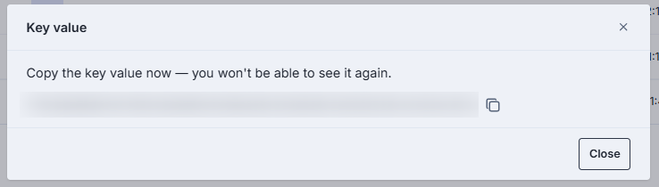
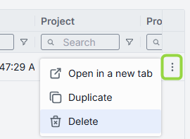
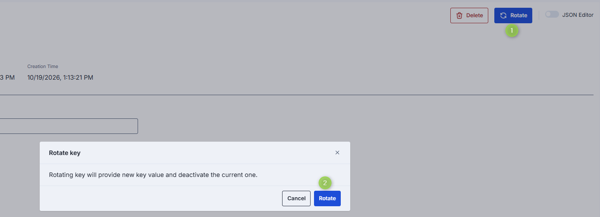
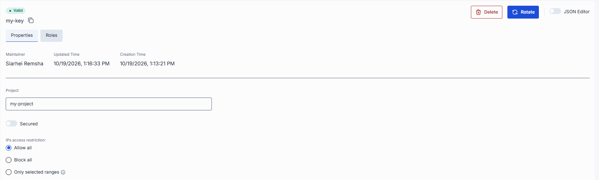
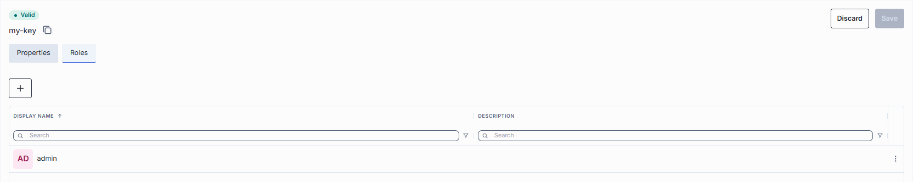

# Manage API keys

This page explains how to create, duplicate, configure, rotate, and delete API keys in DIAL Admin. API keys allow external applications to authenticate with DIAL Core and access resources. You need administrator access to DIAL Admin to perform these tasks.

**Note**
> API keys can also be defined directly in [DIAL Core configuration](https://github.com/epam/ai-dial-core/blob/development/docs/dynamic-settings/keys.md). DIAL Admin manages the keys stored in the **platform** folder.

For background on access control, see [Authentication and access control](../../2.understand-dial/4.security-and-governance/1.authentication-and-access-control.md). To configure API key roles and rate limits, see [Roles and rate limits](../../4.operating-dial/5.auth-and-access-control/3.roles-and-rate-limits.md).

## Keys grid

Navigate to **Keys** in the **Governance** section to see all API keys managed in DIAL Admin.

### Folders

The left panel has a single root folder, **platform**. It holds the keys stored in DIAL Core platform storage, and you create, duplicate, edit and delete keys in it. Unlike [Roles](./1.roles.md#folders), Keys has no read-only **file** folder.

| Column | Description |
|--------|-------------|
| **Name** | Key name displayed in the UI. |
| **Author** | User who created the key. |
| **Created Time** | Key creation timestamp. |
| **Updated Time** | Timestamp of the latest change. |

### Actions

The actions menu (**⋮**) at the end of each row, and the checkboxes for selecting several rows, offer these actions. Bulk selection offers only **Delete**.

| Action | What it does |
|--------|--------------|
| **Open in a new tab** | Opens the key's configuration screen in a new browser tab. |
| **Duplicate** | Creates a copy of the key with a new ID. See [Duplicate](#duplicate). |
| **Delete** | Permanently removes the key. See [Delete](#delete). |

## Create

1. Click **Create** and select **Key**. The **Create Key** modal opens.
2. Specify the parameters for the new key and click **Next**:

    | Field | Required | Description |
    |-------|----------|-------------|
    | **ID** | Yes | Unique key identifier. |
    | **Project** | Yes | Name of the project the key is created for. |

    

3. Select the roles this key grants to its bearer. At least one role is required. Click **Create**.
4. The **Key value** dialog shows the generated key value. Copy it to a secure location: you can't see it again after you close the dialog.

    

5. Click **Close**. The new key's [configuration screen](#configuration) opens, and the key appears in the listing.

## Duplicate

1. Click **Duplicate** in the key's actions menu.
2. Enter an ID for the copy and click **Duplicate**. The copy keeps the **Project** and **Roles** of the original.
3. Copy the new key value from the **Key value** dialog. The copy gets its own key value, and you can't see it again after you close the dialog.
4. Click **Close**. The configuration screen of the copy opens.

## Delete

Click **Delete** in the key's actions menu on the main screen, or use the **Delete** button on the key's configuration screen, to permanently remove the selected key.

**Warning**
> All entities (applications, models, routes) bound to the deleted API key will stop working.

## Configuration

Click any key on the main screen to open its configuration screen. A badge above the key ID shows whether DIAL Core accepted the key: **Valid**, or **Invalid** with a tooltip that names the offending field and the reason. DIAL Core leaves an invalid key out of its served configuration. The screen has two tabs: **Properties** and **Roles**.

### Key rotation

Use **Rotate** to replace the secret value of an existing API key without deleting it. Rotation deactivates the current key value, so clients that use it stop working until you give them the new value.

1. Click the key to open its configuration screen.
2. Click **Rotate**.
3. The **Rotate key** dialog says: "Rotating key will provide new key value and deactivate the current one." Click **Rotate**.
4. A dialog with the new key value opens up. Copy it to a secure location: you can't see it again after you close the dialog.
5. Click **Close** to complete rotation.

### Properties

The Properties tab shows metadata and editable settings for the selected API key.

| Field | Required | Description |
|-------|----------|-------------|
| **ID** | — | Unique key identifier. |
| **Maintainer** | — | User who create the key. |
| **Updated Time** | — | Timestamp of the last update. |
| **Creation Time** | — | Key creation timestamp. |
| **Project** | Yes | Name of the project the key was created for. |
| **Secured** | Yes | Indicates whether this is a secured API key. |
| **IPs access restriction** | No | List of IP address ranges controlling which clients can use this key. — **Allow all** or undefined: any client has access. — **Block all**: no client has access. — **Only selected ranges**: only clients with an IP address within the specified ranges can access. Supports IPv4 and IPv6. On save, each range is normalized to its network address: host bits outside the prefix are dropped. For example, `192.168.1.1/2` is stored and shown back as `192.0.0.0/2`. |

### Roles

The Roles tab lists the roles this key grants to its bearer. A key must have at least one role. Use it to assign existing [roles](./1.roles.md) to the key. Roles set the limits that apply to requests made with the key.

| Column | Description |
|--------|-------------|
| **Display Name** | Role name displayed in the UI. |
| **Description** | Description of the role. |

| Action | Description |
|--------|-------------|
| **Add** (**+**) | Assign roles to this API key. |
| **Remove** | Disconnect the role from this key. To delete the role, go to [Roles](./1.roles.md). |

### JSON editor

Advanced users can view and edit key properties as raw JSON. This is useful for bulk updates, copying configuration between environments, or modifying settings not exposed in the UI.

**Tip**
> You can switch between UI and JSON only when there are no unsaved changes.

To use the JSON editor:

1. Navigate to **Keys**, select the **platform** folder, and select the key you want to edit.
2. Click the **JSON Editor** toggle (top-right). The raw JSON is revealed.
3. Make your changes and click **Save**.

## Next steps

- [Manage roles](./1.roles.md) — create roles and set per-model token limits, cost limits and sharing limits
- [Manage models](../1.ai-gateway/1.models.md) — add models to a role's entity list
- [Manage folders access](3.folders-storage.md) - manage access to files in folders