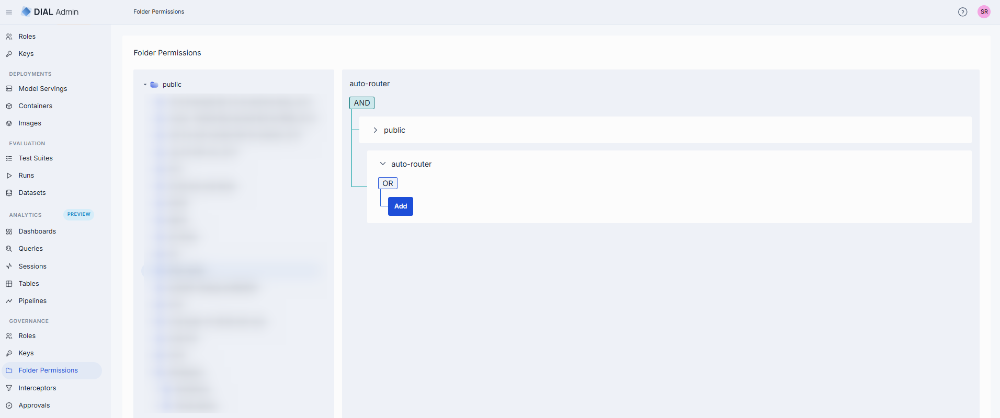
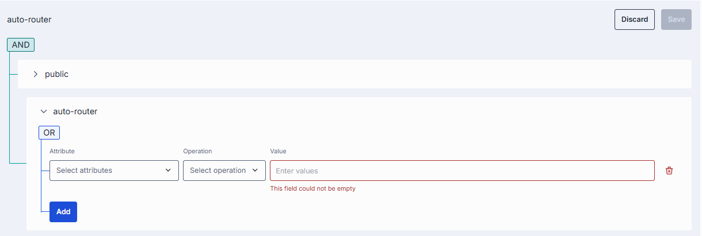
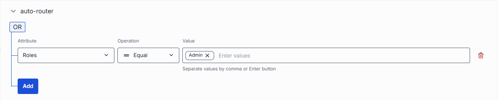
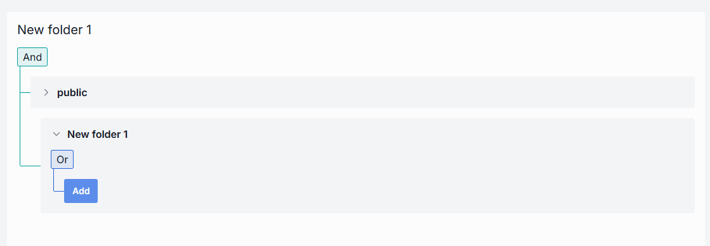

# Folder Permissions

Applications, toolsets, prompts and files that are shared with the whole organization are stored in the **Public folder** of DIAL file storage. It is organized as a tree of folders. A user can see and use a published item only if the access rules of its folder, and of every parent folder up to the root, allow it.

The **Folder Permissions** screen is where you set those rules. This screen manages **access rules only**:

- It shows the folders that exist in the Public folder. It doesn't create, rename, move, export or delete folders.
- You select a folder and edit the rules that apply to it. Parent folders' rules are shown read-only.
- The root folder has predefined rules that give access to all authorized users. You can't change them.

Folders appear in the tree when they are created on the [Applications](../1.ai-gateway/2.applications.md) and [Toolsets](../1.ai-gateway/3.toolsets.md) screens, or when users publish into a new folder and an administrator [approves](./5.publications-and-review.md) the request. Rules can also come from a publication request: when the request is approved, the rules it carries are stored for the target folder, and you can edit them here afterwards.

DIAL Core checks the rules on every request, using the claims of the user's identity token, so a saved change applies to the next request. Administrators, as defined by the `access.admin.rules` setting of DIAL Core, can access all public resources regardless of folder rules.

**Note**
> Refer to [Access Control](../../2.understand-dial/4.security-and-governance/2.access-control-reference.md) to learn more about Private and Public logical spaces for object storage in DIAL.

## Folder structure

The left panel shows the Public folder as a tree. Click a folder to select it and display its rules. Use **Collapse all folders** (above the tree) to collapse the whole tree.

- **Root folder**: visible to all authorized users. Objects published without a target sub-folder are placed in the root by default.
- **Sub-folders**: use them for logical organization. One object per sub-folder is recommended. Folders support a maximum nesting depth of **4 levels** (excluding the root folder), and folder names must not exceed 160 characters. Both limits apply where folders are created.

The effective authorization rule for any object in a sub-folder includes restrictions from all parent folders up to the root. Refer to [Work with publications](../../3.building-with-dial/7.working-with-dial-resources/2.publications-api.md#effective-rules) to learn about effective rules for folders.

**Note**
> Folder actions (**Add sibling**, **Add child**, **Move to**, **Export**, **Rename**, **Delete**) are not available on this screen. Use the folder actions on the [Applications](../1.ai-gateway/2.applications.md) and [Toolsets](../1.ai-gateway/3.toolsets.md) screens.

## Access rules

Click any sub-folder to display its access rules. Changes are not applied until you click **Save**. **Discard** reverts them. **Save** is disabled while any rule is missing an attribute, an operation or a value.

Access rules are evaluated by matching the claims of the user's identity token, issued by the identity provider (IDP), with the defined rules. Each rule is built from three parameters:

| Parameter | Description |
|-----------|-------------|
| **Attribute** | The claim of the user's token that the rule checks (e.g. `role`). The dropdown lists the attributes set in the `PUBLICATION_FILTERS` setting of DIAL Admin (default: `title`, `role`, `dial_roles`). |
| **Operation** | The matching function: **Equal**, **Contains** or **RegEx**. |
| **Value** | What to match against. For **Equal** and **Contains**, enter one or more values (e.g. `admin`). For **RegEx**, enter a single regular expression. Changing the operation clears the value. |

How each operation matches (source: DIAL Core `RuleMatcher`):

- **Equal**: the claim equals one of the values. The comparison ignores case.
- **Contains**: the claim contains one of the values as a substring. The comparison ignores case.
- **RegEx**: the whole claim matches the expression.

If the claim has several values (for example, a list of roles), the rule matches when any of them matches any of the rule's values.

### How rules combine

The panel shows the folder's rules together with the rules of its parents:

- **Across levels (And)**: the panel shows one block for each folder in the path, from the root down to the selected folder, joined by **And**. A user gets access only if every level allows it. The blocks of parent folders are read-only.
- **Within a folder (Or)**: the rules of one folder are joined by **Or**. The user gets access if at least one rule matches. Use **Add** to append a rule.
- **No rules**: a folder with no rules of its own doesn't restrict access beyond its parents.

**Note**
> If a folder has a parent folder, all access rules of the parent also apply to the child. Refer to [Work with publications](../../3.building-with-dial/7.working-with-dial-resources/2.publications-api.md#effective-rules) to learn about effective rules.

**Note**
> Refer to [JWT](../../4.operating-dial/5.auth-and-access-control/2.jwt.md) and [API Keys](../../4.operating-dial/5.auth-and-access-control/1.api-keys.md) for how to enable access to DIAL resources. Refer to [Configure IDPs](../../4.operating-dial/5.auth-and-access-control/4.sso-idp/0.index.md) for supported identity service provider configurations.

## Next steps

- [Manage roles](./1.roles.md) — create roles and set per-model token limits, cost limits and sharing limits
- [Manage API keys](./2.keys.md) — create and rotate API keys, assign roles to keys
- [Manage models](../1.ai-gateway/1.models.md) — add models to a role's entity list

