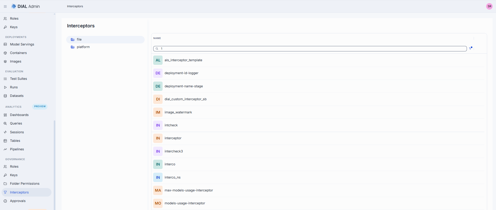
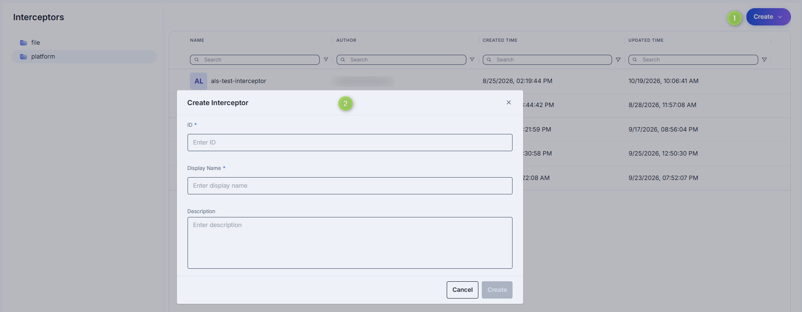
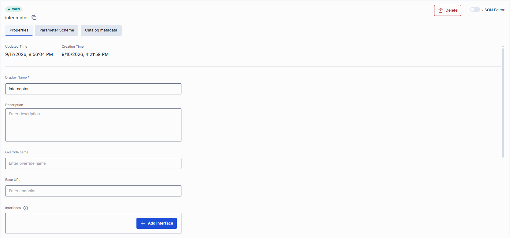
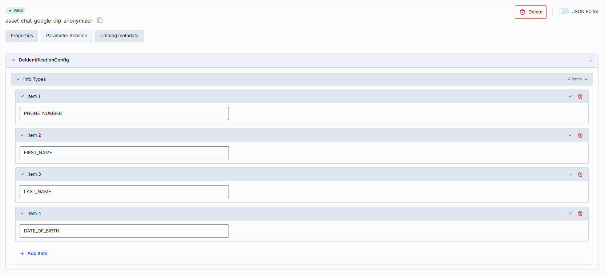
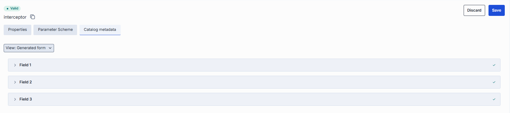

# Manage interceptors

This page explains how administrators use DIAL Admin to add and configure interceptors. It covers creating an interceptor, configuring its endpoint, interfaces and parameters, and where to attach it to models or applications. You need access to DIAL Admin with administrator permissions.

DIAL interceptors are pluggable components with the primary goal of implementing a Responsible AI approach and enforcing compliance with organization and external policies and standards (biased answers, data leaks, etc.).

Interceptors provide the ability to delegate content analysis to third-party systems or dedicated models used within an organization, or to carry any other custom implementation.

Selected use cases:

- Prevent harmful requests from reaching the model
- Prevent harmful replies from reaching the user
- Modify the request/response, introduce disclaimers
- DLP (Data Loss Prevention)
- Smart information collection
- Implement caching strategies
- Application of watermarks

[DIAL Interceptors Python SDK](https://github.com/epam/ai-dial-interceptors-sdk) makes development of new interceptors easier and enables integration with external systems like Google Model Armor, MS Presidio, and more.

An interceptor is an entity of the DIAL Core runtime configuration that points to a service DIAL Core calls for each request. You define it here, and attach it where it should run.

You can configure global interceptors that apply on a system level in [System Properties](../1.config-backup-and-global-settings.md#system-properties) and local interceptors that are triggered for specific [model](../1.ai-gateway/1.models.md#interceptors) or [application](../1.ai-gateway/2.applications.md#interceptors) deployments, or apps created based on application runners.

**Note**
> - Refer to [Interceptors](../../3.building-with-dial/2.interceptors/0.index.md) to learn more.
> - Refer to [DIAL Interceptors Python SDK](https://github.com/epam/ai-dial-interceptors-sdk) for comprehensive information, configuration, and implementation examples.

## Main screen

On this screen, you can access all the available interceptors: those stored by DIAL Admin and those defined in the [DIAL Core config file](https://github.com/epam/ai-dial-core/blob/development/docs/dynamic-settings/interceptors.md). Here, you can manage and add interceptors to your DIAL environment.

### Folders

The left panel shows where each interceptor definition is stored. It has two root folders:

- **file**: interceptors defined in the DIAL Core configuration file. This folder is read-only. To change these interceptors, edit the DIAL Core config file.
- **platform**: interceptors stored in DIAL Core platform storage. This is where you create, edit and delete interceptors in DIAL Admin.

Select a folder to list its interceptors in the grid. See [AI Gateway](../1.ai-gateway/0.index.md#where-an-entity-can-be-defined) for how DIAL Core combines the two sources, including what happens when a **file** interceptor and a **platform** interceptor have the same name.

| | **file** folder | **platform** folder |
|---|---|---|
| **Columns** | Name | Name, Author, Created Time, Updated Time |
| **Create** | Not available. No **Create** button. | Available. |
| **Duplicate, Delete** | Not available. | Available in the row's actions menu. |
| **Open an interceptor** | Read-only: it can't be changed or saved. | Editable. |

### Interceptors grid

| Field | Description |
|-------|-------------|
| **Name** | Name of the interceptor (e.g. "PII Information Remover"). |
| **Author** | User who created the interceptor. Platform folder only. |
| **Created Time** | Entity creation timestamp. Platform folder only. |
| **Updated Time** | Timestamp of the latest update of the entity. Platform folder only. |

## Create

Select the **platform** folder first. Interceptors can't be created in the **file** folder.

Follow these steps to add a new interceptor definition:

1. Click **Create** and select **Interceptor** to invoke the **Create Interceptor** modal.
2. Define interceptor parameters:

    | Column | Required | Description |
    |--------|----------|-------------|
    | **ID** | Yes | Unique identifier for the interceptor (e.g. reject-blacklisted-words, audit-logger). This key is used when you attach it to a Model or Application. |
    | **Display Name** | Yes | Name of the interceptor (e.g. "PII Information Remover") displayed on UI. |
    | **Description** | No | Brief summary of what this interceptor does and any parameters it uses (e.g. `BLACKLIST={"foo","bar"}` or Logs request/response payloads). |

3. Once all required fields are filled, click **Create**. The dialog closes and the new interceptor [configuration screen](#configuration) is opened. Once added, a new entry appears in the **Interceptors** listing. It may take some time for the changes to take effect after saving.

    

## Duplicate

Use **Duplicate** to create a new interceptor with the settings of an existing one. It is available in the actions menu (**⋮**) of an interceptor in the **platform** folder. Interceptors in the **file** folder can't be duplicated.

1. Click **Duplicate** in the interceptor's actions menu to open the duplicate modal.
2. Specify the parameters of the copy:

    | Field | Required | Description |
    |-------|----------|-------------|
    | **ID** | Yes | Unique identifier of the copy. It is prefilled with the original ID plus the `-copy` suffix. If the original ID already contains `copy`, it is prefilled unchanged, so change it. |
    | **Display Name** | Yes | Name of the copy displayed on UI. It is prefilled with the original display name. |

3. Click **Duplicate**. The copy is created in the **platform** folder and appears in the listing.

The copy keeps all other settings of the original: endpoint, interfaces, defaults, headers, topics, catalog schema and catalog metadata. The author and the creation and update times are not copied.

## Delete

Use the **Delete** button in the Configuration screen toolbar or in the main screen actions menu to permanently remove the selected interceptor. Delete is available only for interceptors in the **platform** folder.

## Configuration

Click any interceptor on the main screen to open its configuration details. The screen has three tabs: [Properties](#properties), [Parameter scheme](#parameter-scheme) and [Catalog metadata](#catalog-metadata). A badge above the interceptor ID shows whether DIAL Core accepted the definition: **Valid**, or **Invalid** with a tooltip that names the offending field and the reason. Interceptors from the **file** folder open in read-only mode.

### Properties

In the **Properties** tab, you can define metadata and execution endpoints for interceptors.

| Field | Required | Editable | Description |
|-------|----------|----------|-------------|
| **ID** | - | No | Unique key under `interceptors` in DIAL Core's [dynamic settings](https://github.com/epam/ai-dial-core?tab=readme-ov-file#dynamic-settings) (e.g. data-clustering, support-bot). |
| **Updated Time** | - | No | Date and time when the interceptor's configuration was last updated. |
| **Creation Time** | - | No | Date and time when the interceptor's configuration was created. |
| **Display Name** | Yes | Yes | Name of the interceptor displayed on UI (e.g. "PII Information Remover"). |
| **Description** | No | Yes | Description of the interceptor (e.g. `BLACKLIST={"foo","bar"}`). Helps to identify the interceptor and its purpose. |
| **Override name** | No | Yes | DIAL Core calls the interceptor under this name: the `model` field of the request body and the `X-DIAL-OVERRIDE-NAME` header are rewritten to this value before the request reaches the interceptor. It doesn't change routing, only the value the interceptor receives. It applies to chat completions requests; the Responses API flow ignores it. |
| **Base URL** | No | Yes | The root URL of the interceptor service. It serves every entry in **Interfaces** that has no Base URL of its own. |
| **Interfaces** | No | Yes | Typed alternative to **Endpoint**. See [Interfaces](#interfaces). If both are set, **Interfaces** takes precedence. |
| **Endpoint** | Conditional | Yes | URL of the interceptor's chat completion endpoint. DIAL Core forwards requests to it as is. Required unless **Interfaces** is used. |
| **Configuration Endpoint** | No | Yes | The URL that exposes the configuration of the interceptor. This endpoint returns a JSON schema with configuration parameters that are rendered in the [Parameter scheme tab](#parameter-scheme). |
| **Defaults** | No | Yes | The interceptor configuration can be preset on a per-interceptor basis via the `defaults` field. Default parameters are applied if a request doesn't contain them in an OpenAI chat/completions API call. An interface with its own **Defaults** uses those instead. Refer to [Interceptors SDK](https://github.com/epam/ai-dial-interceptors-sdk/blob/development/README.md#interceptor-configuration) to learn more. |
| **Default headers** | No | Yes | HTTP headers DIAL Core adds to a request that doesn't already carry them, on the call to this interceptor. Headers that DIAL Core strips on the way to an interceptor (for example `Api-Key`) are stripped here too. An interface can add or override headers for itself. |
| **Topics** | No | Yes | Semantic labels (e.g. "finance", "support"). Select existing ones or type to add. |
| **Forward auth token** | No | Yes | Controls whether the user's authorization token is forwarded (in the HTTP header) to the interceptor's completion endpoint. Use this when your interceptor service requires its own authentication. Selector with two options — **- None -** (default) and **Use for this interceptor** — chosen in a popup and confirmed with **Apply**. Choosing **Use for this interceptor** shows a security warning and asks you to enter the interceptor's display name to confirm. |
| **Catalog schema** | No | Yes | The catalog schema that defines this interceptor's catalog metadata. Selecting a schema enables the [Catalog metadata](#catalog-metadata) tab. |

#### Interfaces

Interceptors support one interface type, **OpenAI Chat Completions**. Click **Add interface** to add it.

When an interface has a Base URL, DIAL Core forwards each request to that Base URL followed by the path the request arrived on, with the deployment ID in the path replaced by the interceptor's own name. An interface without a Base URL uses the interceptor-level **Base URL**. If neither is set, DIAL Admin doesn't let you save the interface.

| Field | Required | Description |
|-------|----------|-------------|
| **Defaults** | No | Body parameters applied to requests for this interface only. They replace the interceptor-level **Defaults** instead of merging with them. A parameter the request already carries is never replaced. |
| **Mode** | No | **Passthrough** (default) forwards the request in the shape it arrived in. **Translator** hands it to a service that translates it into another API. |
| **Base URL** | Conditional | The root URL that the request path is appended to. Required if the interceptor has no **Base URL**. Available in Passthrough mode. |
| **Translator** | Conditional | The translator that serves this interface. Select a platform [translator](../1.ai-gateway/5.translators.md), or **Custom** to enter a Base URL and the target interface. Available in Translator mode, and required there. An interface is served by a Base URL or by a translator, never both. |
| **Override paths** | No | Per-operation upstream path that replaces the default "Base URL + request path" routing. For interceptors the only operation is `postAzureOpenaiChatCompletions`, and `{id}` is replaced with the interceptor's name. Passthrough mode only. |
| **Default headers** | No | Headers applied to requests for this interface only, laid over the interceptor-level **Default headers**. |

> Refer to [DIAL Core](https://github.com/epam/ai-dial-core/blob/development/docs/dynamic-settings/interceptors.md#interceptorsinterceptor_nameinterfaces) documentation to learn more about interfaces and how they work.

### Parameter scheme

In this tab, you can define additional configuration parameters for the interceptor. The parameters displayed in this section are defined by the JSON schema returned by the **Configuration Endpoint** specified in the [Properties tab](#properties). If a valid endpoint is specified, the content on this screen is rendered automatically based on the JSON schema returned by that endpoint. Rendered parameters are pre-populated with their default values. If an invalid configuration endpoint is provided, a "No Configuration Scheme" state is shown instead.

### Catalog metadata

Catalog metadata describes the interceptor against a **catalog schema**: a structured set of fields defined centrally. The tab is empty until you select a schema in the **Catalog schema** field on [Properties](#properties). Once a schema is selected, its fields are shown for you to complete.

### JSON editor

Advanced users with technical expertise can work with the interceptor properties in a JSON editor view mode. It is useful for advanced scenarios of bulk updates, copy/paste between environments, or tweaking settings not exposed on UI.

**Tip**
> You can switch between UI and JSON only if there are no unsaved changes.

1. Navigate to **Interceptors**, select the **platform** folder, then select the interceptor you want to edit.
2. Click the **JSON Editor** toggle (top-right). The UI reveals the raw JSON.
3. Make changes and click **Save** to apply them.

Interceptors in the **file** folder open read-only.

## Next steps

- [Manage AI model deployments](../1.ai-gateway/1.models.md) — attach interceptors to individual AI model deployments.
- [Manage applications](../1.ai-gateway/2.applications.md) — attach interceptors to application deployments or application runners.
- [Global settings and system properties](../1.config-backup-and-global-settings.md) — configure interceptors that apply globally across all deployments.
