# Approvals

This page explains how to review, approve, decline, and delete publication requests in DIAL Admin. DIAL users can publish private resources—applications, conversations, files, prompts, toolsets, and skills—to share them with others in the organization. Each request requires an administrator approval before the resource becomes publicly available. You need administrator access to DIAL Admin to perform these tasks.

Users can submit two kinds of requests, and both go through administrator review:

| Request | What the user asks for | What happens on approval |
|---------|------------------------|--------------------------|
| **Publish** | To make a private resource available to others in the organization. | The resource is moved to the Public folder, into the target folder of the request. |
| **Unpublish** | To withdraw a resource that is already published. | The resource is removed from the Public folder and becomes inaccessible. |

A request stays pending until an administrator approves it, declines it with a reason, or deletes it. Nothing changes in the Public folder before that. The **Action** field on the review page shows which kind of request it is. See [Unpublishing](../../6.chat-user-guide/6.sharing-and-publishing.md#unpublishing) in the DIAL Chat User Guide for how users submit unpublish requests.

For background on how publications work in DIAL, see [Publications](../../2.understand-dial/3.capabilities/4.collaboration-and-sharing.md#publication-organization-wide-availability). To learn about the publication process from the perspective of a DIAL Chat end user, see the [DIAL Chat User Guide](../../6.chat-user-guide/6.sharing-and-publishing.md#publishing). For programmatic creation and management of publication requests, see the [Publication API](https://dialx.ai/dial_api#tag/Publications).

## Approvals grid

Navigate to **Approvals** to see all pending publication requests of every resource type in one grid. Use the filter under the **Type** column to show requests of one type, and **Reset filters** to clear all filters.

| Column | Description |
|--------|-------------|
| **Name** | Title of the submitted publication request. |
| **Type** | Type of publication request by entity type: application, conversation, file, toolset, skill or prompt. |
| **Author** | The user who submitted the request. |
| **Creation Time** | Timestamp when the request was submitted. |

The actions menu (**⋮**) at the end of each row has one action, **Open in a new tab**.

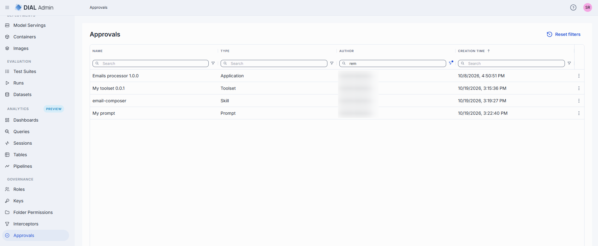

## Review a publication request

Click any request on the main screen to open its review page. On the review page you can inspect the request and take an action. You can also modify selected properties before taking action.

The tabs depend on the type of the request:

| Request type | Tabs |
|--------------|------|
| Application | Properties, Parameters, Permissions, Files |
| Conversation | Properties, Conversation, Files, Permissions |
| File | Properties, Permissions |
| Prompt | Properties, Permissions |
| Skill | Properties, Skill, Permissions |
| Toolset | Properties, Tools Overview, Permissions |

If the item a request refers to is no longer available, or has changed since the request was created, the page shows a warning instead of the tabs. Use **Decline** or **Delete** for such a request.

### Actions

| Action | Description |
|--------|-------------|
| **Publish** | Approve a publish request. The resource is moved to the Public folder and becomes accessible to other users. If the request has no access rules, a confirmation says that the current folder permissions will make the resource visible to all users. |
| **Unpublish** | Approve an unpublish request. The resource is removed from the Public folder and becomes inaccessible. **Removing a published resource can break workflows that depend on it.** |
| **Decline** | Reject the request. You are prompted to enter a reason of 15 to 255 characters that is sent back to the request author. |
| **Delete** | Delete the publication request without taking action on the resource. |

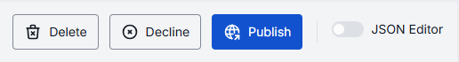

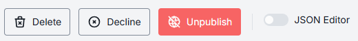

**Note**
> If you change anything in the request, the action buttons are replaced by **Discard** and **Save**. Save the changes first, then approve the request.

### Common properties

All publication types share these request-level fields in the Properties tab.

| Property | Editable | Description |
|----------|----------|-------------|
| **Action** | No | Action requested: Publish or Unpublish. |
| **Creation Time** | No | Timestamp when the request was submitted. |
| **Author** | Yes | Name of the request creator. |
| **Folder Storage** | Yes | Target path in the Public file storage where the resource will be published. Use **Move to** to change the destination. You can select an existing folder, but you can't create a new one here. |

### Permissions

The Permissions tab shows the access rules that will apply to the folder the resource is published to.

- **Root Public folder**: the tab reads "Accessible to all users. Permissions are predefined and cannot be modified." The root folder has no rules.
- **Sub-folder**: the tab shows the rules requested for the folder, and you can edit them before approving. Each rule has an **Attribute**, an **Operation** and a **Value**, and the rules of one folder are joined by **Or**. See [Folder Permissions](./3.folders-storage.md#access-rules) for the rule fields and how rules combine with the rules of parent folders.

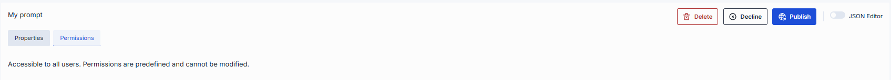

If the rules in the request differ from the rules the folder has now, the tab shows a warning icon and the banner "Permission changes have been proposed. Use "Compare changes" to review them. Changes will apply after publishing." Click **Compare changes** to open the **Compare changes in permissions** dialog. It shows the **Current** rules of the folder and the **Proposed** rules from the request side by side, with the differences between them marked. If the folder has no rules yet, **Current** reads "Permission rules are not configured for these folders".

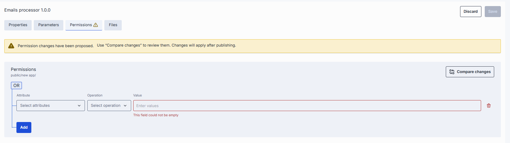

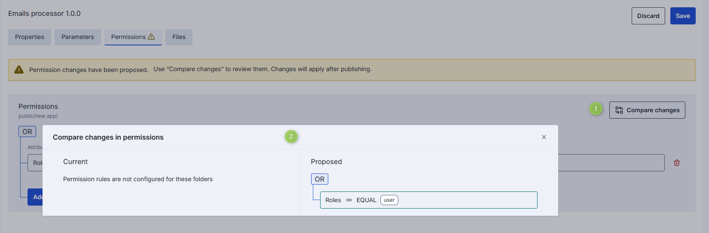

### JSON editor

All publication types support a JSON editor view for advanced scenarios: bulk updates, copying configuration between environments, or modifying settings not exposed in the UI.

**Tip**
> You can switch between UI and JSON only when there are no unsaved changes.

## Application publications

Filter the approvals grid by the Application type to display all publish/unpublish requests submitted via [DIAL Chat UI](../../6.chat-user-guide/6.sharing-and-publishing.md#publish-an-application) or the [Publication API](https://dialx.ai/dial_api#tag/Publications).
Click any publication request to display its properties.

### Properties

The Properties tab includes the [common request properties](#common-properties) plus the application's own properties, which are the same as on the application's configuration screen in [AI Gateway → Applications](../1.ai-gateway/2.applications.md#properties).

| Property | Editable | Description |
|----------|----------|-------------|
| **ID** | Yes | Unique identifier of the application. |
| **Display Name** | Yes | Application name displayed in the UI. |
| **Version** | Yes | Version of the application to be published. |

The remaining properties are described in AI Gateway:

- **Description, Intro, Icon, Topics**: see [Properties](../1.ai-gateway/2.applications.md#properties).
- **Source type** and the fields that depend on it, such as **Interfaces**, **Endpoints**, **App Runner** or **Code App**: see [Source types](../1.ai-gateway/2.applications.md#source-types).
- **Override name, Base URL, Attachment types, Attachments max number, Default headers, Completion Defaults, Responses Defaults, Max retry attempts**: see [Properties](../1.ai-gateway/2.applications.md#properties).
- **External services**: see [External services](../1.ai-gateway/2.applications.md#external-services).

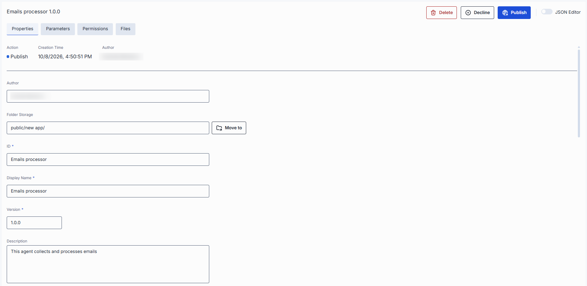

### Parameters

The Parameters tab shows application-specific parameters that influence behavior. The available parameters are determined by the related application runner configuration. See [Parameters](../1.ai-gateway/2.applications.md#parameters) for how parameters are presented and edited.

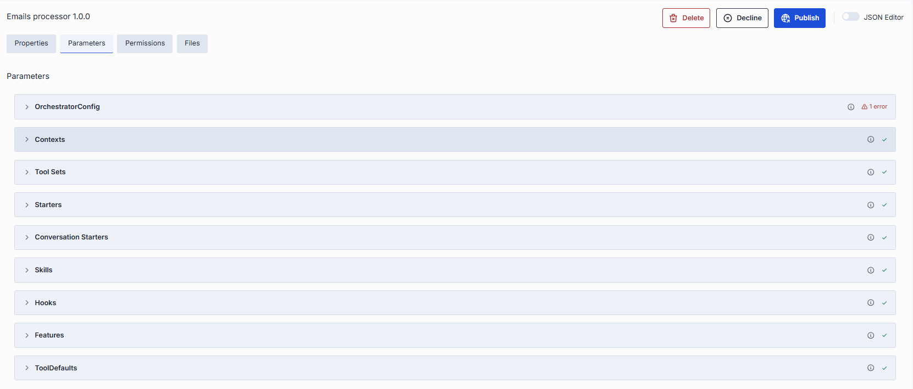

### Files

If the application includes files (for example, source data files for a talk-to-your-data application, or the code of a code app), they are published together with the application.

Published files are accessible in **Artifacts → Files** in the target folder specified in the request.

| Field | Description |
|-------|-------------|
| **Display Name** | Name of the file. |
| **Extension** | File extension (e.g., `.json`, `.png`, `.py`). |
| **Actions** | **Preview**: view file content (may be disabled for some types). **Open in a new tab**: available for unpublish requests, where the file is already in the Public folder. **Download**: save the file to your device. **Remove**: remove the file from the publication request. |

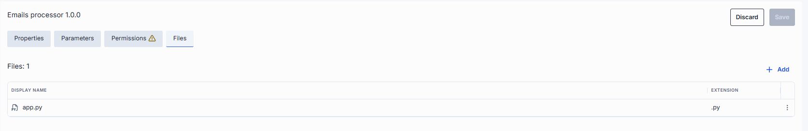

Click **Add** to attach additional files to the request.

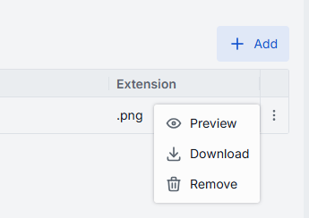

## File publications

Filter the approvals grid by the File type to display all publish/unpublish requests submitted via the [Publication API](https://dialx.ai/dial_api#tag/Publications).

### Properties

The Properties tab contains the [common request properties](#common-properties) and the list of files in the request.

**Note**
> Some actions are disabled for certain file types. Preview and download are supported for: `.html`, `.htm`, `.css`, `.js`, `.mjs`, `.json`, `.xml`, `.txt`, `.md`, `.csv`, `.jpg`, `.jpeg`, `.png`, `.gif`, `.webp`, `.svg`, `.ico`, `.bmp`, `.avif`, `.mp3`, `.wav`, `.ogg`, `.mp4`, `.webm`, `.pdf`.

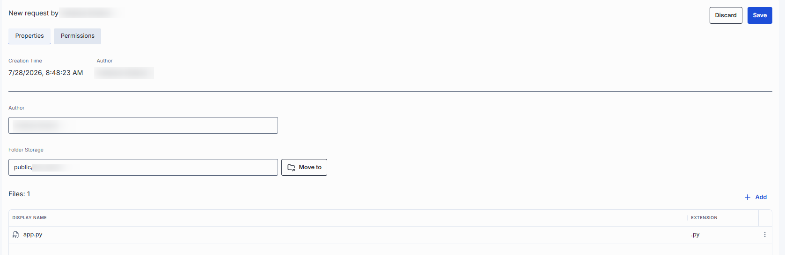

Available file actions:

| Action | Description |
|--------|-------------|
| **Download** | Download the file. May be disabled for certain types. |
| **Preview** | Preview the file content. May be disabled for certain types. |
| **Remove** | Remove the file from the publication request. |
| **Add** | Add files to the publication request. |

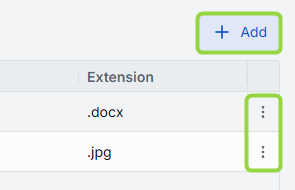

## Prompt publications

Filter the approvals grid by the Prompt type to display all publish/unpublish requests submitted via [DIAL Chat UI](../../6.chat-user-guide/6.sharing-and-publishing.md#publish-a-prompt) or the [Publication API](https://dialx.ai/dial_api#tag/Publications).

### Properties

The Properties tab contains the [common request properties](#common-properties) plus these prompt-specific fields. See [Artifacts → Prompts](../2.artifacts/4.prompts.md#properties) for more about prompt properties.

| Property | Editable | Description |
|----------|----------|-------------|
| **Description** | Yes | Description of the prompt purpose. |
| **Content** | Yes | The prompt content, edited in a Markdown editor. Use the **JSON** toggle to edit it as JSON. |

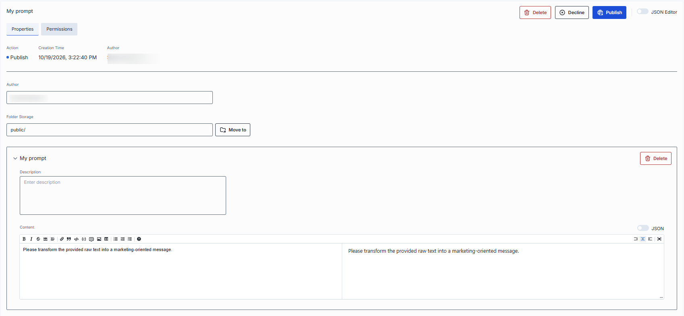

A publication request submitted via the Publication API can include more than one prompt. Use **Delete** in the prompt properties area to remove individual prompts from the request if necessary.

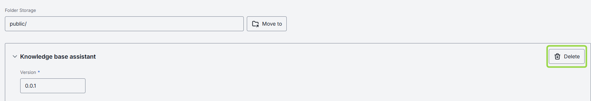

## Toolset publications

Filter the approvals grid by the Toolset type to display all publish/unpublish requests submitted via [DIAL Chat UI](../../6.chat-user-guide/6.sharing-and-publishing.md#publish-a-toolset) or the [Publication API](https://dialx.ai/dial_api#tag/Publications).

### Properties

The Properties tab contains the [common request properties](#common-properties) plus the toolset's own properties, which are the same as on the toolset's configuration screen in [AI Gateway → Toolsets](../1.ai-gateway/3.toolsets.md#properties).

| Property | Editable | Description |
|----------|----------|-------------|
| **Authentication** (header) | No | Current authentication status of the toolset: — **Logged out**: not authenticated with the MCP server. — **Logged in (Personal)**: authenticated with personal credentials only. — **Logged in (Organization)**: authenticated with organization credentials only. — **Logged in**: authenticated at both personal and organization levels. |
| **ID** | Yes | Unique toolset identifier. |
| **Display Name** | Yes | Toolset name displayed in the UI. |
| **Version** | Yes | Version to be published. |

The remaining properties are described in AI Gateway:

- **Description, Icon, Topics, External Endpoint, Transport**: see [Properties](../1.ai-gateway/3.toolsets.md#properties).
- **Authentication** configuration: see [Authentication](../1.ai-gateway/3.toolsets.md#authentication).

If the toolset uses authentication, the header has **Log In** or **Log Out** buttons that sign you in to or out of the MCP server, so you can check the tools before publishing.

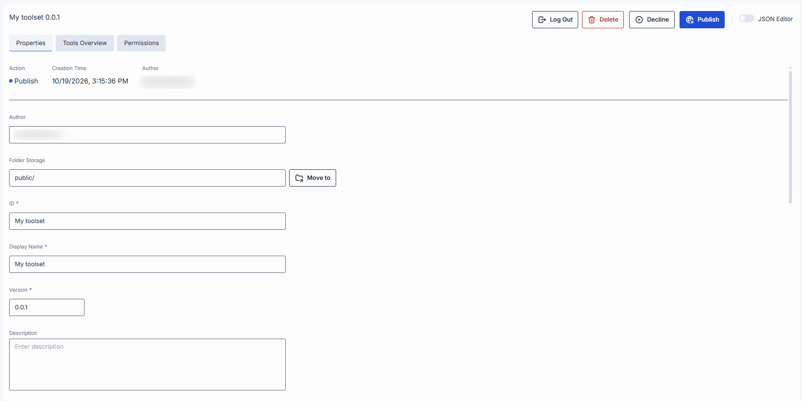

### Tools overview

[Tools](https://modelcontextprotocol.io/specification/2025-06-18/server/tools) are functions supported by the related MCP server. This tab shows and lets you edit the tools included in the toolset being published. It works the same way as the **Tools Overview** tab of a toolset: see [Tools Overview](../1.ai-gateway/3.toolsets.md#tools-overview-tab) in AI Gateway for the full description of using all available tools, managing tools, filtering, and trying tools out.

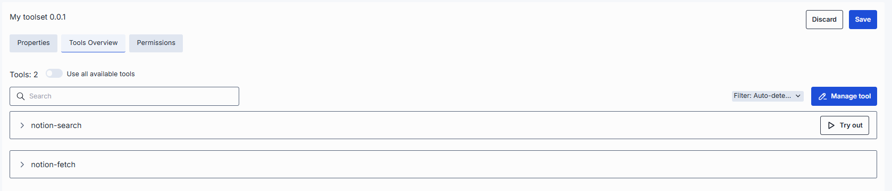

## Conversation publications

Filter the approvals grid by the Conversation type to display all publish/unpublish requests submitted via [DIAL Chat UI](../../6.chat-user-guide/6.sharing-and-publishing.md) or the [Publication API](https://dialx.ai/dial_api#tag/Publications).

### Properties

The Properties tab contains only the [common request properties](#common-properties).

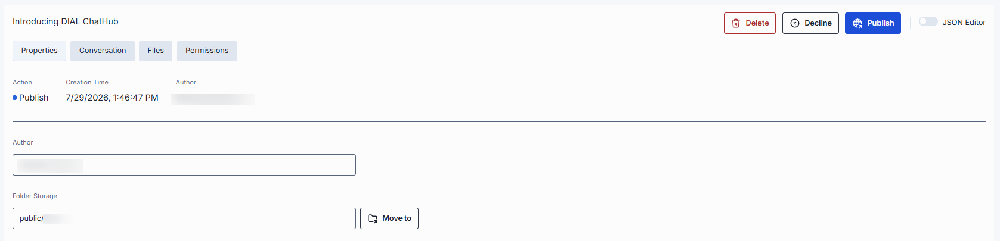

### Conversation

The Conversation tab shows the messages of the conversation in a chat-style layout, as a read-only view, so you can review what is being published. See [Artifacts → Conversations](../2.artifacts/3.conversations.md#conversation) for details.

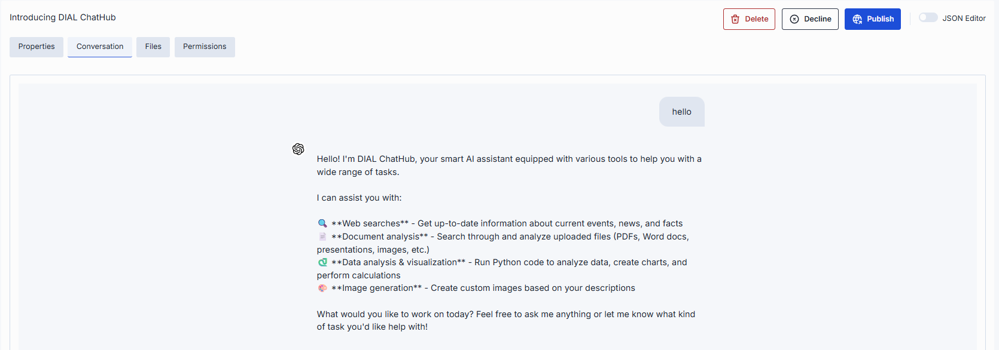

### Files

The Files tab lists the files attached to the conversation. You can't add or remove files in a conversation request. For the list columns and file actions, see [Files](#files).

## Skill publications

Filter the approvals grid by the Skill type to display all publish/unpublish requests submitted via [DIAL Chat UI](../../6.chat-user-guide/6.sharing-and-publishing.md) or the [Publication API](https://dialx.ai/dial_api#tag/Publications). Publish and unpublish requests have the same layout.

### Properties

The Properties tab contains the [common request properties](#common-properties) and the files of the skill.

| Property | Editable | Description |
|----------|----------|-------------|
| **Files** | Yes | Files that go with the skill. You can't edit the content of these files in the request. **Preview** and **Download** work on files that are already saved. **Add** attaches a file, and **Remove** removes one. To change a file, remove it and add the edited version. The list also shows `SKILL.md`, which holds the skill text: it can't be removed, and the description and instructions of the skill are edited in the [Skill tab](#skill). |

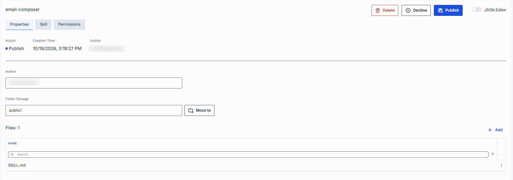

### Skill

The Skill tab is where the text of the skill is: the name and description from the header of the `SKILL.md` file, and the instructions that follow it. Other files of the skill bundle are managed in the Properties tab. See [Artifacts → Skills](../2.artifacts/1.skills.md#skill) for details about the skill format.

| Property | Editable | Description |
|----------|----------|-------------|
| **Name** | No | Name of the skill. |
| **Description** | Yes | Description of when the skill should be used. Required. |
| **Content** | Yes | The instructions of the skill, edited in a Markdown editor. |

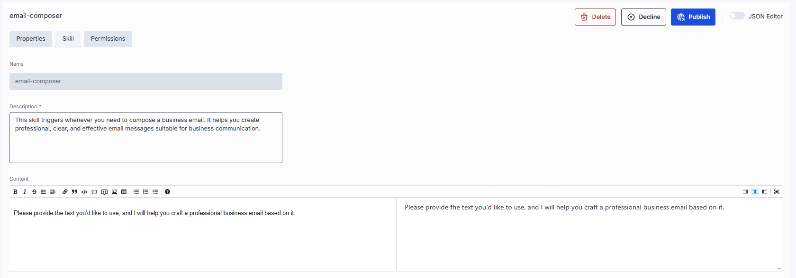

Changes to the files and to `SKILL.md` are applied to the skill when you click **Save**.

## Next steps

- [Folder Permissions](./3.folders-storage.md) — set the access rules of the folders that published resources go to
- [Manage API keys](./2.keys.md) — create and rotate API keys for programmatic publication requests
- Activities and rollback — audit publication approvals and other admin actions
