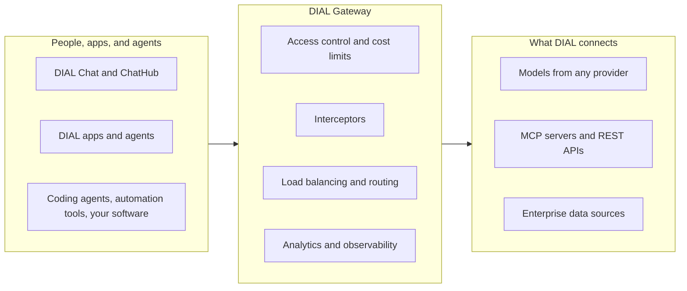

# What is DIAL

DIAL is EPAM's open-source platform that puts one governed layer under all enterprise AI. It brings the models, agents, and tools a company already uses under one point of control, and gives new AI initiatives a running start. This page explains the problem DIAL solves, what it provides, and where it fits in an existing AI stack. It assumes no prior DIAL knowledge.

## The problem DIAL solves

Calling a model is rarely the hard part of enterprise AI. The hard part is everything around the call, once many teams use AI at the same time:

- Reaching models from several providers and clouds without rewriting clients for each one.
- Controlling who can use which models, tools, and data, and what that use costs.
- Keeping personal and confidential data out of prompts and responses.
- Knowing who uses AI, for what, and how much it costs each team.
- Connecting AI to the systems where company data and work live.
- Building, hosting, and sharing apps and agents, including agents that run code.
- Measuring whether models and agents are good enough, and noticing when that changes.

When each team solves these on its own, the result is scattered tools, duplicated spending, and AI use nobody can see. Single-purpose tools each cover one part: a gateway routes traffic, a framework composes logic in code, and a builder assembles workflows. DIAL covers the whole set in one platform, and each part is also an extension point.

## How DIAL approaches it

DIAL does two jobs from one layer:

- **Govern what you already run.** Route requests from people, apps, and agents through DIAL Gateway for shared access control, routing, cost limits, and visibility. Configured interceptors inspect supported model and application paths.
- **Build what comes next.** On the same layer, employees get a governed AI workspace, and teams get tools to build, host, and evaluate their own apps and agents.

You do not have to adopt everything at once. DIAL is built from separate services, and DIAL Core, the service behind DIAL Gateway, is the only mandatory one. Start with the gateway, stop there if that is enough, and add components as the need appears.

## What DIAL provides

Each row below is a need that comes up as AI use grows, and the part of DIAL that meets it.

| Need | What DIAL provides |
|---|---|
| **Access to any model** | DIAL Gateway accepts OpenAI Chat Completions, OpenAI Responses, Anthropic Messages, and OpenAI Embeddings requests. It passes them to compatible backends or translates between formats. Models can come from any major cloud or model provider, self-hosted models, or another DIAL instance. |
| **Reliable, cost-efficient inference** | Load balancing across models, regions, and cloud subscriptions, with provisioned throughput used before pay-as-you-go. Failover to verified destinations, and auto-routing by cost, quota, latency, or data residency rules. |
| **Access and cost control** | Attribute- and role-based access down to individual models, apps, tools, and files, through the identity provider you already use. Spending limits and token quotas per user, team, project, or API key. |
| **Data protection** | Interceptors inspect supported model and application requests and responses for PII, data leaks, prompt injection, and content rules. Build your own with the Interceptors SDK, or connect third-party guardrails. See [control boundaries](../4.security-and-governance/4.data-protection-and-isolation.md). |
| **Visibility into AI use** | DIAL Analytics attributes every request to a user, team, project, or cost category. Every call is logged to storage you own and exported through OpenTelemetry. |
| **Enterprise data and tools** | MCP Toolsets connect existing MCP servers and turn REST APIs into MCP servers. External connectors reach systems such as SharePoint, Confluence, and Salesforce. DIAL RAG answers from your documents with source citations. |
| **A governed AI workspace** | DIAL Chat gives employees one window to every approved model, agent, and tool. DIAL ChatHub is a ready-made assistant that picks the right agents for each prompt. The Marketplace lists everything a user can access, and work can be shared with colleagues or published after admin review. |
| **Building apps and agents** | Quick Apps for no-code agents, Code Apps for Python that DIAL builds and hosts, and Custom Apps on any framework with the DIAL SDK. DIAL Loop runs agents built with Claude Code, OpenCode, or Codex in production, each run in its own container. Any agent can call another as a tool. |
| **Quality** | DIAL Grid benchmarks connected models on your own tasks for cost, speed, and quality. DIAL Eval scores apps, agents, models, and MCP tools against your own ground truth and can gate every deployment. |
| **Administration** | DIAL Admin manages users, models, apps, tools, MCP servers, access, and cost from one console. It also deploys MCP servers and interceptors to Kubernetes. |

DIAL Chat and DIAL applications use the Unified API, DIAL's extension of OpenAI Chat Completions with attachments, stages, and multimodal content. Other clients do not need to adopt it. They call DIAL through the standard API they already use, and the list of supported APIs keeps growing.

## Where DIAL fits

DIAL adds a governed layer to the stack a company already runs rather than replacing it:

- **Model providers and clouds.** DIAL does not host or train models. It connects to wherever they run and governs the traffic.
- **Coding agents.** Claude Code, GitHub Copilot, and Codex can send their model traffic through DIAL Gateway, and DIAL Loop runs agents built with them for many users.
- **Application frameworks.** LangChain, LlamaIndex, and similar frameworks run inside DIAL applications.
- **Automation tools.** n8n, Power Automate, and Apache Airflow call DIAL agents and tools as workflow steps.
- **Identity and monitoring.** DIAL signs users in through your identity provider and sends telemetry to the monitoring stack you already run.

## Design principles

DIAL's shape follows from a few deliberate choices:

- **Open source.** Licensed under the [Apache License, Version 2.0](https://github.com/epam/ai-dial/blob/main/LICENSE).
- **Vendor-agnostic by design.** DIAL favors no model vendor, cloud, or agent harness, so swapping one is a configuration change rather than a rebuild.
- **API-first.** Every feature is available through an API, so extensions build on the same surface as the platform itself.
- **Extensible at every layer.** Adapters, interceptors, routers, MCP servers, and applications are all extension points.
- **Composable.** Each capability is a separate service. Run only the ones you need and add others later.
- **Runs in your environment.** Deploy on Kubernetes in AWS, Azure, Google Cloud, or on-premises with Helm charts. Data, logs, and evaluation results stay in storage you own.
- **Domain-agnostic.** DIAL prioritizes generic, reusable capabilities over features specific to a single industry. Domain logic belongs in applications and extensions.

The name reflects this integrating role: DIAL stands for **D**eterministic **I**ntegrator of **A**pplications and **L**anguage Models.

## Further reading

- [Architecture highlights](../2.architecture/1.architecture-highlights.md) — the services that make up DIAL and how they connect
- [AI API overview](../2.architecture/7.ai-api-overview.md) — the protocol DIAL Chat and DIAL applications use
- [DIAL Apps overview](../../3.building-with-dial/1.apps/0.index.md) — the application types DIAL hosts
- [Agentic tools](../../3.building-with-dial/6.integrations/4.agentic-tools/0.index.md) — connect coding agents to DIAL

## Next steps

- [Run DIAL locally](../../1.home/1.run-dial-locally.md) — start DIAL on your machine with Docker Compose
- [Evaluate your architecture](../2.architecture/1.architecture-highlights.md#evaluate-your-architecture) — review deployment, integration, security, and operating decisions
