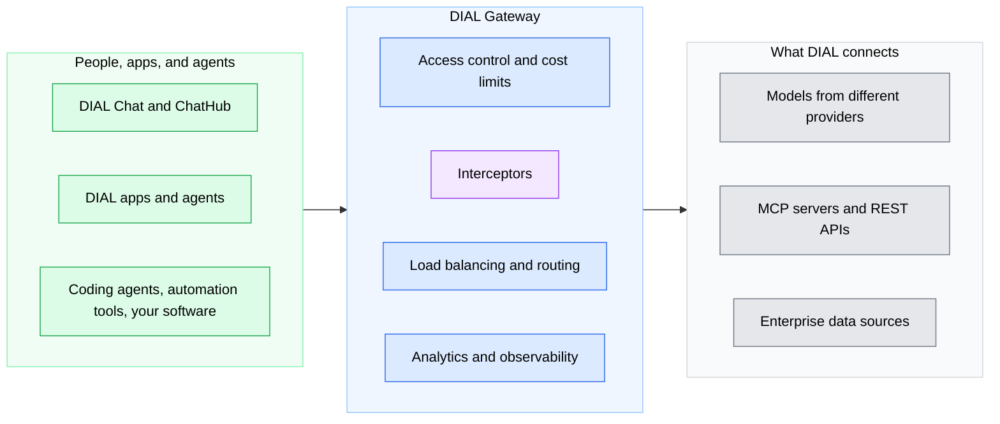

# What is DIAL

DIAL is EPAM's open-source platform that puts all enterprise AI behind one governed layer. It brings the models, agents, and tools a company already uses under one point of control, and gives new AI initiatives a running start. This page explains the problems DIAL solves, what it provides for each, the principles behind it, and where it fits in an existing AI stack. It assumes no prior DIAL knowledge.

## The problem DIAL solves

Calling a model is rarely the hard part of enterprise AI. The hard part is everything around the call once many teams use AI at the same time: access, cost, data protection, visibility, integration, and quality.

When each team solves these on its own, the result is scattered tools, duplicated spending, and AI use nobody can see. Single-purpose tools each cover one part: a gateway routes traffic, a framework composes logic in code, and a builder assembles workflows. DIAL covers the whole set in one platform, and each part is also an extension point.

## How DIAL approaches it

DIAL does two jobs from one layer:

- **Govern what you already run.** Route requests from people, apps, and agents through DIAL Gateway for shared access control, routing, cost limits, and visibility. Configured interceptors inspect supported model and application paths.
- **Build what comes next.** On the same layer, employees get a governed AI workspace, and teams get tools to build, host, and evaluate their own apps and agents.

:::tip
You do not have to adopt everything at once. DIAL is built from separate services, and DIAL Core, the service behind DIAL Gateway, is the only mandatory one. Start with the gateway, stop there if that is enough, and add components as the need appears. **[Deployment profiles](./4.architecture/3.deployment-profiles.md)** describe common starting points.
:::

---

## What DIAL provides

Each need below comes up as AI use grows. For each one, you see the problem it creates and how DIAL solves it.

### Access to any model

- **Problem.** Each provider has its own API, SDK, and keys, so changing a model means changing the app.
- **DIAL.** DIAL Gateway connects models from Azure OpenAI, AWS Bedrock, Google Vertex AI, OpenAI-compatible and self-hosted endpoints, and other DIAL instances. Clients keep the API they already use: OpenAI Chat Completions, OpenAI Responses, Anthropic Messages, or OpenAI Embeddings. DIAL passes each request through to a compatible model or translates it, so a client that speaks Anthropic Messages can still use a GPT model. Switching models is a configuration change. See [Model access and AI APIs](./3.capabilities/1.model-access-and-ai-apis.md).

### Reliable, cost-efficient inference

- **Problem.** One model endpoint is one point of failure, one rate limit, and one price.
- **DIAL.** DIAL spreads a model's traffic across endpoints, regions, and cloud subscriptions, and uses provisioned throughput before pay-as-you-go. It moves traffic elsewhere when an endpoint fails or reaches its limits, and keeps requests that share a prompt cache on one endpoint. Routers pick the model for each request with your own logic. See [Load balancing and failover](./3.capabilities/3.load-balancing-and-failover.md).

### Access control

- **Problem.** Without a shared layer, nobody controls who may use which model, agent, tool, or file.
- **DIAL.** Role- and attribute-based access down to a single model, application, Toolset, file, or conversation. Users sign in through the identity provider you already use, and applications get API keys with their own roles. See [Authentication and access control](./5.security-and-governance/1.authentication-and-access-control.md).

### Cost control

- **Problem.** Open access to models means open-ended spending.
- **DIAL.** Token, request, and USD spending limits per role and API key, over windows from a minute to a month. For users who sign in through an identity provider, budgets can replace the role's cost limit. DIAL checks limits before a request reaches the model, and Claude Code and Codex show the cost limits to the developer. See [Usage limits and cost control](./5.security-and-governance/5.usage-limits-and-cost-control.md).

### Data protection

- **Problem.** Personal and confidential data can leak into prompts and responses.
- **DIAL.** Interceptors check model and application traffic in both directions. They reject or anonymize personal data, block prohibited content, detect prompt injection, and record requests for audit. Build your own with the Interceptors SDK, or connect services such as Google Model Armor and Microsoft Presidio. See [Guardrails](./3.capabilities/4.guardrails.md) and [Data protection and isolation](./5.security-and-governance/6.data-protection-and-isolation.md).

### Visibility into AI use

- **Problem.** A token total shows how much was spent, but not who spent it, on what, and whether it helped.
- **DIAL.** DIAL records every request with its user, project, model or application, tokens, cost, and latency. DIAL Analytics turns these records into dashboards, conversation-level investigation, and your own reports. Runtime telemetry goes through OpenTelemetry to the monitoring you already run. See [Analytics and observability](./3.capabilities/5.analytics-and-observability.md).

### Enterprise tools and data

- **Problem.** Every team builds its own integrations and handles credentials and permissions again each time.
- **DIAL.** Register an MCP server once as a Toolset, and every permitted agent can use it, with roles, allowed tools, and credentials managed in DIAL. The OpenAPI to MCP bridge turns REST APIs into MCP tools, and Generic RAG answers questions over your documents. See [Tools and enterprise data](./3.capabilities/6.tools-and-enterprise-data.md).

### A governed AI workspace

- **Problem.** AI tools are scattered across teams, and good work stays with the person who made it.
- **DIAL.** DIAL Chat gives employees one window to every approved model, agent, and tool. DIAL ChatHub is a ready-made assistant that picks the right agents for each prompt. The Catalog lists everything a user can access, and users share work with colleagues or publish it to the organization after admin review. See [Collaboration and sharing](./3.capabilities/10.collaboration-and-sharing.md).

### Apps and agents

- **Problem.** Teams rebuild the same capabilities, and an agent built by one team is hard for others to reuse safely.
- **DIAL.** DIAL calls an agent the same way as a model, with the same access checks, so any agent can use another as a building block. Build with no code in Quick Apps, in Python that DIAL builds and hosts in Code Apps, or on any framework with the DIAL SDK in Custom Apps. Scheduled tasks run an agent while the user is away. See [Agentic platform](./3.capabilities/7.agentic-platform.md).

### Quality

- **Problem.** Without measurement, choosing a model or shipping a change is guesswork, and quality can drop unnoticed.
- **DIAL.** DIAL Grid benchmarks connected models on your own tasks for cost, speed, and quality. DIAL Eval scores apps, agents, models, and MCP tools against your own ground truth. Re-run a test suite after each change to catch regressions, by hand or from a CI pipeline. See [Evaluations](./3.capabilities/9.evaluations.md).

### Self-hosted models and MCP servers

- **Problem.** Hosting a model or an MCP server yourself means building containers and running them on Kubernetes.
- **DIAL.** DIAL Deployment Manager does this from DIAL Admin. It runs Hugging Face models, MCP servers, including stdio servers exposed over HTTP, and your own adapters, applications, and interceptors. See [Deployments overview](../6.administering-dial-new/3.deployments/0.index.md).

### Data in your own storage

- **Problem.** Files, conversations, and other AI work must stay inside the company's environment.
- **DIAL.** DIAL Core stores files, conversations, prompts, and applications in your blob storage: AWS S3, Azure Blob Storage, Google Cloud Storage, or a filesystem. Valkey caches them, and no relational database is needed. The same access rules and API apply to all of them. See [State and data lifecycle](./4.architecture/4.state-and-data-lifecycle.md).

### Administration

- **Problem.** Running AI for many teams through configuration files does not scale.
- **DIAL.** DIAL Admin manages models, applications, Toolsets, roles, API keys, interceptors, publication approvals, deployments, evaluations, and analytics from one console. Every feature also has an API, so administration can be automated. See [Admin Panel overview](../6.administering-dial-new/0.index.md).

:::note
DIAL Chat and DIAL applications use the Unified API, DIAL's extension of OpenAI Chat Completions with attachments, stages, and multimodal content. Other clients do not need to adopt it. They call DIAL through the standard API they already use, and the list of supported APIs keeps growing.
:::

---

## Where DIAL fits

DIAL adds a governed layer to the stack a company already runs rather than replacing it:

- **Model providers and clouds.** DIAL does not host or train models. It connects to wherever they run and governs the traffic.
- **Coding agents.** Claude Code, GitHub Copilot, and Codex can send their model traffic through DIAL Gateway.
- **Application frameworks.** LangChain, LlamaIndex, and similar frameworks run inside DIAL applications.
- **Automation tools.** n8n, Power Automate, and Apache Airflow call DIAL agents and tools as workflow steps.
- **Identity and monitoring.** DIAL signs users in through your identity provider and sends telemetry to the monitoring stack you already run.

## Main principles

DIAL's shape follows from four deliberate choices:

- **Flexible: take only what you need.** DIAL is a set of separate services, and DIAL Core is the only required one. Every feature has an API, and adapters, interceptors, routers, MCP servers, and applications are all extension points, so DIAL fits very different organizations. The price of this flexibility is complexity: many services with many settings take effort to learn and set up. [Deployment profiles](./4.architecture/3.deployment-profiles.md) give common starting points, and DIAL Admin replaces hand-edited configuration files.
- **Built around enterprise needs.** Features come from what enterprise clients need, such as lower infrastructure costs and faster responses. For example, DIAL uses provisioned capacity before pay-as-you-go and keeps requests that share a prompt cache on one endpoint. Capabilities stay generic and reusable across industries; domain logic belongs in applications and extensions.
- **Secure and governed.** All AI use, by people, applications, and agents, goes through one governed layer. Every call passes the same authentication, access checks, and limits, whatever API or client it uses. Access rules, cost limits, guardrails, and audit live in the platform rather than in each application, so a new application or agent is covered without extra code. Agents that call other agents cannot bypass permissions, and resources reach the whole organization only after administrator review. DIAL governs what passes through it; the providers, tools, and systems you connect keep their own controls. See [Security and governance](./5.security-and-governance/0.index.md).
- **Open and vendor-agnostic.** DIAL is open source under the [Apache License, Version 2.0](https://github.com/epam/ai-dial/blob/main/LICENSE). It favors no model vendor, cloud, or agent harness, so swapping one is a configuration change rather than a rebuild. It runs in your environment, on Kubernetes in AWS, Azure, Google Cloud, or on-premises with Helm charts, and data, logs, and evaluation results stay in storage you own.

The name reflects this integrating role: DIAL stands for **D**eterministic **I**ntegrator of **A**pplications and **L**anguage Models.

## Further reading

- [Architecture highlights](./4.architecture/1.architecture-highlights.md) — the services that make up DIAL and how they connect
- [Concept map](./2.foundations/1.concept-map.md) — how DIAL's components and concepts relate to one another
- [AI API overview](./4.architecture/7.ai-api-overview.md) — the protocol DIAL Chat and DIAL applications use
- [DIAL Apps overview](../4.building-with-dial/1.apps/0.index.md) — the application types DIAL hosts
- [Agentic tools](../3.connecting-to-dial/1.agentic-tools/0.index.md) — connect coding agents to DIAL
