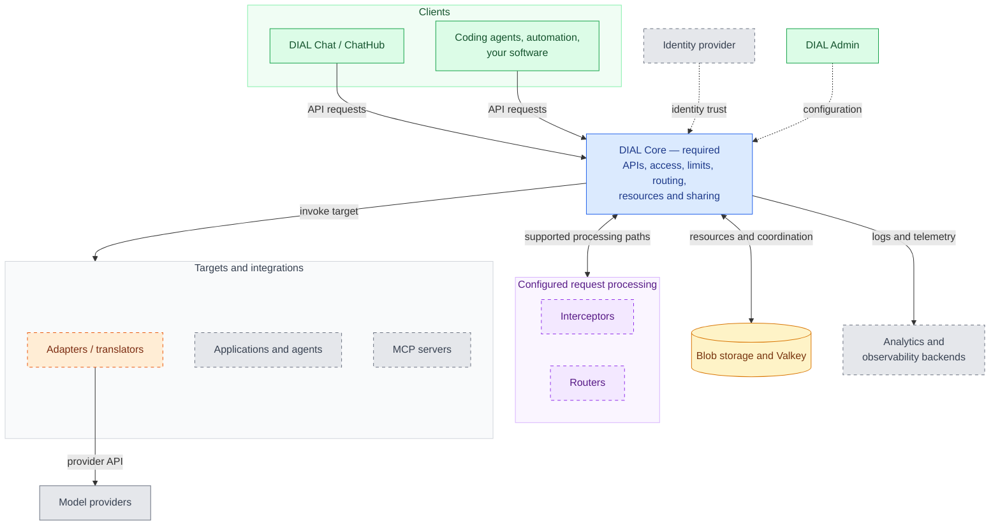

# Architecture highlights

DIAL is built from separate services around one mandatory component, DIAL Core. Each service owns one responsibility, and most of them can be replaced or extended with services you build yourself. This page explains why DIAL is built this way, what each service is responsible for, and where your own services plug in. It assumes you have read [What is DIAL](../1.positioning/1.what-is-dial.md).

## Why DIAL is modular

We built DIAL as a set of services rather than one application. Each service connects to the rest of the platform through a defined interface, so it can be added, replaced, or scaled on its own. That choice has clear benefits and a real cost.

### What modularity gives you

- **Deploy only what you need.** DIAL Core is the only mandatory DIAL service; a working gateway also needs its backing stores, configuration, and model connectivity. Add DIAL Chat, DIAL Admin, analytics, app hosting, or evaluation when the need appears.
- **Go beyond what DIAL ships.** When a default service does not cover your case, build your own and plug it in. Your adapter, interceptor, router, MCP server, or application connects the same way DIAL's own services do.
- **Use third-party components.** Plug in services that others built, such as Google Model Armor or Microsoft Presidio for guardrails, NeMo Switchyard for routing, or any existing MCP server.
- **Change one part at a time.** Services have independent release cycles and can be scaled separately. Check interface and version compatibility when changing a component outside the tested assembly.

### What it costs

The price of modularity is complexity:

- **Many moving parts.** A production deployment runs many services, each with its own configuration, logs, and release cycle.
- **A steep first step.** To follow a single request, you need to know which service handles which part of it. At first, the number of components can be overwhelming.
- **More to operate.** Every added service is one more thing to deploy, monitor, secure, and keep compatible with the others.

We accept this cost on purpose. A single application would be simpler to start with, but it would limit you to whatever it ships.

### Keeping the complexity manageable

- **Start small.** Begin with DIAL Core and add services one at a time, as each need appears.
- **Deploy tested combinations.** The [DIAL Helm chart](../../4.operating-dial/2.cloud-deployment/0.index.md) publishes stable assemblies of component versions known to work together.
- **Manage from one console.** [DIAL Admin](../../5.administering-dial/0.index.md) configures models, applications, interceptors, MCP servers, and access in one place, instead of in each service's configuration files.
- **Use this page as a map.** The sections below describe what each service is responsible for.

## How the services fit together

Client requests routed through DIAL enter DIAL Core. Core checks access and configured limits, applies the processing supported by the selected API, and forwards the request to its target. Applications can call models and tools back through Core using delegated caller context.

The map below separates clients, Core, processing services, targets, and operations. DIAL Admin changes configuration through the management path; it is not another ordinary inference client.

The processing group shows responsibilities, not a direct interceptor-to-backend connection. Core coordinates those calls. The [Request flow](./2.request-flow.md) page explains their order; [Deployment profiles](./3.deployment-profiles.md) maps the services to operating responsibilities.

## DIAL Core (required)

DIAL Core is the only mandatory service. It is headless, so clients reach it only through its APIs. Core is responsible for:

- **APIs.** OpenAI Chat Completions, OpenAI Responses, Anthropic Messages, and OpenAI Embeddings for supported model deployments. The **Unified API** extends Chat Completions and Embeddings; DIAL Chat and DIAL applications use its chat-completion interface. Adapter, application, and interceptor support differ; see [AI API overview](./7.ai-api-overview.md).
- **Load balancing and failover.** Weighted distribution across model upstreams, regions, and cloud subscriptions, with priority tiers, retries, and failover.
- **Access control.** API keys, sign-in through your identity provider, roles, and permissions on every model, application, toolset, route, and stored resource.
- **Usage and cost control.** Token and request quotas, spending limits, and configurable model pricing per user, team, or API key.
- **Request processing.** Coordinating configured interceptor chains and the selected native, passthrough, or translation path. Inspection coverage depends on the API and release.
- **MCP.** Registering toolsets, discovering their tools, and proxying tool calls to MCP servers.
- **Resource storage.** Files, conversations, prompts, applications, toolsets, and skills, with sharing and publication workflows.
- **Telemetry.** Request logging and integration with usage analytics and OpenTelemetry. Exporters and destinations need deployment configuration.

Core requires no relational database. It stores resources in blob storage, such as AWS S3, Azure Blob Storage, Google Cloud Storage, or a filesystem, and uses Valkey for caching, pending resource writes, and coordination. Optional services bring additional stores: Admin retains editable configuration, and Analytics Realtime writes usage metrics to a time-series database.

Keeping resources outside Core lets you scale its service instances, but shared stores remain part of the availability and recovery design. See [State and data lifecycle](./4.state-and-data-lifecycle.md) for the difference between an accepted write and persisted blob content.

For the source code, see the [DIAL Core repository](https://github.com/epam/ai-dial-core). For every endpoint, see the [DIAL Core API reference](https://dialx.ai/dial_api).

## Optional services

Each optional service owns one responsibility. They are grouped below by the part of the diagram they belong to.

### Connecting to models

- **[Adapters](../../3.building-with-dial/3.adapters/0.index.md)** translate a provider's native API into the format DIAL uses. The adapters DIAL ships cover the major providers, so a custom adapter is rarely needed. See [supported providers](../../3.building-with-dial/3.adapters/2.supported-providers.md).
- **Translators** convert between client and target APIs. Anthropic Messages can use the Chat Completions translator inside the Bedrock Adapter; Responses-based translation is planned. Passthrough instead preserves the model API. Responses currently requires the Azure OpenAI Adapter. See the [API support table](./7.ai-api-overview.md).

### Processing requests

- **[Interceptors](../../3.building-with-dial/2.interceptors/0.index.md)** inspect and change requests and responses: PII redaction, guardrails, prompt injection detection, and compliance checks. Assign them globally, per application type, or per deployment.
- **Routers** implement model-selection logic, for example choosing by cost, quota, latency, or permitted region. This is an extension responsibility; the configured router determines the policy. It differs from Core distributing traffic across a model's configured upstreams.

### Running applications and agents

- **Agent builders** let users create applications without writing a service of their own. [Quick Apps](../../3.building-with-dial/1.apps/2.quick-apps/0.index.md) build agents without code. [Code Apps](../../3.building-with-dial/1.apps/3.code-apps/0.index.md) turn Python code into applications that DIAL builds and hosts. See [Application hosting and lifecycle](./6.application-server.md).
- **[Custom Apps](../../3.building-with-dial/1.apps/5.custom-apps/0.index.md)** implement the Unified API and are deployed by your team. Use the DIAL SDK or implement the contract in your own language and framework.
- **DIAL Loop** runs agents built with Claude Code, OpenCode, or Codex for many users, each run in its own container.
- **Ready-made applications**, such as DIAL RAG and Deep Research, cover common use cases out of the box.
- **MCP servers** give agents tools and data. Connect existing servers through [toolsets](../../3.building-with-dial/1.apps/2.quick-apps/1.quick-app-2/9.toolsets/0.index.md), or deploy your own through DIAL Admin.

### User and administration interfaces

- **DIAL Chat** is the web interface for end users: conversations, the Marketplace, agent builders, and sharing. It can be restyled with themes, extended with [custom UIs and visualizers](../../3.building-with-dial/5.developer-tools/2.chat-customization/0.index.md), and embedded in other web apps with [DIAL Overlay](../../3.building-with-dial/5.developer-tools/2.chat-customization/8.dial-overlay.md).
- **DIAL ChatHub** provides a ready-made assistant that selects configured agents and models for a user's task. Chat and ChatHub belong to the employee workspace; applications can also be reached from other clients.
- **[DIAL Admin](../../5.administering-dial/0.index.md)** is the console for administrators: models, applications, interceptors, MCP servers, access control, publication review, and usage and cost.

### Operations

- **Deployment Manager** builds and deploys MCP servers, interceptors, and other images to Kubernetes from DIAL Admin.
- **[Analytics Realtime](../../4.operating-dial/6.observability/5.analytics-realtime-setup.md)** reads Core request logs and derives usage metrics such as cost, topics, and sentiment. Source logs and derived metrics are separate data copies with their own retention and access controls.
- **[Observability](../../4.operating-dial/6.observability/0.index.md)** uses OpenTelemetry for runtime-health signals. Configure component instrumentation, collection, and export to your chosen backend separately from the usage-analytics pipeline.
- **DIAL Eval and DIAL Grid** live in DIAL Admin. Eval scores applications, agents, models, and MCP tools against your own test data. Grid compares models on your own tasks.

For the technologies behind each service, see [DIAL Stack](./9.dial-stack.md).

## Where you plug in your own

Each extension point in the diagram controls one decision. When the default does not fit, this is what you can plug in:

| Extension point | What it controls | What you can plug in |
|---|---|---|
| **Adapter** | How DIAL reaches a model provider | A custom adapter built with the DIAL SDK, for a non-standard provider or a proprietary model |
| **Interceptor** | What happens to each request and response | Your own interceptor built with the Interceptors SDK, or a third-party guardrail such as Google Model Armor or Microsoft Presidio |
| **Router** | Which model serves each request | A third-party router such as NeMo Switchyard, or your own routing logic |
| **MCP server** | Which tools and data agents can use | Any existing MCP server, or your own server deployed through DIAL Admin |
| **Application** | The logic behind an agent | A Custom App on any framework, such as LangChain or LlamaIndex, or your own application type with its own builder |
| **User interface** | What users see | Themes, custom UIs, and visualizers for DIAL Chat, or DIAL Chat embedded in your own web app |
| **Identity provider** | Who users are and what attributes they carry | Any [OpenID Connect provider](../../4.operating-dial/5.auth-and-access-control/4.sso-idp/0.index.md), such as Okta, Microsoft Entra ID, Auth0, Google, AWS Cognito, or Keycloak |
| **Observability backend** | Where metrics, logs, and traces go | Any OpenTelemetry-compatible backend |

Your services plug in the same way DIAL's own do. The adapters DIAL ships are built on the DIAL SDK, and Quick Apps is an application type registered in DIAL Core like any custom one. Calls made through Core use its configured access, limits, and logging for the selected path. Your extension's own credentials, outbound connections, and external side effects remain part of its design; gateway registration alone does not define those boundaries.

## How DIAL connects to the rest of your stack

- **Coding agents.** Claude Code, GitHub Copilot, Codex, and OpenCode can send their model traffic through DIAL Core, so the same access control and cost limits apply to them. See [agentic tools](../../3.building-with-dial/6.integrations/4.agentic-tools/0.index.md).
- **Workflow automation.** [n8n](../../3.building-with-dial/6.integrations/3.workflow-automation/1.n8n.md), Power Automate, and Apache Airflow call DIAL models, agents, and tools as steps in business processes.
- **Chat and productivity tools.** Users reach DIAL from [Microsoft Teams](../../3.building-with-dial/6.integrations/1.chatbot-integrations/1.ms-teams.md), Microsoft Copilot, and [productivity add-ins](../../3.building-with-dial/6.integrations/2.productivity-add-ins/0.index.md) such as Microsoft Excel.
- **Enterprise data.** DIAL applications and MCP servers connect to the systems their logic needs: databases and data warehouses, vector databases, document storage, and third-party APIs.

## Evaluate your architecture

| Decision | Read |
|---|---|
| Which capabilities and services do we need? | [Deployment profiles](./3.deployment-profiles.md) |
| How do requests reach models, applications, and tools? | [Request flow](./2.request-flow.md) |
| Will our clients and models work? | [AI API overview](./7.ai-api-overview.md) |
| Where is data stored, and which access boundaries apply? | [State and data lifecycle](./4.state-and-data-lifecycle.md) and [Data protection and isolation](../4.security-and-governance/4.data-protection-and-isolation.md) |
| What infrastructure and application runtimes will we operate? | [DIAL Stack](./9.dial-stack.md) and [Application hosting and lifecycle](./6.application-server.md) |
| What happens under load or during failures? | [Reliability and performance](./5.reliability-and-performance.md) |
| Which costs and limitations affect adoption? | [Trade-offs and limitations](./8.trade-offs-and-limitations.md) |

## Next steps

- [Run DIAL locally](../../1.home/1.run-dial-locally.md) — start a small DIAL deployment with Docker Compose
