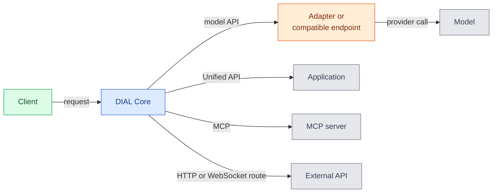
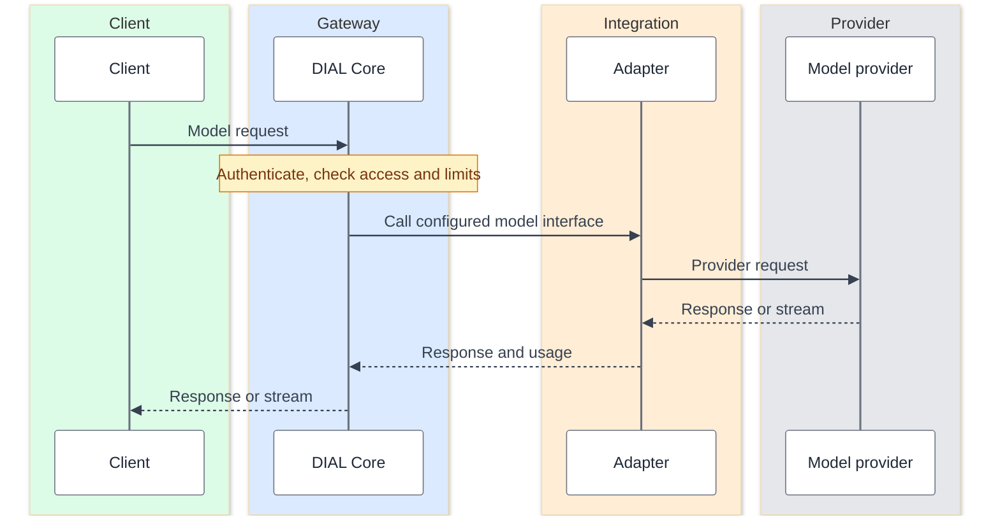
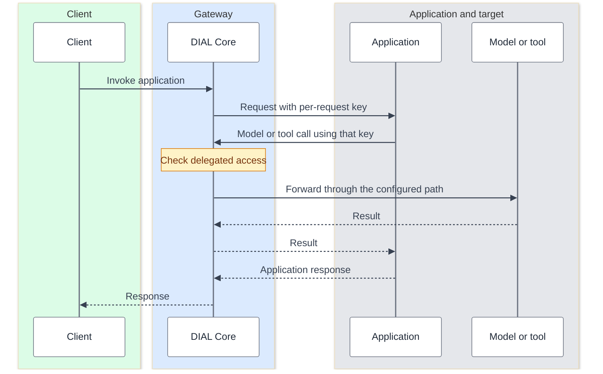
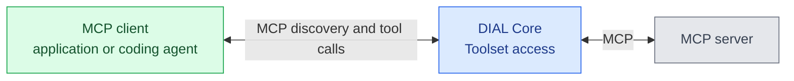
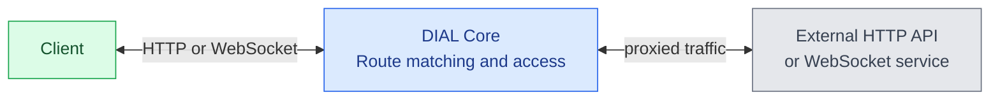
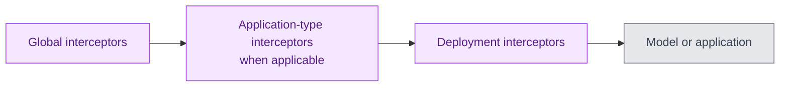
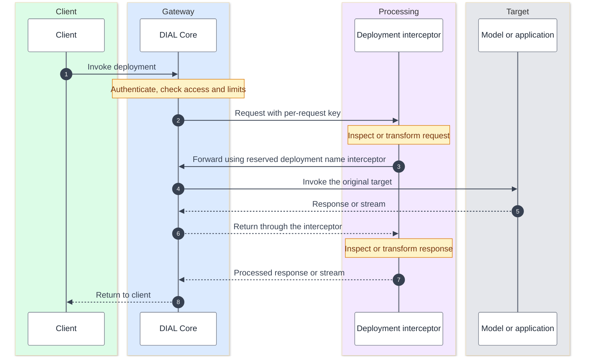

# Request flow

Requests routed through DIAL enter DIAL Core. Core authenticates the caller, checks access, and forwards the call to its configured target. This page explains the main runtime paths for architects who have read [Architecture highlights](./1.architecture-highlights.md).

## The four request paths

A client can be DIAL Chat, a coding agent, an automation tool, your own software, or another DIAL application. The target determines both the protocol and what Core does after authorization. A model invocation, an MCP tool call, and a proxied HTTP request are distinct operations even when they share the same gateway.

This is a logical map, not a deployment topology. Adapters are needed for provider-specific integration; a compatible endpoint can be configured directly. An application becomes a client when it calls another model, application, or tool through Core.

## Models

Core resolves the requested model deployment and selects its configured API path and upstream. An adapter handles provider authentication and either converts the provider format or preserves it in passthrough mode. The client therefore integrates with the exposed interface rather than managing every provider's credentials and transport.

The sequence shows a successful model call. It omits optional interceptor hops so the provider boundary remains visible. The colored columns distinguish the green client, blue gateway, orange adapter, and gray provider.

DIAL's three adapter families serve different provider integrations:

| Adapter | Main integration |
|---|---|
| OpenAI Adapter | Azure OpenAI and other supported OpenAI-compatible or provider-specific endpoints |
| Bedrock Adapter | Models accessed through AWS Bedrock |
| Vertex AI Adapter | Models accessed through Google Vertex AI |

Provider connectivity does not mean every client API is supported. **Responses currently uses only the Azure OpenAI Adapter.** **Anthropic Messages supports passthrough across all adapters** for compatible models, plus translation through Chat Completions inside the Bedrock Adapter. Responses-based translation is planned. See [API support](./7.ai-api-overview.md) and [supported providers](../../3.building-with-dial/3.adapters/2.supported-providers.md).

## Applications

Core invokes a registered application directly through its endpoint; an application implementing the Unified API does not need a model adapter in front of it. That interface is DIAL's extension of Chat Completions. Support for a model's other APIs does not automatically make an application accept those APIs.

An application often needs several model or tool calls to answer one request. In the sequence below, it calls back through the same Core service. The second interaction is a delegated call, not a second required gateway deployment.

The target may be reached through an adapter or MCP server; those hops are omitted here. A [per-request key](../../3.building-with-dial/7.working-with-dial-resources/5.per-request-keys.md) carries the caller's context and is invalidated when its request completes. Applications with sensitive dependencies can also require [user consent](../../3.building-with-dial/7.working-with-dial-resources/6.auth-matrix-for-apps.md).

Delegation lets Core check the user's context for nested calls and associate them with the originating work. It does not give the application unrestricted access to every resource. The [per-request key reference](../../3.building-with-dial/7.working-with-dial-resources/5.per-request-keys.md) describes file access and credential lifetime.

Applications can also have direct network connections. Core governs calls made through it; external data access depends on the application's own credentials and network permissions. See [Application hosting and lifecycle](./6.application-server.md) for the hosting and operating boundary.

## MCP toolsets

A Toolset gives an MCP client a governed endpoint in Core for an MCP server. The client can be an application or a coding agent. Core checks access and proxies tool discovery and execution; the MCP server implements the actual tools and connections to enterprise systems.

For example, an agent can discover a document-search tool and then call it through the same Toolset endpoint. The server's credentials determine what the external document system permits. Toolset credentials can be per-user or shared across the organization, so the downstream identity is an important design choice. See [What is a Toolset](../../3.building-with-dial/1.apps/2.quick-apps/1.quick-app-2/9.toolsets/0.index.md).

Tool discovery is separate from the model deciding to call a tool. The application or agent coordinates those steps; a model API and MCP are not interchangeable transports.

## Routes

A route proxies an HTTP API that does not implement a model, application, or MCP interface. Core matches the configured path and method, checks the caller's access, and forwards the call. Routes can also proxy WebSocket traffic.

This is useful for connecting an existing service without rewriting its API to match the Unified API. The external service keeps its own behavior and data model. Route registration does not turn it into a model or an MCP server, and its external side effects still need application-level handling. See [Manage routes](../../5.administering-dial/2.entities/5.routes.md) and the [route configuration reference](../../4.operating-dial/4.configuration/1.core/2.config-json/6.routes.md).

## Interceptor processing

Interceptors inspect or modify requests and responses on supported model/application paths. They can implement redaction, content rules, or other cross-cutting processing without adding that logic to every application. Their scope determines which deployments use them.

For supported model and application requests, the configured chain runs in this logical order:

Responses return through the chain in reverse order. **Each hop goes through Core**; the diagram shows processing order, not direct service connections. See [interceptor configuration](../../3.building-with-dial/2.interceptors/3.configuration-and-assignment.md).

### Example: a deployment interceptor

This example follows a Chat Completions request with one interceptor assigned to its deployment. Global and application-type interceptors are omitted to make the individual service calls clear. The target is a model or application; any model-adapter hop is also omitted.

The target's response returns through the interceptor before reaching the client, so the service can process both directions. The interceptor does not need to know the target's endpoint. See the [SDK integration reference](../../3.building-with-dial/2.interceptors/2.sdk-integration-reference.md#how-your-interceptor-calls-the-next-deployment) for this forwarding contract.

## Errors and incomplete work

An invalid credential, denied permission, or exceeded limit can stop a request before forwarding. A successful authorization does not guarantee a successful provider or tool call: the target can reject the request, time out, or fail after output has started.

Clients need to distinguish a rejected request from an interrupted stream. Replaying an application or tool call can repeat an external action, and a retry is not a guarantee that an earlier attempt did nothing. Exact retry and cancellation behavior must be established for the selected API and release.

See [Reliability and performance](./5.reliability-and-performance.md) for failover, sizing, and recovery considerations.

## Further reading

- [AI API overview](./7.ai-api-overview.md) — native support, passthrough, and translation
- [Data protection and isolation](../4.security-and-governance/4.data-protection-and-isolation.md) — identity and control boundaries
