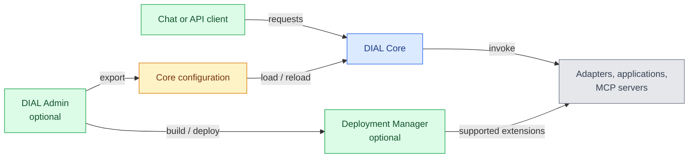

# Deployment profiles

Choose DIAL services around the capabilities you need. This page helps architects identify the infrastructure and ownership behind each choice. It assumes you know the [component map](./1.architecture-highlights.md); installation commands live in [Operating DIAL](../../4.operating-dial/2.cloud-deployment/0.index.md).

## Start with a profile

| Profile | Start with | Add when needed |
|---|---|---|
| Governed gateway | Core, configuration, blob storage, Valkey, model endpoints and required adapters | Interceptors, routing, Admin, analytics |
| Employee workspace | Gateway profile plus DIAL Chat and identity-provider integration | ChatHub, sharing/publication workflows, Quick Apps, RAG |
| Application and agent platform | Gateway profile plus the runtime for your chosen application types | Code Apps, DIAL Loop, custom services, MCP servers, evaluation |

These profiles build on the same gateway foundation. Adding an employee workspace introduces a user-facing service and resource-sharing workflows; adding application hosting introduces execution runtimes and their permissions. You can keep existing clients while adopting either capability.

They are not fixed deployment bundles. An optional service can introduce its own store, credentials, compute, and operating tasks. Choose it because the use case needs its responsibility, rather than assuming a production deployment must include every DIAL component.

## Separate request traffic from management

A user invoking a model and an administrator changing that model's configuration take different paths. The diagram separates runtime calls from configuration export and extension deployment. It is a logical service view; networking and failure-domain placement belong to the chosen deployment.

Green represents clients and management interfaces, blue Core, yellow configuration, and gray the invoked runtimes. The management path changes what runs and who can use it. Restrict configuration and deployment permissions separately from ordinary model access. Core can also load configuration maintained without Admin.

## Place the boundaries

For a production topology, identify:

- **Entry points:** client-facing Chat/Core endpoints, TLS termination, and administrative access.
- **Private services:** Core, runtimes, stores, and their permitted connections.
- **External processing:** model providers, MCP tools, enterprise systems, and telemetry destinations.
- **Failure domains:** service replicas, cache replication, storage durability, and permitted fallback regions.

For example, Core can run in your cluster while the selected model runs in a cloud provider and a Toolset connects to a corporate system. Those are three operating and trust boundaries even though the user sees one conversation.

Self-hosting DIAL does not keep a request local if its selected model or tool runs elsewhere. Residency must also cover logs, indexes, and backups. Multi-region or isolated-network designs need evidence for the complete combination of components, not just a deployable Core image.

## What your team operates

| Owner | Responsibilities |
|---|---|
| Platform team | Deployment, networking, stores, secrets, telemetry, backups, and upgrades |
| Application team | Business logic, dependencies, tool access, application state, and output quality |
| Security/governance team | Identity mappings, access policies, retention, approved destinations, and publication rules |

Use a pinned [Helm assembly](../../4.operating-dial/2.cloud-deployment/0.index.md) for Kubernetes. Docker Compose supports local evaluation. Cloud and [generic Kubernetes](../../4.operating-dial/2.cloud-deployment/4.generic-kubernetes.md) guides describe their backing infrastructure; a local example is not a production availability design.

## Next steps

- [State and data lifecycle](./4.state-and-data-lifecycle.md) — what must survive a failure
- [Production readiness](../../4.operating-dial/7.production-readiness/0.index.md) — implement the operational controls
