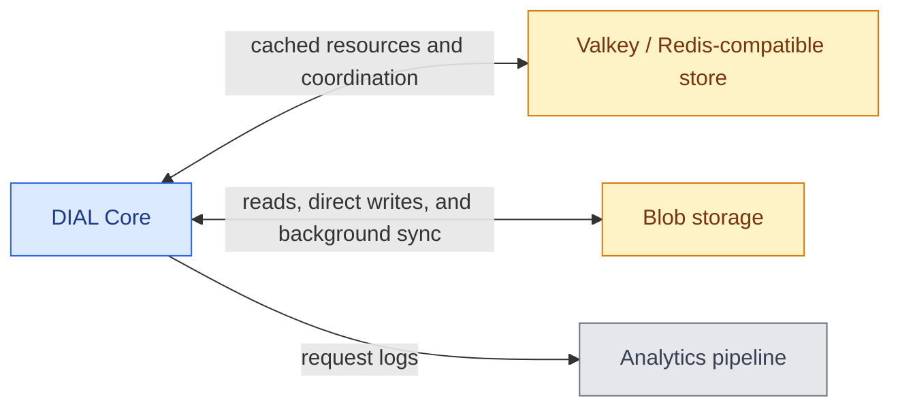

# State and data lifecycle

DIAL Core separates service instances from stored resources and shared coordination state. This page explains that distinction for architects planning persistence, retention, and recovery. Read [Deployment profiles](./3.deployment-profiles.md) first.

## Where state lives

A Core service instance can be replaced while the stores it uses must retain the information the deployment depends on. This separates service scaling from state protection. It does not make every dependency stateless: cached changes, delegation data, and optional component databases still have distinct lifetimes.

The diagram shows Core's storage interactions and a separate logging output. It does not show every optional component's database.

Blue is Core, yellow identifies shared stores, and gray the analytics destination. Core performs synchronization between cached resources and blob storage; Valkey does not independently replicate resources into the blob store.

| State | Location and purpose |
|---|---|
| Conversations, prompts, files, and application resources | Blob storage, with resource caching and write-behind behavior |
| Request credentials, sessions, and limit counters | Transient/shared state, including Valkey; their lifetime differs from stored resources |
| Core configuration | Configuration files; Blob storage |
| Application data and indexes | DIAL resource storage or application-specific stores, depending on the application |
| Audit logs, telemetry, analytics, and evaluation results | Their configured pipelines and stores; separate copies with separate retention |

## A cache can contain pending writes

Cached resource updates can be synchronized to blob storage after a delay. A successful resource write must not be interpreted as proof that its latest contents are already in blob storage. Larger resources can use a direct-write path.

For example, an edited conversation can have newer content in the cache than in its persisted blob. A recovery based only on the blob copy can therefore recover an earlier version. This is why write acknowledgement, synchronization, and backup completion are different events.

Protect Valkey as a dependency that can hold unsynchronized changes and coordination state. Losing it can affect more than read performance. Sync settings describe scheduling, not a guaranteed recovery point. See [resource settings](../../4.operating-dial/4.configuration/1.core/1.settings-json/6.resources.md).

## Follow every copy

A prompt can reach a model provider; a tool can send data to an enterprise system; request logging can create another copy. A RAG application can create derived indexes. Deleting a conversation does not by itself delete those other copies.

Treat the user-visible resource and its derived copies as one lifecycle to govern. A resource access rule does not automatically control a separately exported log, and an object-store retention rule does not govern a provider's state.

Define retention and deletion for each store, including logs, indexes, provider-held state, and backups. Restrict the permitted processing and replication regions together.

## Plan recovery

Back up blob resources, configuration, required keys, and the databases of optional components you deploy. Include pending writes in the recovery design. Test recovery with representative conversations, files, and application state before assigning RPO/RTO targets.

Core's `encryption.secret` and `encryption.key` protect bucket addressing. They are distinct from encryption of file contents by the storage service. Preserve them for recovery; see [Data protection and isolation](../4.security-and-governance/4.data-protection-and-isolation.md).

## Next steps

- [Back up and restore](../../4.operating-dial/7.production-readiness/4.backup-and-restore.md) — storage and configuration recovery
- [Storage settings](../../4.operating-dial/4.configuration/1.core/1.settings-json/2.storage.md) — choose the persistence backend
