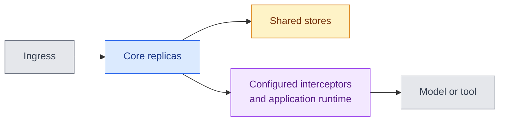

# Reliability and performance

DIAL's reliability depends on the gateway, stores, runtimes, and upstream services in your deployment. This page helps architects assess those dependencies and size a representative workload. It assumes the [deployment](./3.deployment-profiles.md) and [state](./4.state-and-data-lifecycle.md) models are familiar.

## Availability is a dependency chain

A model request can require Core, shared state, an interceptor, and an upstream provider to work at the same time. An application adds its own runtime and possibly more tool or model calls. The diagram highlights those dependencies; it is not a promise that every request traverses every box.

Replicas reduce dependence on one service instance. They do not remove failures in shared stores, required processing services, or the selected provider.

## Design for the failure you need to survive

| Failure | Architectural consideration |
|---|---|
| Pod or node loss | Spread replicas across failure domains. Verify active-stream behavior during termination and rolling updates. |
| Model endpoint unavailable or rate-limited | Configure eligible upstreams and failover. Restrict destinations to approved regions and models. |
| Valkey or blob-store loss | Account for pending writes, shared state, and dependency recovery; do not treat all cache contents as disposable. |
| Application or tool timeout | Establish deadlines and cancellation behavior. Repeating a call can repeat external side effects. |
| Region loss | Coordinate routing, replicated state, keys, and dependencies. A second model endpoint alone is not full-platform disaster recovery. |

Core supports weighted upstream distribution, retries, and failover. The selected API, adapter, error, and response stage affect what can be retried. After streaming starts, clients need to handle incomplete output; failover must not be assumed to resume the same response.

## Size the workload, not the user count

Two deployments with the same number of users can have very different load. Short classification calls, long streaming answers, and agents making several parallel tool calls consume different connections, memory, upstream quota, and time. A user count alone cannot describe those demands.

Measure concurrent requests and streams, input/output sizes, agent fan-out, file operations, and upstream quotas. Compare:

| Measure | What it reveals |
|---|---|
| Gateway overhead and time to first token | Added platform latency versus provider delay |
| Latency percentiles and error rate under load | Whether the complete path meets your service goals |
| CPU, memory, active connections, and store latency | Which component limits capacity |
| Model/tool usage and cost | The effect of retries, longer contexts, and agent loops |

Measure a controlled upstream to distinguish gateway overhead from model generation, then repeat with the real application and processing chain. The first measurement helps locate platform costs; the second establishes whether the user-facing workload meets its goals.

Record component versions, topology, processing chain, and test duration with results. Use the [scaling guide](../../4.operating-dial/7.production-readiness/2.scaling.md) as configuration guidance, then tune from measurements.

## Operate and change safely

Track [runtime health and usage analytics](../../4.operating-dial/6.observability/0.index.md) separately. Set alerts for dependency failures, saturation, and missing telemetry. Evaluate model/output quality as a separate concern from platform uptime. A healthy gateway can return a poor answer, while a correct agent can still depend on an unavailable tool. Both need evidence and an owner.

Pin a tested assembly, follow version-specific upgrade notes, and test rollback and restore. A workload rollback does not undo a database migration or recover an unsynchronized resource.

## Next steps

- [High availability](../../4.operating-dial/7.production-readiness/1.high-availability.md) — replicas and failure domains
- [Upgrade procedure](../../4.operating-dial/7.production-readiness/5.upgrade-procedure.md) — release and rollback considerations
