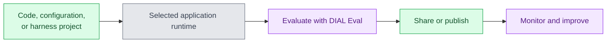

# Application hosting and lifecycle

DIAL applications expose business logic through the platform. Hosting responsibility depends on the application type. This page helps architects choose that boundary; read the [component map](./1.architecture-highlights.md) first.

## Choose who runs the application

Registering an application in Core gives clients a governed way to invoke it. Hosting determines where its business logic executes, who supplies its dependencies, and who responds when it fails. Those are separate choices: a Custom App can use gateway access while its team retains the complete runtime.

| Approach | Runtime model | Your team owns |
|---|---|---|
| Quick Apps | Configured agents served by the Quick Apps runtime | Instructions, models, tools, access, and quality; the platform team operates the runtime |
| Code Apps | Python code built and hosted on DIAL infrastructure | Code, dependencies, permissions, and workload requirements |
| Custom Apps | A service you deploy and register in Core | Code, hosting, scaling, state, networking, and operations |
| DIAL Loop | A harness-based agent with a container per run | Project files, instructions, skills, harness/model choice, and permitted tools |

Schema-based application types describe configuration and editors. They do not imply that every type has the same execution or isolation model. See [DIAL Apps](../../3.building-with-dial/1.apps/0.index.md) for the builders and [Code Apps](../../3.building-with-dial/1.apps/3.code-apps/0.index.md) for the Python runtime.

## Separate authoring, execution, and release

The stages below apply across the application approaches, but each uses a different artifact: Quick Apps configuration, Code Apps source, a Custom App service, or a Loop harness project. The runtime makes that artifact callable; sharing or publication makes it available to its intended audience.

The colors distinguish green authoring/publication interfaces, a gray runtime, and purple evaluation/operating activities. The arrows show lifecycle progression, not network calls or an automatic deployment pipeline. DIAL Eval evaluates applications, agents, models, and MCP tools against your datasets and metrics. DIAL Grid compares models on individual tasks. Use them to validate changes, including a different model or fallback target, before moving production traffic.

Sharing grants selected users access. Publication goes through administrator review. These resource permissions are separate from the runtime's infrastructure permissions. Editing or publishing an application changes who can use its resource; it does not by itself define its service account, permitted network destinations, or database access.

## Keep runtime permissions explicit

Applications call models and tools through Core using delegated context; see [Request flow](./2.request-flow.md). An application's own credentials, network access, and data stores also determine what it can do.

For executable code and harness agents, establish resource limits, filesystem/session boundaries, permitted outbound connections, and secret access. A container per run describes an execution unit; deployment controls determine its access to the surrounding environment.

## Operate the complete solution

For example, a Custom App can keep its own database while invoking models through Core. Model access and delegated calls use DIAL's controls, while the application team still backs up the database and manages credentials for any direct external connections. Platform integration does not transfer those duties automatically.

Core provides governed access. The application team remains responsible for business behavior, external side effects, and answer quality. The platform team operates the selected runtimes, dependencies, backups, and upgrades. See [State and data lifecycle](./4.state-and-data-lifecycle.md) for application data and indexes.

## Next steps

- [Choose an application type](../../3.building-with-dial/1.apps/1.when-to-use-which.md) — compare builder options
- [Register a Custom App](../../3.building-with-dial/1.apps/5.custom-apps/5.register-app.md) — connect a service you operate
- [Evaluations](../../3.building-with-dial/4.evaluations/0.index.md) — measure solution quality
