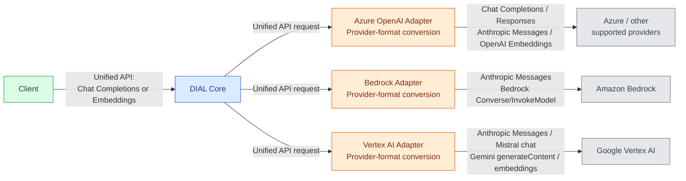
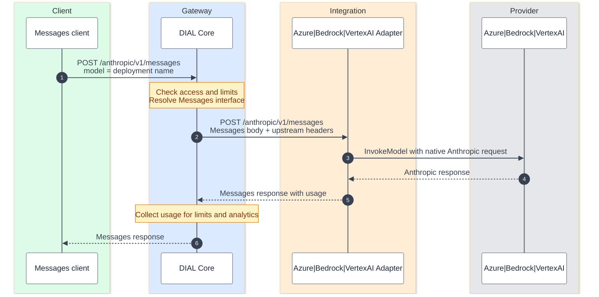
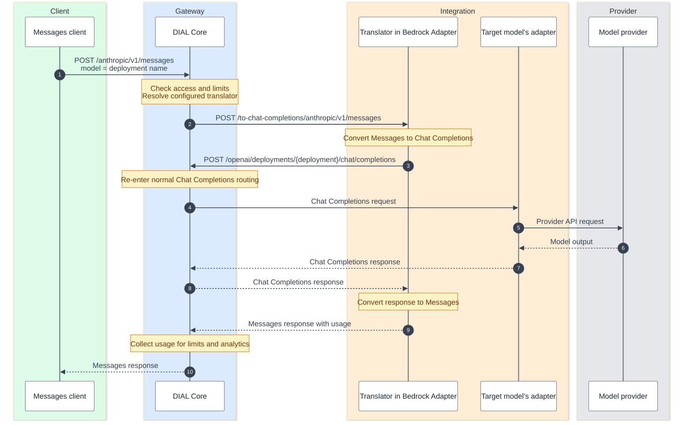

# AI API overview

DIAL offers a Unified API for applications that need a consistent model interface, and other AI APIs for clients that already use Responses or Messages. This page explains how Core and adapters handle those requests. Read [Request flow](./2.request-flow.md) for the wider platform paths.

## Unified API

The Unified API extends **OpenAI Chat Completions and OpenAI Embeddings**. Clients use these formats to reach supported models through Core, while adapters handle the provider's API and convert responses back into the Unified API format.

| Unified API | Core endpoint                                                 | Purpose |
|---|---------------------------------------------------------------|---|
| Chat Completions | `/openai/deployments/{deployment_name}/chat/completions`  or `/openai/v1/chat/completions` | Invoke chat models and DIAL applications; supported adapters also expose speech, image, and video models through this interface |
| Embeddings | `/openai/deployments/{deployment_name}/embeddings`            | Generate vectors with supported text or multimodal embedding models |

Chat-completion extensions include attachments, stages, application state/configuration, and custom content for visualizers. For example, an image-generation model can return an attachment through a chat-completion response. Available features still depend on the model and adapter.

### From the Unified API to the provider

Core selects the deployment's configured adapter. The adapter converts the Unified API request to the appropriate provider format and invokes the model. The diagram includes both unified endpoints: chat requests use generation APIs, while embedding requests use embedding APIs.

Each request follows one configured branch; the listed provider APIs are alternatives, not a chain. Responses return through the adapter and Core in the client's Unified API format.

For Bedrock, Converse and InvokeModel are provider invocation APIs; Claude can use the Anthropic integration, and embedding models use InvokeModel. Vertex uses Gemini `generateContent` for generation and the selected model's embedding API. The adapters also support other model-specific APIs for multimodal workloads; see [Supported providers](../../3.building-with-dial/3.adapters/2.supported-providers.md).

Using an OpenAI-compatible format **into an adapter** does not mean that adapter calls an OpenAI API **at the provider**. For example, Unified Chat Completions can become a Bedrock Converse or Gemini generation request.

## Other supported AI API

Clients can also call Core using a model's native API. The selected deployment either preserves that API through passthrough or sends the request through a configured translator.

| Client API | Core endpoint | Current path |
|---|---|---|
| OpenAI Responses | `/openai/v1/responses` | Passthrough through the Azure OpenAI Adapter |
| Anthropic Messages | `/anthropic/v1/messages` | Passthrough through all three adapters for compatible models, or translation to Chat Completions inside the Bedrock Adapter |

An upstream API shown in the Unified API diagram is not automatically another public client API on Core. Model, application, and interceptor support must be checked for the selected interface and release.

### Passthrough

Use passthrough when the selected model and adapter support the client's API. Core authenticates the caller and checks access and configured limits, then forwards through that interface. The model request is not converted into Unified Chat Completions.

This example shows Messages passthrough through the Bedrock Adapter. Provider authentication and transport remain adapter responsibilities. Responses follows the same request/response pattern through the Azure OpenAI Adapter using `/openai/v1/responses`; Messages passthrough is available across all three adapters for compatible models.

### Translation to Chat Completions

For an Anthropic Messages client targeting a model through Chat Completions, Core calls the translator inside the Bedrock Adapter. The translator converts Messages to Chat Completions and calls back into Core. Core then follows the target model's normal Unified API path, which can use any appropriate model adapter.

The translator calls back into the same Core service for the target deployment. It converts the target's Chat Completions response back to Anthropic Messages, including streaming output. The client continues to use Messages throughout.

**Client-API translation currently targets Chat Completions only.** Responses-based translation is planned. This is separate from a model adapter converting a Unified Chat Completions request into a provider-side Responses request, as shown in the first diagram. Translation does not add features the target model lacks.

## Next steps

- **Choose a provider and adapter:** check [Supported providers](../../3.building-with-dial/3.adapters/2.supported-providers.md) against the client API and model features your application needs.
- **Configure a model deployment:** use [DIAL Admin](../../5.administering-dial/2.entities/1.models.md) or the [Core model configuration](../../4.operating-dial/4.configuration/1.core/2.config-json/1.models.md) to connect the adapter and upstream provider.
- **Make a first request:** follow [Connect to an existing DIAL](../../1.home/3.connect-to-existing-dial.md) for Chat Completions. For Embeddings, Responses, or Messages, use the request schemas in the [Core API reference](https://dialx.ai/dial_api).
- **Review data boundaries:** see [Data protection and isolation](../4.security-and-governance/4.data-protection-and-isolation.md) for what Core, adapters, and providers can access.
