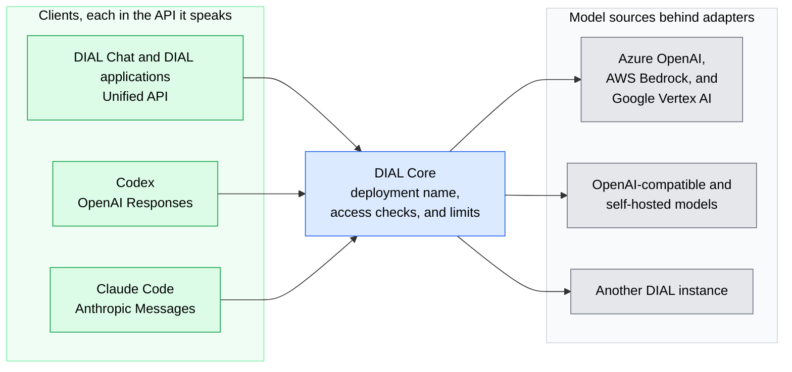

# Model access and AI APIs

DIAL gives every client one governed entry point to models from many providers, through the APIs those clients already speak. This page explains what that access covers and why it lowers the cost of changing models. It is for architects and evaluators who have read [What is DIAL](../1.what-is-dial.md). The request mechanics are in [AI API overview](../4.architecture/7.ai-api-overview.md).

## Why one entry point matters

Without a shared layer, each team integrates each provider on its own: a separate SDK, separate credentials, and separate limits. Changing the model behind an application then means changing the application.

DIAL puts a deployment name between the client and the provider. Clients call DIAL Core by that name, and which provider and model serve it is configuration. Swapping a model, adding a region, or moving to a self-hosted model does not change client code.

## What DIAL provides

- **The Unified API.** DIAL's API extends OpenAI Chat Completions and OpenAI Embeddings with attachments, stages, and application state. DIAL Chat and DIAL applications use it, and a client calls a model, an application, or an agent the same way.
- **The APIs clients already use.** Clients that speak OpenAI Responses or Anthropic Messages call DIAL Core with that API. The selected deployment either passes the request through to a compatible model or translates it to Chat Completions. Coding agents rely on this: Codex speaks Responses, and Claude Code speaks Messages.
- **Models from many sources.** Adapters connect Azure OpenAI, AWS Bedrock, and Google Vertex AI, and OpenAI-compatible endpoints work as well. Self-hosted models, such as those served by Ollama or vLLM, and another DIAL instance through the DIAL-to-DIAL adapter are also options.
- **Media in the same API.** Images, audio, and video travel as attachments, so multimodal models need no separate integration. See [Multimodality](./2.multimodality.md).
- **Other APIs through routes.** An API that DIAL does not serve natively, such as a realtime API over WebSocket, can be registered as a route and called through DIAL Core. See [Custom APIs through routes](./6.tools-and-enterprise-data.md#custom-apis-through-routes).

Every call, whatever its API, passes the same authentication, access checks, and limits in DIAL Core. Usage from each call feeds the same [limits and analytics](./5.analytics-and-observability.md).

## What to check before you commit

- **Features depend on the model and adapter.** A client API being available does not mean every feature of it works with every model. Check the target deployment's model and adapter.
- **Translation targets Chat Completions only.** Client-API translation converts Messages to Chat Completions. Responses-based translation is planned. Translation does not add features the target model lacks.
- **Releases matter.** The native Responses API is available from DIAL v0.45 onwards.

## Further reading

- [AI API overview](../4.architecture/7.ai-api-overview.md) — passthrough, translation, and the adapter path in detail
- [Unified API reference](../../8.reference/1.unified-api.md) — the request and response format
- [Supported providers](../../3.building-with-dial/4.adapters/2.supported-providers.md) — the providers and model families each adapter supports
- [Load balancing and failover](./3.load-balancing-and-failover.md) — spread a model's traffic across several endpoints
- [Models in DIAL Admin](../../5.administering-dial-new/1.ai-gateway/1.models.md) — connect a model deployment from the console
- [One API for every model provider](../../9.use-cases/4.one-api-every-provider.md) — the scenario this capability serves
