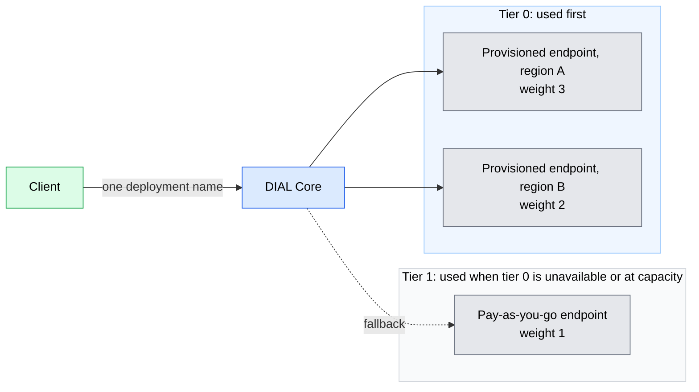

# Load balancing and failover

DIAL Core can spread one model's traffic across several endpoints and move it elsewhere when an endpoint fails or reaches its limits. This page explains what that gives you and where its limits are. It is for architects who know [model access in DIAL](./1.model-access-and-ai-apis.md). Configuration is in the [load balancer reference](../../6.services/1.core/1.configuration/5.load-balancing.md).

## Why it matters

A single model endpoint is a single point of failure, a single rate limit, and a single price. Providers throttle busy deployments, regions have outages, and provisioned capacity is cheaper per token than pay-as-you-go only while you use it.

DIAL treats these as routing decisions in one place. Clients keep calling the same deployment name while DIAL Core decides which endpoint serves each request.

In this example, the two tier 0 endpoints share traffic 3 to 2 by weight. The tier 1 endpoint receives traffic only when tier 0 is unavailable or at capacity.

## What DIAL provides

- **Several upstreams per model.** A model can have endpoints across deployments, regions, and cloud subscriptions. Upstreams can be changed without redeploying DIAL Core.
- **Priority tiers.** Requests reach the lowest tier first, and higher tiers absorb load during an outage or when limits are reached. For example, provisioned-throughput deployments can serve traffic before per-token deployments.
- **Weights.** Within a tier, endpoints receive traffic in proportion to their weights, so larger deployments take a larger share.
- **Retries and fallback.** DIAL Core caps retries per deployment and moves traffic to the next tier when endpoints become unavailable. If every upstream is unavailable, it may retry an endpoint that earlier returned `429` or `500`.
- **Prompt-cache affinity.** Some providers keep a prompt cache per endpoint. DIAL Core can send requests that share a cached prefix to the same endpoint, so cache hits are kept. See [Prompt caching](../../3.building-with-dial/9.advanced-topics/1.prompt-caching.md).
- **Sticky Responses sessions.** For the OpenAI Responses API, DIAL Core forwards follow-up requests to the upstream instance that handled the original request.
- **External routers.** A deployment can forward to a routing service instead of a model endpoint, so you can plug in a third-party router or your own routing logic.
- **Routes too.** Custom APIs registered as [routes](./6.tools-and-enterprise-data.md#custom-apis-through-routes) use the same upstreams, tiers, weights, and retries.

## What to check before you rely on it

- **Failover does not resume a stream.** After streaming starts, a failure leaves the client with incomplete output. Clients need to handle that case.
- **Cluster state is shared asynchronously.** DIAL Core nodes in a cluster share endpoint state asynchronously, which can cause minor inconsistency in routing.
- **Another endpoint is not disaster recovery.** A second model endpoint protects model calls only. Recovering from a region loss also needs routing, replicated state, keys, and other dependencies.

## Further reading

- [Reliability and performance](../4.architecture/5.reliability-and-performance.md) — failure dependencies and workload sizing for the whole platform
- [Load balancer configuration](../../6.services/1.core/1.configuration/5.load-balancing.md) — upstream parameters, tiers, weights, and fallbacks
- [Cost control](../../4.operating-dial/7.production-readiness/6.cost-control.md) — production practices for keeping model spend in check

## Next steps

- [Guardrails](./4.guardrails.md) — inspect and change requests on their way to the model
- [Models configuration](../../6.services/1.core/1.configuration/4.models.md) — where upstreams are defined
