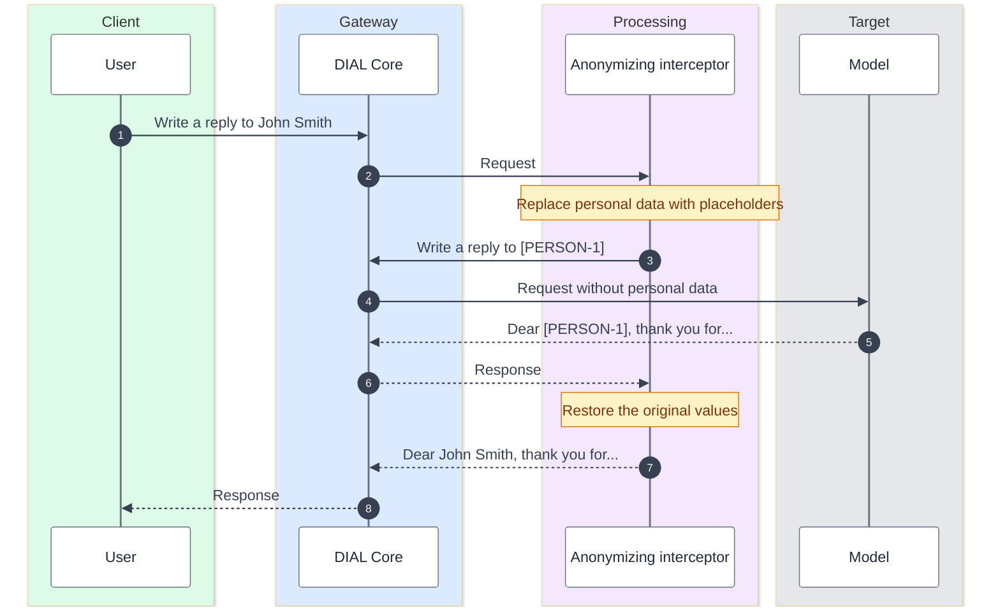
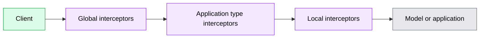

# Guardrails

Guardrails in DIAL are interceptors: services that inspect and change requests and responses on their way to and from models and applications. This page explains what guardrails can enforce, where they apply, and what they do not cover. It is for architects and security reviewers who have read [What is DIAL](../1.what-is-dial.md).

## Why guardrails belong in the platform

Every team that uses AI needs the same protections: keep personal data out of prompts, block unsafe content, and keep an audit trail. Built into each application, these rules are duplicated and drift apart.

DIAL moves them into standalone services that DIAL Core runs in the request path. One interceptor can protect any number of models and applications, and application code stays unchanged.

## What guardrails can enforce

- **Personal data protection.** Reject requests that contain personal data, or replace it with placeholders before the model sees it and restore the original values in the response.
- **Content rules.** Reject prompts with prohibited terms, detect prompt injection attempts, or filter harmful model output.
- **Audit.** Record requests and responses for compliance or investigation.
- **Other cross-cutting rules.** Inject a system prompt, stamp generated images, or cache frequent responses to reduce cost.

Interceptors act on chat completion and embedding requests.

The example below follows the anonymize mode of the DIAL Interceptor Microsoft service. The model never sees the personal data, and the user receives the answer with the original values restored.

In reject mode, the same service refuses a request that contains personal data instead of anonymizing it.

## Where guardrails apply

An interceptor can be assigned at three levels. When all three are configured, a request passes through them in this order, and the response returns in reverse:

- **Global** interceptors apply to every deployment. They see the original request first and the final response last.
- **Application type** interceptors apply to every application of one type, such as all Quick Apps.
- **Local** interceptors apply to one model or application.

## Where guardrails come from

- **Your own.** The Interceptors SDK is a Python framework for building interceptors. Its repository includes example interceptors for redacting, rejecting, rewriting, and observing traffic.
- **Personal data detection.** The DIAL Interceptor Microsoft service uses Microsoft Presidio to reject or anonymize personal data in English and Russian text. It can also reject through Azure Text Analytics. The package is in early development.
- **External guardrail services.** The Interceptors SDK can connect to external systems such as Google Model Armor and Microsoft Presidio.

Administrators register and assign interceptors in DIAL Admin or in DIAL Core configuration.

## What guardrails do not cover

- **Other paths.** Interceptors cover the supported model and application paths. MCP calls and [routes](./6.tools-and-enterprise-data.md#custom-apis-through-routes) are separate from the interceptor chain. Verify API and release coverage for the paths you need.
- **Attached files.** The anonymizing interceptor still rejects attachments that contain personal data, because attached files are forwarded as they are.
- **Availability.** Each interceptor is one more service in the request path. If it fails, requests that depend on it fail too.

## Further reading

- [What are interceptors](../../3.building-with-dial/2.interceptors/0.index.md) — interceptor categories and how the chain works
- [Data protection and isolation](../5.security-and-governance/4.data-protection-and-isolation.md) — how guardrails combine with access, runtime, and network controls
- [Interceptor examples](../../3.building-with-dial/2.interceptors/4.examples.md) — patterns to read and adapt
- [Compliance and PII-safe AI](../../8.use-cases/9.compliance-and-pii-safe-ai.md) — the scenario this capability serves

## Next steps

- [Tutorial: PII-redacting interceptor](../../3.building-with-dial/2.interceptors/1.tutorial-pii-interceptor.md) — build and deploy an interceptor end to end
- [Manage interceptors](../../10.administering-dial-new/6.governance/4.interceptors.md) — register and assign interceptors in DIAL Admin
