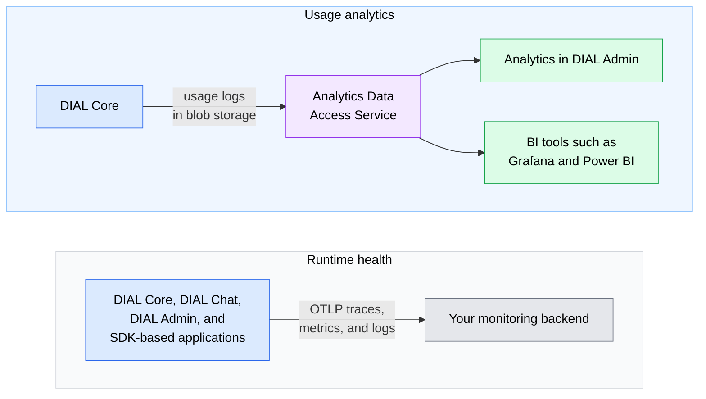

# Analytics and observability

Because AI traffic passes through DIAL Core, DIAL can show how AI is used, what it costs, and whether the platform is healthy. This page explains the two kinds of visibility DIAL provides and the components behind each. It is for architects and evaluators who have read [What is DIAL](../1.what-is-dial.md).

## Two questions, two planes

DIAL separates two questions that are easy to mix up:

- **Usage analytics** answers "How is AI used, and what does it cost?" It works on the record of every call DIAL Core handled.
- **Runtime health** answers "Is the platform working?" It works on traces, metrics, and logs from every component.

The planes are configured and operated independently. They share one link: the trace and span identifiers recorded with each usage record, so a usage entry can be traced back to its request.

## Usage analytics

- **Analytics in DIAL Admin.** Dashboards show usage, cost, latency, and errors. Sessions let you investigate a single conversation. Queries answer questions the dashboards do not cover, and you can save them.
- **Derived insights.** Pipelines add computed fields to conversations, such as sentiment or topic, using an LLM call or SQL.
- **User feedback.** Ratings and comments that users give to responses are kept alongside the usage data.
- **Data access for other tools.** [DIAL Analytics](../../6.services/20.analytics/0.index.md), the Analytics Data Access Service, ingests DIAL usage logs from blob storage into ClickHouse and serves governed queries over them. BI tools such as Grafana and Power BI can query it directly. The optional [Enrichment Runner](../../6.services/21.analytics-enrichment-runner/0.index.md) executes SQL and LLM pipelines that add derived values.
- **Offline datasets.** [DIAL Log Parser](../../6.services/22.log-parser/0.index.md) converts stored Core logs into Parquet partitions for analysis and evaluation.

Analytics in DIAL Admin is a Preview feature and may change before general availability.

## Runtime health

DIAL standardizes on [OpenTelemetry](https://opentelemetry.io/). DIAL Core, DIAL Chat, DIAL Admin, and applications built with the DIAL SDK emit traces, metrics, and logs over OTLP, and they expose Prometheus metrics. You send this telemetry to the backend you already run, such as Prometheus, Jaeger, or Grafana.

DIAL Core's trace enrichment excludes prompt, completion, and tool payload contents.

## What to plan for

- **Sensitive copies.** Request logs, traces, and analytics data can hold sensitive content. Define redaction and retention for each destination.
- **Separate operation.** Each plane has its own components and storage to deploy, size, and secure.

## Further reading

- [Observability overview](../../4.operating-dial/6.observability/0.index.md) — what each component emits and how telemetry flows
- [Analytics in DIAL Admin](../../5.administering-dial-new/5.analytics/0.index.md) — dashboards, sessions, queries, tables, and pipelines
- [Configure tracing with OpenTelemetry](../../4.operating-dial/6.observability/1.tracing.md) — connect DIAL to your tracing backend
- [DIAL Admin: Dashboards](../../5.administering-dial-new/5.analytics/1.dashboards.md) — read usage, cost, latency, and errors in DIAL Admin
- [Usage limits and cost control](../5.security-and-governance/5.usage-limits-and-cost-control.md) — act on usage with quotas and spending limits
- [Cost and usage governance](../../9.use-cases/5.cost-and-usage-governance.md) — the scenario this capability serves
