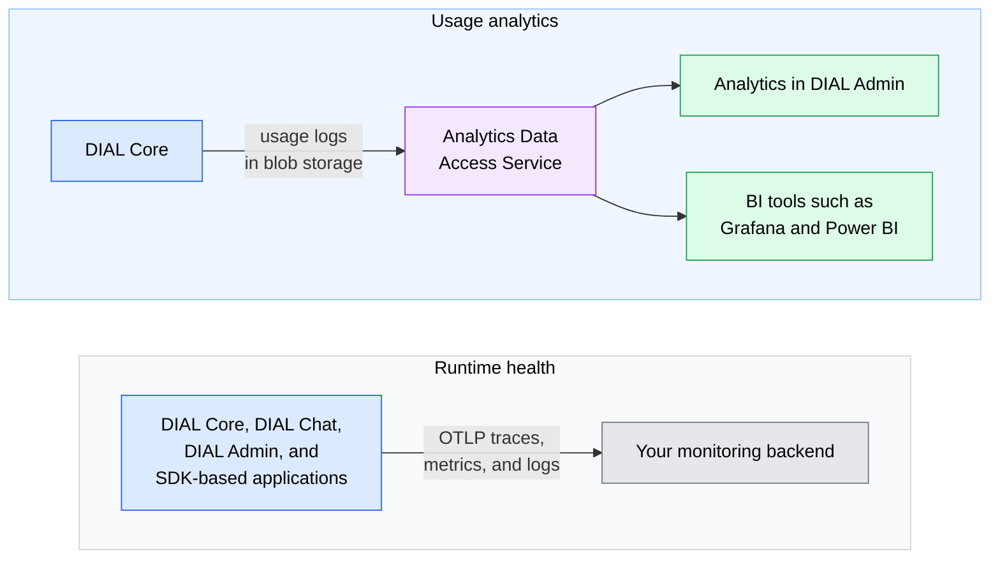

# Analytics and observability

Because AI traffic passes through DIAL Core, DIAL can show where the AI budget goes, what people use AI for, whether the answers help, and whether the platform is healthy. This page explains the two kinds of visibility DIAL provides and the components behind each. It is for architects and evaluators who have read [What is DIAL](../1.what-is-dial.md).

## Two questions, two planes

DIAL separates two questions that are easy to mix up:

- **Usage analytics** answers "How is AI used, and what does it cost?" It works on the record of every call DIAL Core handled.
- **Runtime health** answers "Is the platform working?" It works on traces, metrics, and logs from every component.

The planes are configured and operated independently. They share one link: the trace and span identifiers recorded with each usage record, so a usage entry can be traced back to its request.

## Usage analytics

DIAL Core records every request it handles: who sent it, which model or application answered, how many tokens it used, what it cost, and how long it took. DIAL Analytics turns these records into answers to three questions: where the AI budget goes, what people use AI for, and whether the answers help.

**Note**
> Analytics in DIAL Admin is a Preview feature and may change before general availability.

### Where the AI budget goes

- [Dashboards](../../6.administering-dial-new/5.analytics/1.dashboards.md) show spend, requests, tokens, errors, and response time for any period, compared with the previous one.
- Cost breaks down by model, application, project, MCP server, or tool, so top spenders and sudden spikes show up before the invoice arrives. Queries break it down by any other recorded field, such as user.

### What people use AI for

- [Sessions](../../6.administering-dial-new/5.analytics/5.sessions.md) group requests into conversations, so you see a whole task rather than single calls: how many turns it took, how long it lasted, and what it cost.
- Enrichment [pipelines](../../6.administering-dial-new/5.analytics/3.pipelines.md) send each conversation to a model and store the labels it returns, such as title, summary, topic, language, sentiment, and resolution status. You choose the labels, so "what do people ask about?" becomes a filter instead of a log search.
- Topics that recur across teams show where a shared assistant, prompt, or training would pay off.

### Whether the answers help

- User ratings and comments are stored with the exact response they rate, so you can filter for badly rated conversations.
- Each conversation opens call by call: every model, application, and tool behind an answer, with its tokens, cost, duration, and errors. This shows why an answer was slow, expensive, or failed.

### Use the data your way

- Ready-made dashboards come in DIAL Admin, and seven ready-made Grafana dashboards cover views such as cost and model mix, unit economics, and what AI is used for.
- [Queries](../../6.administering-dial-new/5.analytics/4.queries.md) answer your own questions through a visual builder, SQL, or a plain-language request that an AI assistant turns into a query. Save a query for yourself or share it with everyone who has Analytics access.
- BI tools such as Grafana and Power BI query the data directly, and any result exports to CSV.
- Aggregate pipelines keep summary tables, such as daily cost per project, up to date on a schedule, so reports stay fast.
- Your own applications and agents can send OpenTelemetry logs, traces, and metrics, or write rows to [tables](../../6.administering-dial-new/5.analytics/2.tables.md) you define, and you analyze them next to DIAL usage.
- [DIAL Log Parser](../../7.services/22.log-parser/0.index.md) converts stored Core logs into Parquet partitions for offline analysis and evaluation.

### Who sees the data

- Access is granted per table and narrowed per row, so a manager can see their project's numbers without seeing anyone's conversations.
- Prompt and response text is marked sensitive out of the box, and roles without sensitive clearance do not see it.
- Changes to tables and pipelines are kept in an audit history.
- The data stays in your infrastructure: blob storage, ClickHouse, and PostgreSQL. One export and import moves tables and pipelines from a test environment to production.

### Components

[DIAL Analytics](../../7.services/20.analytics/0.index.md), the Analytics Data Access Service, ingests DIAL usage logs from blob storage into ClickHouse and serves governed queries over them. The optional [Enrichment Runner](../../7.services/21.analytics-enrichment-runner/0.index.md) executes the SQL and LLM pipelines that add derived values.

## Runtime health

DIAL standardizes on [OpenTelemetry](https://opentelemetry.io/). DIAL Core, DIAL Chat, DIAL Admin, and applications built with the DIAL SDK emit traces, metrics, and logs over OTLP, and they expose Prometheus metrics. You send this telemetry to the backend you already run, such as Prometheus, Jaeger, or Grafana.

DIAL Core's trace enrichment excludes prompt, completion, and tool payload contents.

## What to plan for

- **Sensitive copies.** Request logs, traces, and analytics data can hold sensitive content. Define redaction and retention for each destination.
- **Analytics authentication.** DIAL Analytics defaults to no authentication, which also turns off sensitive-column protection. Configure authentication before collecting production logs. See [Security and observability](../../7.services/20.analytics/1.configuration/2.security-and-observability.md).
- **Separate operation.** Each plane has its own components and storage to deploy, size, and secure.

## Further reading

- [Observability overview](../../5.operating-dial/6.observability/0.index.md) — what each component emits and how telemetry flows
- [Analytics in DIAL Admin](../../6.administering-dial-new/5.analytics/0.index.md) — dashboards, sessions, queries, tables, and pipelines
- [Configure tracing with OpenTelemetry](../../5.operating-dial/6.observability/1.tracing.md) — connect DIAL to your tracing backend
- [DIAL Admin: Dashboards](../../6.administering-dial-new/5.analytics/1.dashboards.md) — read usage, cost, latency, and errors in DIAL Admin
- [Usage limits and cost control](../5.security-and-governance/5.usage-limits-and-cost-control.md) — act on usage with quotas and spending limits
