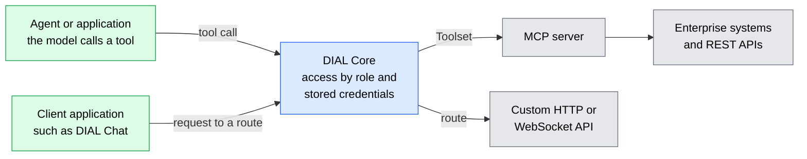

# Tools and enterprise data

Agents and applications are only as useful as the systems they can reach. DIAL connects them to tools, custom APIs, and documents through mechanisms that keep the platform's access control in place. This page explains those mechanisms and the access boundaries that come with them. It is for architects who have read [What is DIAL](../1.what-is-dial.md).

## Why connect tools through the platform

Each integration a team builds on its own solves the same problems again: credentials, who may use the tool, and what gets recorded. A tool registered once in DIAL can serve many agents, under one set of access rules.

DIAL offers two ways in. A Toolset gives a model tools to call during a conversation. A route lets a client application call a custom API as it is.

## MCP Toolsets

DIAL supports the [Model Context Protocol](https://modelcontextprotocol.io/) (MCP) natively. A Toolset registers an MCP server in DIAL, and any Quick App or other compatible application can then use its tools. When the model decides to call a tool, the call goes through DIAL Core and the result returns within the same conversation.

Toolsets are governed resources:

- **Access by role.** Only users with the right roles can use a Toolset.
- **Allowed tools.** Administrators can expose only some of an MCP server's tools.
- **Credentials.** A Toolset connects to its MCP server with an API key, with OAuth 2.0, or without authentication. Credentials can belong to each user or to the whole organization.
- **Publication and audit.** Toolsets can be published to the Catalog through the approval workflow, and administrators review their history in DIAL Admin.

## REST APIs as tools

Not every system has an MCP server. The [OpenAPI to MCP bridge](../../6.services/12.openapi-to-mcp/0.index.md) is a separate service that puts an MCP interface in front of a REST API. It creates MCP tools from the API's OpenAPI 3.x document, which the client sends, and resolves DIAL's stored credentials for each request. See [Expose a REST API as MCP tools](../../3.building-with-dial/2.toolsets/2.rest-api-as-mcp-tools.md).

## Custom APIs through routes

Some APIs need to reach clients as they are, not as tools a model calls. A route registers such an API in DIAL Core. Client applications, such as DIAL Chat, then call it through DIAL Core, which handles authentication and authorization between the client and the API.

- **Any HTTP or WebSocket API.** A route matches request paths and HTTP methods and proxies them to upstream endpoints over HTTP or WebSocket. Examples include a vector store query API, a realtime API over WebSocket, and an external model provider's chat completions endpoint.
- **Credentials stay in DIAL.** DIAL Core sends the upstream's key as an API key or a Bearer token, so the client never handles it.
- **Access by role.** A route can be limited to users with specific roles. A route without roles is available to all users.
- **Load balancing.** A route can have several upstreams with the same weights, tiers, and retries as a model. See [Load balancing and failover](./3.load-balancing-and-failover.md).
- **Static responses.** A route can return a fixed response without calling any backend, for example for a health check.
- **Global or per application.** Global routes serve the whole platform, and their order sets their priority. Application routes belong to one application and apply only to its requests.
- **Traceable.** Traces, log lines, and analytics log entries record which route served a request.

A route passes requests through to the API. It does not convert them to the Unified API, and routes are separate from the [interceptor](./4.guardrails.md) chain.

## DIAL RAG

[DIAL RAG](https://github.com/epam/ai-dial-rag) is EPAM's reference retrieval-augmented generation (RAG) application. You attach documents to a request and receive an answer grounded in them. It reaches models through DIAL Core, so it uses the platform's model access, access control, and file storage.

- **Documents.** It reads PDF, DOC/DOCX, PPT/PPTX, TXT, and code files, and it understands page images in PDF, JPEG, and PNG.
- **Hybrid retrieval.** It combines keyword search, semantic search, a vision model's descriptions of page images, and multimodal embeddings. Information in diagrams, tables, and scanned pages can be found, not only extracted text.
- **Index reuse.** Indexes are stored in DIAL file storage and reused across requests.
- **Retrieval without generation.** A request can ask DIAL RAG only for the passages that match the question, without a generated answer. Your application then builds its own prompt from those passages and sends it to the model it chooses.

## Toolsets and connections in DIAL Loop agents

[DIAL Loop agents](./8.coding-agents-and-harnesses.md) reach outside systems in two separate ways:

- **Toolsets for tools.** A Loop agent uses the same Toolsets from the DIAL Catalog as a Quick App and calls their tools through MCP.
- **Connections for content.** A Loop agent takes its instructions, skills, plugins, and knowledge files from a DIAL files folder or through a connection to a Git repository, SharePoint, or OneDrive. DIAL Loop places that content in the agent's workspace for each run. The connectors that a deployment offers, such as GitHub or SharePoint, set which sources can be connected.

A Loop agent acts as the person who sent the request. Toolsets, DIAL files, and SharePoint use that person's own access and sign-ins.

## Access boundaries to decide

- **Whose permissions the tool uses.** DIAL Core decides who may call a Toolset. The external system decides what that call may see, based on the credentials used there. An organization-wide credential gives every caller the same account's permissions, while a per-user credential keeps each user's own permissions.
- **Guardrail coverage.** MCP calls and routes are separate from the [interceptor](./4.guardrails.md) chain on model and application paths.

## Further reading

- [What is a Toolset](../../3.building-with-dial/2.toolsets/0.index.md) — tool types, configuration, and authentication
- [Manage toolsets](../../5.administering-dial-new/1.ai-gateway/3.toolsets.md) — create and govern Toolsets in DIAL Admin
- [Manage routes](../../5.administering-dial-new/1.ai-gateway/4.routes.md) — add and configure global routes in DIAL Admin
- [Routes configuration](../../6.services/1.core/1.configuration/10.routes.md) — route attributes and examples in DIAL Core configuration
- [Data protection and isolation](../5.security-and-governance/4.data-protection-and-isolation.md) — how identity follows a request to an external system
- [Chat with your knowledge base](../../9.use-cases/2.chat-with-your-knowledge-base.md) — the scenario DIAL RAG serves

## Next steps

- [MCP server integration](../../3.building-with-dial/2.toolsets/1.mcp-server-integration.md) — connect an MCP server to a Quick App
- [Agentic platform](./7.agentic-platform.md) — how tools and agents combine into larger applications
