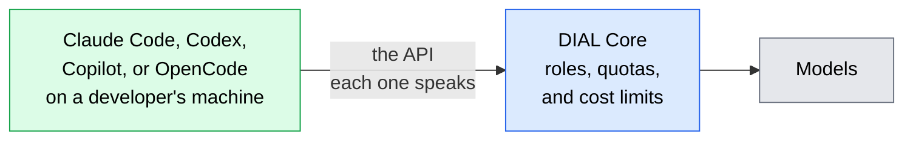

# Coding agents and harnesses

Coding agents such as Claude Code, Codex, and OpenCode are harnesses: programs that drive a model through planning, tool calls, and file edits. DIAL governs the coding agents developers already run. This page explains how. It is for architects and developers who have read [What is DIAL](../1.what-is-dial.md).

## Govern the coding agents developers already use

A coding agent normally calls one provider with its developer's own key. Pointed at DIAL instead, it reaches the models DIAL offers, while DIAL applies its roles, quotas, and cost tracking.

DIAL serves each agent through the API it already speaks, so the agent needs configuration, not code changes:

- **Claude Code** uses DIAL's Anthropic Messages API.
- **Codex** uses the OpenAI Responses API, either natively or through a translating proxy.
- **GitHub Copilot**, **OpenCode**, **Open Claw**, **Claude Desktop**, and the **Claude for Microsoft 365** add-ins connect as well. Each has a tutorial in [Agentic tools](../../3.building-with-dial/6.integrations/4.agentic-tools/0.index.md).

DIAL's day, week, and month cost limits show up inside Claude Code and Codex. Claude Code shows its built-in notices as a user nears the limit and reports the amounts in `/usage`. Codex warns when the remaining limit is low and stops when it is reached.

## What to check

- **Release and API.** Codex reaches DIAL without a proxy only from DIAL v0.45 onwards, when the native Responses API is available.
- **Executable code.** Agents that run commands need resource limits, filesystem and session boundaries, permitted outbound connections, and a plan for secrets.

## Further reading

- [Agentic tools](../../3.building-with-dial/6.integrations/4.agentic-tools/0.index.md) — connect each coding agent to DIAL
- [Connect Claude Code to DIAL](../../3.building-with-dial/6.integrations/4.agentic-tools/5.claude-code.md) — route Claude Code through DIAL's Messages API
- [Connect Codex to DIAL](../../3.building-with-dial/6.integrations/4.agentic-tools/1.codex.md) — route Codex through the Responses API
- [Usage limits and cost control](../5.security-and-governance/5.usage-limits-and-cost-control.md) — the limits coding agents report
