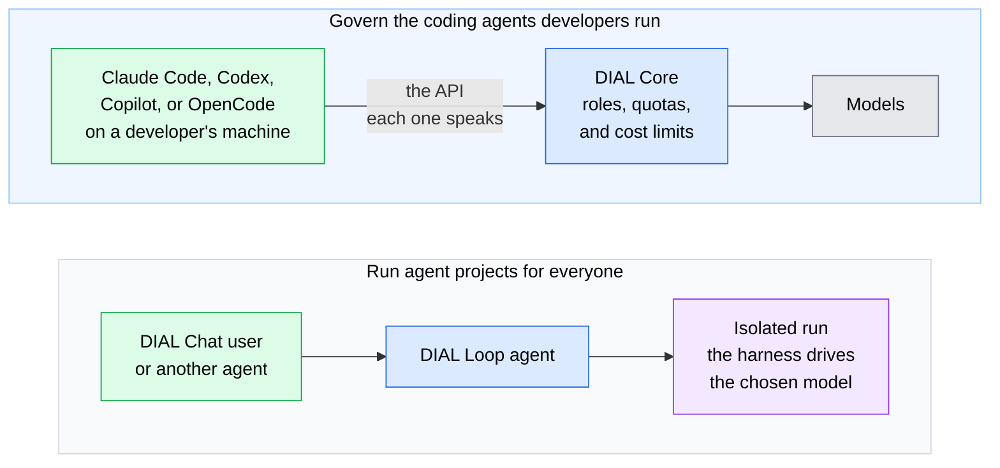

# Coding agents and harnesses

Coding agents such as Claude Code, Codex, and OpenCode are harnesses: programs that drive a model through planning, tool calls, and file edits. DIAL works with them in two ways. It governs the coding agents developers already run, and it turns agent projects built in them into DIAL agents for everyone. This page explains both. It is for architects and developers who have read [What is DIAL](../1.what-is-dial.md).

## Govern the coding agents developers already use

A coding agent normally calls one provider with its developer's own key. Pointed at DIAL instead, it reaches the models DIAL offers, while DIAL applies its roles, quotas, and cost tracking.

DIAL serves each agent through the API it already speaks, so the agent needs configuration, not code changes:

- **Claude Code** uses DIAL's Anthropic Messages API.
- **Codex** uses the OpenAI Responses API, either natively or through a translating proxy.
- **GitHub Copilot**, **OpenCode**, **Open Claw**, **Claude Cowork**, and the **Claude for Microsoft 365** add-ins connect as well. Each has a tutorial in [Agentic tools](../../3.building-with-dial/7.integrations/4.agentic-tools/0.index.md).

DIAL's day, week, and month cost limits show up inside Claude Code and Codex. Claude Code shows its built-in notices as a user nears the limit and reports the amounts in `/usage`. Codex warns when the remaining limit is low and stops when it is reached.

## Run agent projects for everyone with DIAL Loop

An agent project built in Claude Code, Codex, or OpenCode usually works only on its author's machine. DIAL Loop turns that project into a DIAL agent others can use, without rebuilding it.

- **Point at the project.** The agent's instructions, skills, plugins, and knowledge files stay where they are: in a Git repository, SharePoint or OneDrive, or a DIAL files folder. DIAL Loop sets them up in the layout the harness expects.
- **Choose the harness and model.** Both are settings of the agent, so changing either does not mean rebuilding the project.
- **Isolated runs.** Each request runs in its own isolated environment, every command is sandboxed, and the agent can reach only the hosts on its egress allowlist.
- **The requester's access.** The agent acts as the person who sent the message, so Toolsets, other agents, DIAL files, and SharePoint use that person's own access.
- **An ordinary DIAL agent.** Colleagues use it in DIAL Chat, share it, publish it to the Catalog, or call it from other agents.

A rule of thumb from the DIAL Chat guide: if a competent person could finish the task in one sitting with clear instructions, start with a Quick App. If the task needs investigation and revision, use DIAL Loop.

## What to check

- **Release and API.** Codex reaches DIAL without a proxy only from DIAL v0.45 onwards, when the native Responses API is available.
- **Harness differences.** DIAL Loop reads plugins in the Claude Code plugin format. On OpenCode, a plugin's subagents are translated; on Codex, only the plugin's skills are used.
- **Executable code.** Agents that run commands need resource limits, filesystem and session boundaries, permitted outbound connections, and a plan for secrets.

## Further reading

- [Agentic tools](../../3.building-with-dial/7.integrations/4.agentic-tools/0.index.md) — connect each coding agent to DIAL
- [Build a Loop agent](../../7.chat-user-guide/3.catalog/2.agents.md#build-a-loop-agent) — create and configure a DIAL Loop agent in DIAL Chat
- [Application hosting and lifecycle](../4.architecture/6.application-server.md) — how DIAL Loop runs compare with other application types
- [Usage limits and cost control](../5.security-and-governance/3.usage-limits-and-cost-control.md) — the limits coding agents report

## Next steps

- [Connect Claude Code to DIAL](../../3.building-with-dial/7.integrations/4.agentic-tools/5.claude-code.md) — route Claude Code through DIAL's Messages API
- [Connect Codex to DIAL](../../3.building-with-dial/7.integrations/4.agentic-tools/1.codex.md) — route Codex through the Responses API
