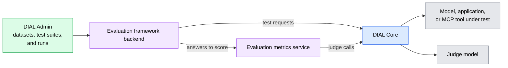

# Evaluations

A model, prompt, or retriever change can make an AI application better or quietly worse. DIAL evaluations measure quality on your own test cases, so a change is judged by evidence rather than impressions. This page explains what DIAL can evaluate and how. It is for architects and evaluators who have read [What is DIAL](../1.what-is-dial.md).

## Why evaluate in the platform

Quality checks are easy to skip when each team builds its own harness for them. When evaluations run where the models and applications already live, the same test suite can be re-run after every change, and the results sit next to cost and timing.

## Evaluation in DIAL Admin

The Evaluation section of DIAL Admin measures models, applications, and MCP tools against test cases you define:

- **Your own benchmarks.** Score accuracy, answer relevance, faithfulness to retrieved context, or custom criteria.
- **RAG applications.** Score retrieval and answer quality with ready-made metrics.
- **MCP tools.** Call a tool with test arguments and check the result.
- **Multi-step behavior.** Test multi-turn dialogues and chains of up to eleven requests, where each request uses the results of the previous ones.
- **Regressions.** Re-run a suite after a change, compare two runs side by side, and follow score trends. A score threshold marks which test cases and runs pass.
- **Automation.** Run test suites from a pipeline with `eval-cli`, and the results return to DIAL Admin.

Each run sends its test requests through DIAL Core to the target deployment. An evaluation metrics service scores the answers, and metrics that use a model as a judge call a model deployed in DIAL Core. Results include cost and timing, and traces can be opened in Grafana.

Both the test requests and the judge calls pass through DIAL Core, so they follow the same access rules and limits as any other request.

## DIAL RAG Eval

[DIAL RAG Eval](../../3.building-with-dial/5.evaluations/1.rag-eval-toolkit.md) is an open-source library for developers who tune a RAG application in code. It computes retrieval metrics, such as recall, precision, and mean reciprocal rank, and generation metrics, such as faithfulness and answer coverage. It applies to any RAG application.

## Evaluation and analytics answer different questions

Evaluation checks answers against what you expect. [Analytics](./5.analytics-and-observability.md) shows how the platform is used and what it costs. A release decision needs evaluation; a capacity or budget decision needs analytics.

## What to plan for

- **Judge costs.** Judge-based metrics call a model through DIAL Core, so they consume that model's quota and cost like any other request.
- **Sensitive datasets.** Evaluation datasets can contain real prompts and documents. Treat them with the same care as other copies of that data.
- **Setup.** Evaluation needs two services next to DIAL Admin, Evaluation Framework Backend and Evaluation Metrics, and the Evaluation menu appears only when Admin is connected to the backend. See [DIAL Evaluations](../../6.services/10.evaluations/0.index.md).

## Further reading

- [Evaluation overview](../../5.administering-dial-new/4.evaluation/0.index.md) — concepts, components, and the typical workflow in DIAL Admin
- [Evaluations overview](../../3.building-with-dial/5.evaluations/0.index.md) — evaluation in the application development lifecycle
- [Evaluate RAG quality with DIAL RAG Eval](../../3.building-with-dial/5.evaluations/1.rag-eval-toolkit.md) — measure retrieval and generation quality with DIAL RAG Eval
- [Tutorial: eval-driven development](../../3.building-with-dial/5.evaluations/2.tutorial-eval-driven-dev.md) — improve an application one measured change at a time
- [DIAL Evaluations](../../6.services/10.evaluations/0.index.md) — deploying and configuring the two evaluation services
- [Measure and improve quality](../../9.use-cases/8.measure-and-improve-quality.md) — the scenario this capability serves
