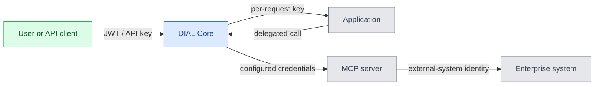

# Data protection and isolation

DIAL governs requests routed through Core. Data protection also depends on the model providers, applications, tools, and infrastructure you connect. This page helps identify those boundaries; read [Authentication and access control](./1.authentication-and-access-control.md) first.

## Follow identity to the external system

Authorization at the gateway and authorization in a downstream system are separate decisions. The diagram follows a user request into an application and an MCP tool call. It omits model and storage calls to keep the transition between platform identity and external credentials visible.

Core checks platform access. [Per-request keys](../../3.building-with-dial/7.working-with-dial-resources/5.per-request-keys.md) carry caller context for delegated calls; [application consent](../../3.building-with-dial/7.working-with-dial-resources/6.auth-matrix-for-apps.md) covers configured sensitive dependencies. External-system permissions depend on the credentials used there. An organization-wide Toolset credential and a per-user credential imply different access boundaries.

For example, Core can allow a user to invoke a document-search Toolset while the server uses a shared corporate account. The external system then sees that account's permissions, not automatically the user's individual permissions. The Toolset's authentication choice must therefore match the intended access model.

## Distinguish the controls

| Control | What it establishes |
|---|---|
| Roles and resource permissions | Who can use or manage a DIAL resource |
| Configured interceptors | Inspection/transformation on the supported model/application paths; verify API and release coverage |
| Runtime isolation | Boundaries for executable code, files, and sessions in the selected runtime |
| Network policies and outbound restrictions | Which services and destinations a workload can reach |
| TLS, storage encryption, and secret management | Protection of connections, stored content, and credentials |

These controls compose: an application may need resource permission to receive a file, runtime permission to read it, and an allowed network destination to send it elsewhere. Passing one check does not grant the others.

MCP and HTTP routes are separate from the model/application interceptor chain. A container or a resource ACL alone does not establish isolation between mutually untrusted tenants. Validate the combined runtime, identity, store, and network boundaries for that use case.

## Protect data and its copies

Core's bucket-addressing encryption settings are separate from file-content encryption and Toolset credential encryption. Configure the storage service, key management, and transport protection for your deployment.

Treat prompts, tool results, request logs, traces, analytics, evaluation datasets, indexes, and backups according to their sensitivity. Define redaction and retention for each destination; self-hosting Core does not prevent an approved external model or tool from processing data.

## Next steps

- [State and data lifecycle](../2.architecture/4.state-and-data-lifecycle.md) — persistence, deletion, and recovery boundaries
- [Security hardening](../../4.operating-dial/7.production-readiness/7.security-hardening.md) — configure deployment controls
- [Toolset security settings](../../4.operating-dial/4.configuration/1.core/1.settings-json/9.toolsets-security.md) — credential encryption
