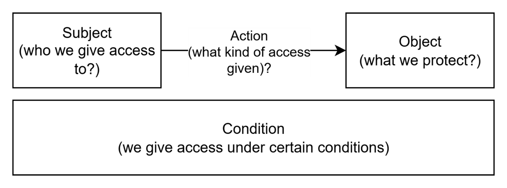
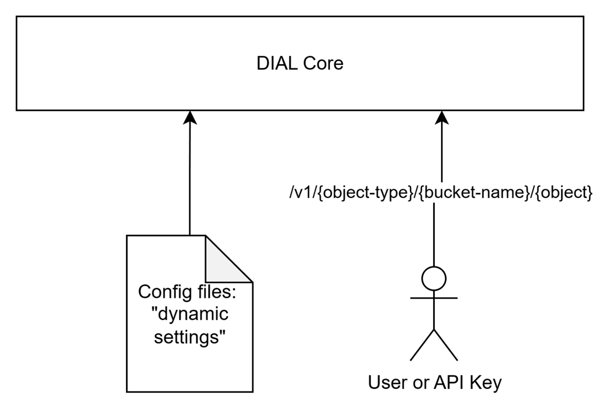
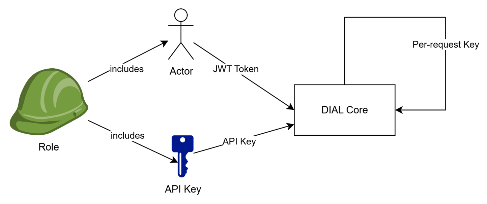

# Authentication and access control

This page covers authentication and the objects and subjects in DIAL's access-control model. Architects and developers can start here, then read [Authorization rules and spaces](./2.authorization-rules-and-spaces.md) and [Public and private access](./3.public-and-private-access.md). For configuration tasks, see [Auth and access control](../../4.operating-dial/5.auth-and-access-control/0.index.md).

## Authentication

There are two supported methods to authenticate DIAL Core API calls: JSON Web Token (JWT) and API key. Both options enable control over access to specific resources in DIAL such as applications, files, conversations, or prompts.

- **API keys** provide server-to-server authentication. They are associated with roles that control resource access and usage limits. See [API keys](../../4.operating-dial/5.auth-and-access-control/1.api-keys.md).
- **JWT access tokens** authenticate end users. An identity provider validates the user's credentials and issues a signed token. DIAL maps claim values in the token to roles. See [JWT configuration](../../4.operating-dial/5.auth-and-access-control/2.jwt.md) and [identity providers](../../4.operating-dial/5.auth-and-access-control/4.sso-idp/0.index.md).

DIAL Core also generates [per-request keys](../../3.building-with-dial/7.working-with-dial-resources/5.per-request-keys.md) when invoking applications or adapters. These carry the caller's context for delegated calls and expire when the request completes.

## Introduction

This article describes authorization in DIAL. Authorization rules can usually be defined by specifying **Object** of access (what we protect?), **Subject** of access (who we give access to?) and **Action** (what kind of access is given). This article follows this principle for better structuring: it defines Objects, Subjects, authorization rules and mechanisms, how these rules are managed in DIAL.

## Objects

In DIAL, **Objects** refer to entities accessible by users. These include Models, Applications, Toolsets, Files, Prompts, and Conversations. A complete list is provided in the [ACL summary table](./4.access-control-reference.md#acls-for-objects).

> **Note**: In DIAL documentation, the term *Resources* may be used as a synonym for Objects. However, in this article, we will use the term Objects to emphasize their role in authorization rules.

Technically, [DIAL Core](../../6.services/1.core/0.index.md) manages all objects, handling persistence and associated business logic.

On a low level, objects can be defined in two ways:

* Declaratively via configuration files. For brevity, in this document, we use the term “pre-configured objects” for objects defined in configuration files. All such objects belong to so-called "dynamic settings" of DIAL Core and can be updated in the configuration files and applied without restarting DIAL Core services. File-defined objects cannot be changed through the resource API. Refer to [Tutorials](../../6.services/1.core/1.configuration/0.index.md#static-settings-and-dynamic-configuration) to learn how to configure dynamic setting for DIAL Core.
* Through the DIAL Core [resource API](../../3.building-with-dial/7.working-with-dial-resources/0.index.md). We use the term “runtime objects” for such objects.

This dual approach to managing objects provides users freedom to choose a configuration strategy based on their business case. For example, centralized management via configuration files is suitable for setups where the DIAL administration team prefers to leverage an Infrastructure as Code approach, whereas the API is suitable for situations where objects should be created by regular users. A combination of both approaches is also fully supported.

> **Note**: Not every object supports both approaches. For example, models are configuration entities, while conversations are runtime resources. Administrators can also manage configuration entities in the `platform` bucket through the [Configuration API](../../6.services/1.core/1.configuration/1.configuration-api.md), separately from public/private runtime resources.

> * For general configuration guidelines, refer to [Configuration Guide](../../4.operating-dial/4.configuration/0.index.md).
> * For details about DIAL Core dynamic settings, please refer to [Tutorials](../../6.services/1.core/1.configuration/0.index.md#static-settings-and-dynamic-configuration).
> * DIAL Core API reference is available on the [DIALX landing website](https://dialx.ai/dial_api).

### DIAL Chat UI and DIAL Admin Panel

While DIAL Core is responsible for managing objects via configuration files and APIs, DIAL also provides the following UI tools to manage objects:

* [DIAL Chat UI](../../6.services/2.chat/0.index.md): Allows users to work with runtime objects via API.
* [DIAL Admin Panel](../../5.administering-dial-new/0.index.md): Allows admin users to manage configuration entities and public resources, including publication approvals and folder permissions.

Both applications work on top of DIAL Core and rely on DIAL Core’s access control mechanisms, which is why this article focuses on DIAL Core authorization.

## Subjects

**Subjects** are actors who access **Objects**, trying to create, update, delete, read, or use them.

In DIAL, subjects include end-users, API Keys (used by external applications), or DIAL Applications, acting on a user's behalf.

* **End-users** authenticate in DIAL Core using JWT access tokens.
* **API Keys** are used by external applications to access DIAL Core without user context.
* **DIAL Applications** use internally-generated [Per-Request Keys](../../3.building-with-dial/7.working-with-dial-resources/5.per-request-keys.md) that include information about both the application and the user. In this case on one hand, a DIAL Application acts on behalf of a user (who has certain permissions), but on the other hand, DIAL Applications are not fully trusted and should be limited in what they can do. This scenario is covered in a [separate section](./3.public-and-private-access.md#special-subject-dial-application-acting-on-users-behalf) of this article.
* **Services acting for an absent user**, such as [DIAL Scheduler](../../6.services/23.scheduler/0.index.md), authenticate with their own project key and request on-behalf-of credentials for the user who owns the work. Core returns them only when two separate approvals exist: the user has signed in for offline access, and an administrator has granted the application consent for that external service. A user who signs out stops their own runs; an administrator who withdraws consent stops the application for every user.

### Roles as subjects

DIAL also supports the notion of **Roles** to avoid managing access individually for every user or API Key.

A role can be associated with multiple individual Subjects, such as Users, User Groups and API Keys, and then used as a Subject to prove access to Objects in specific scenarios.

> **Note**: Roles are configuration entities, not user-created resources. They can be defined in [DIAL Core configuration files](../../6.services/1.core/1.configuration/12.roles.md) or managed by administrators through the [Configuration API](../../6.services/1.core/1.configuration/1.configuration-api.md) and [DIAL Admin](../../5.administering-dial-new/6.governance/1.roles.md). File-defined roles are read-only in DIAL Admin; editable roles are stored in the `platform` folder. The Configuration API is in preview.

#### Default roles

By default, DIAL defines one dedicated role - DIAL Administrators - which has elevated access over DIAL configuration (dynamic settings) and Core API:

* DIAL Administrators can command DIAL Core to reload “dynamic settings” configuration files without restarting DIAL Core services.
* DIAL Administrators have access to certain DIAL Core APIs and Objects that other Subjects cannot access.

More details on the DIAL Administrators role can be found in [Authorization rules and spaces](./2.authorization-rules-and-spaces.md). The administrator identity is determined by the configured [admin rules](../../6.services/1.core/1.configuration/2.settings/7.access.md), rather than by a fixed role name in every deployment.

#### How to associate a user or API key with a role

* **User** (JWT Token): A User is represented by a JWT token issued by an identity service provider (IDP) and mapped to the roles using claim values in the token. Refer to [Tutorials](../../4.operating-dial/5.auth-and-access-control/2.jwt.md) to learn how it works.
* **API Key**: An API Key is defined in [DIAL Core configuration](../../6.services/1.core/1.configuration/13.keys.md), through a file or the administrator-only Configuration API, and must include a "roles" attribute specifying the roles assigned to the key. For more details, refer to [Programmatic Auth](../../4.operating-dial/5.auth-and-access-control/1.api-keys.md).

## How access is granted: public and private spaces

Every resource belongs to a public or private logical space. Public resources are readable by authenticated callers by default, subject to restrictions; private resources are accessible to their owners unless shared. Configuration entities in the `platform` bucket are managed separately through the administrator-only Configuration API.

## Further reading

- [Authorization rules and spaces](./2.authorization-rules-and-spaces.md) — understand rule notation, defaults, and the public folder hierarchy
- [Public and private access](./3.public-and-private-access.md) — understand sharing, role restrictions, and application delegation
- [Access control reference](./4.access-control-reference.md) — check the permission matrices
- [Configure authentication and access](../../4.operating-dial/5.auth-and-access-control/0.index.md) — set up API keys, JWT, roles, and identity providers
- [SSO / IdP setup overview](../../4.operating-dial/5.auth-and-access-control/4.sso-idp/0.index.md) — compare supported identity providers and the shared setup workflow
- [Manage users and their access](../../5.administering-dial-new/6.governance/6.user-management.md) — apply the model through DIAL Admin
